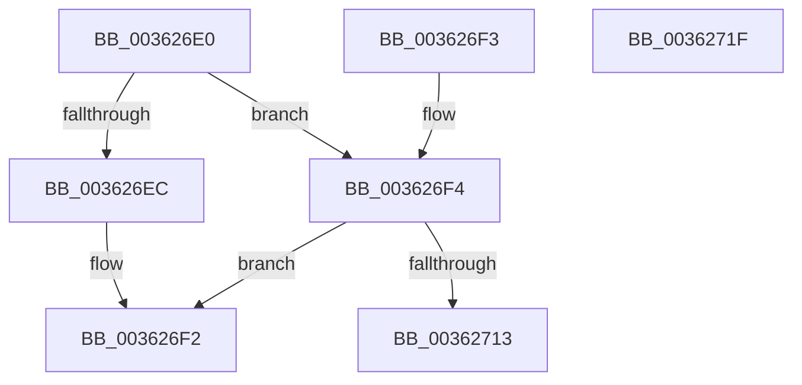

# MiGetEffectivePagePriorityThread

- RVA: `0x003626E0`–`0x00362720` (길이 `64` bytes)
- VA: `0x00000001403626E0`
- 실행 섹션: `.text`
- PDB 이름 있음: `예`; PDB Function 태그: `아니요`
- unwind 정보 RVA: `0x000DB714`
- 디코드: `19`개 명령, `64/64` bytes 표시
- 미해석 바이트: `0` (있으면 어셈블리에 `.byte`로 보존)

> 이 문서는 커널 이미지의 기계어와 PDB 기호를 분석해 생성했습니다. 4번과 5번은 함수 원형과 자료형을 바이너리 사용 방식에서 추정한 C 해석이며 원본 소스 복구 결과는 아닙니다.

## 1. Dependencies

- 직접 호출 지점: **0**; 고유 호출 대상: **0**
- 직접 호출자로 확인된 함수: **16**
- RIP 상대 이미지 참조: **0**

### Outgoing calls
- 직접 디코드된 call 명령이 없습니다.

### Direct callers
- [MmCopyMemory](../22/MmCopyMemory_function_002285B0.md) at `0x002288B9`
- [MiInitializeImageProtos](../2A/MiInitializeImageProtos_function_002ABDAC.md) at `0x002ABDFA`
- [MiGetPageForHeader](../2A/MiGetPageForHeader_function_002AC120.md) at `0x002AC1C9`
- [MiGetInPageSupportBlock](MiGetInPageSupportBlock_function_00362500.md) at `0x003625DE`
- [MiInitializeInPageSupport](MiInitializeInPageSupport_function_00362728.md) at `0x003627AF`
- [MiCopyOnWrite](MiCopyOnWrite_function_00362A0C.md) at `0x00362D9C`
- [MiWalkEntireImage](MiWalkEntireImage_function_00365D70.md) at `0x00366BE4`
- [MiPrivateFixup](MiPrivateFixup_function_003693E8.md) at `0x00369592`
- [MiPrefetchRestOfCluster](MiPrefetchRestOfCluster_function_0036B590.md) at `0x0036B5F9`
- [MiIssueHardFault](../38/MiIssueHardFault_function_00380074.md) at `0x003805F4`
- [MiUnlockWsle](../40/MiUnlockWsle_function_00407F84.md) at `0x00407FED`
- [NtLockVirtualMemory](../40/NtLockVirtualMemory_function_004088A0.md) at `0x00408C9E`
- [MiSetPagesModified](../49/MiSetPagesModified_function_0049DC2C.md) at `0x0049DD2E`
- [MiSwitchToTransition](../4C/MiSwitchToTransition_function_004C0F5C.md) at `0x004C0FDC`
- [MmPrefetchVirtualAddresses](../../page/93/MmPrefetchVirtualAddresses_function_0093A5E0.md) at `0x0093A676`
- [NtSetInformationVirtualMemory](../../page/9F/NtSetInformationVirtualMemory_function_009F4580.md) at `0x009F49D0`

### Static image references
- 디코드된 RIP-relative 메모리 참조가 없습니다.

## 2. Other-region calls and transfers

- 다른 실행 섹션으로 향하는 call: **0**
- 별도 외부 분기/꼬리 이동을 확인하지 못했습니다.

## 3. Assembly (complete function range)

```asm
003626E0  8B 81 A8 05 00 00               mov eax, dword ptr [rcx + 0x5a8]
003626E6  0F BA E0 08                     bt eax, 8
003626EA  73 08                           jae 0x1403626f4
003626EC  C1 E8 09                        shr eax, 9
003626EF  83 E0 07                        and eax, 7
003626F2  C3                              ret
003626F3  CC                              int3
003626F4  8B 81 A0 05 00 00               mov eax, dword ptr [rcx + 0x5a0]
003626FA  48 8B 89 20 02 00 00            mov rcx, qword ptr [rcx + 0x220]
00362701  C1 E8 0C                        shr eax, 0xc
00362704  83 E0 07                        and eax, 7
00362707  48 8B 89 A0 02 00 00            mov rcx, qword ptr [rcx + 0x2a0]
0036270E  48 85 C9                        test rcx, rcx
00362711  74 DF                           je 0x1403626f2
00362713  8B 89 44 04 00 00               mov ecx, dword ptr [rcx + 0x444]
00362719  3B C1                           cmp eax, ecx
0036271B  0F 43 C1                        cmovae eax, ecx
0036271E  C3                              ret
0036271F  CC                              int3
```

## 4. C-style interpretation (structured pseudocode)

```c
__int64 __fastcall MiGetEffectivePagePriorityThread(__int64 a1)
{
    __int64 result;

    if (condition_is_above_or_equal) goto loc_003626F4;
    result = (unsigned int)(((unsigned int)(*(unsigned int *)(a1 + 1448))) >> (9));
    result = (unsigned int)((result) & (7));
loc_003626F2:
    return result;
loc_003626F4:
    result = (unsigned int)(((unsigned int)(*(unsigned int *)(a1 + 1440))) >> (12));
    result = (unsigned int)((result) & (7));
    if (*(unsigned __int64 *)(*(unsigned __int64 *)(a1 + 544) + 672) == 0) goto loc_003626F2;
    if (((unsigned int)(result)) >= ((unsigned int)((unsigned int)(*(unsigned int *)(*(unsigned __int64 *)(*(unsigned __int64 *)(a1 + 544) + 672) + 1092))))) { result = (unsigned int)((unsigned int)(*(unsigned int *)(*(unsigned __int64 *)(*(unsigned __int64 *)(a1 + 544) + 672) + 1092))); }
    return result;
}
```

## 5. (Beta) C Style

```c
int64_t MiGetEffectivePagePriorityThread(void *Arg1)
{
    uint8_t *arg1 = (uint8_t *)Arg1;

    int64_t result;

    if (condition_is_above_or_equal) goto loc_003626F4;
    result = (uint32_t)(((uint32_t)(*(uint32_t *)(arg1 + 0x5A8))) >> (9));
    result = (uint32_t)((result) & (7));
loc_003626F2:
    return result;
loc_003626F4:
    result = (uint32_t)(((uint32_t)(*(uint32_t *)(arg1 + 0x5A0))) >> (12));
    result = (uint32_t)((result) & (7));
    if (*(uint64_t *)(*(uint64_t *)(arg1 + 0x220) + 0x2A0) == 0) goto loc_003626F2;
    if (((uint32_t)(result)) >= ((uint32_t)((uint32_t)(*(uint32_t *)(*(uint64_t *)(*(uint64_t *)(arg1 + 0x220) + 0x2A0) + 0x444))))) { result = (uint32_t)((uint32_t)(*(uint32_t *)(*(uint64_t *)(*(uint64_t *)(arg1 + 0x220) + 0x2A0) + 0x444))); }
    return result;
}
```

### 관측된 메모리 오프셋

구조체 형식이 확인되지 않은 접근은 인자 기준의 오프셋으로만 기록했습니다.

| 기준 인자 | 오프셋 표현 | 폭 (bit) | 접근 |
|---|---:|---:|---|
| `Arg1` | `+ 0x220` | `64` | `R` |
| `Arg1` | `+ 0x5A0` | `32` | `R` |
| `Arg1` | `+ 0x5A8` | `32` | `R` |

## 6. Execution-region graph

[열기: 2D/3D 그래프와 함수 탐색 컨트롤 패널](../../../control-panel.html?section=text&rva=0x003626E0&view=graph)

- 2D 그래프는 위에서 아래로 흐르고, 3D 그래프는 빈 공간을 드래그해 회전합니다. Shift+드래그는 이동, 휠은 확대·축소, 함수 노드 선택은 대상 보고서 이동입니다.

### Static fallback


