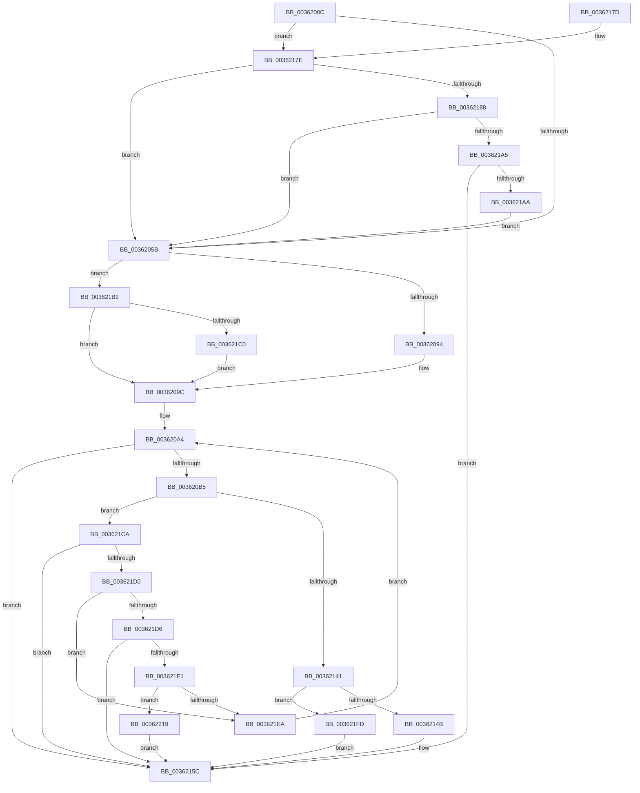

# MiGetHardFaultPages

- RVA: `0x0036200C`–`0x00362246` (길이 `570` bytes)
- VA: `0x000000014036200C`
- 실행 섹션: `.text`
- PDB 이름 있음: `예`; PDB Function 태그: `아니요`
- unwind 정보 RVA: `0x00079D9C`
- 디코드: `140`개 명령, `570/570` bytes 표시
- 미해석 바이트: `0` (있으면 어셈블리에 `.byte`로 보존)

> 이 문서는 커널 이미지의 기계어와 PDB 기호를 분석해 생성했습니다. 4번과 5번은 함수 원형과 자료형을 바이너리 사용 방식에서 추정한 C 해석이며 원본 소스 복구 결과는 아닙니다.

## 1. Dependencies

- 직접 호출 지점: **7**; 고유 호출 대상: **7**
- 직접 호출자로 확인된 함수: **1**
- RIP 상대 이미지 참조: **0**

### Outgoing calls
- `0x00362087` → [MiUseSlabAllocator](MiUseSlabAllocator_function_00365C68.md) (function, `0x00365C68`)
- `0x003620BF` → [memset](../6C/memset_function_006C6C40.md) (function, `0x006C6C40`)
- `0x003620D3` → [MiProtectionToCacheAttribute](../2B/MiProtectionToCacheAttribute_function_002B8530.md) (function, `0x002B8530`)
- `0x00362126` → [MiInitializePageChainPacket](../43/MiInitializePageChainPacket_function_004367C0.md) (function, `0x004367C0`)
- `0x0036212F` → [MiGetPageChain](../33/MiGetPageChain_function_00330130.md) (function, `0x00330130`)
- `0x00362197` → [MiGetAvailablePagesBelowPriority](../34/MiGetAvailablePagesBelowPriority_function_0034D340.md) (function, `0x0034D340`)
- `0x0036223C` → [ExAcquireRundownProtection](../21/ExAcquireRundownProtection_function_00216620.md) (function, `0x00216620`)

### Direct callers
- [MiBuildMdlForMappedFileFault](MiBuildMdlForMappedFileFault_function_0036380C.md) at `0x003639A4`

### Static image references
- 디코드된 RIP-relative 메모리 참조가 없습니다.

## 2. Other-region calls and transfers

- 다른 실행 섹션으로 향하는 call: **0**
- 별도 외부 분기/꼬리 이동을 확인하지 못했습니다.

## 3. Assembly (complete function range)

```asm
0036200C  48 8B C4                        mov rax, rsp
0036200F  48 89 58 08                     mov qword ptr [rax + 8], rbx
00362013  48 89 70 10                     mov qword ptr [rax + 0x10], rsi
00362017  48 89 78 18                     mov qword ptr [rax + 0x18], rdi
0036201B  55                              push rbp
0036201C  41 54                           push r12
0036201E  41 55                           push r13
00362020  41 56                           push r14
00362022  41 57                           push r15
00362024  48 8D 68 C1                     lea rbp, [rax - 0x3f]
00362028  48 81 EC F0 00 00 00            sub rsp, 0xf0
0036202F  4C 8B 55 6F                     mov r10, qword ptr [rbp + 0x6f]
00362033  4D 8B E8                        mov r13, r8
00362036  83 65 5F 00                     and dword ptr [rbp + 0x5f], 0
0036203A  4C 8B FA                        mov r15, rdx
0036203D  48 8B F1                        mov rsi, rcx
00362040  49 8B 82 D0 00 00 00            mov rax, qword ptr [r10 + 0xd0]
00362047  8B 40 20                        mov eax, dword ptr [rax + 0x20]
0036204A  D1 E8                           shr eax, 1
0036204C  83 E0 1F                        and eax, 0x1f
0036204F  89 45 6F                        mov dword ptr [rbp + 0x6f], eax
00362052  4D 85 C9                        test r9, r9
00362055  0F 85 23 01 00 00               jne 0x14036217e
0036205B  4C 8B 4D 7F                     mov r9, qword ptr [rbp + 0x7f]
0036205F  48 8D 45 5F                     lea rax, [rbp + 0x5f]
00362063  4C 8B 45 77                     mov r8, qword ptr [rbp + 0x77]
00362067  49 8B CD                        mov rcx, r13
0036206A  49 8B 92 D0 00 00 00            mov rdx, qword ptr [r10 + 0xd0]
00362071  BB 01 00 00 00                  mov ebx, 1
00362076  48 89 44 24 20                  mov qword ptr [rsp + 0x20], rax
0036207B  45 8B 49 08                     mov r9d, dword ptr [r9 + 8]
0036207F  41 C1 E9 09                     shr r9d, 9
00362083  41 83 E1 3F                     and r9d, 0x3f
00362087  E8 DC 3B 00 00                  call 0x140365c68
0036208C  85 C0                           test eax, eax
0036208E  0F 85 1E 01 00 00               jne 0x1403621b2
00362094  44 8D 73 08                     lea r14d, [rbx + 8]
00362098  44 89 75 5F                     mov dword ptr [rbp + 0x5f], r14d
0036209C  4C 8B 65 67                     mov r12, qword ptr [rbp + 0x67]
003620A0  41 8D 79 01                     lea edi, [r9 + 1]
003620A4  48 8B 46 10                     mov rax, qword ptr [rsi + 0x10]
003620A8  48 89 45 9F                     mov qword ptr [rbp - 0x61], rax
003620AC  49 3B C7                        cmp rax, r15
003620AF  0F 83 A7 00 00 00               jae 0x14036215c
003620B5  33 D2                           xor edx, edx
003620B7  48 8D 4D A7                     lea rcx, [rbp - 0x59]
003620BB  44 8D 42 70                     lea r8d, [rdx + 0x70]
003620BF  E8 7C 4B 36 00                  call 0x1406c6c40
003620C4  8B 4D 6F                        mov ecx, dword ptr [rbp + 0x6f]
003620C7  4D 8B CF                        mov r9, r15
003620CA  4C 2B 4D 9F                     sub r9, qword ptr [rbp - 0x61]
003620CE  48 83 65 97 00                  and qword ptr [rbp - 0x69], 0
003620D3  E8 58 64 F5 FF                  call 0x1402b8530
003620D8  45 0F B6 44 24 45               movzx r8d, byte ptr [r12 + 0x45]
003620DE  48 8D 4D A7                     lea rcx, [rbp - 0x59]
003620E2  49 8B 54 24 38                  mov rdx, qword ptr [r12 + 0x38]
003620E7  41 83 E0 01                     and r8d, 1
003620EB  48 89 4C 24 60                  mov qword ptr [rsp + 0x60], rcx
003620F0  48 8D 4D 97                     lea rcx, [rbp - 0x69]
003620F4  4C 89 4C 24 58                  mov qword ptr [rsp + 0x58], r9
003620F9  4D 8B 0C 24                     mov r9, qword ptr [r12]
003620FD  48 89 4C 24 50                  mov qword ptr [rsp + 0x50], rcx
00362102  49 8B 4C 24 60                  mov rcx, qword ptr [r12 + 0x60]
00362107  44 89 74 24 48                  mov dword ptr [rsp + 0x48], r14d
0036210C  48 89 4C 24 40                  mov qword ptr [rsp + 0x40], rcx
00362111  49 8B CD                        mov rcx, r13
00362114  48 83 4C 24 38 FF               or qword ptr [rsp + 0x38], 0xffffffffffffffff
0036211A  89 5C 24 30                     mov dword ptr [rsp + 0x30], ebx
0036211E  89 44 24 28                     mov dword ptr [rsp + 0x28], eax
00362122  89 7C 24 20                     mov dword ptr [rsp + 0x20], edi
00362126  E8 95 46 0D 00                  call 0x1404367c0
0036212B  48 8D 4D A7                     lea rcx, [rbp - 0x59]
0036212F  E8 FC DF FC FF                  call 0x140330130
00362134  48 8B 55 0F                     mov rdx, qword ptr [rbp + 0xf]
00362138  48 85 D2                        test rdx, rdx
0036213B  0F 84 89 00 00 00               je 0x1403621ca
00362141  48 83 3E 00                     cmp qword ptr [rsi], 0
00362145  0F 85 B2 00 00 00               jne 0x1403621fd
0036214B  0F 10 45 FF                     movups xmm0, xmmword ptr [rbp - 1]
0036214F  F2 0F 10 4D 0F                  movsd xmm1, qword ptr [rbp + 0xf]
00362154  0F 11 06                        movups xmmword ptr [rsi], xmm0
00362157  F2 0F 11 4E 10                  movsd qword ptr [rsi + 0x10], xmm1
0036215C  4C 8D 9C 24 F0 00 00 00         lea r11, [rsp + 0xf0]
00362164  49 8B 5B 30                     mov rbx, qword ptr [r11 + 0x30]
00362168  49 8B 73 38                     mov rsi, qword ptr [r11 + 0x38]
0036216C  49 8B 7B 40                     mov rdi, qword ptr [r11 + 0x40]
00362170  49 8B E3                        mov rsp, r11
00362173  41 5F                           pop r15
00362175  41 5E                           pop r14
00362177  41 5D                           pop r13
00362179  41 5C                           pop r12
0036217B  5D                              pop rbp
0036217C  C3                              ret
0036217D  CC                              int3
0036217E  41 80 39 01                     cmp byte ptr [r9], 1
00362182  0F 85 D3 FE FF FF               jne 0x14036205b
00362188  41 8B 51 50                     mov edx, dword ptr [r9 + 0x50]
0036218C  49 8B CD                        mov rcx, r13
0036218F  C1 EA 03                        shr edx, 3
00362192  83 E2 07                        and edx, 7
00362195  FF C2                           inc edx
00362197  E8 A4 B1 FE FF                  call 0x14034d340
0036219C  4C 3B F8                        cmp r15, rax
0036219F  0F 86 B6 FE FF FF               jbe 0x14036205b
003621A5  48 85 C0                        test rax, rax
003621A8  74 B2                           je 0x14036215c
003621AA  4C 8B F8                        mov r15, rax
003621AD  E9 A9 FE FF FF                  jmp 0x14036205b
003621B2  44 8B 75 5F                     mov r14d, dword ptr [rbp + 0x5f]
003621B6  41 83 FE 05                     cmp r14d, 5
003621BA  0F 85 DC FE FF FF               jne 0x14036209c
003621C0  BB 01 10 00 00                  mov ebx, 0x1001
003621C5  E9 D2 FE FF FF                  jmp 0x14036209c
003621CA  41 83 FE 09                     cmp r14d, 9
003621CE  74 8C                           je 0x14036215c
003621D0  41 83 FE 05                     cmp r14d, 5
003621D4  74 14                           je 0x1403621ea
003621D6  48 83 7E 10 00                  cmp qword ptr [rsi + 0x10], 0
003621DB  0F 85 7B FF FF FF               jne 0x14036215c
003621E1  48 8B 45 97                     mov rax, qword ptr [rbp - 0x69]
003621E5  48 85 C0                        test rax, rax
003621E8  75 2F                           jne 0x140362219
003621EA  41 BE 09 00 00 00               mov r14d, 9
003621F0  0F BA F3 0C                     btr ebx, 0xc
003621F4  44 89 75 5F                     mov dword ptr [rbp + 0x5f], r14d
003621F8  E9 A7 FE FF FF                  jmp 0x1403620a4
003621FD  48 8B 4E 08                     mov rcx, qword ptr [rsi + 8]
00362201  48 8B 45 FF                     mov rax, qword ptr [rbp - 1]
00362205  48 89 01                        mov qword ptr [rcx], rax
00362208  48 8B 45 07                     mov rax, qword ptr [rbp + 7]
0036220C  48 01 56 10                     add qword ptr [rsi + 0x10], rdx
00362210  48 89 46 08                     mov qword ptr [rsi + 8], rax
00362214  E9 43 FF FF FF                  jmp 0x14036215c
00362219  49 89 84 24 80 00 00 00         mov qword ptr [r12 + 0x80], rax
00362221  49 8D 8D C8 47 00 00            lea rcx, [r13 + 0x47c8]
00362228  4C 2B 7E 10                     sub r15, qword ptr [rsi + 0x10]
0036222C  4D 89 BC 24 90 00 00 00         mov qword ptr [r12 + 0x90], r15
00362234  4D 89 AC 24 88 00 00 00         mov qword ptr [r12 + 0x88], r13
0036223C  E8 DF 43 EB FF                  call 0x140216620
00362241  E9 16 FF FF FF                  jmp 0x14036215c
```

## 4. C-style interpretation (structured pseudocode)

```c
__int64 __fastcall MiGetHardFaultPages(__int64 a1, __int64 a2, __int64 a3, __int64 a4)
{
    __int64 result;
    __int64 v_r15;
    __int64 v_rsp;
    unsigned __int64 v_stack_m28;
    unsigned __int64 v_stack_mB8;
    unsigned __int64 v_stack_mC0;
    unsigned __int64 v_stack_mC8;
    unsigned int v_stack_mD0;
    unsigned __int64 v_stack_mD8;
    unsigned __int64 v_stack_mE0;
    unsigned int v_stack_mE8;
    unsigned int v_stack_mF0;
    unsigned __int64 v_stack_mF8;

    *(unsigned __int64 *)(v_rsp + 8) = v_rbx;
    *(unsigned __int64 *)(v_rsp + 16) = v_rsi;
    *(unsigned __int64 *)(v_rsp + 24) = v_rdi;
    v_rsp = (v_rsp) - (240);
    result = (unsigned int)(((unsigned int)(*(unsigned int *)(*(unsigned __int64 *)(*(unsigned __int64 *)(v_rsp - 63 + 111) + 208) + 32))) >> (1));
    result = (unsigned int)((result) & (31));
    *(unsigned int *)(v_rsp - 63 + 111) = (unsigned int)(result);
    if (a4 != 0) goto loc_0036217E;
loc_0036205B:
    v_stack_mF8 = v_rsp - 63 + 95;
    a4 = (unsigned int)(((unsigned int)(*(unsigned int *)(*(unsigned __int64 *)(v_rsp - 63 + 127) + 8))) >> (9));
    a4 = (unsigned int)((a4) & (63));
    result = MiUseSlabAllocator(a3, *(unsigned __int64 *)(*(unsigned __int64 *)(v_rsp - 63 + 111) + 208), *(unsigned __int64 *)(v_rsp - 63 + 119), a4);
    if ((unsigned int)(result) != 0) goto loc_003621B2;
    *(unsigned int *)(v_rsp - 63 + 95) = (unsigned int)(1 + 8);
loc_0036209C:
loc_003620A4:
    *(unsigned __int64 *)(v_rsp - 63 - 97) = *(unsigned __int64 *)(a1 + 16);
    if ((*(unsigned __int64 *)(a1 + 16)) >= a2) goto loc_0036215C;
    a2 = 0;
    result = memset(v_rsp - 63 - 89, a2, a2 + 112, a4);
    a4 = (0) - (*(unsigned __int64 *)(v_rsp - 63 - 97));
    result = MiProtectionToCacheAttribute((unsigned int)(*(unsigned int *)(v_rsp - 63 + 111)), a2, a2 + 112, a4);
    a3 = (unsigned int)((*(unsigned __int8 *)(*(unsigned __int64 *)(v_rsp - 63 + 103) + 69)) & (1));
    v_stack_mB8 = v_rsp - 63 - 89;
    v_stack_mC0 = a4;
    v_stack_mC8 = v_rsp - 63 - 105;
    v_stack_mD0 = (unsigned int)(1 + 8);
    v_stack_mD8 = *(unsigned __int64 *)(*(unsigned __int64 *)(v_rsp - 63 + 103) + 96);
    v_stack_mE8 = 1;
    v_stack_mF0 = (unsigned int)(result);
    v_stack_mF8 = (unsigned int)(a4 + 1);
    result = MiInitializePageChainPacket(a3, *(unsigned __int64 *)(*(unsigned __int64 *)(v_rsp - 63 + 103) + 56), a3, *(unsigned __int64 *)(*(unsigned __int64 *)(v_rsp - 63 + 103)));
    result = MiGetPageChain(v_rsp - 63 - 89, *(unsigned __int64 *)(*(unsigned __int64 *)(v_rsp - 63 + 103) + 56), a3, *(unsigned __int64 *)(*(unsigned __int64 *)(v_rsp - 63 + 103)));
    if (*(unsigned __int64 *)(v_rsp - 63 + 15) == 0) goto loc_003621CA;
    if ((*(unsigned __int64 *)(a1)) != 0) goto loc_003621FD;
    *(unsigned __int64 *)(a1) = v_xmm0;
    *(unsigned __int64 *)(a1 + 16) = v_xmm1;
loc_0036215C:
    return result;
loc_0036217E:
    if ((*(unsigned __int8 *)(*(unsigned __int64 *)(*(unsigned __int64 *)(v_rsp - 63 + 103)))) != 1) goto loc_0036205B;
    a2 = (unsigned int)(((unsigned int)(*(unsigned int *)(*(unsigned __int64 *)(*(unsigned __int64 *)(v_rsp - 63 + 103)) + 80))) >> (3));
    a2 = (unsigned int)((a2) & (7));
    a2 = (unsigned int)((a2) + 1);
    result = MiGetAvailablePagesBelowPriority(a3, a2, a3, *(unsigned __int64 *)(*(unsigned __int64 *)(v_rsp - 63 + 103)));
    if (a2 <= result) goto loc_0036205B;
    if (result == 0) goto loc_0036215C;
    goto loc_0036205B;
loc_003621B2:
    if (((unsigned int)((unsigned int)(*(unsigned int *)(v_rsp - 63 + 95)))) != 5) goto loc_0036209C;
    goto loc_0036209C;
loc_003621CA:
    if (((unsigned int)((unsigned int)(*(unsigned int *)(v_rsp - 63 + 95)))) == 9) goto loc_0036215C;
    if (((unsigned int)((unsigned int)(*(unsigned int *)(v_rsp - 63 + 95)))) == 5) goto loc_003621EA;
    if ((*(unsigned __int64 *)(*(unsigned __int64 *)(v_stack_m28 + 56) + 16)) != 0) goto loc_0036215C;
    if (*(unsigned __int64 *)(v_rsp - 63 - 105) != 0) goto loc_00362219;
loc_003621EA:
    *(unsigned int *)(v_rsp - 63 + 95) = 9;
    goto loc_003620A4;
loc_003621FD:
    *(unsigned __int64 *)(*(unsigned __int64 *)(*(unsigned __int64 *)(v_stack_m28 + 56) + 8)) = *(unsigned __int64 *)(v_rsp - 63 - 1);
    *(unsigned __int64 *)(*(unsigned __int64 *)(v_stack_m28 + 56) + 8) = *(unsigned __int64 *)(v_rsp - 63 + 7);
    goto loc_0036215C;
loc_00362219:
    *(unsigned __int64 *)(*(unsigned __int64 *)(v_rsp - 63 + 103) + 128) = *(unsigned __int64 *)(v_rsp - 63 + 7);
    v_r15 = (result) - (*(unsigned __int64 *)(*(unsigned __int64 *)(v_stack_m28 + 56) + 16));
    *(unsigned __int64 *)(*(unsigned __int64 *)(v_rsp - 63 + 103) + 144) = v_r15;
    *(unsigned __int64 *)(*(unsigned __int64 *)(v_rsp - 63 + 103) + 136) = a3;
    result = ExAcquireRundownProtection(a3 + 18376, a2, a3, *(unsigned __int64 *)(*(unsigned __int64 *)(v_rsp - 63 + 103)));
    goto loc_0036215C;
}
```

## 5. (Beta) C Style

```c
int64_t MiGetHardFaultPages(void *Arg1, int64_t Arg2, void *Arg3, int64_t Arg4)
{
    uint8_t *arg1 = (uint8_t *)Arg1;
    uint8_t *arg3 = (uint8_t *)Arg3;

    int64_t result;
    int64_t local_r15;
    int64_t local_rsp;
    uint64_t v_stack_m28;
    uint64_t v_stack_mB8;
    uint64_t v_stack_mC0;
    uint64_t v_stack_mC8;
    uint32_t v_stack_mD0;
    uint64_t v_stack_mD8;
    uint64_t v_stack_mE0;
    uint32_t v_stack_mE8;
    uint32_t v_stack_mF0;
    uint64_t v_stack_mF8;

    *(uint64_t *)(local_rsp + 0x8) = local_rbx;
    *(uint64_t *)(local_rsp + 0x10) = local_rsi;
    *(uint64_t *)(local_rsp + 0x18) = local_rdi;
    local_rsp = (local_rsp) - (240);
    result = (uint32_t)(((uint32_t)(*(uint32_t *)(*(uint64_t *)(*(uint64_t *)(local_rsp - 0x3F + 0x6F) + 0xD0) + 0x20))) >> (1));
    result = (uint32_t)((result) & (31));
    *(uint32_t *)(local_rsp - 0x3F + 0x6F) = (uint32_t)(result);
    if (Arg4 != 0) goto loc_0036217E;
loc_0036205B:
    v_stack_mF8 = local_rsp - 63 + 95;
    Arg4 = (uint32_t)(((uint32_t)(*(uint32_t *)(*(uint64_t *)(local_rsp - 0x3F + 0x7F) + 0x8))) >> (9));
    Arg4 = (uint32_t)((Arg4) & (63));
    result = MiUseSlabAllocator(Arg3, *(uint64_t *)(*(uint64_t *)(local_rsp - 0x3F + 0x6F) + 0xD0), *(uint64_t *)(local_rsp - 0x3F + 0x77), Arg4);
    if ((uint32_t)(result) != 0) goto loc_003621B2;
    *(uint32_t *)(local_rsp - 0x3F + 0x5F) = (uint32_t)(1 + 8);
loc_0036209C:
loc_003620A4:
    *(uint64_t *)(local_rsp - 0x3F - 0x61) = *(uint64_t *)(arg1 + 0x10);
    if ((*(uint64_t *)(arg1 + 0x10)) >= Arg2) goto loc_0036215C;
    Arg2 = 0;
    result = memset(local_rsp - 63 - 89, Arg2, Arg2 + 112, Arg4);
    Arg4 = (0) - (*(uint64_t *)(local_rsp - 0x3F - 0x61));
    result = MiProtectionToCacheAttribute((uint32_t)(*(uint32_t *)(local_rsp - 0x3F + 0x6F)), Arg2, Arg2 + 112, Arg4);
    Arg3 = (uint32_t)((*(uint8_t *)(*(uint64_t *)(local_rsp - 0x3F + 0x67) + 0x45)) & (1));
    v_stack_mB8 = local_rsp - 63 - 89;
    v_stack_mC0 = Arg4;
    v_stack_mC8 = local_rsp - 63 - 105;
    v_stack_mD0 = (uint32_t)(1 + 8);
    v_stack_mD8 = *(uint64_t *)(*(uint64_t *)(local_rsp - 0x3F + 0x67) + 0x60);
    v_stack_mE8 = 1;
    v_stack_mF0 = (uint32_t)(result);
    v_stack_mF8 = (uint32_t)(Arg4 + 1);
    result = MiInitializePageChainPacket(Arg3, *(uint64_t *)(*(uint64_t *)(local_rsp - 0x3F + 0x67) + 0x38), Arg3, *(uint64_t *)(*(uint64_t *)(local_rsp - 0x3F + 0x67)));
    result = MiGetPageChain(local_rsp - 63 - 89, *(uint64_t *)(*(uint64_t *)(local_rsp - 0x3F + 0x67) + 0x38), Arg3, *(uint64_t *)(*(uint64_t *)(local_rsp - 0x3F + 0x67)));
    if (*(uint64_t *)(local_rsp - 0x3F + 0xF) == 0) goto loc_003621CA;
    if ((*(uint64_t *)(arg1)) != 0) goto loc_003621FD;
    *(uint64_t *)(arg1) = v_xmm0;
    *(uint64_t *)(arg1 + 0x10) = v_xmm1;
loc_0036215C:
    return result;
loc_0036217E:
    if ((*(uint8_t *)(*(uint64_t *)(*(uint64_t *)(local_rsp - 0x3F + 0x67)))) != 1) goto loc_0036205B;
    Arg2 = (uint32_t)(((uint32_t)(*(uint32_t *)(*(uint64_t *)(*(uint64_t *)(local_rsp - 0x3F + 0x67)) + 0x50))) >> (3));
    Arg2 = (uint32_t)((Arg2) & (7));
    Arg2 = (uint32_t)((Arg2) + 1);
    result = MiGetAvailablePagesBelowPriority(Arg3, Arg2, Arg3, *(uint64_t *)(*(uint64_t *)(local_rsp - 0x3F + 0x67)));
    if (Arg2 <= result) goto loc_0036205B;
    if (result == 0) goto loc_0036215C;
    goto loc_0036205B;
loc_003621B2:
    if (((uint32_t)((uint32_t)(*(uint32_t *)(local_rsp - 0x3F + 0x5F)))) != 5) goto loc_0036209C;
    goto loc_0036209C;
loc_003621CA:
    if (((uint32_t)((uint32_t)(*(uint32_t *)(local_rsp - 0x3F + 0x5F)))) == 9) goto loc_0036215C;
    if (((uint32_t)((uint32_t)(*(uint32_t *)(local_rsp - 0x3F + 0x5F)))) == 5) goto loc_003621EA;
    if ((*(uint64_t *)(*(uint64_t *)(v_stack_m28 + 0x38) + 0x10)) != 0) goto loc_0036215C;
    if (*(uint64_t *)(local_rsp - 0x3F - 0x69) != 0) goto loc_00362219;
loc_003621EA:
    *(uint32_t *)(local_rsp - 0x3F + 0x5F) = 9;
    goto loc_003620A4;
loc_003621FD:
    *(uint64_t *)(*(uint64_t *)(*(uint64_t *)(v_stack_m28 + 0x38) + 0x8)) = *(uint64_t *)(local_rsp - 0x3F - 0x1);
    *(uint64_t *)(*(uint64_t *)(v_stack_m28 + 0x38) + 0x8) = *(uint64_t *)(local_rsp - 0x3F + 0x7);
    goto loc_0036215C;
loc_00362219:
    *(uint64_t *)(*(uint64_t *)(local_rsp - 0x3F + 0x67) + 0x80) = *(uint64_t *)(local_rsp - 0x3F + 0x7);
    local_r15 = (result) - (*(uint64_t *)(*(uint64_t *)(v_stack_m28 + 0x38) + 0x10));
    *(uint64_t *)(*(uint64_t *)(local_rsp - 0x3F + 0x67) + 0x90) = local_r15;
    *(void **)(*(uint64_t *)(local_rsp - 0x3F + 0x67) + 0x88) = Arg3;
    result = ExAcquireRundownProtection(Arg3 + 18376, Arg2, Arg3, *(uint64_t *)(*(uint64_t *)(local_rsp - 0x3F + 0x67)));
    goto loc_0036215C;
}
```

### 관측된 메모리 오프셋

구조체 형식이 확인되지 않은 접근은 인자 기준의 오프셋으로만 기록했습니다.

| 기준 인자 | 오프셋 표현 | 폭 (bit) | 접근 |
|---|---:|---:|---|
| `Arg1` | `+ 0x0` | `64` | `R` |
| `Arg1` | `+ 0x0` | `128` | `R` |
| `Arg1` | `+ 0x8` | `64` | `R` |
| `Arg1` | `+ 0x8` | `64` | `W` |
| `Arg1` | `+ 0x10` | `64` | `R` |
| `Arg1` | `+ 0x10` | `64` | `R/W` |
| `Arg1` | `+ 0x10` | `64` | `W` |
| `Arg3` | `+ 0x47C8` | `64` | `R` |

## 6. Execution-region graph

[열기: 2D/3D 그래프와 함수 탐색 컨트롤 패널](../../../control-panel.html?section=text&rva=0x0036200C&view=graph)

- 2D 그래프는 위에서 아래로 흐르고, 3D 그래프는 빈 공간을 드래그해 회전합니다. Shift+드래그는 이동, 휠은 확대·축소, 함수 노드 선택은 대상 보고서 이동입니다.

### Static fallback


