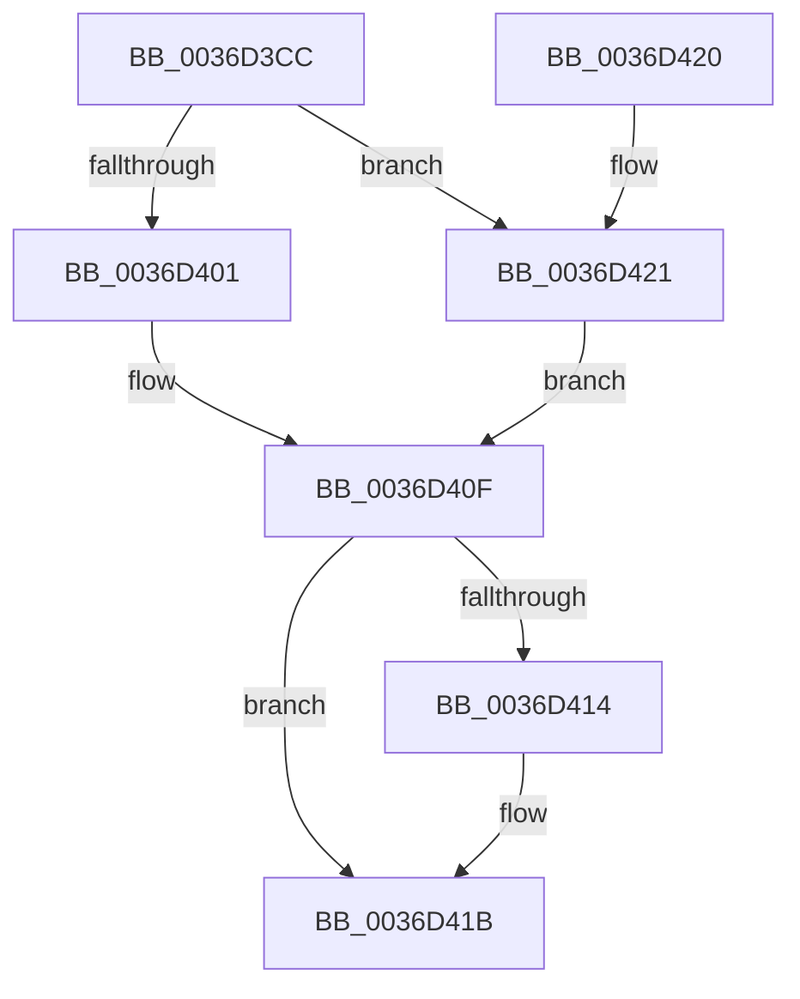

# MiGetInPageAutoBoostLock

- RVA: `0x0036D3CC`–`0x0036D46A` (길이 `158` bytes)
- VA: `0x000000014036D3CC`
- 실행 섹션: `.text`
- PDB 이름 있음: `예`; PDB Function 태그: `아니요`
- unwind 정보 RVA: `0x0007A5D0`
- 디코드: `33`개 명령, `158/158` bytes 표시
- 미해석 바이트: `0` (있으면 어셈블리에 `.byte`로 보존)

> 이 문서는 커널 이미지의 기계어와 PDB 기호를 분석해 생성했습니다. 4번과 5번은 함수 원형과 자료형을 바이너리 사용 방식에서 추정한 C 해석이며 원본 소스 복구 결과는 아닙니다.

## 1. Dependencies

- 직접 호출 지점: **2**; 고유 호출 대상: **2**
- 직접 호출자로 확인된 함수: **3**
- RIP 상대 이미지 참조: **1**

### Outgoing calls
- `0x0036D40A` → [ExpAllocatePoolWithTagFromNode](../35/ExpAllocatePoolWithTagFromNode_function_0035B970.md) (function, `0x0035B970`)
- `0x0036D463` → [VfHandlePoolAlloc](../../pagevrfy/BB/VfHandlePoolAlloc_function_00BB8A90.md) (function, `0x00BB8A90`)

### Direct callers
- [sub_0036CA68](Unknown_function_0036CA68.md) at `0x0036CA68`
- [MmPrefetchPagesEx](../../page/93/MmPrefetchPagesEx_function_0093C9A0.md) at `0x0093CA19`
- [MiPrefetchControlArea](../../page/93/MiPrefetchControlArea_function_0093E830.md) at `0x0093E86E`

### Static image references
- `0x0036D3EA` → RVA `0x00FC6BD0` (`ALMOSTRO`; read)

## 2. Other-region calls and transfers

- 다른 실행 섹션으로 향하는 call: **1**
  - `0x0036D463` → [VfHandlePoolAlloc](../../pagevrfy/BB/VfHandlePoolAlloc_function_00BB8A90.md) (`.text` → `PAGEVRFY`)
- 별도 외부 분기/꼬리 이동을 확인하지 못했습니다.

## 3. Assembly (complete function range)

```asm
0036D3CC  48 83 EC 58                     sub rsp, 0x58
0036D3D0  65 48 8B 04 25 20 00 00 00      mov rax, qword ptr gs:[0x20]
0036D3D9  BA 08 00 00 00                  mov edx, 8
0036D3DE  83 64 24 4C 00                  and dword ptr [rsp + 0x4c], 0
0036D3E3  48 8B 88 C0 00 00 00            mov rcx, qword ptr [rax + 0xc0]
0036D3EA  8B 05 E0 97 C5 00               mov eax, dword ptr [rip + 0xc597e0]
0036D3F0  44 0F B7 89 8A 00 00 00         movzx r9d, word ptr [rcx + 0x8a]
0036D3F8  41 0F BA E9 1F                  bts r9d, 0x1f
0036D3FD  84 C2                           test dl, al
0036D3FF  75 20                           jne 0x14036d421
0036D401  8D 4A 38                        lea ecx, [rdx + 0x38]
0036D404  41 B8 4D 69 49 41               mov r8d, 0x4149694d
0036D40A  E8 61 E5 FE FF                  call 0x14035b970
0036D40F  48 85 C0                        test rax, rax
0036D412  74 07                           je 0x14036d41b
0036D414  48 C7 00 01 00 00 00            mov qword ptr [rax], 1
0036D41B  48 83 C4 58                     add rsp, 0x58
0036D41F  C3                              ret
0036D420  CC                              int3
0036D421  48 8B 44 24 58                  mov rax, qword ptr [rsp + 0x58]
0036D426  4C 8B C2                        mov r8, rdx
0036D429  48 89 44 24 38                  mov qword ptr [rsp + 0x38], rax
0036D42E  41 B9 4D 69 49 41               mov r9d, 0x4149694d
0036D434  48 8D 44 24 40                  lea rax, [rsp + 0x40]
0036D439  C7 44 24 30 01 00 00 00         mov dword ptr [rsp + 0x30], 1
0036D441  48 89 44 24 28                  mov qword ptr [rsp + 0x28], rax
0036D446  BA 40 00 00 00                  mov edx, 0x40
0036D44B  83 64 24 20 00                  and dword ptr [rsp + 0x20], 0
0036D450  33 C9                           xor ecx, ecx
0036D452  48 C7 44 24 40 01 00 00 00      mov qword ptr [rsp + 0x40], 1
0036D45B  C7 44 24 48 20 00 00 00         mov dword ptr [rsp + 0x48], 0x20
0036D463  E8 28 B6 84 00                  call 0x140bb8a90
0036D468  EB A5                           jmp 0x14036d40f
```

## 4. C-style interpretation (structured pseudocode)

```c
__int64 __fastcall MiGetInPageAutoBoostLock(void)
{
    __int64 result;
    __int64 v_rsp;
    unsigned int v_stack_mC;
    unsigned int v_stack_p20;
    unsigned __int64 v_stack_p28;
    unsigned int v_stack_p30;
    unsigned __int64 v_stack_p38;
    unsigned __int64 v_stack_p40;
    unsigned int v_stack_p48;
    unsigned __int64 v_stack_p58;

    v_rsp = (v_rsp) - (88);
    if (((8) & ((unsigned __int8)((unsigned int)(*(unsigned int *)(v_rip + 12949472))))) != 0) goto loc_0036D421;
    result = ExpAllocatePoolWithTagFromNode(8 + 56, 8, (unsigned int)(0x4149694DULL), *(unsigned __int16 *)(*(unsigned __int64 *)(*(unsigned __int64 *)(gs_base + (0 + 32)) + 192) + 138));
loc_0036D40F:
    if (result != 0) {
        *(unsigned __int64 *)(result) = 1;
    }
    v_rsp = (v_rsp) + (88);
    return result;
loc_0036D421:
    v_stack_p38 = v_stack_p58;
    v_stack_p30 = 1;
    v_stack_p28 = v_stack_p40;
    a1 = 0;
    v_stack_p40 = 1;
    v_stack_p48 = 32;
    result = VfHandlePoolAlloc(a1, 64, 8, (unsigned int)(0x4149694DULL));
    goto loc_0036D40F;
}
```

## 5. (Beta) C Style

```c
void MiGetInPageAutoBoostLock(void)
{
    int64_t result;
    int64_t local_rsp;
    uint32_t v_stack_mC;
    uint32_t v_stack_p20;
    uint64_t v_stack_p28;
    uint32_t v_stack_p30;
    uint64_t v_stack_p38;
    uint64_t v_stack_p40;
    uint32_t v_stack_p48;
    uint64_t v_stack_p58;

    local_rsp = (local_rsp) - (88);
    if (((8) & ((uint8_t)((uint32_t)(*(uint32_t *)(v_rip + 0xC597E0))))) != 0) goto loc_0036D421;
    result = ExpAllocatePoolWithTagFromNode(8 + 56, 8, (uint32_t)(0x4149694DULL), *(uint16_t *)(*(uint64_t *)(*(uint64_t *)(gs_base + (0 + 0x20)) + 0xC0) + 0x8A));
loc_0036D40F:
    if (result != 0) {
        *(uint64_t *)(result) = 1;
    }
    local_rsp = (local_rsp) + (88);
    return result;
loc_0036D421:
    v_stack_p38 = v_stack_p58;
    v_stack_p30 = 1;
    v_stack_p28 = v_stack_p40;
    a1 = 0;
    v_stack_p40 = 1;
    v_stack_p48 = 32;
    result = VfHandlePoolAlloc(a1, 64, 8, (uint32_t)(0x4149694DULL));
    goto loc_0036D40F;
}
```

## 6. Execution-region graph

[열기: 2D/3D 그래프와 함수 탐색 컨트롤 패널](../../../control-panel.html?section=text&rva=0x0036D3CC&view=graph)

- 2D 그래프는 위에서 아래로 흐르고, 3D 그래프는 빈 공간을 드래그해 회전합니다. Shift+드래그는 이동, 휠은 확대·축소, 함수 노드 선택은 대상 보고서 이동입니다.

### Static fallback


