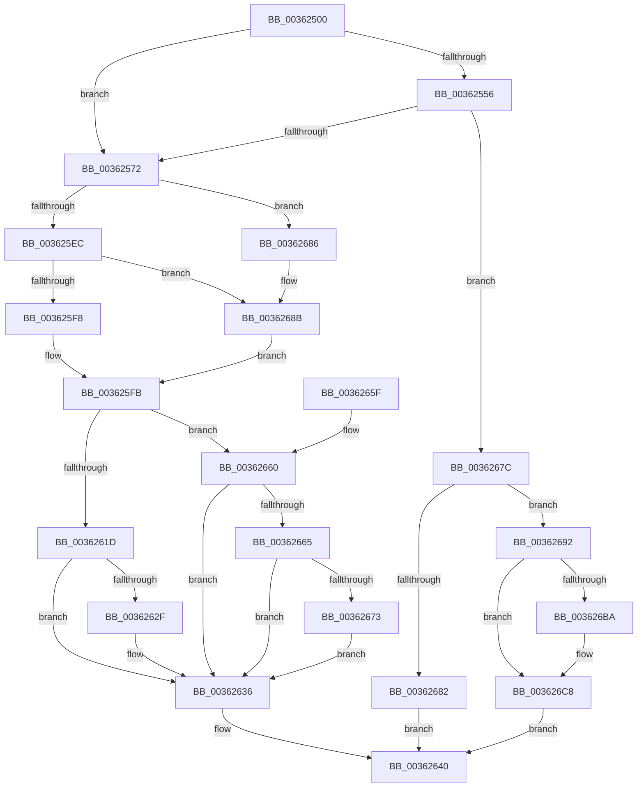

# MiGetInPageSupportBlock

- RVA: `0x00362500`–`0x003626D0` (길이 `464` bytes)
- VA: `0x0000000140362500`
- 실행 섹션: `.text`
- PDB 이름 있음: `예`; PDB Function 태그: `아니요`
- unwind 정보 RVA: `0x00079DE8`
- 디코드: `126`개 명령, `464/464` bytes 표시
- 미해석 바이트: `0` (있으면 어셈블리에 `.byte`로 보존)

> 이 문서는 커널 이미지의 기계어와 PDB 기호를 분석해 생성했습니다. 4번과 5번은 함수 원형과 자료형을 바이너리 사용 방식에서 추정한 C 해석이며 원본 소스 복구 결과는 아닙니다.

## 1. Dependencies

- 직접 호출 지점: **7**; 고유 호출 대상: **6**
- 직접 호출자로 확인된 함수: **9**
- RIP 상대 이미지 참조: **1**

### Outgoing calls
- `0x00362549` → [ExpInterlockedPopEntrySList](../6B/ExpInterlockedPopEntrySList_function_006BA570.md) (function, `0x006BA570`)
- `0x00362561` → [ExpInterlockedPopEntrySList](../6B/ExpInterlockedPopEntrySList_function_006BA570.md) (function, `0x006BA570`)
- `0x0036257F` → [memset](../6C/memset_function_006C6C40.md) (function, `0x006C6C40`)
- `0x003625DE` → [MiGetEffectivePagePriorityThread](MiGetEffectivePagePriorityThread_function_003626E0.md) (function, `0x003626E0`)
- `0x00362625` → [KeAbPreAcquire](../21/KeAbPreAcquire_function_00210230.md) (function, `0x00210230`)
- `0x003626AD` → [MiAllocatePool](../35/MiAllocatePool_function_0035B540.md) (function, `0x0035B540`)
- `0x003626C3` → [MiInitializeInPageSupport](MiInitializeInPageSupport_function_00362728.md) (function, `0x00362728`)

### Direct callers
- [MiMigratePfn](../28/MiMigratePfn_function_0028DBB0.md) at `0x0028DDB4`
- [MiPfPutPagesInTransition](MiPfPutPagesInTransition_function_003640EC.md) at `0x0036430E`
- [MiPrivateFixup](MiPrivateFixup_function_003693E8.md) at `0x0036957B`
- [MiResolveMappedFileFault](MiResolveMappedFileFault_function_0036B640.md) at `0x0036B855`
- [MiResolveMappedFileFault](MiResolveMappedFileFault_function_0036B640.md) at `0x0036B874`
- [MiResolveMappedFileFault](MiResolveMappedFileFault_function_0036B640.md) at `0x0036C010`
- [MiAllocateInPageSupport](MiAllocateInPageSupport_function_0036F100.md) at `0x0036F15F`
- [MiAllocateInPageSupport](MiAllocateInPageSupport_function_0036F100.md) at `0x0036F19C`
- [MiAllocateInPageSupport](MiAllocateInPageSupport_function_0036F100.md) at `0x0036F1F6`
- [sub_006E313A](../6E/Unknown_function_006E313A.md) at `0x006E3358`
- [MiPfAllocateMdls](../../page/93/MiPfAllocateMdls_function_0093E45C.md) at `0x0093E585`
- [MiCreateRotateView](../../page/A7/MiCreateRotateView_function_00A7F498.md) at `0x00A7F4C9`
- [MiGetReadyInPageBlock](../../page/AB/MiGetReadyInPageBlock_function_00ABB398.md) at `0x00ABB3C7`

### Static image references
- `0x00362520` → RVA `0x00E2CB40` (`.data`; read)

## 2. Other-region calls and transfers

- 다른 실행 섹션으로 향하는 call: **0**
- 별도 외부 분기/꼬리 이동을 확인하지 못했습니다.

## 3. Assembly (complete function range)

```asm
00362500  48 89 5C 24 08                  mov qword ptr [rsp + 8], rbx
00362505  48 89 6C 24 10                  mov qword ptr [rsp + 0x10], rbp
0036250A  48 89 74 24 18                  mov qword ptr [rsp + 0x18], rsi
0036250F  48 89 7C 24 20                  mov qword ptr [rsp + 0x20], rdi
00362514  41 54                           push r12
00362516  41 56                           push r14
00362518  41 57                           push r15
0036251A  48 83 EC 20                     sub rsp, 0x20
0036251E  8B E9                           mov ebp, ecx
00362520  4C 8D 25 19 A6 AC 00            lea r12, [rip + 0xaca619]
00362527  44 8B F1                        mov r14d, ecx
0036252A  83 E5 01                        and ebp, 1
0036252D  8B C5                           mov eax, ebp
0036252F  49 8D 8C 24 60 A8 00 00         lea rcx, [r12 + 0xa860]
00362537  83 F0 01                        xor eax, 1
0036253A  48 8B F2                        mov rsi, rdx
0036253D  8B D8                           mov ebx, eax
0036253F  48 C1 E3 04                     shl rbx, 4
00362543  48 03 CB                        add rcx, rbx
00362546  44 8B F8                        mov r15d, eax
00362549  E8 22 80 35 00                  call 0x1406ba570
0036254E  48 8B F8                        mov rdi, rax
00362551  48 85 C0                        test rax, rax
00362554  75 1C                           jne 0x140362572
00362556  49 8D 8C 24 80 A8 00 00         lea rcx, [r12 + 0xa880]
0036255E  48 03 CB                        add rcx, rbx
00362561  E8 0A 80 35 00                  call 0x1406ba570
00362566  48 8B F8                        mov rdi, rax
00362569  48 85 C0                        test rax, rax
0036256C  0F 84 0A 01 00 00               je 0x14036267c
00362572  33 D2                           xor edx, edx
00362574  41 B8 10 01 00 00               mov r8d, 0x110
0036257A  48 8B CF                        mov rcx, rdi
0036257D  33 DB                           xor ebx, ebx
0036257F  E8 BC 46 36 00                  call 0x1406c6c40
00362584  89 5F 24                        mov dword ptr [rdi + 0x24], ebx
00362587  48 8D 47 28                     lea rax, [rdi + 0x28]
0036258B  66 C7 47 21 00 06               mov word ptr [rdi + 0x21], 0x600
00362591  85 ED                           test ebp, ebp
00362593  48 89 40 08                     mov qword ptr [rax + 8], rax
00362597  BA 01 00 00 00                  mov edx, 1
0036259C  48 89 00                        mov qword ptr [rax], rax
0036259F  48 8D 47 40                     lea rax, [rdi + 0x40]
003625A3  66 89 5F 38                     mov word ptr [rdi + 0x38], bx
003625A7  89 5F 3C                        mov dword ptr [rdi + 0x3c], ebx
003625AA  C6 47 3A 06                     mov byte ptr [rdi + 0x3a], 6
003625AE  48 89 40 08                     mov qword ptr [rax + 8], rax
003625B2  48 89 00                        mov qword ptr [rax], rax
003625B5  B8 00 01 00 00                  mov eax, 0x100
003625BA  89 97 B0 00 00 00               mov dword ptr [rdi + 0xb0], edx
003625C0  0F 45 D8                        cmovne ebx, eax
003625C3  48 8D 47 10                     lea rax, [rdi + 0x10]
003625C7  48 89 40 08                     mov qword ptr [rax + 8], rax
003625CB  48 89 00                        mov qword ptr [rax], rax
003625CE  65 48 8B 0C 25 88 01 00 00      mov rcx, qword ptr gs:[0x188]
003625D7  48 89 8F 98 00 00 00            mov qword ptr [rdi + 0x98], rcx
003625DE  E8 FD 00 00 00                  call 0x1403626e0
003625E3  83 F8 05                        cmp eax, 5
003625E6  0F 87 9A 00 00 00               ja 0x140362686
003625EC  0F BA EB 14                     bts ebx, 0x14
003625F0  85 C0                           test eax, eax
003625F2  0F 84 93 00 00 00               je 0x14036268b
003625F8  8D 48 FF                        lea ecx, [rax - 1]
003625FB  0F B6 C9                        movzx ecx, cl
003625FE  83 E1 07                        and ecx, 7
00362601  0F B6 C0                        movzx eax, al
00362604  C1 E1 03                        shl ecx, 3
00362607  83 E0 07                        and eax, 7
0036260A  0B C8                           or ecx, eax
0036260C  C1 E1 0B                        shl ecx, 0xb
0036260F  0B CB                           or ecx, ebx
00362611  89 8F C0 00 00 00               mov dword ptr [rdi + 0xc0], ecx
00362617  41 F6 C6 02                     test r14b, 2
0036261B  74 43                           je 0x140362660
0036261D  45 33 C0                        xor r8d, r8d
00362620  33 D2                           xor edx, edx
00362622  48 8B CF                        mov rcx, rdi
00362625  E8 06 DC EA FF                  call 0x140210230
0036262A  48 85 C0                        test rax, rax
0036262D  74 07                           je 0x140362636
0036262F  C6 40 0A 01                     mov byte ptr [rax + 0xa], 1
00362633  48 8B F7                        mov rsi, rdi
00362636  48 89 B7 D8 00 00 00            mov qword ptr [rdi + 0xd8], rsi
0036263D  48 8B C7                        mov rax, rdi
00362640  48 8B 5C 24 40                  mov rbx, qword ptr [rsp + 0x40]
00362645  48 8B 6C 24 48                  mov rbp, qword ptr [rsp + 0x48]
0036264A  48 8B 74 24 50                  mov rsi, qword ptr [rsp + 0x50]
0036264F  48 8B 7C 24 58                  mov rdi, qword ptr [rsp + 0x58]
00362654  48 83 C4 20                     add rsp, 0x20
00362658  41 5F                           pop r15
0036265A  41 5E                           pop r14
0036265C  41 5C                           pop r12
0036265E  C3                              ret
0036265F  CC                              int3
00362660  48 85 F6                        test rsi, rsi
00362663  74 D1                           je 0x140362636
00362665  F0 48 0F C1 16                  lock xadd qword ptr [rsi], rdx
0036266A  48 FF C2                        inc rdx
0036266D  48 83 FA 01                     cmp rdx, 1
00362671  7F C3                           jg 0x140362636
00362673  B9 0E 00 00 00                  mov ecx, 0xe
00362678  CD 29                           int 0x29
0036267A  EB BA                           jmp 0x140362636
0036267C  41 F6 C6 04                     test r14b, 4
00362680  74 10                           je 0x140362692
00362682  33 C0                           xor eax, eax
00362684  EB BA                           jmp 0x140362640
00362686  B8 05 00 00 00                  mov eax, 5
0036268B  8B C8                           mov ecx, eax
0036268D  E9 69 FF FF FF                  jmp 0x1403625fb
00362692  B8 C0 01 00 00                  mov eax, 0x1c0
00362697  45 85 FF                        test r15d, r15d
0036269A  BA 40 09 00 00                  mov edx, 0x940
0036269F  B9 40 00 00 00                  mov ecx, 0x40
003626A4  0F 45 D0                        cmovne edx, eax
003626A7  41 B8 4D 6D 49 6E               mov r8d, 0x6e496d4d
003626AD  E8 8E 8E FF FF                  call 0x14035b540
003626B2  48 8B D8                        mov rbx, rax
003626B5  48 85 C0                        test rax, rax
003626B8  74 0E                           je 0x1403626c8
003626BA  4C 8B C6                        mov r8, rsi
003626BD  41 8B D6                        mov edx, r14d
003626C0  48 8B C8                        mov rcx, rax
003626C3  E8 60 00 00 00                  call 0x140362728
003626C8  48 8B C3                        mov rax, rbx
003626CB  E9 70 FF FF FF                  jmp 0x140362640
```

## 4. C-style interpretation (structured pseudocode)

```c
__int64 __fastcall MiGetInPageSupportBlock(int a1, __int64 a2)
{
    __int64 result;
    __int64 v_rbp;
    __int64 v_rbx;
    __int64 v_rsi;
    __int64 v_rsp;
    unsigned __int64 v_stack_p10;
    unsigned __int64 v_stack_p18;
    unsigned __int64 v_stack_p20;
    unsigned __int64 v_stack_p8;

    v_stack_p8 = v_rbx;
    v_stack_p10 = v_rbp;
    v_stack_p18 = v_rsi;
    v_stack_p20 = v_rdi;
    v_rsp = (v_rsp) - (32);
    v_rbp = (unsigned int)(((unsigned int)(a1)) & (1));
    result = (unsigned int)(((unsigned int)((unsigned int)(v_rbp))) ^ (1));
    v_rbx = ((unsigned int)((unsigned int)(result))) << (4);
    a1 = (v_rip + 11314713 + 43104) + (v_rbx);
    result = ExpInterlockedPopEntrySList(a1, a2, a3, a4);
    if (result != 0) goto loc_00362572;
    a1 = (v_rip + 11314713 + 43136) + (v_rbx);
    result = ExpInterlockedPopEntrySList(a1, a2, a3, a4);
    if (result == 0) goto loc_0036267C;
loc_00362572:
    a2 = 0;
    v_rbx = 0;
    result = memset(result, a2, 272, a4);
    *(unsigned int *)(result + 36) = 0;
    *(unsigned __int16 *)(result + 33) = 0x600ULL;
    *(unsigned __int64 *)(result + 40 + 8) = result + 40;
    *(unsigned __int64 *)(result + 40) = result + 40;
    *(unsigned __int16 *)(result + 56) = 0;
    *(unsigned int *)(result + 60) = 0;
    *(unsigned __int8 *)(result + 58) = 6;
    *(unsigned __int64 *)(result + 64 + 8) = result + 64;
    *(unsigned __int64 *)(result + 64) = result + 64;
    *(unsigned int *)(result + 176) = 1;
    if ((unsigned int)(v_rbp) != 0) { v_rbx = 256; }
    *(unsigned __int64 *)(result + 16 + 8) = result + 16;
    *(unsigned __int64 *)(result + 16) = result + 16;
    *(unsigned __int64 *)(result + 152) = *(unsigned __int64 *)(gs_base + (0 + 392));
    result = MiGetEffectivePagePriorityThread(*(unsigned __int64 *)(gs_base + (0 + 392)), 1, 272, a4);
    if (((unsigned int)(result)) > 5) goto loc_00362686;
    if ((unsigned int)(result) == 0) goto loc_0036268B;
loc_003625FB:
    a1 = (unsigned int)(((unsigned __int8)(result - 1)) & (7));
    a1 = (unsigned int)((a1) << (3));
    result = (unsigned int)(((unsigned __int8)(result)) & (7));
    a1 = (unsigned int)((a1) | ((unsigned int)(result)));
    a1 = (unsigned int)((a1) << (11));
    a1 = (unsigned int)((a1) | ((unsigned int)(v_rbx)));
    *(unsigned int *)(result + 192) = a1;
    if ((((unsigned __int8)((unsigned int)(a1))) & (2)) == 0) goto loc_00362660;
    a3 = 0;
    a2 = 0;
    result = KeAbPreAcquire(result, a2, a3, a4);
    v_rsi = a2;
    if (result != 0) {
        *(unsigned __int8 *)(result + 10) = 1;
        v_rsi = result;
    }
    *(unsigned __int64 *)(result + 216) = v_rsi;
loc_00362640:
    v_rsp = (v_rsp) + (32);
    return result;
loc_00362660:
    if (v_stack_p18 == 0) goto loc_00362636;
    a2 = (a2) + 1;
    if (a2 > 1) goto loc_00362636;
    goto loc_00362636;
loc_0036267C:
    if ((((unsigned __int8)((unsigned int)(a1))) & (4)) == 0) goto loc_00362692;
    result = 0;
    goto loc_00362640;
loc_00362686:
loc_0036268B:
    goto loc_003625FB;
loc_00362692:
    a2 = (unsigned int)(0x940ULL);
    if ((unsigned int)((unsigned int)((unsigned int)(result))) != 0) { a2 = 448; }
    result = MiAllocatePool(64, a2, (unsigned int)(0x6E496D4DULL), a4);
    if (result != 0) {
        a3 = v_stack_p18;
        a2 = (unsigned int)((unsigned int)(a1));
        a1 = result;
        result = MiInitializeInPageSupport(a1, a2, a3, a4);
    }
    goto loc_00362640;
}
```

## 5. (Beta) C Style

```c
int64_t MiGetInPageSupportBlock(int32_t Arg1, int64_t Arg2)
{
    int64_t result;
    int64_t local_rbp;
    int64_t local_rbx;
    int64_t local_rsi;
    int64_t local_rsp;
    uint64_t v_stack_p10;
    uint64_t v_stack_p18;
    uint64_t v_stack_p20;
    uint64_t v_stack_p8;

    v_stack_p8 = local_rbx;
    v_stack_p10 = local_rbp;
    v_stack_p18 = local_rsi;
    v_stack_p20 = local_rdi;
    local_rsp = (local_rsp) - (32);
    local_rbp = (uint32_t)(((uint32_t)(Arg1)) & (1));
    result = (uint32_t)(((uint32_t)((uint32_t)(local_rbp))) ^ (1));
    local_rbx = ((uint32_t)((uint32_t)(result))) << (4);
    Arg1 = (v_rip + 11314713 + 43104) + (local_rbx);
    result = ExpInterlockedPopEntrySList(Arg1, Arg2, a3, a4);
    if (result != 0) goto loc_00362572;
    Arg1 = (v_rip + 11314713 + 43136) + (local_rbx);
    result = ExpInterlockedPopEntrySList(Arg1, Arg2, a3, a4);
    if (result == 0) goto loc_0036267C;
loc_00362572:
    Arg2 = 0;
    local_rbx = 0;
    result = memset(result, Arg2, 272, a4);
    *(uint32_t *)(result + 0x24) = 0;
    *(uint16_t *)(result + 0x21) = 0x600ULL;
    *(uint64_t *)(result + 0x28 + 0x8) = result + 40;
    *(uint64_t *)(result + 0x28) = result + 40;
    *(uint16_t *)(result + 0x38) = 0;
    *(uint32_t *)(result + 0x3C) = 0;
    *(uint8_t *)(result + 0x3A) = 6;
    *(uint64_t *)(result + 0x40 + 0x8) = result + 64;
    *(uint64_t *)(result + 0x40) = result + 64;
    *(uint32_t *)(result + 0xB0) = 1;
    if ((uint32_t)(local_rbp) != 0) { local_rbx = 256; }
    *(uint64_t *)(result + 0x10 + 0x8) = result + 16;
    *(uint64_t *)(result + 0x10) = result + 16;
    *(uint64_t *)(result + 0x98) = *(uint64_t *)(gs_base + (0 + 0x188));
    result = MiGetEffectivePagePriorityThread(*(uint64_t *)(gs_base + (0 + 0x188)), 1, 272, a4);
    if (((uint32_t)(result)) > 5) goto loc_00362686;
    if ((uint32_t)(result) == 0) goto loc_0036268B;
loc_003625FB:
    Arg1 = (uint32_t)(((uint8_t)(result - 1)) & (7));
    Arg1 = (uint32_t)((Arg1) << (3));
    result = (uint32_t)(((uint8_t)(result)) & (7));
    Arg1 = (uint32_t)((Arg1) | ((uint32_t)(result)));
    Arg1 = (uint32_t)((Arg1) << (11));
    Arg1 = (uint32_t)((Arg1) | ((uint32_t)(local_rbx)));
    *(uint32_t *)(result + 0xC0) = Arg1;
    if ((((uint8_t)((uint32_t)(Arg1))) & (2)) == 0) goto loc_00362660;
    a3 = 0;
    Arg2 = 0;
    result = KeAbPreAcquire(result, Arg2, a3, a4);
    local_rsi = Arg2;
    if (result != 0) {
        *(uint8_t *)(result + 0xA) = 1;
        local_rsi = result;
    }
    *(uint64_t *)(result + 0xD8) = local_rsi;
loc_00362640:
    local_rsp = (local_rsp) + (32);
    return result;
loc_00362660:
    if (v_stack_p18 == 0) goto loc_00362636;
    Arg2 = (Arg2) + 1;
    if (Arg2 > 1) goto loc_00362636;
    goto loc_00362636;
loc_0036267C:
    if ((((uint8_t)((uint32_t)(Arg1))) & (4)) == 0) goto loc_00362692;
    result = 0;
    goto loc_00362640;
loc_00362686:
loc_0036268B:
    goto loc_003625FB;
loc_00362692:
    Arg2 = (uint32_t)(0x940ULL);
    if ((uint32_t)((uint32_t)((uint32_t)(result))) != 0) { Arg2 = 448; }
    result = MiAllocatePool(64, Arg2, (uint32_t)(0x6E496D4DULL), a4);
    if (result != 0) {
        a3 = v_stack_p18;
        Arg2 = (uint32_t)((uint32_t)(Arg1));
        Arg1 = result;
        result = MiInitializeInPageSupport(Arg1, Arg2, a3, a4);
    }
    goto loc_00362640;
}
```

## 6. Execution-region graph

[열기: 2D/3D 그래프와 함수 탐색 컨트롤 패널](../../../control-panel.html?section=text&rva=0x00362500&view=graph)

- 2D 그래프는 위에서 아래로 흐르고, 3D 그래프는 빈 공간을 드래그해 회전합니다. Shift+드래그는 이동, 휠은 확대·축소, 함수 노드 선택은 대상 보고서 이동입니다.

### Static fallback


