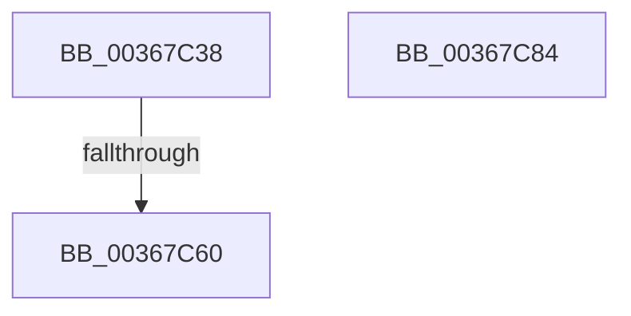

# MiGetPageForEnclave

- RVA: `0x00367C38`–`0x00367C85` (길이 `77` bytes)
- VA: `0x0000000140367C38`
- 실행 섹션: `.text`
- PDB 이름 있음: `예`; PDB Function 태그: `예`
- unwind 정보 RVA: `0x0006C2A4`
- 디코드: `18`개 명령, `77/77` bytes 표시
- 미해석 바이트: `0` (있으면 어셈블리에 `.byte`로 보존)

> 이 문서는 커널 이미지의 기계어와 PDB 기호를 분석해 생성했습니다. 4번과 5번은 함수 원형과 자료형을 바이너리 사용 방식에서 추정한 C 해석이며 원본 소스 복구 결과는 아닙니다.

## 1. Dependencies

- 직접 호출 지점: **1**; 고유 호출 대상: **1**
- 직접 호출자로 확인된 함수: **2**
- RIP 상대 이미지 참조: **0**

### Outgoing calls
- `0x00367C52` → [MiUnlinkPageChainHead](MiUnlinkPageChainHead_function_00365C40.md) (function, `0x00365C40`)

### Direct callers
- [MiAddPagesToEnclave](MiAddPagesToEnclave_function_00367EEC.md) at `0x003680CD`
- [MiCopyPagesIntoEnclave](../../page/A4/MiCopyPagesIntoEnclave_function_00A472AC.md) at `0x00A47758`

### Static image references
- 디코드된 RIP-relative 메모리 참조가 없습니다.

## 2. Other-region calls and transfers

- 다른 실행 섹션으로 향하는 call: **0**
- call이 아닌 외부 분기/꼬리 이동: **1**
  - `0x00367C5A` → [sub_006E3572](../6E/Unknown_function_006E3572.md) (`tail-transfer`)

## 3. Assembly (complete function range)

```asm
00367C38  48 83 EC 58                     sub rsp, 0x58
00367C3C  33 C0                           xor eax, eax
00367C3E  0F 57 C0                        xorps xmm0, xmm0
00367C41  48 83 C1 60                     add rcx, 0x60
00367C45  48 89 44 24 40                  mov qword ptr [rsp + 0x40], rax
00367C4A  0F 11 44 24 30                  movups xmmword ptr [rsp + 0x30], xmm0
00367C4F  4C 8B D2                        mov r10, rdx
00367C52  E8 E9 DF FF FF                  call 0x140365c40
00367C57  48 85 C0                        test rax, rax
00367C5A  0F 84 12 B9 37 00               je 0x1406e3572
00367C60  48 B9 00 00 00 00 00 DE FF FF   movabs rcx, 0xffffde0000000000
00367C6A  48 2B C1                        sub rax, rcx
00367C6D  48 B9 AB AA AA AA AA AA AA AA   movabs rcx, 0xaaaaaaaaaaaaaaab
00367C77  48 C1 F8 04                     sar rax, 4
00367C7B  48 0F AF C1                     imul rax, rcx
00367C7F  48 83 C4 58                     add rsp, 0x58
00367C83  C3                              ret
00367C84  CC                              int3
```

## 4. C-style interpretation (structured pseudocode)

```c
__int64 __fastcall MiGetPageForEnclave(__int64 a1, __int64 a2)
{
    __int64 result;
    __int64 v_rsp;
    unsigned __int64 v_stack_m18;
    unsigned __int64 v_stack_m28;

    v_rsp = (v_rsp) - (88);
    result = 0;
    a1 = (a1) + (96);
    v_stack_m18 = 0;
    v_stack_m28 = v_xmm0;
    result = MiUnlinkPageChainHead(a1, a2, a3, a4);
    result = (result) - (a1);
    result = (result) >> (4);
    result = (result) * (a1);
    v_rsp = (v_rsp) + (88);
    return result;
}
```

## 5. (Beta) C Style

```c
int64_t MiGetPageForEnclave(int64_t Arg1, int64_t Arg2)
{
    int64_t result;
    int64_t local_rsp;
    uint64_t v_stack_m18;
    uint64_t v_stack_m28;

    local_rsp = (local_rsp) - (88);
    result = 0;
    Arg1 = (Arg1) + (96);
    v_stack_m18 = 0;
    v_stack_m28 = v_xmm0;
    result = MiUnlinkPageChainHead(Arg1, Arg2, a3, a4);
    result = (result) - (Arg1);
    result = (result) >> (4);
    result = (result) * (Arg1);
    local_rsp = (local_rsp) + (88);
    return result;
}
```

## 6. Execution-region graph

[열기: 2D/3D 그래프와 함수 탐색 컨트롤 패널](../../../control-panel.html?section=text&rva=0x00367C38&view=graph)

- 2D 그래프는 위에서 아래로 흐르고, 3D 그래프는 빈 공간을 드래그해 회전합니다. Shift+드래그는 이동, 휠은 확대·축소, 함수 노드 선택은 대상 보고서 이동입니다.

### Static fallback


