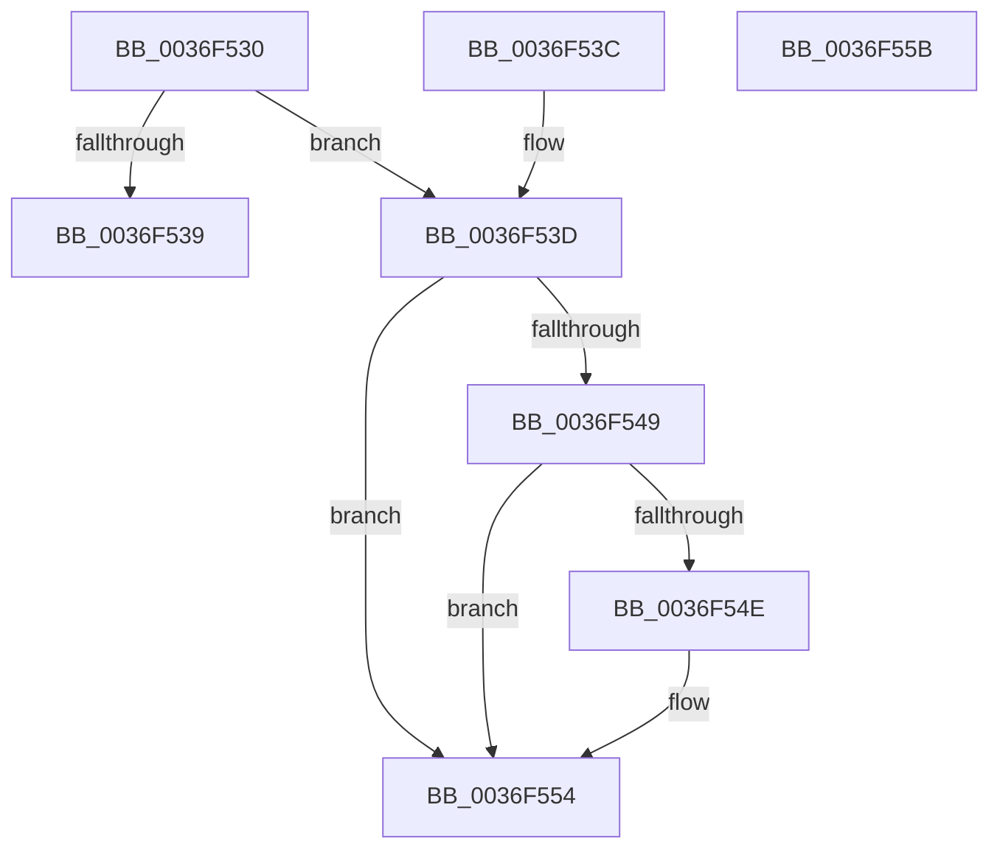

# MiGetPagingFileOffset

- RVA: `0x0036F530`–`0x0036F55C` (길이 `44` bytes)
- VA: `0x000000014036F530`
- 실행 섹션: `.text`
- PDB 이름 있음: `예`; PDB Function 태그: `아니요`
- unwind 정보 RVA: `0x000DB714`
- 디코드: `18`개 명령, `44/44` bytes 표시
- 미해석 바이트: `0` (있으면 어셈블리에 `.byte`로 보존)

> 이 문서는 커널 이미지의 기계어와 PDB 기호를 분석해 생성했습니다. 4번과 5번은 함수 원형과 자료형을 바이너리 사용 방식에서 추정한 C 해석이며 원본 소스 복구 결과는 아닙니다.

## 1. Dependencies

- 직접 호출 지점: **0**; 고유 호출 대상: **0**
- 직접 호출자로 확인된 함수: **28**
- RIP 상대 이미지 참조: **1**

### Outgoing calls
- 직접 디코드된 call 명령이 없습니다.

### Direct callers
- [MiDemoteCombinedPte](../22/MiDemoteCombinedPte_function_0022ABAC.md) at `0x0022AE09`
- [MiWsleFree](../28/MiWsleFree_function_00284600.md) at `0x00285116`
- [MiWsleFree](../28/MiWsleFree_function_00284600.md) at `0x00285192`
- [MiWorkingSetInfoCheckPageTable](../2A/MiWorkingSetInfoCheckPageTable_function_002AEFCC.md) at `0x002AF00A`
- [MiGetWorkingSetInfoList](../2A/MiGetWorkingSetInfoList_function_002AF770.md) at `0x002AFB5F`
- [MiGetWorkingSetInfoList](../2A/MiGetWorkingSetInfoList_function_002AF770.md) at `0x002B05E3`
- [MiResolveProtoPteFault](../32/MiResolveProtoPteFault_function_00321750.md) at `0x00321FA6`
- [MiValidFault](../32/MiValidFault_function_003280B4.md) at `0x0032824A`
- [MiPfnShareCountIsZero](../33/MiPfnShareCountIsZero_function_00330930.md) at `0x00330BF9`
- [MiCompletePrivateZeroFault](../33/MiCompletePrivateZeroFault_function_00330CC0.md) at `0x00331AC4`
- [sub_003341DB](../33/Unknown_function_003341DB.md) at `0x003342AE`
- [MiRestoreTransitionPte](../33/MiRestoreTransitionPte_function_0033DD90.md) at `0x0033E071`
- [MiCompleteProtoPteFault](../34/MiCompleteProtoPteFault_function_00345710.md) at `0x00345F32`
- [MiComputeFaultCluster](MiComputeFaultCluster_function_003635B4.md) at `0x00363777`
- [MiWalkEntireImage](MiWalkEntireImage_function_00365D70.md) at `0x00366B88`
- [MiResolvePageFileFault](MiResolvePageFileFault_function_0036D968.md) at `0x0036E212`
- [MiResolvePageFileFault](MiResolvePageFileFault_function_0036D968.md) at `0x0036E2F2`
- [MiResolvePageFileFault](MiResolvePageFileFault_function_0036D968.md) at `0x0036E8F4`
- [MiResolvePageFileFault](MiResolvePageFileFault_function_0036D968.md) at `0x0036EB79`
- [MiExpandSharedZeroCluster](MiExpandSharedZeroCluster_function_0036F20C.md) at `0x0036F3FB`
- [sub_00370B5B](../37/Unknown_function_00370B5B.md) at `0x00370C85`
- [MiIssueHardFault](../38/MiIssueHardFault_function_00380074.md) at `0x003805C5`
- [MiArePagefileContentsCorrupted](../38/MiArePagefileContentsCorrupted_function_003818C8.md) at `0x00381942`
- [MiArePagefileContentsCorrupted](../38/MiArePagefileContentsCorrupted_function_003818C8.md) at `0x00381978`
- [MiWritePageFileHash](../38/MiWritePageFileHash_function_00381DC8.md) at `0x00381F9B`
- [MiWritePageFileHash](../38/MiWritePageFileHash_function_00381DC8.md) at `0x00381FAE`
- [NtLockVirtualMemory](../40/NtLockVirtualMemory_function_004088A0.md) at `0x00408FE5`
- [MiStoreUpdatePagefileHash](../49/MiStoreUpdatePagefileHash_function_004920AC.md) at `0x00492126`
- [MiFlowThroughInsertNode](../4B/MiFlowThroughInsertNode_function_004B560C.md) at `0x004B566B`
- [MiReadPagefilePage](../66/MiReadPagefilePage_function_0066F78C.md) at `0x0066F8A2`
- [MiDbgMarkPfnModified](../68/MiDbgMarkPfnModified_function_0068524C.md) at `0x0068537F`
- [sub_006D6E94](../6D/Unknown_function_006D6E94.md) at `0x006D6F65`
- [sub_006D6E94](../6D/Unknown_function_006D6E94.md) at `0x006D705B`
- [sub_006DBBC0](../6D/Unknown_function_006DBBC0.md) at `0x006DBC1C`
- [sub_006E313A](../6E/Unknown_function_006E313A.md) at `0x006E3221`
- [MiScanPagefileSpace](../../page/80/MiScanPagefileSpace_function_00800440.md) at `0x00800515`
- [MiScanPagefileSpace](../../page/80/MiScanPagefileSpace_function_00800440.md) at `0x00800587`

### Static image references
- `0x0036F53D` → RVA `0x00E2DC80` (`.data`; read)

## 2. Other-region calls and transfers

- 다른 실행 섹션으로 향하는 call: **0**
- 별도 외부 분기/꼬리 이동을 확인하지 못했습니다.

## 3. Assembly (complete function range)

```asm
0036F530  8A C1                           mov al, cl
0036F532  C0 E8 02                        shr al, 2
0036F535  A8 01                           test al, 1
0036F537  75 04                           jne 0x14036f53d
0036F539  33 C0                           xor eax, eax
0036F53B  C3                              ret
0036F53C  CC                              int3
0036F53D  48 8B 05 3C E7 AB 00            mov rax, qword ptr [rip + 0xabe73c]
0036F544  48 85 C0                        test rax, rax
0036F547  74 0B                           je 0x14036f554
0036F549  F6 C1 10                        test cl, 0x10
0036F54C  75 06                           jne 0x14036f554
0036F54E  48 F7 D0                        not rax
0036F551  48 23 C8                        and rcx, rax
0036F554  48 C1 E9 20                     shr rcx, 0x20
0036F558  8B C1                           mov eax, ecx
0036F55A  C3                              ret
0036F55B  CC                              int3
```

## 4. C-style interpretation (structured pseudocode)

```c
__int64 __fastcall MiGetPagingFileOffset(__int64 a1)
{
    __int64 result;

    result = (unsigned __int8)(((unsigned __int8)(a1)) >> (2));
    if ((((unsigned __int8)(result)) & (1)) != 0) goto loc_0036F53D;
    result = 0;
    return result;
loc_0036F53D:
    if (*(unsigned __int64 *)(v_rip + 11265852) == 0) goto loc_0036F554;
    result = *(unsigned __int64 *)(v_rip + 11265852);
    if ((((unsigned __int8)(a1)) & (16)) == 0) {
        result = ~(*(unsigned __int64 *)(v_rip + 11265852));
        a1 = (a1) & (result);
    }
    a1 = (a1) >> (32);
    return (unsigned int)((unsigned int)(a1));
}
```

## 5. (Beta) C Style

```c
int64_t MiGetPagingFileOffset(int64_t Arg1)
{
    int64_t result;

    result = (uint8_t)(((uint8_t)(Arg1)) >> (2));
    if ((((uint8_t)(result)) & (1)) != 0) goto loc_0036F53D;
    result = 0;
    return result;
loc_0036F53D:
    if (*(uint64_t *)(v_rip + 0xABE73C) == 0) goto loc_0036F554;
    result = *(uint64_t *)(v_rip + 0xABE73C);
    if ((((uint8_t)(Arg1)) & (16)) == 0) {
        result = ~(*(uint64_t *)(v_rip + 0xABE73C));
        Arg1 = (Arg1) & (result);
    }
    Arg1 = (Arg1) >> (32);
    return (uint32_t)((uint32_t)(Arg1));
}
```

## 6. Execution-region graph

[열기: 2D/3D 그래프와 함수 탐색 컨트롤 패널](../../../control-panel.html?section=text&rva=0x0036F530&view=graph)

- 2D 그래프는 위에서 아래로 흐르고, 3D 그래프는 빈 공간을 드래그해 회전합니다. Shift+드래그는 이동, 휠은 확대·축소, 함수 노드 선택은 대상 보고서 이동입니다.

### Static fallback


