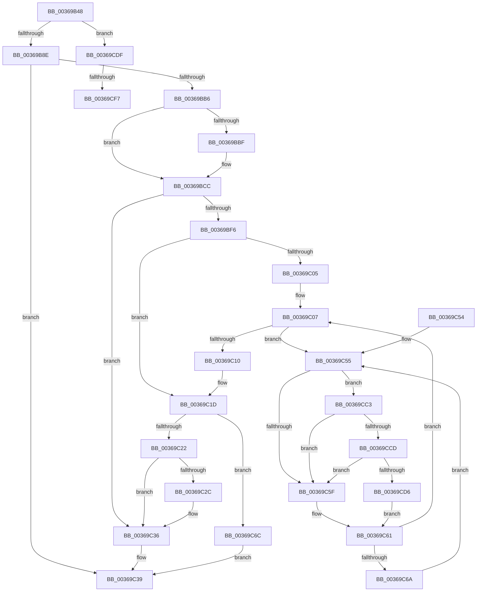

# MiHandleCollidedFault

- RVA: `0x00369B48`–`0x00369D07` (길이 `447` bytes)
- VA: `0x0000000140369B48`
- 실행 섹션: `.text`
- PDB 이름 있음: `예`; PDB Function 태그: `예`
- unwind 정보 RVA: `0x0007A204`
- 디코드: `119`개 명령, `447/447` bytes 표시
- 미해석 바이트: `0` (있으면 어셈블리에 `.byte`로 보존)

> 이 문서는 커널 이미지의 기계어와 PDB 기호를 분석해 생성했습니다. 4번과 5번은 함수 원형과 자료형을 바이너리 사용 방식에서 추정한 C 해석이며 원본 소스 복구 결과는 아닙니다.

## 1. Dependencies

- 직접 호출 지점: **11**; 고유 호출 대상: **9**
- 직접 호출자로 확인된 함수: **1**
- RIP 상대 이미지 참조: **2**

### Outgoing calls
- `0x00369B7F` → [MiAllowReadInProgress](MiAllowReadInProgress_function_00369D10.md) (function, `0x00369D10`)
- `0x00369BA7` → [MiIssueFlowThroughFault](MiIssueFlowThroughFault_function_00369D64.md) (function, `0x00369D64`)
- `0x00369BC7` → [MiObtainProtoReference](../31/MiObtainProtoReference_function_00318178.md) (function, `0x00318178`)
- `0x00369BE7` → [MiWaitForCollidedFaultComplete](MiWaitForCollidedFaultComplete_function_00369EDC.md) (function, `0x00369EDC`)
- `0x00369C13` → [MiRemoveLockedPageChargeAndDecRef](../24/MiRemoveLockedPageChargeAndDecRef_function_002459D0.md) (function, `0x002459D0`)
- `0x00369C31` → [MiUnlockProtoPoolPage](../24/MiUnlockProtoPoolPage_function_00246090.md) (function, `0x00246090`)
- `0x00369C74` → [MiAddLockedPageCharge](../28/MiAddLockedPageCharge_function_0028B550.md) (function, `0x0028B550`)
- `0x00369CB7` → [MiRemoveLockedPageChargeAndDecRef](../24/MiRemoveLockedPageChargeAndDecRef_function_002459D0.md) (function, `0x002459D0`)
- `0x00369CCD` → [KiCheckVpBackingLongSpinWaitHypercall](../30/KiCheckVpBackingLongSpinWaitHypercall_function_0030F490.md) (function, `0x0030F490`)
- `0x00369CD8` → [HvlNotifyLongSpinWait](../30/HvlNotifyLongSpinWait_function_0030F460.md) (function, `0x0030F460`)
- `0x00369CFC` → [MiUnlockProtoPoolPage](../24/MiUnlockProtoPoolPage_function_00246090.md) (function, `0x00246090`)

### Direct callers
- [MiResolveTransitionFault](../28/MiResolveTransitionFault_function_00282940.md) at `0x002835CF`

### Static image references
- `0x00369C57` → RVA `0x00FC52AC` (`ALMOSTRO`; reference)
- `0x00369CC3` → RVA `0x00FC6AB8` (`ALMOSTRO`; read)

## 2. Other-region calls and transfers

- 다른 실행 섹션으로 향하는 call: **0**
- call이 아닌 외부 분기/꼬리 이동: **2**
  - `0x00369CF1` → [sub_006E3B7C](../6E/Unknown_function_006E3B7C.md) (`tail-transfer`)
  - `0x00369D02` → [sub_006E3B7C](../6E/Unknown_function_006E3B7C.md) (`tail-transfer`)

## 3. Assembly (complete function range)

```asm
00369B48  48 8B C4                        mov rax, rsp
00369B4B  48 89 58 08                     mov qword ptr [rax + 8], rbx
00369B4F  48 89 68 10                     mov qword ptr [rax + 0x10], rbp
00369B53  48 89 70 18                     mov qword ptr [rax + 0x18], rsi
00369B57  48 89 78 20                     mov qword ptr [rax + 0x20], rdi
00369B5B  41 56                           push r14
00369B5D  48 83 EC 40                     sub rsp, 0x40
00369B61  4C 8B 54 24 70                  mov r10, qword ptr [rsp + 0x70]
00369B66  49 8B F9                        mov rdi, r9
00369B69  4C 8B 74 24 78                  mov r14, qword ptr [rsp + 0x78]
00369B6E  49 8B D8                        mov rbx, r8
00369B71  48 8B F1                        mov rsi, rcx
00369B74  49 83 22 00                     and qword ptr [r10], 0
00369B78  41 C7 06 02 00 00 00            mov dword ptr [r14], 2
00369B7F  E8 8C 01 00 00                  call 0x140369d10
00369B84  8B E8                           mov ebp, eax
00369B86  85 C0                           test eax, eax
00369B88  0F 88 51 01 00 00               js 0x140369cdf
00369B8E  4D 8B 09                        mov r9, qword ptr [r9]
00369B91  4C 8B C3                        mov r8, rbx
00369B94  4C 89 74 24 30                  mov qword ptr [rsp + 0x30], r14
00369B99  49 83 C1 E0                     add r9, -0x20
00369B9D  4C 89 54 24 28                  mov qword ptr [rsp + 0x28], r10
00369BA2  48 89 7C 24 20                  mov qword ptr [rsp + 0x20], rdi
00369BA7  E8 B8 01 00 00                  call 0x140369d64
00369BAC  41 83 3E 01                     cmp dword ptr [r14], 1
00369BB0  0F 84 83 00 00 00               je 0x140369c39
00369BB6  48 8B 47 28                     mov rax, qword ptr [rdi + 0x28]
00369BBA  48 85 C0                        test rax, rax
00369BBD  79 0D                           jns 0x140369bcc
00369BBF  BA 01 00 00 00                  mov edx, 1
00369BC4  48 8B CB                        mov rcx, rbx
00369BC7  E8 AC E5 FA FF                  call 0x140318178
00369BCC  83 64 24 70 00                  and dword ptr [rsp + 0x70], 0
00369BD1  48 8D 44 24 70                  lea rax, [rsp + 0x70]
00369BD6  41 B1 02                        mov r9b, 2
00369BD9  48 89 44 24 20                  mov qword ptr [rsp + 0x20], rax
00369BDE  4C 8B C3                        mov r8, rbx
00369BE1  48 8B D7                        mov rdx, rdi
00369BE4  48 8B CE                        mov rcx, rsi
00369BE7  E8 F0 02 00 00                  call 0x140369edc
00369BEC  83 7C 24 70 00                  cmp dword ptr [rsp + 0x70], 0
00369BF1  44 8B F0                        mov r14d, eax
00369BF4  75 40                           jne 0x140369c36
00369BF6  48 BE FF FF FF FF FF FF FF 7F   movabs rsi, 0x7fffffffffffffff
00369C00  48 85 DB                        test rbx, rbx
00369C03  74 18                           je 0x140369c1d
00369C05  33 ED                           xor ebp, ebp
00369C07  F0 48 0F BA 6B 18 3F            lock bts qword ptr [rbx + 0x18], 0x3f
00369C0E  72 45                           jb 0x140369c55
00369C10  48 8B CB                        mov rcx, rbx
00369C13  E8 B8 BD ED FF                  call 0x1402459d0
00369C18  F0 48 21 73 18                  lock and qword ptr [rbx + 0x18], rsi
00369C1D  45 85 F6                        test r14d, r14d
00369C20  74 4A                           je 0x140369c6c
00369C22  F0 48 21 77 18                  lock and qword ptr [rdi + 0x18], rsi
00369C27  48 85 DB                        test rbx, rbx
00369C2A  74 0A                           je 0x140369c36
00369C2C  B2 11                           mov dl, 0x11
00369C2E  48 8B CB                        mov rcx, rbx
00369C31  E8 5A C4 ED FF                  call 0x140246090
00369C36  41 8B C6                        mov eax, r14d
00369C39  48 8B 5C 24 50                  mov rbx, qword ptr [rsp + 0x50]
00369C3E  48 8B 6C 24 58                  mov rbp, qword ptr [rsp + 0x58]
00369C43  48 8B 74 24 60                  mov rsi, qword ptr [rsp + 0x60]
00369C48  48 8B 7C 24 68                  mov rdi, qword ptr [rsp + 0x68]
00369C4D  48 83 C4 40                     add rsp, 0x40
00369C51  41 5E                           pop r14
00369C53  C3                              ret
00369C54  CC                              int3
00369C55  FF C5                           inc ebp
00369C57  85 2D 4F B6 C5 00               test dword ptr [rip + 0xc5b64f], ebp
00369C5D  74 64                           je 0x140369cc3
00369C5F  F3 90                           pause
00369C61  48 8B 43 18                     mov rax, qword ptr [rbx + 0x18]
00369C65  48 85 C0                        test rax, rax
00369C68  79 9D                           jns 0x140369c07
00369C6A  EB E9                           jmp 0x140369c55
00369C6C  BA 03 00 00 00                  mov edx, 3
00369C71  48 8B CF                        mov rcx, rdi
00369C74  E8 D7 18 F2 FF                  call 0x14028b550
00369C79  48 8B 47 18                     mov rax, qword ptr [rdi + 0x18]
00369C7D  48 8D 48 01                     lea rcx, [rax + 1]
00369C81  48 8B D1                        mov rdx, rcx
00369C84  48 33 D0                        xor rdx, rax
00369C87  48 B8 00 00 00 00 00 00 00 C0   movabs rax, 0xc000000000000000
00369C91  48 23 D0                        and rdx, rax
00369C94  48 33 D1                        xor rdx, rcx
00369C97  48 8B CF                        mov rcx, rdi
00369C9A  48 89 57 18                     mov qword ptr [rdi + 0x18], rdx
00369C9E  8B 47 20                        mov eax, dword ptr [rdi + 0x20]
00369CA1  89 44 24 70                     mov dword ptr [rsp + 0x70], eax
00369CA5  C1 E8 10                        shr eax, 0x10
00369CA8  24 FE                           and al, 0xfe
00369CAA  0C 06                           or al, 6
00369CAC  88 44 24 72                     mov byte ptr [rsp + 0x72], al
00369CB0  8B 44 24 70                     mov eax, dword ptr [rsp + 0x70]
00369CB4  89 47 20                        mov dword ptr [rdi + 0x20], eax
00369CB7  E8 14 BD ED FF                  call 0x1402459d0
00369CBC  33 C0                           xor eax, eax
00369CBE  E9 76 FF FF FF                  jmp 0x140369c39
00369CC3  8B 05 EF CD C5 00               mov eax, dword ptr [rip + 0xc5cdef]
00369CC9  A8 40                           test al, 0x40
00369CCB  74 92                           je 0x140369c5f
00369CCD  E8 BE 57 FA FF                  call 0x14030f490
00369CD2  84 C0                           test al, al
00369CD4  74 89                           je 0x140369c5f
00369CD6  8B CD                           mov ecx, ebp
00369CD8  E8 83 57 FA FF                  call 0x14030f460
00369CDD  EB 82                           jmp 0x140369c61
00369CDF  48 BE FF FF FF FF FF FF FF 7F   movabs rsi, 0x7fffffffffffffff
00369CE9  F0 49 21 71 18                  lock and qword ptr [r9 + 0x18], rsi
00369CEE  48 85 DB                        test rbx, rbx
00369CF1  0F 84 85 9E 37 00               je 0x1406e3b7c
00369CF7  B2 11                           mov dl, 0x11
00369CF9  48 8B CB                        mov rcx, rbx
00369CFC  E8 8F C3 ED FF                  call 0x140246090
00369D01  90                              nop
00369D02  E9 75 9E 37 00                  jmp 0x1406e3b7c
```

## 4. C-style interpretation (structured pseudocode)

```c
__int64 __fastcall MiHandleCollidedFault(__int64 a1, __int64 a2, __int64 a3, __int64 a4, unsigned int a5, __int64 a6)
{
    __int64 result;
    __int64 v_rbp;
    __int64 v_rsp;
    unsigned __int64 v_stack_m18;
    unsigned __int64 v_stack_m20;
    unsigned __int64 v_stack_m28;
    unsigned __int64 v_stack_p10;
    unsigned __int64 v_stack_p18;
    unsigned __int64 v_stack_p20;
    unsigned int v_stack_p70;
    unsigned __int8 v_stack_p72;
    unsigned __int64 v_stack_p8;

    *(unsigned __int64 *)(v_rsp + 8) = v_rbx;
    *(unsigned __int64 *)(v_rsp + 16) = v_rbp;
    *(unsigned __int64 *)(v_rsp + 24) = v_rsi;
    *(unsigned __int64 *)(v_rsp + 32) = v_rdi;
    v_rsp = (v_rsp) - (64);
    *(unsigned int *)(a6) = 2;
    result = MiAllowReadInProgress(a1, a2, a3, a4);
    if (sign_flag) goto loc_00369CDF;
    v_stack_m18 = a6;
    a4 = (*(unsigned __int64 *)(a4)) + (-32);
    v_stack_m20 = a5;
    v_stack_m28 = a4;
    result = MiIssueFlowThroughFault(a1, a2, a3, a4);
    if ((*(unsigned int *)(a6)) == 1) goto loc_00369C39;
    result = *(unsigned __int64 *)(a4 + 40);
    if (sign_flag) {
        a2 = 1;
        a1 = a3;
        result = MiObtainProtoReference(a1, a2, a3, a4);
    }
    v_stack_m28 = a5;
    result = MiWaitForCollidedFaultComplete(a1, a4, a3, 2);
    if (a5 != 0) goto loc_00369C36;
    if (a3 == 0) goto loc_00369C1D;
    v_rbp = 0;
loc_00369C07:
    if (condition_is_below) goto loc_00369C55;
    result = MiRemoveLockedPageChargeAndDecRef(a3, a4, a3, 2);
loc_00369C1D:
    if ((unsigned int)((unsigned int)((unsigned int)(result))) == 0) goto loc_00369C6C;
    if (a3 != 0) {
        a2 = 17;
        a1 = a3;
        result = MiUnlockProtoPoolPage(a1, a2, a3, 2);
    }
loc_00369C39:
    v_rsp = (v_rsp) + (64);
    return (unsigned int)((unsigned int)((unsigned int)((unsigned int)(result))));
loc_00369C55:
    v_rbp = (unsigned int)((v_stack_p10) + 1);
    if (((*(unsigned int *)(v_rip + 12957263)) & ((unsigned int)(v_rbp))) == 0) goto loc_00369CC3;
loc_00369C5F:
loc_00369C61:
    if (!sign_flag) goto loc_00369C07;
    goto loc_00369C55;
loc_00369C6C:
    result = MiAddLockedPageCharge(v_stack_p20, 3, a3, 2);
    a2 = (*(unsigned __int64 *)(v_stack_p20 + 24) + 1) ^ (*(unsigned __int64 *)(v_stack_p20 + 24));
    a2 = (a2) & (*(unsigned __int64 *)(v_stack_p20 + 24));
    a2 = (a2) ^ (*(unsigned __int64 *)(v_stack_p20 + 24) + 1);
    *(unsigned __int64 *)(v_stack_p20 + 24) = a2;
    v_stack_p70 = (unsigned int)((unsigned int)(*(unsigned int *)(v_stack_p20 + 32)));
    result = (unsigned int)(((unsigned int)(*(unsigned int *)(v_stack_p20 + 32))) >> (16));
    result = (unsigned __int8)((result) & (254));
    result = (unsigned __int8)((result) | (6));
    v_stack_p72 = (unsigned __int8)(result);
    *(unsigned int *)(v_stack_p20 + 32) = (unsigned int)((unsigned int)(a5));
    result = MiRemoveLockedPageChargeAndDecRef(v_stack_p20, a2, a3, 2);
    result = 0;
    goto loc_00369C39;
loc_00369CC3:
    if ((((unsigned __int8)((unsigned int)(*(unsigned int *)(v_rip + 12963311)))) & (64)) == 0) goto loc_00369C5F;
    result = KiCheckVpBackingLongSpinWaitHypercall(v_stack_p20, a2, a3, 2);
    if ((unsigned __int8)(result) == 0) goto loc_00369C5F;
    result = HvlNotifyLongSpinWait((unsigned int)((unsigned int)(v_rbp)), a2, a3, 2);
    goto loc_00369C61;
loc_00369CDF:
    result = MiUnlockProtoPoolPage(v_stack_p8, 17, a3, 2);
}
```

## 5. (Beta) C Style

```c
int64_t MiHandleCollidedFault(int64_t Arg1, int64_t Arg2, int64_t Arg3, void *Arg4, void *Arg5, void *Arg6)
{
    uint8_t *arg4 = (uint8_t *)Arg4;
    uint8_t *arg5 = (uint8_t *)Arg5;
    uint8_t *arg6 = (uint8_t *)Arg6;

    int64_t result;
    int64_t local_rbp;
    int64_t local_rsp;
    uint64_t v_stack_m18;
    uint64_t v_stack_m20;
    uint64_t v_stack_m28;
    uint64_t v_stack_p10;
    uint64_t v_stack_p18;
    uint64_t v_stack_p20;
    uint32_t v_stack_p70;
    uint8_t v_stack_p72;
    uint64_t v_stack_p8;

    *(uint64_t *)(local_rsp + 0x8) = local_rbx;
    *(uint64_t *)(local_rsp + 0x10) = local_rbp;
    *(uint64_t *)(local_rsp + 0x18) = local_rsi;
    *(uint64_t *)(local_rsp + 0x20) = local_rdi;
    local_rsp = (local_rsp) - (64);
    *(uint32_t *)(arg6) = 2;
    result = MiAllowReadInProgress(Arg1, Arg2, Arg3, Arg4);
    if (sign_flag) goto loc_00369CDF;
    v_stack_m18 = Arg6;
    Arg4 = (*(uint64_t *)(arg4)) + (-32);
    v_stack_m20 = Arg5;
    v_stack_m28 = Arg4;
    result = MiIssueFlowThroughFault(Arg1, Arg2, Arg3, Arg4);
    if ((*(uint32_t *)(arg6)) == 1) goto loc_00369C39;
    result = *(uint64_t *)(arg4 + 0x28);
    if (sign_flag) {
        Arg2 = 1;
        Arg1 = Arg3;
        result = MiObtainProtoReference(Arg1, Arg2, Arg3, Arg4);
    }
    v_stack_m28 = Arg5;
    result = MiWaitForCollidedFaultComplete(Arg1, Arg4, Arg3, 2);
    if (Arg5 != NULL) goto loc_00369C36;
    if (Arg3 == 0) goto loc_00369C1D;
    local_rbp = 0;
loc_00369C07:
    if (condition_is_below) goto loc_00369C55;
    result = MiRemoveLockedPageChargeAndDecRef(Arg3, Arg4, Arg3, 2);
loc_00369C1D:
    if ((uint32_t)((uint32_t)((uint32_t)(result))) == 0) goto loc_00369C6C;
    if (Arg3 != 0) {
        Arg2 = 17;
        Arg1 = Arg3;
        result = MiUnlockProtoPoolPage(Arg1, Arg2, Arg3, 2);
    }
loc_00369C39:
    local_rsp = (local_rsp) + (64);
    return (uint32_t)((uint32_t)((uint32_t)((uint32_t)(result))));
loc_00369C55:
    local_rbp = (uint32_t)((v_stack_p10) + 1);
    if (((*(uint32_t *)(v_rip + 0xC5B64F)) & ((uint32_t)(local_rbp))) == 0) goto loc_00369CC3;
loc_00369C5F:
loc_00369C61:
    if (!sign_flag) goto loc_00369C07;
    goto loc_00369C55;
loc_00369C6C:
    result = MiAddLockedPageCharge(v_stack_p20, 3, Arg3, 2);
    Arg2 = (*(uint64_t *)(v_stack_p20 + 0x18) + 1) ^ (*(uint64_t *)(v_stack_p20 + 0x18));
    Arg2 = (Arg2) & (*(uint64_t *)(v_stack_p20 + 0x18));
    Arg2 = (Arg2) ^ (*(uint64_t *)(v_stack_p20 + 0x18) + 1);
    *(uint64_t *)(v_stack_p20 + 0x18) = Arg2;
    v_stack_p70 = (uint32_t)((uint32_t)(*(uint32_t *)(v_stack_p20 + 0x20)));
    result = (uint32_t)(((uint32_t)(*(uint32_t *)(v_stack_p20 + 0x20))) >> (16));
    result = (uint8_t)((result) & (254));
    result = (uint8_t)((result) | (6));
    v_stack_p72 = (uint8_t)(result);
    *(uint32_t *)(v_stack_p20 + 0x20) = (uint32_t)((uint32_t)(Arg5));
    result = MiRemoveLockedPageChargeAndDecRef(v_stack_p20, Arg2, Arg3, 2);
    result = 0;
    goto loc_00369C39;
loc_00369CC3:
    if ((((uint8_t)((uint32_t)(*(uint32_t *)(v_rip + 0xC5CDEF)))) & (64)) == 0) goto loc_00369C5F;
    result = KiCheckVpBackingLongSpinWaitHypercall(v_stack_p20, Arg2, Arg3, 2);
    if ((uint8_t)(result) == 0) goto loc_00369C5F;
    result = HvlNotifyLongSpinWait((uint32_t)((uint32_t)(local_rbp)), Arg2, Arg3, 2);
    goto loc_00369C61;
loc_00369CDF:
    result = MiUnlockProtoPoolPage(v_stack_p8, 17, Arg3, 2);
}
```

### 관측된 메모리 오프셋

구조체 형식이 확인되지 않은 접근은 인자 기준의 오프셋으로만 기록했습니다.

| 기준 인자 | 오프셋 표현 | 폭 (bit) | 접근 |
|---|---:|---:|---|
| `Arg4` | `+ 0x18` | `64` | `R` |
| `Arg4` | `+ 0x18` | `64` | `R/W` |
| `Arg4` | `+ 0x18` | `64` | `W` |
| `Arg4` | `+ 0x20` | `32` | `R` |
| `Arg4` | `+ 0x20` | `32` | `W` |
| `Arg4` | `+ 0x28` | `64` | `R` |
| `Arg5` | `+ 0x0` | `64` | `R/W` |
| `Arg6` | `+ 0x0` | `32` | `R` |
| `Arg6` | `+ 0x0` | `32` | `W` |

## 6. Execution-region graph

[열기: 2D/3D 그래프와 함수 탐색 컨트롤 패널](../../../control-panel.html?section=text&rva=0x00369B48&view=graph)

- 2D 그래프는 위에서 아래로 흐르고, 3D 그래프는 빈 공간을 드래그해 회전합니다. Shift+드래그는 이동, 휠은 확대·축소, 함수 노드 선택은 대상 보고서 이동입니다.

### Static fallback


