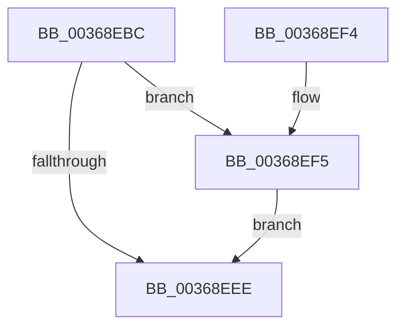

# MiHandleInPageError

- RVA: `0x00368EBC`–`0x00368F0F` (길이 `83` bytes)
- VA: `0x0000000140368EBC`
- 실행 섹션: `.text`
- PDB 이름 있음: `예`; PDB Function 태그: `아니요`
- unwind 정보 RVA: `0x0007A180`
- 디코드: `23`개 명령, `83/83` bytes 표시
- 미해석 바이트: `0` (있으면 어셈블리에 `.byte`로 보존)

> 이 문서는 커널 이미지의 기계어와 PDB 기호를 분석해 생성했습니다. 4번과 5번은 함수 원형과 자료형을 바이너리 사용 방식에서 추정한 C 해석이며 원본 소스 복구 결과는 아닙니다.

## 1. Dependencies

- 직접 호출 지점: **1**; 고유 호출 대상: **1**
- 직접 호출자로 확인된 함수: **2**
- RIP 상대 이미지 참조: **0**

### Outgoing calls
- `0x00368ECA` → [MiRestoreTransitionPte](../33/MiRestoreTransitionPte_function_0033DD90.md) (function, `0x0033DD90`)

### Direct callers
- [MiHardFaultPageRelease](../2B/MiHardFaultPageRelease_function_002B5728.md) at `0x002B5803`
- [MiCopyFileOnlyGlobalSubsectionPage](MiCopyFileOnlyGlobalSubsectionPage_function_0036A9EC.md) at `0x0036ADE1`

### Static image references
- 디코드된 RIP-relative 메모리 참조가 없습니다.

## 2. Other-region calls and transfers

- 다른 실행 섹션으로 향하는 call: **0**
- 별도 외부 분기/꼬리 이동을 확인하지 못했습니다.

## 3. Assembly (complete function range)

```asm
00368EBC  40 53                           push rbx
00368EBE  48 83 EC 20                     sub rsp, 0x20
00368EC2  BA 01 00 00 00                  mov edx, 1
00368EC7  48 8B D9                        mov rbx, rcx
00368ECA  E8 C1 4E FD FF                  call 0x14033dd90
00368ECF  48 8B 43 18                     mov rax, qword ptr [rbx + 0x18]
00368ED3  48 B9 00 00 00 00 00 00 00 40   movabs rcx, 0x4000000000000000
00368EDD  48 0B C1                        or rax, rcx
00368EE0  48 89 43 18                     mov qword ptr [rbx + 0x18], rax
00368EE4  8B 43 10                        mov eax, dword ptr [rbx + 0x10]
00368EE7  48 0F BA E0 0A                  bt rax, 0xa
00368EEC  73 07                           jae 0x140368ef5
00368EEE  48 83 C4 20                     add rsp, 0x20
00368EF2  5B                              pop rbx
00368EF3  C3                              ret
00368EF4  CC                              int3
00368EF5  48 8B 43 10                     mov rax, qword ptr [rbx + 0x10]
00368EF9  48 83 E0 FB                     and rax, 0xfffffffffffffffb
00368EFD  48 89 43 10                     mov qword ptr [rbx + 0x10], rax
00368F01  48 8B 43 10                     mov rax, qword ptr [rbx + 0x10]
00368F05  48 83 E0 FD                     and rax, 0xfffffffffffffffd
00368F09  48 89 43 10                     mov qword ptr [rbx + 0x10], rax
00368F0D  EB DF                           jmp 0x140368eee
```

## 4. C-style interpretation (structured pseudocode)

```c
__int64 __fastcall MiHandleInPageError(__int64 a1)
{
    __int64 result;
    __int64 v_rsp;

    v_rsp = (v_rsp) - (32);
    result = MiRestoreTransitionPte(a1, 1, a3, a4);
    result = (*(unsigned __int64 *)(a1 + 24)) | (a1);
    *(unsigned __int64 *)(a1 + 24) = result;
    if (condition_is_above_or_equal) goto loc_00368EF5;
loc_00368EEE:
    v_rsp = (v_rsp) + (32);
    return (unsigned int)(*(unsigned int *)(a1 + 16));
loc_00368EF5:
    result = (*(unsigned __int64 *)(a1 + 16)) & (-5);
    *(unsigned __int64 *)(a1 + 16) = result;
    result = (*(unsigned __int64 *)(a1 + 16)) & (-3);
    *(unsigned __int64 *)(a1 + 16) = result;
    goto loc_00368EEE;
}
```

## 5. (Beta) C Style

```c
int64_t MiHandleInPageError(void *Arg1)
{
    uint8_t *arg1 = (uint8_t *)Arg1;

    int64_t result;
    int64_t local_rsp;

    local_rsp = (local_rsp) - (32);
    result = MiRestoreTransitionPte(Arg1, 1, a3, a4);
    result = (*(uint64_t *)(arg1 + 0x18)) | (Arg1);
    *(uint64_t *)(arg1 + 0x18) = result;
    if (condition_is_above_or_equal) goto loc_00368EF5;
loc_00368EEE:
    local_rsp = (local_rsp) + (32);
    return (uint32_t)(*(uint32_t *)(arg1 + 0x10));
loc_00368EF5:
    result = (*(uint64_t *)(arg1 + 0x10)) & (-5);
    *(uint64_t *)(arg1 + 0x10) = result;
    result = (*(uint64_t *)(arg1 + 0x10)) & (-3);
    *(uint64_t *)(arg1 + 0x10) = result;
    goto loc_00368EEE;
}
```

### 관측된 메모리 오프셋

구조체 형식이 확인되지 않은 접근은 인자 기준의 오프셋으로만 기록했습니다.

| 기준 인자 | 오프셋 표현 | 폭 (bit) | 접근 |
|---|---:|---:|---|
| `Arg1` | `+ 0x10` | `32` | `R` |
| `Arg1` | `+ 0x10` | `64` | `R` |
| `Arg1` | `+ 0x10` | `64` | `W` |
| `Arg1` | `+ 0x18` | `64` | `R` |
| `Arg1` | `+ 0x18` | `64` | `W` |

## 6. Execution-region graph

[열기: 2D/3D 그래프와 함수 탐색 컨트롤 패널](../../../control-panel.html?section=text&rva=0x00368EBC&view=graph)

- 2D 그래프는 위에서 아래로 흐르고, 3D 그래프는 빈 공간을 드래그해 회전합니다. Shift+드래그는 이동, 휠은 확대·축소, 함수 노드 선택은 대상 보고서 이동입니다.

### Static fallback


