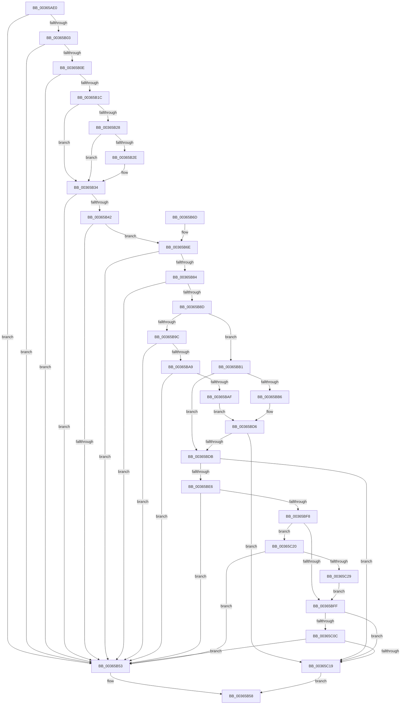

# MiImagePageOk

- RVA: `0x00365AE0`–`0x00365C2B` (길이 `331` bytes)
- VA: `0x0000000140365AE0`
- 실행 섹션: `.text`
- PDB 이름 있음: `예`; PDB Function 태그: `아니요`
- unwind 정보 RVA: `0x00079F64`
- 디코드: `93`개 명령, `331/331` bytes 표시
- 미해석 바이트: `0` (있으면 어셈블리에 `.byte`로 보존)

> 이 문서는 커널 이미지의 기계어와 PDB 기호를 분석해 생성했습니다. 4번과 5번은 함수 원형과 자료형을 바이너리 사용 방식에서 추정한 C 해석이며 원본 소스 복구 결과는 아닙니다.

## 1. Dependencies

- 직접 호출 지점: **3**; 고유 호출 대상: **3**
- 직접 호출자로 확인된 함수: **2**
- RIP 상대 이미지 참조: **2**

### Outgoing calls
- `0x00365BBA` → [MiLockVadTree](../27/MiLockVadTree_function_0027C0F0.md) (function, `0x0027C0F0`)
- `0x00365BC2` → [MiLocateAddress](../31/MiLocateAddress_function_003168D0.md) (function, `0x003168D0`)
- `0x00365BD1` → [MiUnlockVadTree](../29/MiUnlockVadTree_function_00297020.md) (function, `0x00297020`)

### Direct callers
- [MiSoftFaultMappedView](MiSoftFaultMappedView_function_00365364.md) at `0x0036557D`
- [MiWaitForCollidedFaultComplete](MiWaitForCollidedFaultComplete_function_00369EDC.md) at `0x0036A0FB`

### Static image references
- `0x00365B1C` → RVA `0x00E2DC80` (`.data`; read)
- `0x00365B9C` → RVA `0x00FC6A88` (`ALMOSTRO`; read)

## 2. Other-region calls and transfers

- 다른 실행 섹션으로 향하는 call: **0**
- 별도 외부 분기/꼬리 이동을 확인하지 못했습니다.

## 3. Assembly (complete function range)

```asm
00365AE0  48 89 5C 24 08                  mov qword ptr [rsp + 8], rbx
00365AE5  48 89 6C 24 10                  mov qword ptr [rsp + 0x10], rbp
00365AEA  48 89 74 24 18                  mov qword ptr [rsp + 0x18], rsi
00365AEF  57                              push rdi
00365AF0  48 83 EC 20                     sub rsp, 0x20
00365AF4  48 8B 42 28                     mov rax, qword ptr [rdx + 0x28]
00365AF8  49 8B F1                        mov rsi, r9
00365AFB  48 8B E9                        mov rbp, rcx
00365AFE  48 85 C0                        test rax, rax
00365B01  79 50                           jns 0x140365b53
00365B03  48 8B 7A 10                     mov rdi, qword ptr [rdx + 0x10]
00365B07  48 0F BA E7 0A                  bt rdi, 0xa
00365B0C  73 45                           jae 0x140365b53
00365B0E  48 8B 42 28                     mov rax, qword ptr [rdx + 0x28]
00365B12  48 C1 E8 3C                     shr rax, 0x3c
00365B16  24 07                           and al, 7
00365B18  3C 03                           cmp al, 3
00365B1A  74 37                           je 0x140365b53
00365B1C  48 8B 05 5D 81 AC 00            mov rax, qword ptr [rip + 0xac815d]
00365B23  48 85 C0                        test rax, rax
00365B26  74 0C                           je 0x140365b34
00365B28  40 F6 C7 10                     test dil, 0x10
00365B2C  75 06                           jne 0x140365b34
00365B2E  48 F7 D0                        not rax
00365B31  48 23 F8                        and rdi, rax
00365B34  48 C1 FF 10                     sar rdi, 0x10
00365B38  48 8B 1F                        mov rbx, qword ptr [rdi]
00365B3B  8B 43 38                        mov eax, dword ptr [rbx + 0x38]
00365B3E  A8 20                           test al, 0x20
00365B40  74 11                           je 0x140365b53
00365B42  48 8B 5B 60                     mov rbx, qword ptr [rbx + 0x60]
00365B46  48 83 E3 F8                     and rbx, 0xfffffffffffffff8
00365B4A  48 8B 5B 28                     mov rbx, qword ptr [rbx + 0x28]
00365B4E  48 85 DB                        test rbx, rbx
00365B51  75 1B                           jne 0x140365b6e
00365B53  B8 01 00 00 00                  mov eax, 1
00365B58  48 8B 5C 24 30                  mov rbx, qword ptr [rsp + 0x30]
00365B5D  48 8B 6C 24 38                  mov rbp, qword ptr [rsp + 0x38]
00365B62  48 8B 74 24 40                  mov rsi, qword ptr [rsp + 0x40]
00365B67  48 83 C4 20                     add rsp, 0x20
00365B6B  5F                              pop rdi
00365B6C  C3                              ret
00365B6D  CC                              int3
00365B6E  48 8B C3                        mov rax, rbx
00365B71  48 B9 F8 FF FF FF FF FF FF 7F   movabs rcx, 0x7ffffffffffffff8
00365B7B  48 83 E0 F8                     and rax, 0xfffffffffffffff8
00365B7F  48 3B C1                        cmp rax, rcx
00365B82  76 CF                           jbe 0x140365b53
00365B84  0F B6 C3                        movzx eax, bl
00365B87  24 03                           and al, 3
00365B89  3C 02                           cmp al, 2
00365B8B  74 C6                           je 0x140365b53
00365B8D  48 B8 00 00 00 00 00 80 FF FF   movabs rax, 0xffff800000000000
00365B97  48 3B E8                        cmp rbp, rax
00365B9A  72 15                           jb 0x140365bb1
00365B9C  48 F7 05 E1 0E C6 00 00 80 00 00  test qword ptr [rip + 0xc60ee1], 0x8000
00365BA7  74 AA                           je 0x140365b53
00365BA9  F6 42 10 40                     test byte ptr [rdx + 0x10], 0x40
00365BAD  74 A4                           je 0x140365b53
00365BAF  EB 25                           jmp 0x140365bd6
00365BB1  4D 85 C9                        test r9, r9
00365BB4  75 25                           jne 0x140365bdb
00365BB6  41 8D 49 01                     lea ecx, [r9 + 1]
00365BBA  E8 31 65 F1 FF                  call 0x14027c0f0
00365BBF  48 8B CD                        mov rcx, rbp
00365BC2  E8 09 0D FB FF                  call 0x1403168d0
00365BC7  B2 11                           mov dl, 0x11
00365BC9  B9 01 00 00 00                  mov ecx, 1
00365BCE  48 8B F0                        mov rsi, rax
00365BD1  E8 4A 14 F3 FF                  call 0x140297020
00365BD6  48 85 F6                        test rsi, rsi
00365BD9  74 3E                           je 0x140365c19
00365BDB  8B 4E 30                        mov ecx, dword ptr [rsi + 0x30]
00365BDE  8B C1                           mov eax, ecx
00365BE0  24 70                           and al, 0x70
00365BE2  3C 20                           cmp al, 0x20
00365BE4  75 33                           jne 0x140365c19
00365BE6  81 E1 80 0F 00 00               and ecx, 0xf80
00365BEC  81 F9 80 00 00 00               cmp ecx, 0x80
00365BF2  0F 84 5B FF FF FF               je 0x140365b53
00365BF8  8B 46 40                        mov eax, dword ptr [rsi + 0x40]
00365BFB  A8 08                           test al, 8
00365BFD  75 21                           jne 0x140365c20
00365BFF  48 F7 05 7E 0E C6 00 00 04 00 00  test qword ptr [rip + 0xc60e7e], 0x400
00365C0A  74 0D                           je 0x140365c19
00365C0C  8B 47 20                        mov eax, dword ptr [rdi + 0x20]
00365C0F  0F BA E0 11                     bt eax, 0x11
00365C13  0F 82 3A FF FF FF               jb 0x140365b53
00365C19  33 C0                           xor eax, eax
00365C1B  E9 38 FF FF FF                  jmp 0x140365b58
00365C20  F6 C3 04                        test bl, 4
00365C23  0F 84 2A FF FF FF               je 0x140365b53
00365C29  EB D4                           jmp 0x140365bff
```

## 4. C-style interpretation (structured pseudocode)

```c
__int64 __fastcall MiImagePageOk(__int64 a1, __int64 a2, __int64 a3, __int64 a4)
{
    __int64 result;
    __int64 v_rbx;
    __int64 v_rdi;
    __int64 v_rsp;
    unsigned __int64 v_stack_p10;
    unsigned __int64 v_stack_p18;
    unsigned __int64 v_stack_p8;

    v_stack_p8 = v_rbx;
    v_stack_p10 = v_rbp;
    v_stack_p18 = v_rsi;
    v_rsp = (v_rsp) - (32);
    if (!sign_flag) goto loc_00365B53;
    if (condition_is_above_or_equal) goto loc_00365B53;
    result = (*(unsigned __int64 *)(a2 + 40)) >> (60);
    result = (unsigned __int8)((result) & (7));
    if (((unsigned __int8)(result)) == 3) goto loc_00365B53;
    if (*(unsigned __int64 *)(v_rip + 11305309) == 0) goto loc_00365B34;
    result = *(unsigned __int64 *)(v_rip + 11305309);
    v_rdi = *(unsigned __int64 *)(a2 + 16);
    if ((((unsigned __int8)(*(unsigned __int64 *)(a2 + 16))) & (16)) == 0) {
        result = ~(*(unsigned __int64 *)(v_rip + 11305309));
        v_rdi = (*(unsigned __int64 *)(a2 + 16)) & (result);
    }
    v_rdi = (v_rdi) >> (16);
    if ((((unsigned __int8)((unsigned int)(*(unsigned int *)(*(unsigned __int64 *)(v_rdi) + 56)))) & (32)) == 0) goto loc_00365B53;
    v_rbx = (*(unsigned __int64 *)(*(unsigned __int64 *)(v_rdi) + 96)) & (-8);
    if (*(unsigned __int64 *)(v_rbx + 40) != 0) goto loc_00365B6E;
loc_00365B53:
loc_00365B58:
    v_rsp = (v_rsp) + (32);
    return 1;
loc_00365B6E:
    result = (v_stack_p8) & (-8);
    if (result <= a1) goto loc_00365B53;
    result = (unsigned __int8)(((unsigned __int8)(v_stack_p8)) & (3));
    if (((unsigned __int8)(result)) == 2) goto loc_00365B53;
    if (v_stack_p10 < result) goto loc_00365BB1;
    if (((*(unsigned __int64 *)(v_rip + 12979937)) & (0x8000ULL)) == 0) goto loc_00365B53;
    if (((*(unsigned __int8 *)(a2 + 16)) & (64)) == 0) goto loc_00365B53;
    goto loc_00365BD6;
loc_00365BB1:
    if (a4 != 0) goto loc_00365BDB;
    result = MiLockVadTree(a4 + 1, a2, a3, a4);
    result = MiLocateAddress(v_stack_p10, a2, a3, a4);
    result = MiUnlockVadTree(1, 17, a3, a4);
loc_00365BD6:
    if (result == 0) goto loc_00365C19;
loc_00365BDB:
    result = (unsigned __int8)(((unsigned int)((unsigned int)((unsigned int)(*(unsigned int *)(result + 48))))) & (112));
    if (((unsigned __int8)(result)) != 32) goto loc_00365C19;
    a1 = (unsigned int)(((unsigned int)(*(unsigned int *)(result + 48))) & (0xF80ULL));
    if (((unsigned int)(a1)) == 128) goto loc_00365B53;
    if ((((unsigned __int8)((unsigned int)(*(unsigned int *)(result + 64)))) & (8)) != 0) goto loc_00365C20;
loc_00365BFF:
    if (((*(unsigned __int64 *)(v_rip + 12979838)) & (0x400ULL)) == 0) goto loc_00365C19;
    if (condition_is_below) goto loc_00365B53;
loc_00365C19:
    result = 0;
    goto loc_00365B58;
loc_00365C20:
    if ((((unsigned __int8)(v_stack_p8)) & (4)) == 0) goto loc_00365B53;
    goto loc_00365BFF;
}
```

## 5. (Beta) C Style

```c
int64_t MiImagePageOk(int64_t Arg1, void *Arg2, int64_t Arg3, int64_t Arg4)
{
    uint8_t *arg2 = (uint8_t *)Arg2;

    int64_t result;
    int64_t local_rbx;
    int64_t local_rdi;
    int64_t local_rsp;
    uint64_t v_stack_p10;
    uint64_t v_stack_p18;
    uint64_t v_stack_p8;

    v_stack_p8 = local_rbx;
    v_stack_p10 = local_rbp;
    v_stack_p18 = local_rsi;
    local_rsp = (local_rsp) - (32);
    if (!sign_flag) goto loc_00365B53;
    if (condition_is_above_or_equal) goto loc_00365B53;
    result = (*(uint64_t *)(arg2 + 0x28)) >> (60);
    result = (uint8_t)((result) & (7));
    if (((uint8_t)(result)) == 3) goto loc_00365B53;
    if (*(uint64_t *)(v_rip + 0xAC815D) == 0) goto loc_00365B34;
    result = *(uint64_t *)(v_rip + 0xAC815D);
    local_rdi = *(uint64_t *)(arg2 + 0x10);
    if ((((uint8_t)(*(uint64_t *)(arg2 + 0x10))) & (16)) == 0) {
        result = ~(*(uint64_t *)(v_rip + 0xAC815D));
        local_rdi = (*(uint64_t *)(arg2 + 0x10)) & (result);
    }
    local_rdi = (local_rdi) >> (16);
    if ((((uint8_t)((uint32_t)(*(uint32_t *)(*(uint64_t *)(local_rdi) + 0x38)))) & (32)) == 0) goto loc_00365B53;
    local_rbx = (*(uint64_t *)(*(uint64_t *)(local_rdi) + 0x60)) & (-8);
    if (*(uint64_t *)(local_rbx + 0x28) != 0) goto loc_00365B6E;
loc_00365B53:
loc_00365B58:
    local_rsp = (local_rsp) + (32);
    return 1;
loc_00365B6E:
    result = (v_stack_p8) & (-8);
    if (result <= Arg1) goto loc_00365B53;
    result = (uint8_t)(((uint8_t)(v_stack_p8)) & (3));
    if (((uint8_t)(result)) == 2) goto loc_00365B53;
    if (v_stack_p10 < result) goto loc_00365BB1;
    if (((*(uint64_t *)(v_rip + 0xC60EE1)) & (0x8000ULL)) == 0) goto loc_00365B53;
    if (((*(uint8_t *)(arg2 + 0x10)) & (64)) == 0) goto loc_00365B53;
    goto loc_00365BD6;
loc_00365BB1:
    if (Arg4 != 0) goto loc_00365BDB;
    result = MiLockVadTree(Arg4 + 1, Arg2, Arg3, Arg4);
    result = MiLocateAddress(v_stack_p10, Arg2, Arg3, Arg4);
    result = MiUnlockVadTree(1, 17, Arg3, Arg4);
loc_00365BD6:
    if (result == 0) goto loc_00365C19;
loc_00365BDB:
    result = (uint8_t)(((uint32_t)((uint32_t)((uint32_t)(*(uint32_t *)(result + 0x30))))) & (112));
    if (((uint8_t)(result)) != 32) goto loc_00365C19;
    Arg1 = (uint32_t)(((uint32_t)(*(uint32_t *)(result + 0x30))) & (0xF80ULL));
    if (((uint32_t)(Arg1)) == 128) goto loc_00365B53;
    if ((((uint8_t)((uint32_t)(*(uint32_t *)(result + 0x40)))) & (8)) != 0) goto loc_00365C20;
loc_00365BFF:
    if (((*(uint64_t *)(v_rip + 0xC60E7E)) & (0x400ULL)) == 0) goto loc_00365C19;
    if (condition_is_below) goto loc_00365B53;
loc_00365C19:
    result = 0;
    goto loc_00365B58;
loc_00365C20:
    if ((((uint8_t)(v_stack_p8)) & (4)) == 0) goto loc_00365B53;
    goto loc_00365BFF;
}
```

### 관측된 메모리 오프셋

구조체 형식이 확인되지 않은 접근은 인자 기준의 오프셋으로만 기록했습니다.

| 기준 인자 | 오프셋 표현 | 폭 (bit) | 접근 |
|---|---:|---:|---|
| `Arg2` | `+ 0x10` | `8` | `R` |
| `Arg2` | `+ 0x10` | `64` | `R` |
| `Arg2` | `+ 0x28` | `64` | `R` |

## 6. Execution-region graph

[열기: 2D/3D 그래프와 함수 탐색 컨트롤 패널](../../../control-panel.html?section=text&rva=0x00365AE0&view=graph)

- 2D 그래프는 위에서 아래로 흐르고, 3D 그래프는 빈 공간을 드래그해 회전합니다. Shift+드래그는 이동, 휠은 확대·축소, 함수 노드 선택은 대상 보고서 이동입니다.

### Static fallback


