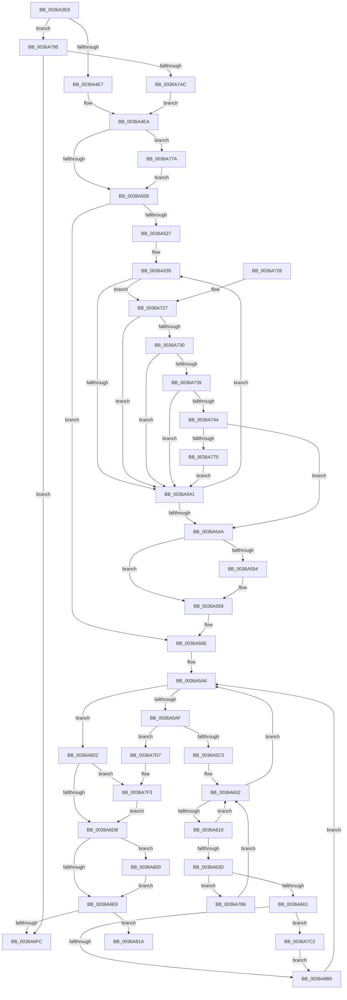

# MiInPageSingleKernelStack

- RVA: `0x0036A3E8`–`0x0036A843` (길이 `1,115` bytes)
- VA: `0x000000014036A3E8`
- 실행 섹션: `.text`
- PDB 이름 있음: `예`; PDB Function 태그: `아니요`
- unwind 정보 RVA: `0x0007A2A0`
- 디코드: `261`개 명령, `1,115/1,115` bytes 표시
- 미해석 바이트: `0` (있으면 어셈블리에 `.byte`로 보존)

> 이 문서는 커널 이미지의 기계어와 PDB 기호를 분석해 생성했습니다. 4번과 5번은 함수 원형과 자료형을 바이너리 사용 방식에서 추정한 C 해석이며 원본 소스 복구 결과는 아닙니다.

## 1. Dependencies

- 직접 호출 지점: **20**; 고유 호출 대상: **16**
- 직접 호출자로 확인된 함수: **1**
- RIP 상대 이미지 참조: **5**

### Outgoing calls
- `0x0036A433` → [memset](../6C/memset_function_006C6C40.md) (function, `0x006C6C40`)
- `0x0036A4F2` → [MiMakeDemandZeroPte](../33/MiMakeDemandZeroPte_function_00337A00.md) (function, `0x00337A00`)
- `0x0036A50D` → [MiMakeDemandZeroPte](../33/MiMakeDemandZeroPte_function_00337A00.md) (function, `0x00337A00`)
- `0x0036A51A` → [MiMakeDemandZeroPte](../33/MiMakeDemandZeroPte_function_00337A00.md) (function, `0x00337A00`)
- `0x0036A564` → [MiPrefetchVirtualMemory](MiPrefetchVirtualMemory_function_0036C560.md) (function, `0x0036C560`)
- `0x0036A5FD` → [MmAccessFault](../27/MmAccessFault_function_0027EE80.md) (function, `0x0027EE80`)
- `0x0036A630` → [MiSafeLockPage](../32/MiSafeLockPage_function_00321620.md) (function, `0x00321620`)
- `0x0036A666` → [MiSetPfnKernelStack](../2A/MiSetPfnKernelStack_function_002A2300.md) (function, `0x002A2300`)
- `0x0036A670` → [MiSetPfnIdentity](../2A/MiSetPfnIdentity_function_002A2350.md) (function, `0x002A2350`)
- `0x0036A693` → [MiReleaseWsSwapReservationPfn](MiReleaseWsSwapReservationPfn_function_003628DC.md) (function, `0x003628DC`)
- `0x0036A6A2` → [MiUnlockPage](../31/MiUnlockPage_function_0031A3E0.md) (function, `0x0031A3E0`)
- `0x0036A706` → [_security_check_cookie](../6A/_security_check_cookie_function_006AC640.md) (function, `0x006AC640`)
- `0x0036A79B` → [MiKernelStackVaToStackNode](../34/MiKernelStackVaToStackNode_function_00348A4C.md) (function, `0x00348A4C`)
- `0x0036A7B8` → [MiUnlockPage](../31/MiUnlockPage_function_0031A3E0.md) (function, `0x0031A3E0`)
- `0x0036A7CD` → [MiReleasePageFileInfo](../28/MiReleasePageFileInfo_function_00283FD0.md) (function, `0x00283FD0`)
- `0x0036A7ED` → [KeBugCheckEx](../4F/KeBugCheckEx_function_004FD660.md) (function, `0x004FD660`)
- `0x0036A7F6` → [MiDeleteKernelStackNode](../67/MiDeleteKernelStackNode_function_0067B1B0.md) (function, `0x0067B1B0`)
- `0x0036A810` → [MiLogKernelStackEvent](../4D/MiLogKernelStackEvent_function_004D6848.md) (function, `0x004D6848`)
- `0x0036A81F` → [MiFlushAllFilesystemPages](../4E/MiFlushAllFilesystemPages_function_004E141C.md) (function, `0x004E141C`)
- `0x0036A83D` → [KeBugCheckEx](../4F/KeBugCheckEx_function_004FD660.md) (function, `0x004FD660`)

### Direct callers
- [MmInPageKernelStack](MmInPageKernelStack_function_0036A2E4.md) at `0x0036A350`
- [MmInPageKernelStack](MmInPageKernelStack_function_0036A2E4.md) at `0x0036A3DB`

### Static image references
- `0x0036A407` → RVA `0x00E0A740` (`.data`; read)
- `0x0036A43F` → RVA `0x00FC8C40` (`ALMOSTRO`; read)
- `0x0036A4C7` → RVA `0x00E30088` (`.data`; read)
- `0x0036A4D2` → RVA `0x00E38D00` (`.data`; read)
- `0x0036A6DB` → RVA `0x00FC6B04` (`ALMOSTRO`; read)

## 2. Other-region calls and transfers

- 다른 실행 섹션으로 향하는 call: **0**
- 별도 외부 분기/꼬리 이동을 확인하지 못했습니다.

## 3. Assembly (complete function range)

```asm
0036A3E8  48 89 5C 24 18                  mov qword ptr [rsp + 0x18], rbx
0036A3ED  55                              push rbp
0036A3EE  56                              push rsi
0036A3EF  57                              push rdi
0036A3F0  41 54                           push r12
0036A3F2  41 55                           push r13
0036A3F4  41 56                           push r14
0036A3F6  41 57                           push r15
0036A3F8  48 8D AC 24 C0 FD FF FF         lea rbp, [rsp - 0x240]
0036A400  48 81 EC 40 03 00 00            sub rsp, 0x340
0036A407  48 8B 05 32 03 AA 00            mov rax, qword ptr [rip + 0xaa0332]
0036A40E  48 33 C4                        xor rax, rsp
0036A411  48 89 85 30 02 00 00            mov qword ptr [rbp + 0x230], rax
0036A418  48 8B DA                        mov rbx, rdx
0036A41B  48 89 54 24 60                  mov qword ptr [rsp + 0x60], rdx
0036A420  33 D2                           xor edx, edx
0036A422  48 89 4C 24 38                  mov qword ptr [rsp + 0x38], rcx
0036A427  4C 8B F9                        mov r15, rcx
0036A42A  48 8D 4C 24 70                  lea rcx, [rsp + 0x70]
0036A42F  44 8D 42 78                     lea r8d, [rdx + 0x78]
0036A433  E8 08 C8 35 00                  call 0x1406c6c40
0036A438  41 8B 87 4C 02 00 00            mov eax, dword ptr [r15 + 0x24c]
0036A43F  48 8D 0D FA E7 C5 00            lea rcx, [rip + 0xc5e7fa]
0036A446  4C 8B 4B 08                     mov r9, qword ptr [rbx + 8]
0036A44A  41 BD 01 00 00 00               mov r13d, 1
0036A450  49 C1 E9 09                     shr r9, 9
0036A454  49 B8 00 00 00 00 80 F6 FF FF   movabs r8, 0xfffff68000000000
0036A45E  48 8B 04 C1                     mov rax, qword ptr [rcx + rax*8]
0036A462  48 8B 88 C0 00 00 00            mov rcx, qword ptr [rax + 0xc0]
0036A469  0F B7 B9 8A 00 00 00            movzx edi, word ptr [rcx + 0x8a]
0036A470  48 B9 F8 FF FF FF 7F 00 00 00   movabs rcx, 0x7ffffffff8
0036A47A  4C 23 C9                        and r9, rcx
0036A47D  41 03 FD                        add edi, r13d
0036A480  49 8B C0                        mov rax, r8
0036A483  48 8B 13                        mov rdx, qword ptr [rbx]
0036A486  4C 03 C8                        add r9, rax
0036A489  4C 89 4C 24 40                  mov qword ptr [rsp + 0x40], r9
0036A48E  4C 8D B2 00 F0 FF FF            lea r14, [rdx - 0x1000]
0036A495  49 C1 EE 09                     shr r14, 9
0036A499  4C 23 F1                        and r14, rcx
0036A49C  49 8B C0                        mov rax, r8
0036A49F  48 8B 73 10                     mov rsi, qword ptr [rbx + 0x10]
0036A4A3  4C 03 F0                        add r14, rax
0036A4A6  48 83 EE 08                     sub rsi, 8
0036A4AA  48 C1 EE 09                     shr rsi, 9
0036A4AE  48 23 F1                        and rsi, rcx
0036A4B1  49 8B C0                        mov rax, r8
0036A4B4  48 03 F0                        add rsi, rax
0036A4B7  33 DB                           xor ebx, ebx
0036A4B9  49 8B 87 20 02 00 00            mov rax, qword ptr [r15 + 0x220]
0036A4C0  0F B7 88 AE 04 00 00            movzx ecx, word ptr [rax + 0x4ae]
0036A4C7  48 8B 05 BA 5B AC 00            mov rax, qword ptr [rip + 0xac5bba]
0036A4CE  48 8B 04 C8                     mov rax, qword ptr [rax + rcx*8]
0036A4D2  48 8D 0D 27 E8 AC 00            lea rcx, [rip + 0xace827]
0036A4D9  48 89 44 24 58                  mov qword ptr [rsp + 0x58], rax
0036A4DE  48 3B C1                        cmp rax, rcx
0036A4E1  0F 85 AE 02 00 00               jne 0x14036a795
0036A4E7  45 33 E4                        xor r12d, r12d
0036A4EA  48 8B 16                        mov rdx, qword ptr [rsi]
0036A4ED  B9 04 00 00 00                  mov ecx, 4
0036A4F2  E8 09 D5 FC FF                  call 0x140337a00
0036A4F7  48 21 5C 24 50                  and qword ptr [rsp + 0x50], rbx
0036A4FC  4C 8B C0                        mov r8, rax
0036A4FF  48 3B D0                        cmp rdx, rax
0036A502  0F 85 72 02 00 00               jne 0x14036a77a
0036A508  B9 18 00 00 00                  mov ecx, 0x18
0036A50D  E8 EE D4 FC FF                  call 0x140337a00
0036A512  B9 1F 00 00 00                  mov ecx, 0x1f
0036A517  48 8B D0                        mov rdx, rax
0036A51A  E8 E1 D4 FC FF                  call 0x140337a00
0036A51F  4D 8B D1                        mov r10, r9
0036A522  4D 3B CE                        cmp r9, r14
0036A525  77 47                           ja 0x14036a56e
0036A527  4C 8D 5D F8                     lea r11, [rbp - 8]
0036A52B  49 BF 00 00 00 00 80 F6 FF FF   movabs r15, 0xfffff68000000000
0036A535  49 8B 0A                        mov rcx, qword ptr [r10]
0036A538  48 3B C8                        cmp rcx, rax
0036A53B  0F 85 E6 01 00 00               jne 0x14036a727
0036A541  49 83 C2 08                     add r10, 8
0036A545  4D 3B D6                        cmp r10, r14
0036A548  76 EB                           jbe 0x14036a535
0036A54A  4C 8B 7C 24 38                  mov r15, qword ptr [rsp + 0x38]
0036A54F  49 3B DD                        cmp rbx, r13
0036A552  76 15                           jbe 0x14036a569
0036A554  41 B9 2D 00 00 00               mov r9d, 0x2d
0036A55A  48 8D 55 F0                     lea rdx, [rbp - 0x10]
0036A55E  4D 8B C5                        mov r8, r13
0036A561  48 8B CB                        mov rcx, rbx
0036A564  E8 F7 1F 00 00                  call 0x14036c560
0036A569  4C 8B 4C 24 40                  mov r9, qword ptr [rsp + 0x40]
0036A56E  49 8B F6                        mov rsi, r14
0036A571  48 B8 00 00 00 00 80 F6 FF FF   movabs rax, 0xfffff68000000000
0036A57B  48 C1 E6 19                     shl rsi, 0x19
0036A57F  45 33 ED                        xor r13d, r13d
0036A582  48 8B C0                        mov rax, rax
0036A585  48 C1 E0 19                     shl rax, 0x19
0036A589  48 8D 4C 24 70                  lea rcx, [rsp + 0x70]
0036A58E  48 2B F0                        sub rsi, rax
0036A591  48 C7 45 F8 00 10 00 00         mov qword ptr [rbp - 8], 0x1000
0036A599  48 C1 FE 10                     sar rsi, 0x10
0036A59D  48 83 C9 01                     or rcx, 1
0036A5A1  48 89 4C 24 48                  mov qword ptr [rsp + 0x48], rcx
0036A5A6  4D 3B F1                        cmp r14, r9
0036A5A9  0F 82 23 01 00 00               jb 0x14036a6d2
0036A5AF  49 8B 06                        mov rax, qword ptr [r14]
0036A5B2  25 E0 03 00 00                  and eax, 0x3e0
0036A5B7  48 3D E0 03 00 00               cmp rax, 0x3e0
0036A5BD  0F 85 14 02 00 00               jne 0x14036a7d7
0036A5C3  48 83 65 88 00                  and qword ptr [rbp - 0x78], 0
0036A5C8  48 8D 45 F0                     lea rax, [rbp - 0x10]
0036A5CC  48 83 65 90 00                  and qword ptr [rbp - 0x70], 0
0036A5D1  45 33 C0                        xor r8d, r8d
0036A5D4  4C 8B C9                        mov r9, rcx
0036A5D7  48 89 75 F0                     mov qword ptr [rbp - 0x10], rsi
0036A5DB  48 8B D6                        mov rdx, rsi
0036A5DE  66 C7 44 24 70 04 00            mov word ptr [rsp + 0x70], 4
0036A5E5  48 89 44 24 78                  mov qword ptr [rsp + 0x78], rax
0036A5EA  41 8D 48 02                     lea ecx, [r8 + 2]
0036A5EE  48 C7 45 80 01 00 00 00         mov qword ptr [rbp - 0x80], 1
0036A5F6  4C 89 7D A0                     mov qword ptr [rbp - 0x60], r15
0036A5FA  89 7D 98                        mov dword ptr [rbp - 0x68], edi
0036A5FD  E8 7E 48 F1 FF                  call 0x14027ee80
0036A602  49 8B 1E                        mov rbx, qword ptr [r14]
0036A605  48 8B 4C 24 48                  mov rcx, qword ptr [rsp + 0x48]
0036A60A  4C 8B 7C 24 38                  mov r15, qword ptr [rsp + 0x38]
0036A60F  4C 8B 4C 24 40                  mov r9, qword ptr [rsp + 0x40]
0036A614  F6 C3 01                        test bl, 1
0036A617  74 8D                           je 0x14036a5a6
0036A619  48 B8 FF FF FF FF FF 00 00 00   movabs rax, 0xffffffffff
0036A623  4C 8B FB                        mov r15, rbx
0036A626  49 C1 EF 0C                     shr r15, 0xc
0036A62A  4C 23 F8                        and r15, rax
0036A62D  49 8B CF                        mov rcx, r15
0036A630  E8 EB 6F FB FF                  call 0x140321620
0036A635  88 44 24 30                     mov byte ptr [rsp + 0x30], al
0036A639  3C 11                           cmp al, 0x11
0036A63B  74 C5                           je 0x14036a602
0036A63D  4F 8D 3C 7F                     lea r15, [r15 + r15*2]
0036A641  49 C1 E7 04                     shl r15, 4
0036A645  48 B9 00 00 00 00 00 DE FF FF   movabs rcx, 0xffffde0000000000
0036A64F  49 8B 16                        mov rdx, qword ptr [r14]
0036A652  4C 03 F9                        add r15, rcx
0036A655  49 8B CF                        mov rcx, r15
0036A658  48 3B DA                        cmp rbx, rdx
0036A65B  0F 85 55 01 00 00               jne 0x14036a7b6
0036A661  48 8B 54 24 38                  mov rdx, qword ptr [rsp + 0x38]
0036A666  E8 95 7C F3 FF                  call 0x1402a2300
0036A66B  BA 02 00 00 00                  mov edx, 2
0036A670  E8 DB 7C F3 FF                  call 0x1402a2350
0036A675  41 8B 47 20                     mov eax, dword ptr [r15 + 0x20]
0036A679  49 8B CF                        mov rcx, r15
0036A67C  89 44 24 34                     mov dword ptr [rsp + 0x34], eax
0036A680  C1 E8 18                        shr eax, 0x18
0036A683  24 FD                           and al, 0xfd
0036A685  0C 05                           or al, 5
0036A687  88 44 24 37                     mov byte ptr [rsp + 0x37], al
0036A68B  8B 44 24 34                     mov eax, dword ptr [rsp + 0x34]
0036A68F  41 89 47 20                     mov dword ptr [r15 + 0x20], eax
0036A693  E8 44 82 FF FF                  call 0x1403628dc
0036A698  8A 54 24 30                     mov dl, byte ptr [rsp + 0x30]
0036A69C  49 8B CF                        mov rcx, r15
0036A69F  48 8B D8                        mov rbx, rax
0036A6A2  E8 39 FD FA FF                  call 0x14031a3e0
0036A6A7  48 85 DB                        test rbx, rbx
0036A6AA  0F 85 12 01 00 00               jne 0x14036a7c2
0036A6B0  48 8B 4C 24 48                  mov rcx, qword ptr [rsp + 0x48]
0036A6B5  49 83 EE 08                     sub r14, 8
0036A6B9  4C 8B 7C 24 38                  mov r15, qword ptr [rsp + 0x38]
0036A6BE  48 81 EE 00 10 00 00            sub rsi, 0x1000
0036A6C5  4C 8B 4C 24 40                  mov r9, qword ptr [rsp + 0x40]
0036A6CA  49 FF C5                        inc r13
0036A6CD  E9 D4 FE FF FF                  jmp 0x14036a5a6
0036A6D2  4D 85 E4                        test r12, r12
0036A6D5  0F 85 18 01 00 00               jne 0x14036a7f3
0036A6DB  8B 05 23 C4 C5 00               mov eax, dword ptr [rip + 0xc5c423]
0036A6E1  A8 01                           test al, 1
0036A6E3  0F 85 17 01 00 00               jne 0x14036a800
0036A6E9  48 8B 5C 24 60                  mov rbx, qword ptr [rsp + 0x60]
0036A6EE  48 8B 43 10                     mov rax, qword ptr [rbx + 0x10]
0036A6F2  4C 39 78 F8                     cmp qword ptr [rax - 8], r15
0036A6F6  0F 85 1E 01 00 00               jne 0x14036a81a
0036A6FC  48 8B 8D 30 02 00 00            mov rcx, qword ptr [rbp + 0x230]
0036A703  48 33 CC                        xor rcx, rsp
0036A706  E8 35 1F 34 00                  call 0x1406ac640
0036A70B  48 8B 9C 24 90 03 00 00         mov rbx, qword ptr [rsp + 0x390]
0036A713  48 81 C4 40 03 00 00            add rsp, 0x340
0036A71A  41 5F                           pop r15
0036A71C  41 5E                           pop r14
0036A71E  41 5D                           pop r13
0036A720  41 5C                           pop r12
0036A722  5F                              pop rdi
0036A723  5E                              pop rsi
0036A724  5D                              pop rbp
0036A725  C3                              ret
0036A726  CC                              int3
0036A727  49 3B C8                        cmp rcx, r8
0036A72A  0F 84 11 FE FF FF               je 0x14036a541
0036A730  48 3B CA                        cmp rcx, rdx
0036A733  0F 84 08 FE FF FF               je 0x14036a541
0036A739  48 0F BA E1 0B                  bt rcx, 0xb
0036A73E  0F 82 FD FD FF FF               jb 0x14036a541
0036A744  4D 8B CA                        mov r9, r10
0036A747  49 C1 E1 19                     shl r9, 0x19
0036A74B  49 8B CF                        mov rcx, r15
0036A74E  48 C1 E1 19                     shl rcx, 0x19
0036A752  49 03 DD                        add rbx, r13
0036A755  4C 2B C9                        sub r9, rcx
0036A758  49 C7 03 00 10 00 00            mov qword ptr [r11], 0x1000
0036A75F  49 C1 F9 10                     sar r9, 0x10
0036A763  4D 89 4B F8                     mov qword ptr [r11 - 8], r9
0036A767  49 83 C3 10                     add r11, 0x10
0036A76B  48 83 FB 24                     cmp rbx, 0x24
0036A76F  0F 84 D5 FD FF FF               je 0x14036a54a
0036A775  E9 C7 FD FF FF                  jmp 0x14036a541
0036A77A  45 33 FF                        xor r15d, r15d
0036A77D  48 0F BA E2 0B                  bt rdx, 0xb
0036A782  4D 0F 43 FD                     cmovae r15, r13
0036A786  4C 89 7C 24 50                  mov qword ptr [rsp + 0x50], r15
0036A78B  4C 8B 7C 24 38                  mov r15, qword ptr [rsp + 0x38]
0036A790  E9 73 FD FF FF                  jmp 0x14036a508
0036A795  48 8D 4A FF                     lea rcx, [rdx - 1]
0036A799  33 D2                           xor edx, edx
0036A79B  E8 AC E2 FD FF                  call 0x140348a4c
0036A7A0  4C 8B E0                        mov r12, rax
0036A7A3  48 85 C0                        test rax, rax
0036A7A6  0F 84 50 FF FF FF               je 0x14036a6fc
0036A7AC  4C 8B 4C 24 40                  mov r9, qword ptr [rsp + 0x40]
0036A7B1  E9 34 FD FF FF                  jmp 0x14036a4ea
0036A7B6  8A D0                           mov dl, al
0036A7B8  E8 23 FC FA FF                  call 0x14031a3e0
0036A7BD  E9 40 FE FF FF                  jmp 0x14036a602
0036A7C2  48 8B 4C 24 58                  mov rcx, qword ptr [rsp + 0x58]
0036A7C7  45 33 C0                        xor r8d, r8d
0036A7CA  48 8B D3                        mov rdx, rbx
0036A7CD  E8 FE 97 F1 FF                  call 0x140283fd0
0036A7D2  E9 D9 FE FF FF                  jmp 0x14036a6b0
0036A7D7  48 83 64 24 20 00               and qword ptr [rsp + 0x20], 0
0036A7DD  4D 8B CF                        mov r9, r15
0036A7E0  4D 8B C6                        mov r8, r14
0036A7E3  BA 51 34 00 00                  mov edx, 0x3451
0036A7E8  B9 1A 00 00 00                  mov ecx, 0x1a
0036A7ED  E8 6E 2E 19 00                  call 0x1404fd660
0036A7F2  CC                              int3
0036A7F3  49 8B CC                        mov rcx, r12
0036A7F6  E8 B5 09 31 00                  call 0x14067b1b0
0036A7FB  E9 DB FE FF FF                  jmp 0x14036a6db
0036A800  48 8D 8E 00 10 00 00            lea rcx, [rsi + 0x1000]
0036A807  41 B8 01 00 00 00               mov r8d, 1
0036A80D  49 8B D5                        mov rdx, r13
0036A810  E8 33 C0 16 00                  call 0x1404d6848
0036A815  E9 CF FE FF FF                  jmp 0x14036a6e9
0036A81A  B9 01 00 00 00                  mov ecx, 1
0036A81F  E8 F8 6B 17 00                  call 0x1404e141c
0036A824  4C 8B 43 10                     mov r8, qword ptr [rbx + 0x10]
0036A828  45 33 C9                        xor r9d, r9d
0036A82B  48 8B 54 24 50                  mov rdx, qword ptr [rsp + 0x50]
0036A830  4C 89 44 24 20                  mov qword ptr [rsp + 0x20], r8
0036A835  4D 8B 40 F8                     mov r8, qword ptr [r8 - 8]
0036A839  41 8D 49 77                     lea ecx, [r9 + 0x77]
0036A83D  E8 1E 2E 19 00                  call 0x1404fd660
0036A842  CC                              int3
```

## 4. C-style interpretation (structured pseudocode)

```c
__int64 __fastcall MiInPageSingleKernelStack(__int64 a1, __int64 a2)
{
    __int64 result;
    __int64 v_r10;
    __int64 v_r11;
    __int64 v_r12;
    __int64 v_r13;
    __int64 v_r14;
    __int64 v_r15;
    __int64 v_rbx;
    __int64 v_rdi;
    __int64 v_rsi;
    __int64 v_rsp;
    unsigned __int64 v_stack_m278;
    unsigned __int64 v_stack_m280;
    unsigned __int64 v_stack_m288;
    unsigned __int64 v_stack_m2D8;
    unsigned int v_stack_m2E0;
    unsigned __int64 v_stack_m2E8;
    unsigned __int64 v_stack_m2F0;
    unsigned __int64 v_stack_m2F8;
    unsigned __int64 v_stack_m300;
    unsigned __int64 v_stack_m308;
    unsigned __int64 v_stack_m318;
    unsigned __int64 v_stack_m320;
    unsigned __int64 v_stack_m328;
    unsigned __int64 v_stack_m330;
    unsigned __int64 v_stack_m338;
    unsigned __int64 v_stack_m340;
    unsigned __int8 v_stack_m341;
    unsigned int v_stack_m344;
    unsigned __int8 v_stack_m348;
    unsigned __int64 v_stack_m48;
    unsigned __int64 v_stack_p18;
    unsigned __int64 v_stack_p20;
    unsigned __int64 v_stack_p38;
    unsigned __int64 v_stack_p40;
    unsigned __int64 v_stack_p50;
    unsigned __int64 v_stack_p58;

    v_stack_p18 = v_rbx;
    v_rsp = (v_rsp) - (832);
    result = (*(unsigned __int64 *)(v_rip + 11141938)) ^ (v_rsp);
    v_stack_m48 = result;
    v_stack_m318 = a2;
    a2 = 0;
    v_stack_m340 = a1;
    result = memset(v_stack_m308, a2, a2 + 120, a4);
    a4 = (*(unsigned __int64 *)(a2 + 8)) >> (9);
    a4 = (a4) & (*(unsigned __int64 *)(*(unsigned __int64 *)(v_rip + 12969978 + (unsigned int)(*(unsigned int *)(a1 + 588)) * 8) + 192));
    v_rdi = (unsigned int)((*(unsigned __int16 *)(*(unsigned __int64 *)(*(unsigned __int64 *)(v_rip + 12969978 + (unsigned int)(*(unsigned int *)(a1 + 588)) * 8) + 192) + 138)) + (1));
    a4 = (a4) + (a2 + 120);
    v_stack_m338 = a4;
    v_r14 = (*(unsigned __int64 *)(a2) - 4096) >> (9);
    v_r14 = (v_r14) & (*(unsigned __int64 *)(*(unsigned __int64 *)(v_rip + 12969978 + (unsigned int)(*(unsigned int *)(a1 + 588)) * 8) + 192));
    v_r14 = (v_r14) + (a2 + 120);
    v_rsi = (*(unsigned __int64 *)(a2 + 16)) - (8);
    v_rsi = (v_rsi) >> (9);
    v_rsi = (v_rsi) & (*(unsigned __int64 *)(*(unsigned __int64 *)(v_rip + 12969978 + (unsigned int)(*(unsigned int *)(a1 + 588)) * 8) + 192));
    v_rsi = (v_rsi) + (a2 + 120);
    v_rbx = 0;
    v_stack_m320 = *(unsigned __int64 *)(*(unsigned __int64 *)(v_rip + 11295674) + *(unsigned __int16 *)(*(unsigned __int64 *)(a1 + 544) + 1198) * 8);
    if ((*(unsigned __int64 *)(*(unsigned __int64 *)(v_rip + 11295674) + *(unsigned __int16 *)(*(unsigned __int64 *)(a1 + 544) + 1198) * 8)) != (v_rip + 11331623)) goto loc_0036A795;
    v_r12 = 0;
loc_0036A4EA:
    result = MiMakeDemandZeroPte(4, *(unsigned __int64 *)(v_rsi), a2 + 120, a4);
    if ((*(unsigned __int64 *)(v_rsi)) != result) goto loc_0036A77A;
loc_0036A508:
    result = MiMakeDemandZeroPte(24, *(unsigned __int64 *)(v_rsi), result, a4);
    result = MiMakeDemandZeroPte(31, result, result, a4);
    if (a4 > v_r14) goto loc_0036A56E;
loc_0036A535:
    if ((*(unsigned __int64 *)(a4)) != result) goto loc_0036A727;
loc_0036A541:
    v_r10 = (a4) + (8);
    if (v_r10 <= v_r14) goto loc_0036A535;
loc_0036A54A:
    if (0 >= = 1) {
        a4 = 45;
        a2 = v_stack_m288;
        a3 = 1;
        a1 = 0;
        result = MiPrefetchVirtualMemory(a1, a2, a3, a4);
    }
loc_0036A56E:
    v_rsi = (v_r14) << (25);
    v_r13 = 0;
    result = (result) << (25);
    v_rsi = (v_rsi) - (result);
    v_stack_m280 = 0x1000ULL;
    v_rsi = (v_rsi) >> (16);
    a1 = (v_stack_m308) | (1);
    v_stack_m330 = a1;
loc_0036A5A6:
    if (v_r14 < v_stack_m338) goto loc_0036A6D2;
    result = (unsigned int)((*(unsigned __int64 *)(v_r14)) & (992));
    if (result != 992) goto loc_0036A7D7;
    a3 = 0;
    v_stack_m288 = v_rsi;
    v_stack_m308 = 4;
    v_stack_m300 = v_stack_m288;
    v_stack_m2F8 = 1;
    v_stack_m2D8 = v_stack_m340;
    v_stack_m2E0 = (unsigned int)(v_rdi);
    result = MmAccessFault(a3 + 2, v_rsi, a3, a1);
loc_0036A602:
    if ((((unsigned __int8)(*(unsigned __int64 *)(v_r14))) & (1)) == 0) goto loc_0036A5A6;
    v_r15 = (*(unsigned __int64 *)(v_r14)) >> (12);
    v_r15 = (v_r15) & (result);
    result = MiSafeLockPage(v_r15, v_rsi, a3, v_stack_m338);
    v_stack_m348 = (unsigned __int8)(result);
    if (((unsigned __int8)(result)) == 17) goto loc_0036A602;
    v_r15 = (v_r15 + v_r15 * 2) << (4);
    v_r15 = (v_r15) + (v_r15);
    if ((*(unsigned __int64 *)(v_r14)) != (*(unsigned __int64 *)(v_r14))) goto loc_0036A7B6;
    result = MiSetPfnKernelStack(v_r15, v_stack_m340, a3, v_stack_m338);
    result = MiSetPfnIdentity(v_r15, 2, a3, v_stack_m338);
    v_stack_m344 = (unsigned int)((unsigned int)(*(unsigned int *)(v_r15 + 32)));
    result = (unsigned int)(((unsigned int)(*(unsigned int *)(v_r15 + 32))) >> (24));
    result = (unsigned __int8)((result) & (253));
    result = (unsigned __int8)((result) | (5));
    v_stack_m341 = (unsigned __int8)(result);
    *(unsigned int *)(v_r15 + 32) = (unsigned int)((unsigned int)(v_stack_m344));
    result = MiReleaseWsSwapReservationPfn(v_r15, 2, a3, v_stack_m338);
    result = MiUnlockPage(v_r15, v_stack_m348, a3, v_stack_m338);
    if (result != 0) goto loc_0036A7C2;
loc_0036A6B0:
    v_r14 = (v_r14) - (8);
    v_rsi = (v_rsi) - (0x1000ULL);
    v_r13 = (v_r13) + 1;
    goto loc_0036A5A6;
loc_0036A6D2:
    if (0 != 0) goto loc_0036A7F3;
loc_0036A6DB:
    if ((((unsigned __int8)((unsigned int)(*(unsigned int *)(v_rip + 12960803)))) & (1)) != 0) goto loc_0036A800;
loc_0036A6E9:
    if ((*(unsigned __int64 *)(*(unsigned __int64 *)(v_stack_m318 + 16) - 8)) != v_stack_m340) goto loc_0036A81A;
loc_0036A6FC:
    a1 = (v_stack_m48) ^ (v_rsp);
    result = _security_check_cookie(a1, v_stack_m348, a3, v_stack_m338);
    v_rsp = (v_rsp) + (832);
    return result;
loc_0036A727:
    if (a1 == 0) goto loc_0036A541;
    if (a1 == v_stack_m348) goto loc_0036A541;
    if (a1 < v_stack_m348) goto loc_0036A541;
    a4 = (v_r10) << (25);
    a1 = (v_stack_m340) << (25);
    v_rbx = (v_stack_p18) + (v_r13);
    a4 = (a4) - (a1);
    *(unsigned __int64 *)(v_stack_m280) = 0x1000ULL;
    a4 = (a4) >> (16);
    *(unsigned __int64 *)(v_stack_m280 - 8) = a4;
    v_r11 = (v_stack_m280) + (16);
    if (v_rbx == 36) goto loc_0036A54A;
    goto loc_0036A541;
loc_0036A77A:
    v_r15 = 0;
    if (condition_is_above_or_equal) { v_r15 = v_r13; }
    v_stack_p50 = v_r15;
    goto loc_0036A508;
loc_0036A795:
    a2 = 0;
    result = MiKernelStackVaToStackNode(v_stack_m348 - 1, a2, a3, a4);
    if (result == 0) goto loc_0036A6FC;
    goto loc_0036A4EA;
loc_0036A7B6:
    result = MiUnlockPage(v_stack_m348 - 1, (unsigned __int8)(result), a3, v_stack_p40);
    goto loc_0036A602;
loc_0036A7C2:
    a3 = 0;
    result = MiReleasePageFileInfo(v_stack_p58, v_rbx, a3, v_stack_p40);
    goto loc_0036A6B0;
loc_0036A7D7:
    result = KeBugCheckEx(26, (unsigned int)(0x3451ULL), v_r14, v_stack_p38);
loc_0036A7F3:
    result = MiDeleteKernelStackNode(result, (unsigned int)(0x3451ULL), v_r14, v_stack_p38);
    goto loc_0036A6DB;
loc_0036A800:
    result = MiLogKernelStackEvent(v_rsi + 4096, v_r13, 1, v_stack_p38);
    goto loc_0036A6E9;
loc_0036A81A:
    result = MiFlushAllFilesystemPages(1, v_r13, 1, v_stack_p38);
    a4 = 0;
    v_stack_p20 = *(unsigned __int64 *)(v_rbx + 16);
    result = KeBugCheckEx(a4 + 119, v_stack_p50, *(unsigned __int64 *)(*(unsigned __int64 *)(v_rbx + 16) - 8), a4);
    return result;
}
```

## 5. (Beta) C Style

```c
int64_t MiInPageSingleKernelStack(void *Arg1, void *Arg2)
{
    uint8_t *arg1 = (uint8_t *)Arg1;
    uint8_t *arg2 = (uint8_t *)Arg2;

    int64_t result;
    int64_t local_r10;
    int64_t local_r11;
    int64_t local_r12;
    int64_t local_r13;
    int64_t local_r14;
    int64_t local_r15;
    int64_t local_rbx;
    int64_t local_rdi;
    int64_t local_rsi;
    int64_t local_rsp;
    uint64_t v_stack_m278;
    uint64_t v_stack_m280;
    uint64_t v_stack_m288;
    uint64_t v_stack_m2D8;
    uint32_t v_stack_m2E0;
    uint64_t v_stack_m2E8;
    uint64_t v_stack_m2F0;
    uint64_t v_stack_m2F8;
    uint64_t v_stack_m300;
    uint64_t v_stack_m308;
    uint64_t v_stack_m318;
    uint64_t v_stack_m320;
    uint64_t v_stack_m328;
    uint64_t v_stack_m330;
    uint64_t v_stack_m338;
    uint64_t v_stack_m340;
    uint8_t v_stack_m341;
    uint32_t v_stack_m344;
    uint8_t v_stack_m348;
    uint64_t v_stack_m48;
    uint64_t v_stack_p18;
    uint64_t v_stack_p20;
    uint64_t v_stack_p38;
    uint64_t v_stack_p40;
    uint64_t v_stack_p50;
    uint64_t v_stack_p58;

    v_stack_p18 = local_rbx;
    local_rsp = (local_rsp) - (832);
    result = (*(uint64_t *)(v_rip + 0xAA0332)) ^ (local_rsp);
    v_stack_m48 = result;
    v_stack_m318 = Arg2;
    Arg2 = 0;
    v_stack_m340 = Arg1;
    result = memset(v_stack_m308, Arg2, Arg2 + 120, a4);
    a4 = (*(uint64_t *)(arg2 + 0x8)) >> (9);
    a4 = (a4) & (*(uint64_t *)(*(uint64_t *)(v_rip + 0xC5E7FA + (uint32_t)(*(uint32_t *)(arg1 + 0x24C)) * 8) + 0xC0));
    local_rdi = (uint32_t)((*(uint16_t *)(*(uint64_t *)(*(uint64_t *)(v_rip + 0xC5E7FA + (uint32_t)(*(uint32_t *)(arg1 + 0x24C)) * 8) + 0xC0) + 0x8A)) + (1));
    a4 = (a4) + (Arg2 + 120);
    v_stack_m338 = a4;
    local_r14 = (*(uint64_t *)(arg2) - 4096) >> (9);
    local_r14 = (local_r14) & (*(uint64_t *)(*(uint64_t *)(v_rip + 0xC5E7FA + (uint32_t)(*(uint32_t *)(arg1 + 0x24C)) * 8) + 0xC0));
    local_r14 = (local_r14) + (Arg2 + 120);
    local_rsi = (*(uint64_t *)(arg2 + 0x10)) - (8);
    local_rsi = (local_rsi) >> (9);
    local_rsi = (local_rsi) & (*(uint64_t *)(*(uint64_t *)(v_rip + 0xC5E7FA + (uint32_t)(*(uint32_t *)(arg1 + 0x24C)) * 8) + 0xC0));
    local_rsi = (local_rsi) + (Arg2 + 120);
    local_rbx = 0;
    v_stack_m320 = *(uint64_t *)(*(uint64_t *)(v_rip + 0xAC5BBA) + *(uint16_t *)(*(uint64_t *)(arg1 + 0x220) + 0x4AE) * 8);
    if ((*(uint64_t *)(*(uint64_t *)(v_rip + 0xAC5BBA) + *(uint16_t *)(*(uint64_t *)(arg1 + 0x220) + 0x4AE) * 8)) != (v_rip + 11331623)) goto loc_0036A795;
    local_r12 = 0;
loc_0036A4EA:
    result = MiMakeDemandZeroPte(4, *(uint64_t *)(local_rsi), Arg2 + 120, a4);
    if ((*(uint64_t *)(local_rsi)) != result) goto loc_0036A77A;
loc_0036A508:
    result = MiMakeDemandZeroPte(24, *(uint64_t *)(local_rsi), result, a4);
    result = MiMakeDemandZeroPte(31, result, result, a4);
    if (a4 > local_r14) goto loc_0036A56E;
loc_0036A535:
    if ((*(uint64_t *)(a4)) != result) goto loc_0036A727;
loc_0036A541:
    local_r10 = (a4) + (8);
    if (local_r10 <= local_r14) goto loc_0036A535;
loc_0036A54A:
    if (0 >= = 1) {
        a4 = 45;
        Arg2 = v_stack_m288;
        a3 = 1;
        Arg1 = 0;
        result = MiPrefetchVirtualMemory(Arg1, Arg2, a3, a4);
    }
loc_0036A56E:
    local_rsi = (local_r14) << (25);
    local_r13 = 0;
    result = (result) << (25);
    local_rsi = (local_rsi) - (result);
    v_stack_m280 = 0x1000ULL;
    local_rsi = (local_rsi) >> (16);
    Arg1 = (v_stack_m308) | (1);
    v_stack_m330 = Arg1;
loc_0036A5A6:
    if (local_r14 < v_stack_m338) goto loc_0036A6D2;
    result = (uint32_t)((*(uint64_t *)(local_r14)) & (992));
    if (result != 992) goto loc_0036A7D7;
    a3 = 0;
    v_stack_m288 = local_rsi;
    v_stack_m308 = 4;
    v_stack_m300 = v_stack_m288;
    v_stack_m2F8 = 1;
    v_stack_m2D8 = v_stack_m340;
    v_stack_m2E0 = (uint32_t)(local_rdi);
    result = MmAccessFault(a3 + 2, local_rsi, a3, Arg1);
loc_0036A602:
    if ((((uint8_t)(*(uint64_t *)(local_r14))) & (1)) == 0) goto loc_0036A5A6;
    local_r15 = (*(uint64_t *)(local_r14)) >> (12);
    local_r15 = (local_r15) & (result);
    result = MiSafeLockPage(local_r15, local_rsi, a3, v_stack_m338);
    v_stack_m348 = (uint8_t)(result);
    if (((uint8_t)(result)) == 17) goto loc_0036A602;
    local_r15 = (local_r15 + local_r15 * 2) << (4);
    local_r15 = (local_r15) + (local_r15);
    if ((*(uint64_t *)(local_r14)) != (*(uint64_t *)(local_r14))) goto loc_0036A7B6;
    result = MiSetPfnKernelStack(local_r15, v_stack_m340, a3, v_stack_m338);
    result = MiSetPfnIdentity(local_r15, 2, a3, v_stack_m338);
    v_stack_m344 = (uint32_t)((uint32_t)(*(uint32_t *)(local_r15 + 0x20)));
    result = (uint32_t)(((uint32_t)(*(uint32_t *)(local_r15 + 0x20))) >> (24));
    result = (uint8_t)((result) & (253));
    result = (uint8_t)((result) | (5));
    v_stack_m341 = (uint8_t)(result);
    *(uint32_t *)(local_r15 + 0x20) = (uint32_t)((uint32_t)(v_stack_m344));
    result = MiReleaseWsSwapReservationPfn(local_r15, 2, a3, v_stack_m338);
    result = MiUnlockPage(local_r15, v_stack_m348, a3, v_stack_m338);
    if (result != 0) goto loc_0036A7C2;
loc_0036A6B0:
    local_r14 = (local_r14) - (8);
    local_rsi = (local_rsi) - (0x1000ULL);
    local_r13 = (local_r13) + 1;
    goto loc_0036A5A6;
loc_0036A6D2:
    if (0 != 0) goto loc_0036A7F3;
loc_0036A6DB:
    if ((((uint8_t)((uint32_t)(*(uint32_t *)(v_rip + 0xC5C423)))) & (1)) != 0) goto loc_0036A800;
loc_0036A6E9:
    if ((*(uint64_t *)(*(uint64_t *)(v_stack_m318 + 0x10) - 0x8)) != v_stack_m340) goto loc_0036A81A;
loc_0036A6FC:
    Arg1 = (v_stack_m48) ^ (local_rsp);
    result = _security_check_cookie(Arg1, v_stack_m348, a3, v_stack_m338);
    local_rsp = (local_rsp) + (832);
    return result;
loc_0036A727:
    if (Arg1 == NULL) goto loc_0036A541;
    if (Arg1 == v_stack_m348) goto loc_0036A541;
    if (Arg1 < v_stack_m348) goto loc_0036A541;
    a4 = (local_r10) << (25);
    Arg1 = (v_stack_m340) << (25);
    local_rbx = (v_stack_p18) + (local_r13);
    a4 = (a4) - (Arg1);
    *(uint64_t *)(v_stack_m280) = 0x1000ULL;
    a4 = (a4) >> (16);
    *(uint64_t *)(v_stack_m280 - 0x8) = a4;
    local_r11 = (v_stack_m280) + (16);
    if (local_rbx == 36) goto loc_0036A54A;
    goto loc_0036A541;
loc_0036A77A:
    local_r15 = 0;
    if (condition_is_above_or_equal) { local_r15 = local_r13; }
    v_stack_p50 = local_r15;
    goto loc_0036A508;
loc_0036A795:
    Arg2 = 0;
    result = MiKernelStackVaToStackNode(v_stack_m348 - 1, Arg2, a3, a4);
    if (result == 0) goto loc_0036A6FC;
    goto loc_0036A4EA;
loc_0036A7B6:
    result = MiUnlockPage(v_stack_m348 - 1, (uint8_t)(result), a3, v_stack_p40);
    goto loc_0036A602;
loc_0036A7C2:
    a3 = 0;
    result = MiReleasePageFileInfo(v_stack_p58, local_rbx, a3, v_stack_p40);
    goto loc_0036A6B0;
loc_0036A7D7:
    result = KeBugCheckEx(26, (uint32_t)(0x3451ULL), local_r14, v_stack_p38);
loc_0036A7F3:
    result = MiDeleteKernelStackNode(result, (uint32_t)(0x3451ULL), local_r14, v_stack_p38);
    goto loc_0036A6DB;
loc_0036A800:
    result = MiLogKernelStackEvent(local_rsi + 4096, local_r13, 1, v_stack_p38);
    goto loc_0036A6E9;
loc_0036A81A:
    result = MiFlushAllFilesystemPages(1, local_r13, 1, v_stack_p38);
    a4 = 0;
    v_stack_p20 = *(uint64_t *)(local_rbx + 0x10);
    result = KeBugCheckEx(a4 + 119, v_stack_p50, *(uint64_t *)(*(uint64_t *)(local_rbx + 0x10) - 0x8), a4);
    return result;
}
```

### 관측된 메모리 오프셋

구조체 형식이 확인되지 않은 접근은 인자 기준의 오프셋으로만 기록했습니다.

| 기준 인자 | 오프셋 표현 | 폭 (bit) | 접근 |
|---|---:|---:|---|
| `Arg1` | `+ 0x220` | `64` | `R` |
| `Arg1` | `+ 0x24C` | `32` | `R` |
| `Arg2` | `+ 0x0` | `64` | `R` |
| `Arg2` | `+ 0x8` | `64` | `R` |
| `Arg2` | `+ 0x10` | `64` | `R` |

## 6. Execution-region graph

[열기: 2D/3D 그래프와 함수 탐색 컨트롤 패널](../../../control-panel.html?section=text&rva=0x0036A3E8&view=graph)

- 2D 그래프는 위에서 아래로 흐르고, 3D 그래프는 빈 공간을 드래그해 회전합니다. Shift+드래그는 이동, 휠은 확대·축소, 함수 노드 선택은 대상 보고서 이동입니다.

### Static fallback


