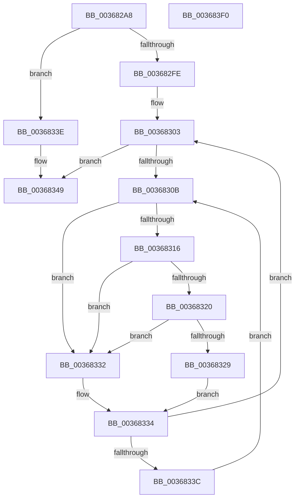

# MiInitializeEnclavePfn

- RVA: `0x003682A8`–`0x003683F1` (길이 `329` bytes)
- VA: `0x00000001403682A8`
- 실행 섹션: `.text`
- PDB 이름 있음: `예`; PDB Function 태그: `아니요`
- unwind 정보 RVA: `0x00075C18`
- 디코드: `92`개 명령, `329/329` bytes 표시
- 미해석 바이트: `0` (있으면 어셈블리에 `.byte`로 보존)

> 이 문서는 커널 이미지의 기계어와 PDB 기호를 분석해 생성했습니다. 4번과 5번은 함수 원형과 자료형을 바이너리 사용 방식에서 추정한 C 해석이며 원본 소스 복구 결과는 아닙니다.

## 1. Dependencies

- 직접 호출 지점: **6**; 고유 호출 대상: **6**
- 직접 호출자로 확인된 함수: **3**
- RIP 상대 이미지 참조: **2**

### Outgoing calls
- `0x00368320` → [KiCheckVpBackingLongSpinWaitHypercall](../30/KiCheckVpBackingLongSpinWaitHypercall_function_0030F490.md) (function, `0x0030F490`)
- `0x0036832B` → [HvlNotifyLongSpinWait](../30/HvlNotifyLongSpinWait_function_0030F460.md) (function, `0x0030F460`)
- `0x00368341` → [MiLockPageInline](../31/MiLockPageInline_function_0031A340.md) (function, `0x0031A340`)
- `0x003683B3` → [MiSetPfnModified](MiSetPfnModified_function_00362960.md) (function, `0x00362960`)
- `0x003683BF` → [MiMakeDemandZeroPte](../33/MiMakeDemandZeroPte_function_00337A00.md) (function, `0x00337A00`)
- `0x003683CE` → [MiUnlockPage](../31/MiUnlockPage_function_0031A3E0.md) (function, `0x0031A3E0`)

### Direct callers
- [MiAddPagesToEnclave](MiAddPagesToEnclave_function_00367EEC.md) at `0x00368173`
- [MiCreateHardwareEnclave](../../page/80/MiCreateHardwareEnclave_function_00808500.md) at `0x00808754`
- [MiCopyPagesIntoEnclave](../../page/A4/MiCopyPagesIntoEnclave_function_00A472AC.md) at `0x00A477EF`

### Static image references
- `0x0036830E` → RVA `0x00FC52AC` (`ALMOSTRO`; reference)
- `0x00368316` → RVA `0x00FC6AB8` (`ALMOSTRO`; read)

## 2. Other-region calls and transfers

- 다른 실행 섹션으로 향하는 call: **0**
- 별도 외부 분기/꼬리 이동을 확인하지 못했습니다.

## 3. Assembly (complete function range)

```asm
003682A8  48 89 5C 24 08                  mov qword ptr [rsp + 8], rbx
003682AD  48 89 6C 24 10                  mov qword ptr [rsp + 0x10], rbp
003682B2  48 89 74 24 18                  mov qword ptr [rsp + 0x18], rsi
003682B7  57                              push rdi
003682B8  41 54                           push r12
003682BA  41 55                           push r13
003682BC  41 56                           push r14
003682BE  41 57                           push r15
003682C0  48 83 EC 20                     sub rsp, 0x20
003682C4  65 48 8B 04 25 88 01 00 00      mov rax, qword ptr gs:[0x188]
003682CD  48 8D 1C 49                     lea rbx, [rcx + rcx*2]
003682D1  45 8B F8                        mov r15d, r8d
003682D4  48 C1 E3 04                     shl rbx, 4
003682D8  4C 8B E2                        mov r12, rdx
003682DB  4C 8B B0 B8 00 00 00            mov r14, qword ptr [rax + 0xb8]
003682E2  48 B8 00 00 00 00 00 DE FF FF   movabs rax, 0xffffde0000000000
003682EC  48 03 D8                        add rbx, rax
003682EF  41 BD 01 00 00 00               mov r13d, 1
003682F5  48 8D 7B 18                     lea rdi, [rbx + 0x18]
003682F9  45 85 C9                        test r9d, r9d
003682FC  74 40                           je 0x14036833e
003682FE  40 B5 11                        mov bpl, 0x11
00368301  33 F6                           xor esi, esi
00368303  F0 48 0F BA 2F 3F               lock bts qword ptr [rdi], 0x3f
00368309  73 3E                           jae 0x140368349
0036830B  41 03 F5                        add esi, r13d
0036830E  85 35 98 CF C5 00               test dword ptr [rip + 0xc5cf98], esi
00368314  75 1C                           jne 0x140368332
00368316  8B 05 9C E7 C5 00               mov eax, dword ptr [rip + 0xc5e79c]
0036831C  A8 40                           test al, 0x40
0036831E  74 12                           je 0x140368332
00368320  E8 6B 71 FA FF                  call 0x14030f490
00368325  84 C0                           test al, al
00368327  74 09                           je 0x140368332
00368329  8B CE                           mov ecx, esi
0036832B  E8 30 71 FA FF                  call 0x14030f460
00368330  EB 02                           jmp 0x140368334
00368332  F3 90                           pause
00368334  48 8B 07                        mov rax, qword ptr [rdi]
00368337  48 85 C0                        test rax, rax
0036833A  79 C7                           jns 0x140368303
0036833C  EB CD                           jmp 0x14036830b
0036833E  48 8B CB                        mov rcx, rbx
00368341  E8 FA 1F FB FF                  call 0x14031a340
00368346  40 8A E8                        mov bpl, al
00368349  48 8B 0B                        mov rcx, qword ptr [rbx]
0036834C  48 B8 01 00 00 00 00 F0 FF FF   movabs rax, 0xfffff00000000001
00368356  49 C1 EE 03                     shr r14, 3
0036835A  49 8B D6                        mov rdx, r14
0036835D  48 33 D1                        xor rdx, rcx
00368360  48 B9 01 00 00 00 00 00 00 C0   movabs rcx, 0xc000000000000001
0036836A  48 23 D0                        and rdx, rax
0036836D  49 33 D6                        xor rdx, r14
00368370  48 89 13                        mov qword ptr [rbx], rdx
00368373  41 8B D5                        mov edx, r13d
00368376  8B 43 20                        mov eax, dword ptr [rbx + 0x20]
00368379  89 44 24 68                     mov dword ptr [rsp + 0x68], eax
0036837D  C1 E8 10                        shr eax, 0x10
00368380  24 FE                           and al, 0xfe
00368382  0C 06                           or al, 6
00368384  88 44 24 6A                     mov byte ptr [rsp + 0x6a], al
00368388  8B 44 24 68                     mov eax, dword ptr [rsp + 0x68]
0036838C  89 43 20                        mov dword ptr [rbx + 0x20], eax
0036838F  48 8B 07                        mov rax, qword ptr [rdi]
00368392  48 23 C1                        and rax, rcx
00368395  48 8B CB                        mov rcx, rbx
00368398  49 0B C5                        or rax, r13
0036839B  48 89 43 18                     mov qword ptr [rbx + 0x18], rax
0036839F  8B 43 20                        mov eax, dword ptr [rbx + 0x20]
003683A2  89 44 24 68                     mov dword ptr [rsp + 0x68], eax
003683A6  66 44 89 6C 24 68               mov word ptr [rsp + 0x68], r13w
003683AC  8B 44 24 68                     mov eax, dword ptr [rsp + 0x68]
003683B0  89 43 20                        mov dword ptr [rbx + 0x20], eax
003683B3  E8 A8 A5 FF FF                  call 0x140362960
003683B8  41 8B CF                        mov ecx, r15d
003683BB  4C 89 63 08                     mov qword ptr [rbx + 8], r12
003683BF  E8 3C F6 FC FF                  call 0x140337a00
003683C4  48 8B CB                        mov rcx, rbx
003683C7  48 89 43 10                     mov qword ptr [rbx + 0x10], rax
003683CB  40 8A D5                        mov dl, bpl
003683CE  E8 0D 20 FB FF                  call 0x14031a3e0
003683D3  48 8B 5C 24 50                  mov rbx, qword ptr [rsp + 0x50]
003683D8  48 8B 6C 24 58                  mov rbp, qword ptr [rsp + 0x58]
003683DD  48 8B 74 24 60                  mov rsi, qword ptr [rsp + 0x60]
003683E2  48 83 C4 20                     add rsp, 0x20
003683E6  41 5F                           pop r15
003683E8  41 5E                           pop r14
003683EA  41 5D                           pop r13
003683EC  41 5C                           pop r12
003683EE  5F                              pop rdi
003683EF  C3                              ret
003683F0  CC                              int3
```

## 4. C-style interpretation (structured pseudocode)

```c
__int64 __fastcall MiInitializeEnclavePfn(__int64 a1, __int64 a2, int a3, int a4)
{
    __int64 result;
    __int64 v_r14;
    __int64 v_rbx;
    __int64 v_rsi;
    __int64 v_rsp;
    unsigned __int64 v_stack_p10;
    unsigned __int64 v_stack_p18;
    unsigned int v_stack_p20;
    unsigned __int8 v_stack_p22;
    unsigned __int64 v_stack_p8;

    v_stack_p8 = v_rbx;
    v_stack_p10 = v_rbp;
    v_stack_p18 = v_rsi;
    v_rsp = (v_rsp) - (32);
    v_rbx = (a1 + a1 * 2) << (4);
    v_rbx = (v_rbx) + (*(unsigned __int64 *)(gs_base + (0 + 392)));
    if (a4 == 0) goto loc_0036833E;
    v_rsi = 0;
loc_00368303:
    if (condition_is_above_or_equal) goto loc_00368349;
loc_0036830B:
    v_rsi = (unsigned int)((v_rsi) + (1));
    if (((*(unsigned int *)(v_rip + 12963736)) & ((unsigned int)(v_rsi))) != 0) goto loc_00368332;
    if ((((unsigned __int8)((unsigned int)(*(unsigned int *)(v_rip + 12969884)))) & (64)) == 0) goto loc_00368332;
    result = KiCheckVpBackingLongSpinWaitHypercall(a1, a2, a3, a4);
    if ((unsigned __int8)(result) == 0) goto loc_00368332;
    result = HvlNotifyLongSpinWait((unsigned int)((unsigned int)(v_rsi)), a2, a3, a4);
    goto loc_00368334;
loc_00368332:
loc_00368334:
    if (!sign_flag) goto loc_00368303;
    goto loc_0036830B;
loc_0036833E:
    result = MiLockPageInline(v_rbx, a2, a3, a4);
loc_00368349:
    v_r14 = (*(unsigned __int64 *)(*(unsigned __int64 *)(gs_base + (0 + 392)) + 184)) >> (3);
    a2 = (v_r14) ^ (*(unsigned __int64 *)(v_rbx));
    a2 = (a2) & (result);
    a2 = (a2) ^ (v_r14);
    *(unsigned __int64 *)(v_rbx) = a2;
    v_stack_p20 = (unsigned int)((unsigned int)(*(unsigned int *)(v_rbx + 32)));
    result = (unsigned int)(((unsigned int)(*(unsigned int *)(v_rbx + 32))) >> (16));
    result = (unsigned __int8)((result) & (254));
    result = (unsigned __int8)((result) | (6));
    v_stack_p22 = (unsigned __int8)(result);
    *(unsigned int *)(v_rbx + 32) = (unsigned int)((unsigned int)(v_stack_p20));
    result = (*(unsigned __int64 *)(v_rbx + 24)) & (*(unsigned __int64 *)(v_rbx));
    result = (result) | (1);
    *(unsigned __int64 *)(v_rbx + 24) = result;
    v_stack_p20 = (unsigned int)((unsigned int)(*(unsigned int *)(v_rbx + 32)));
    v_stack_p20 = 1;
    *(unsigned int *)(v_rbx + 32) = (unsigned int)((unsigned int)(v_stack_p20));
    result = MiSetPfnModified(v_rbx, 1, a3, a4);
    *(unsigned __int64 *)(v_rbx + 8) = a2;
    result = MiMakeDemandZeroPte((unsigned int)((unsigned int)((unsigned int)(a3))), 1, a3, a4);
    *(unsigned __int64 *)(v_rbx + 16) = result;
    result = MiUnlockPage(v_rbx, (unsigned __int8)((unsigned __int8)(result)), a3, a4);
    v_rsp = (v_rsp) + (32);
    return result;
}
```

## 5. (Beta) C Style

```c
int64_t MiInitializeEnclavePfn(void *Arg1, int64_t Arg2, int32_t Arg3, int32_t Arg4)
{
    uint8_t *arg1 = (uint8_t *)Arg1;

    int64_t result;
    int64_t local_r14;
    int64_t local_rbx;
    int64_t local_rsi;
    int64_t local_rsp;
    uint64_t v_stack_p10;
    uint64_t v_stack_p18;
    uint32_t v_stack_p20;
    uint8_t v_stack_p22;
    uint64_t v_stack_p8;

    v_stack_p8 = local_rbx;
    v_stack_p10 = local_rbp;
    v_stack_p18 = local_rsi;
    local_rsp = (local_rsp) - (32);
    local_rbx = (Arg1 + Arg1 * 2) << (4);
    local_rbx = (local_rbx) + (*(uint64_t *)(gs_base + (0 + 0x188)));
    if (Arg4 == 0) goto loc_0036833E;
    local_rsi = 0;
loc_00368303:
    if (condition_is_above_or_equal) goto loc_00368349;
loc_0036830B:
    local_rsi = (uint32_t)((local_rsi) + (1));
    if (((*(uint32_t *)(v_rip + 0xC5CF98)) & ((uint32_t)(local_rsi))) != 0) goto loc_00368332;
    if ((((uint8_t)((uint32_t)(*(uint32_t *)(v_rip + 0xC5E79C)))) & (64)) == 0) goto loc_00368332;
    result = KiCheckVpBackingLongSpinWaitHypercall(Arg1, Arg2, Arg3, Arg4);
    if ((uint8_t)(result) == 0) goto loc_00368332;
    result = HvlNotifyLongSpinWait((uint32_t)((uint32_t)(local_rsi)), Arg2, Arg3, Arg4);
    goto loc_00368334;
loc_00368332:
loc_00368334:
    if (!sign_flag) goto loc_00368303;
    goto loc_0036830B;
loc_0036833E:
    result = MiLockPageInline(local_rbx, Arg2, Arg3, Arg4);
loc_00368349:
    local_r14 = (*(uint64_t *)(*(uint64_t *)(gs_base + (0 + 0x188)) + 0xB8)) >> (3);
    Arg2 = (local_r14) ^ (*(uint64_t *)(local_rbx));
    Arg2 = (Arg2) & (result);
    Arg2 = (Arg2) ^ (local_r14);
    *(uint64_t *)(local_rbx) = Arg2;
    v_stack_p20 = (uint32_t)((uint32_t)(*(uint32_t *)(local_rbx + 0x20)));
    result = (uint32_t)(((uint32_t)(*(uint32_t *)(local_rbx + 0x20))) >> (16));
    result = (uint8_t)((result) & (254));
    result = (uint8_t)((result) | (6));
    v_stack_p22 = (uint8_t)(result);
    *(uint32_t *)(local_rbx + 0x20) = (uint32_t)((uint32_t)(v_stack_p20));
    result = (*(uint64_t *)(local_rbx + 0x18)) & (*(uint64_t *)(local_rbx));
    result = (result) | (1);
    *(uint64_t *)(local_rbx + 0x18) = result;
    v_stack_p20 = (uint32_t)((uint32_t)(*(uint32_t *)(local_rbx + 0x20)));
    v_stack_p20 = 1;
    *(uint32_t *)(local_rbx + 0x20) = (uint32_t)((uint32_t)(v_stack_p20));
    result = MiSetPfnModified(local_rbx, 1, Arg3, Arg4);
    *(uint64_t *)(local_rbx + 0x8) = Arg2;
    result = MiMakeDemandZeroPte((uint32_t)((uint32_t)((uint32_t)(Arg3))), 1, Arg3, Arg4);
    *(uint64_t *)(local_rbx + 0x10) = result;
    result = MiUnlockPage(local_rbx, (uint8_t)((uint8_t)(result)), Arg3, Arg4);
    local_rsp = (local_rsp) + (32);
    return result;
}
```

### 관측된 메모리 오프셋

구조체 형식이 확인되지 않은 접근은 인자 기준의 오프셋으로만 기록했습니다.

| 기준 인자 | 오프셋 표현 | 폭 (bit) | 접근 |
|---|---:|---:|---|
| `Arg1` | `+ 0x0 + rcx*2` | `64` | `R` |

## 6. Execution-region graph

[열기: 2D/3D 그래프와 함수 탐색 컨트롤 패널](../../../control-panel.html?section=text&rva=0x003682A8&view=graph)

- 2D 그래프는 위에서 아래로 흐르고, 3D 그래프는 빈 공간을 드래그해 회전합니다. Shift+드래그는 이동, 휠은 확대·축소, 함수 노드 선택은 대상 보고서 이동입니다.

### Static fallback


