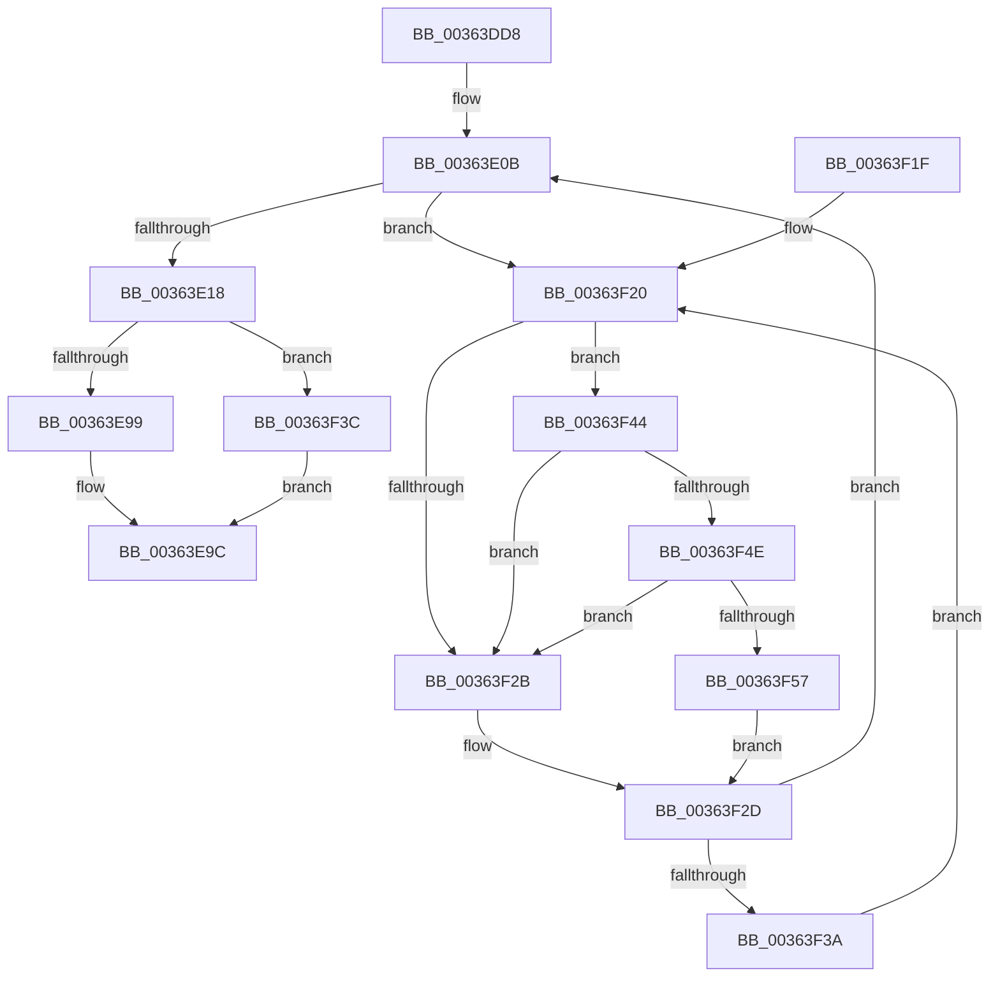

# MiInitializeHardFaultPfn

- RVA: `0x00363DD8`–`0x00363F60` (길이 `392` bytes)
- VA: `0x0000000140363DD8`
- 실행 섹션: `.text`
- PDB 이름 있음: `예`; PDB Function 태그: `아니요`
- unwind 정보 RVA: `0x00079EA0`
- 디코드: `109`개 명령, `392/392` bytes 표시
- 미해석 바이트: `0` (있으면 어셈블리에 `.byte`로 보존)

> 이 문서는 커널 이미지의 기계어와 PDB 기호를 분석해 생성했습니다. 4번과 5번은 함수 원형과 자료형을 바이너리 사용 방식에서 추정한 C 해석이며 원본 소스 복구 결과는 아닙니다.

## 1. Dependencies

- 직접 호출 지점: **5**; 고유 호출 대상: **5**
- 직접 호출자로 확인된 함수: **1**
- RIP 상대 이미지 참조: **2**

### Outgoing calls
- `0x00363DFD` → [MiGetContainingPageTable](../34/MiGetContainingPageTable_function_003467F0.md) (function, `0x003467F0`)
- `0x00363EB3` → [MiSetPfnContainingFrame](MiSetPfnContainingFrame_function_00363FC0.md) (function, `0x00363FC0`)
- `0x00363EDF` → [MiFinalizePageAttribute](../33/MiFinalizePageAttribute_function_00332E30.md) (function, `0x00332E30`)
- `0x00363F4E` → [KiCheckVpBackingLongSpinWaitHypercall](../30/KiCheckVpBackingLongSpinWaitHypercall_function_0030F490.md) (function, `0x0030F490`)
- `0x00363F59` → [HvlNotifyLongSpinWait](../30/HvlNotifyLongSpinWait_function_0030F460.md) (function, `0x0030F460`)

### Direct callers
- [MiBuildMdlForMappedFileFault](MiBuildMdlForMappedFileFault_function_0036380C.md) at `0x00363BE4`

### Static image references
- `0x00363F23` → RVA `0x00FC52AC` (`ALMOSTRO`; reference)
- `0x00363F44` → RVA `0x00FC6AB8` (`ALMOSTRO`; read)

## 2. Other-region calls and transfers

- 다른 실행 섹션으로 향하는 call: **0**
- 별도 외부 분기/꼬리 이동을 확인하지 못했습니다.

## 3. Assembly (complete function range)

```asm
00363DD8  48 89 5C 24 08                  mov qword ptr [rsp + 8], rbx
00363DDD  48 89 6C 24 10                  mov qword ptr [rsp + 0x10], rbp
00363DE2  56                              push rsi
00363DE3  57                              push rdi
00363DE4  41 54                           push r12
00363DE6  41 56                           push r14
00363DE8  41 57                           push r15
00363DEA  48 83 EC 20                     sub rsp, 0x20
00363DEE  48 8B D9                        mov rbx, rcx
00363DF1  45 8B F1                        mov r14d, r9d
00363DF4  49 8B C8                        mov rcx, r8
00363DF7  49 8B F0                        mov rsi, r8
00363DFA  48 8B EA                        mov rbp, rdx
00363DFD  E8 EE 29 FE FF                  call 0x1403467f0
00363E02  33 FF                           xor edi, edi
00363E04  4C 8B F8                        mov r15, rax
00363E07  44 8D 67 01                     lea r12d, [rdi + 1]
00363E0B  F0 48 0F BA 6B 18 3F            lock bts qword ptr [rbx + 0x18], 0x3f
00363E12  0F 82 08 01 00 00               jb 0x140363f20
00363E18  48 8B 43 18                     mov rax, qword ptr [rbx + 0x18]
00363E1C  48 8D 55 20                     lea rdx, [rbp + 0x20]
00363E20  48 B9 00 00 00 00 00 FF FF FF   movabs rcx, 0xffffff0000000000
00363E2A  48 23 C1                        and rax, rcx
00363E2D  48 B9 00 00 00 00 00 00 00 80   movabs rcx, 0x8000000000000000
00363E37  48 89 43 18                     mov qword ptr [rbx + 0x18], rax
00363E3B  48 8B 43 28                     mov rax, qword ptr [rbx + 0x28]
00363E3F  48 0B C1                        or rax, rcx
00363E42  48 89 43 28                     mov qword ptr [rbx + 0x28], rax
00363E46  8B 43 20                        mov eax, dword ptr [rbx + 0x20]
00363E49  89 44 24 68                     mov dword ptr [rsp + 0x68], eax
00363E4D  66 44 89 64 24 68               mov word ptr [rsp + 0x68], r12w
00363E53  8B 44 24 68                     mov eax, dword ptr [rsp + 0x68]
00363E57  89 43 20                        mov dword ptr [rbx + 0x20], eax
00363E5A  8B 43 20                        mov eax, dword ptr [rbx + 0x20]
00363E5D  89 44 24 68                     mov dword ptr [rsp + 0x68], eax
00363E61  C1 E8 10                        shr eax, 0x10
00363E64  0C 20                           or al, 0x20
00363E66  88 44 24 6A                     mov byte ptr [rsp + 0x6a], al
00363E6A  8B 44 24 68                     mov eax, dword ptr [rsp + 0x68]
00363E6E  89 43 20                        mov dword ptr [rbx + 0x20], eax
00363E71  48 8B C5                        mov rax, rbp
00363E74  48 F7 D8                        neg rax
00363E77  48 1B C9                        sbb rcx, rcx
00363E7A  48 23 CA                        and rcx, rdx
00363E7D  48 89 0B                        mov qword ptr [rbx], rcx
00363E80  8B 85 C0 00 00 00               mov eax, dword ptr [rbp + 0xc0]
00363E86  8B 4B 20                        mov ecx, dword ptr [rbx + 0x20]
00363E89  89 4C 24 68                     mov dword ptr [rsp + 0x68], ecx
00363E8D  C1 E9 18                        shr ecx, 0x18
00363E90  45 85 F6                        test r14d, r14d
00363E93  0F 85 A3 00 00 00               jne 0x140363f3c
00363E99  C1 E8 0E                        shr eax, 0xe
00363E9C  32 C1                           xor al, cl
00363E9E  49 8B D7                        mov rdx, r15
00363EA1  24 07                           and al, 7
00363EA3  32 C1                           xor al, cl
00363EA5  48 8B CB                        mov rcx, rbx
00363EA8  88 44 24 6B                     mov byte ptr [rsp + 0x6b], al
00363EAC  8B 44 24 68                     mov eax, dword ptr [rsp + 0x68]
00363EB0  89 43 20                        mov dword ptr [rbx + 0x20], eax
00363EB3  E8 08 01 00 00                  call 0x140363fc0
00363EB8  8B 54 24 70                     mov edx, dword ptr [rsp + 0x70]
00363EBC  45 8B C4                        mov r8d, r12d
00363EBF  48 89 73 08                     mov qword ptr [rbx + 8], rsi
00363EC3  48 8B CB                        mov rcx, rbx
00363EC6  8B 43 20                        mov eax, dword ptr [rbx + 0x20]
00363EC9  89 44 24 68                     mov dword ptr [rsp + 0x68], eax
00363ECD  C1 E8 10                        shr eax, 0x10
00363ED0  24 FA                           and al, 0xfa
00363ED2  0C 02                           or al, 2
00363ED4  88 44 24 6A                     mov byte ptr [rsp + 0x6a], al
00363ED8  8B 44 24 68                     mov eax, dword ptr [rsp + 0x68]
00363EDC  89 43 20                        mov dword ptr [rbx + 0x20], eax
00363EDF  E8 4C EF FC FF                  call 0x140332e30
00363EE4  48 8B 43 18                     mov rax, qword ptr [rbx + 0x18]
00363EE8  48 B9 00 00 00 00 00 00 00 C0   movabs rcx, 0xc000000000000000
00363EF2  48 23 C1                        and rax, rcx
00363EF5  48 89 43 18                     mov qword ptr [rbx + 0x18], rax
00363EF9  48 B8 FF FF FF FF FF FF FF 7F   movabs rax, 0x7fffffffffffffff
00363F03  F0 48 21 43 18                  lock and qword ptr [rbx + 0x18], rax
00363F08  48 8B 5C 24 50                  mov rbx, qword ptr [rsp + 0x50]
00363F0D  48 8B 6C 24 58                  mov rbp, qword ptr [rsp + 0x58]
00363F12  48 83 C4 20                     add rsp, 0x20
00363F16  41 5F                           pop r15
00363F18  41 5E                           pop r14
00363F1A  41 5C                           pop r12
00363F1C  5F                              pop rdi
00363F1D  5E                              pop rsi
00363F1E  C3                              ret
00363F1F  CC                              int3
00363F20  41 03 FC                        add edi, r12d
00363F23  85 3D 83 13 C6 00               test dword ptr [rip + 0xc61383], edi
00363F29  74 19                           je 0x140363f44
00363F2B  F3 90                           pause
00363F2D  48 8B 43 18                     mov rax, qword ptr [rbx + 0x18]
00363F31  48 85 C0                        test rax, rax
00363F34  0F 89 D1 FE FF FF               jns 0x140363e0b
00363F3A  EB E4                           jmp 0x140363f20
00363F3C  C1 E8 0B                        shr eax, 0xb
00363F3F  E9 58 FF FF FF                  jmp 0x140363e9c
00363F44  8B 05 6E 2B C6 00               mov eax, dword ptr [rip + 0xc62b6e]
00363F4A  A8 40                           test al, 0x40
00363F4C  74 DD                           je 0x140363f2b
00363F4E  E8 3D B5 FA FF                  call 0x14030f490
00363F53  84 C0                           test al, al
00363F55  74 D4                           je 0x140363f2b
00363F57  8B CF                           mov ecx, edi
00363F59  E8 02 B5 FA FF                  call 0x14030f460
00363F5E  EB CD                           jmp 0x140363f2d
```

## 4. C-style interpretation (structured pseudocode)

```c
__int64 __fastcall MiInitializeHardFaultPfn(__int64 a1, __int64 a2, __int64 a3, int a4, unsigned int a5)
{
    __int64 result;
    __int64 v_rdi;
    __int64 v_rsp;
    unsigned __int64 v_stack_p10;
    unsigned int v_stack_p20;
    unsigned __int8 v_stack_p22;
    unsigned __int8 v_stack_p23;
    unsigned __int64 v_stack_p8;

    v_stack_p8 = v_rbx;
    v_stack_p10 = v_rbp;
    v_rsp = (v_rsp) - (32);
    result = MiGetContainingPageTable(a3, a2, a3, a4);
    v_rdi = 0;
loc_00363E0B:
    if (condition_is_below) goto loc_00363F20;
    result = (*(unsigned __int64 *)(a1 + 24)) & (a3);
    *(unsigned __int64 *)(a1 + 24) = result;
    result = (*(unsigned __int64 *)(a1 + 40)) | (a3);
    *(unsigned __int64 *)(a1 + 40) = result;
    v_stack_p20 = (unsigned int)((unsigned int)(*(unsigned int *)(a1 + 32)));
    v_stack_p20 = (unsigned __int16)(v_rdi + 1);
    *(unsigned int *)(a1 + 32) = (unsigned int)((unsigned int)(v_stack_p20));
    v_stack_p20 = (unsigned int)((unsigned int)(*(unsigned int *)(a1 + 32)));
    result = (unsigned int)(((unsigned int)(*(unsigned int *)(a1 + 32))) >> (16));
    result = (unsigned __int8)((result) | (32));
    v_stack_p22 = (unsigned __int8)(result);
    *(unsigned int *)(a1 + 32) = (unsigned int)((unsigned int)(v_stack_p20));
    result = -(a2);
    a1 = (a3) & (a2 + 32);
    *(unsigned __int64 *)(a1) = a1;
    v_stack_p20 = (unsigned int)((unsigned int)(*(unsigned int *)(a1 + 32)));
    a1 = (unsigned int)(((unsigned int)(*(unsigned int *)(a1 + 32))) >> (24));
    if ((unsigned int)((unsigned int)(a4)) != 0) goto loc_00363F3C;
    result = (unsigned int)(((unsigned int)(*(unsigned int *)(a2 + 192))) >> (14));
loc_00363E9C:
    result = (unsigned __int8)((result) ^ ((unsigned __int8)(a1)));
    result = (unsigned __int8)((result) & (7));
    result = (unsigned __int8)((result) ^ ((unsigned __int8)(a1)));
    v_stack_p23 = (unsigned __int8)(result);
    *(unsigned int *)(a1 + 32) = (unsigned int)((unsigned int)(v_stack_p20));
    result = MiSetPfnContainingFrame(a1, result, a3, a4);
    *(unsigned __int64 *)(a1 + 8) = a3;
    v_stack_p20 = (unsigned int)((unsigned int)(*(unsigned int *)(a1 + 32)));
    result = (unsigned int)(((unsigned int)(*(unsigned int *)(a1 + 32))) >> (16));
    result = (unsigned __int8)((result) & (250));
    result = (unsigned __int8)((result) | (2));
    v_stack_p22 = (unsigned __int8)(result);
    *(unsigned int *)(a1 + 32) = (unsigned int)((unsigned int)(v_stack_p20));
    result = MiFinalizePageAttribute(a1, (unsigned int)(a5), (unsigned int)((unsigned int)(v_rdi + 1)), a4);
    result = (*(unsigned __int64 *)(a1 + 24)) & (a1);
    *(unsigned __int64 *)(a1 + 24) = result;
    v_rsp = (v_rsp) + (32);
    return result;
loc_00363F20:
    v_rdi = (unsigned int)((v_rdi) + ((unsigned int)(v_rdi + 1)));
    if (((*(unsigned int *)(v_rip + 12981123)) & ((unsigned int)(v_rdi))) == 0) goto loc_00363F44;
loc_00363F2B:
loc_00363F2D:
    if (!sign_flag) goto loc_00363E0B;
    goto loc_00363F20;
loc_00363F3C:
    result = (unsigned int)((*(unsigned __int64 *)(v_stack_p8 + 24)) >> (11));
    goto loc_00363E9C;
loc_00363F44:
    if ((((unsigned __int8)((unsigned int)(*(unsigned int *)(v_rip + 12987246)))) & (64)) == 0) goto loc_00363F2B;
    result = KiCheckVpBackingLongSpinWaitHypercall(a1, (unsigned int)(a5), (unsigned int)((unsigned int)(v_rdi + 1)), a4);
    if ((unsigned __int8)(result) == 0) goto loc_00363F2B;
    result = HvlNotifyLongSpinWait((unsigned int)((unsigned int)(v_rdi)), (unsigned int)(a5), (unsigned int)((unsigned int)(v_rdi + 1)), a4);
    goto loc_00363F2D;
}
```

## 5. (Beta) C Style

```c
int64_t MiInitializeHardFaultPfn(void *Arg1, void *Arg2, int64_t Arg3, int32_t Arg4, uint32_t Arg5)
{
    uint8_t *arg1 = (uint8_t *)Arg1;
    uint8_t *arg2 = (uint8_t *)Arg2;

    int64_t result;
    int64_t local_rdi;
    int64_t local_rsp;
    uint64_t v_stack_p10;
    uint32_t v_stack_p20;
    uint8_t v_stack_p22;
    uint8_t v_stack_p23;
    uint64_t v_stack_p8;

    v_stack_p8 = local_rbx;
    v_stack_p10 = local_rbp;
    local_rsp = (local_rsp) - (32);
    result = MiGetContainingPageTable(Arg3, Arg2, Arg3, Arg4);
    local_rdi = 0;
loc_00363E0B:
    if (condition_is_below) goto loc_00363F20;
    result = (*(uint64_t *)(arg1 + 0x18)) & (Arg3);
    *(uint64_t *)(arg1 + 0x18) = result;
    result = (*(uint64_t *)(arg1 + 0x28)) | (Arg3);
    *(uint64_t *)(arg1 + 0x28) = result;
    v_stack_p20 = (uint32_t)((uint32_t)(*(uint32_t *)(arg1 + 0x20)));
    v_stack_p20 = (uint16_t)(local_rdi + 1);
    *(uint32_t *)(arg1 + 0x20) = (uint32_t)((uint32_t)(v_stack_p20));
    v_stack_p20 = (uint32_t)((uint32_t)(*(uint32_t *)(arg1 + 0x20)));
    result = (uint32_t)(((uint32_t)(*(uint32_t *)(arg1 + 0x20))) >> (16));
    result = (uint8_t)((result) | (32));
    v_stack_p22 = (uint8_t)(result);
    *(uint32_t *)(arg1 + 0x20) = (uint32_t)((uint32_t)(v_stack_p20));
    result = -(Arg2);
    Arg1 = (Arg3) & (Arg2 + 32);
    *(void **)(arg1) = Arg1;
    v_stack_p20 = (uint32_t)((uint32_t)(*(uint32_t *)(arg1 + 0x20)));
    Arg1 = (uint32_t)(((uint32_t)(*(uint32_t *)(arg1 + 0x20))) >> (24));
    if ((uint32_t)((uint32_t)(Arg4)) != 0) goto loc_00363F3C;
    result = (uint32_t)(((uint32_t)(*(uint32_t *)(arg2 + 0xC0))) >> (14));
loc_00363E9C:
    result = (uint8_t)((result) ^ ((uint8_t)(Arg1)));
    result = (uint8_t)((result) & (7));
    result = (uint8_t)((result) ^ ((uint8_t)(Arg1)));
    v_stack_p23 = (uint8_t)(result);
    *(uint32_t *)(arg1 + 0x20) = (uint32_t)((uint32_t)(v_stack_p20));
    result = MiSetPfnContainingFrame(Arg1, result, Arg3, Arg4);
    *(uint64_t *)(arg1 + 0x8) = Arg3;
    v_stack_p20 = (uint32_t)((uint32_t)(*(uint32_t *)(arg1 + 0x20)));
    result = (uint32_t)(((uint32_t)(*(uint32_t *)(arg1 + 0x20))) >> (16));
    result = (uint8_t)((result) & (250));
    result = (uint8_t)((result) | (2));
    v_stack_p22 = (uint8_t)(result);
    *(uint32_t *)(arg1 + 0x20) = (uint32_t)((uint32_t)(v_stack_p20));
    result = MiFinalizePageAttribute(Arg1, (uint32_t)(Arg5), (uint32_t)((uint32_t)(local_rdi + 1)), Arg4);
    result = (*(uint64_t *)(arg1 + 0x18)) & (Arg1);
    *(uint64_t *)(arg1 + 0x18) = result;
    local_rsp = (local_rsp) + (32);
    return result;
loc_00363F20:
    local_rdi = (uint32_t)((local_rdi) + ((uint32_t)(local_rdi + 1)));
    if (((*(uint32_t *)(v_rip + 0xC61383)) & ((uint32_t)(local_rdi))) == 0) goto loc_00363F44;
loc_00363F2B:
loc_00363F2D:
    if (!sign_flag) goto loc_00363E0B;
    goto loc_00363F20;
loc_00363F3C:
    result = (uint32_t)((*(uint64_t *)(v_stack_p8 + 0x18)) >> (11));
    goto loc_00363E9C;
loc_00363F44:
    if ((((uint8_t)((uint32_t)(*(uint32_t *)(v_rip + 0xC62B6E)))) & (64)) == 0) goto loc_00363F2B;
    result = KiCheckVpBackingLongSpinWaitHypercall(Arg1, (uint32_t)(Arg5), (uint32_t)((uint32_t)(local_rdi + 1)), Arg4);
    if ((uint8_t)(result) == 0) goto loc_00363F2B;
    result = HvlNotifyLongSpinWait((uint32_t)((uint32_t)(local_rdi)), (uint32_t)(Arg5), (uint32_t)((uint32_t)(local_rdi + 1)), Arg4);
    goto loc_00363F2D;
}
```

### 관측된 메모리 오프셋

구조체 형식이 확인되지 않은 접근은 인자 기준의 오프셋으로만 기록했습니다.

| 기준 인자 | 오프셋 표현 | 폭 (bit) | 접근 |
|---|---:|---:|---|
| `Arg1` | `+ 0x0` | `64` | `W` |
| `Arg1` | `+ 0x8` | `64` | `W` |
| `Arg1` | `+ 0x18` | `64` | `R` |
| `Arg1` | `+ 0x18` | `64` | `R/W` |
| `Arg1` | `+ 0x18` | `64` | `W` |
| `Arg1` | `+ 0x20` | `32` | `R` |
| `Arg1` | `+ 0x20` | `32` | `W` |
| `Arg1` | `+ 0x28` | `64` | `R` |
| `Arg1` | `+ 0x28` | `64` | `W` |
| `Arg2` | `+ 0x20` | `64` | `R` |
| `Arg2` | `+ 0xC0` | `32` | `R` |

## 6. Execution-region graph

[열기: 2D/3D 그래프와 함수 탐색 컨트롤 패널](../../../control-panel.html?section=text&rva=0x00363DD8&view=graph)

- 2D 그래프는 위에서 아래로 흐르고, 3D 그래프는 빈 공간을 드래그해 회전합니다. Shift+드래그는 이동, 휠은 확대·축소, 함수 노드 선택은 대상 보고서 이동입니다.

### Static fallback


