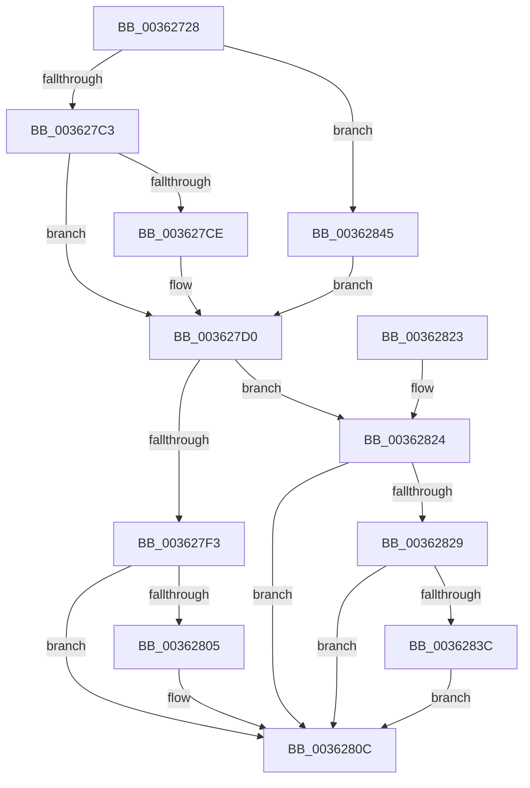

# MiInitializeInPageSupport

- RVA: `0x00362728`–`0x0036284A` (길이 `290` bytes)
- VA: `0x0000000140362728`
- 실행 섹션: `.text`
- PDB 이름 있음: `예`; PDB Function 태그: `아니요`
- unwind 정보 RVA: `0x0006D260`
- 디코드: `78`개 명령, `290/290` bytes 표시
- 미해석 바이트: `0` (있으면 어셈블리에 `.byte`로 보존)

> 이 문서는 커널 이미지의 기계어와 PDB 기호를 분석해 생성했습니다. 4번과 5번은 함수 원형과 자료형을 바이너리 사용 방식에서 추정한 C 해석이며 원본 소스 복구 결과는 아닙니다.

## 1. Dependencies

- 직접 호출 지점: **3**; 고유 호출 대상: **3**
- 직접 호출자로 확인된 함수: **4**
- RIP 상대 이미지 참조: **0**

### Outgoing calls
- `0x00362747` → [memset](../6C/memset_function_006C6C40.md) (function, `0x006C6C40`)
- `0x003627AF` → [MiGetEffectivePagePriorityThread](MiGetEffectivePagePriorityThread_function_003626E0.md) (function, `0x003626E0`)
- `0x003627FB` → [KeAbPreAcquire](../21/KeAbPreAcquire_function_00210230.md) (function, `0x00210230`)

### Direct callers
- [MiGetInPageSupportBlock](MiGetInPageSupportBlock_function_00362500.md) at `0x003626C3`
- [MiPfIssueCoalescedSupport](MiPfIssueCoalescedSupport_function_0036AE14.md) at `0x0036AE67`
- [MiReadPagefilePage](../66/MiReadPagefilePage_function_0066F78C.md) at `0x0066F868`
- [MiGetReadyInPageBlock](../../page/AB/MiGetReadyInPageBlock_function_00ABB398.md) at `0x00ABB3FD`

### Static image references
- 디코드된 RIP-relative 메모리 참조가 없습니다.

## 2. Other-region calls and transfers

- 다른 실행 섹션으로 향하는 call: **0**
- 별도 외부 분기/꼬리 이동을 확인하지 못했습니다.

## 3. Assembly (complete function range)

```asm
00362728  48 89 5C 24 08                  mov qword ptr [rsp + 8], rbx
0036272D  48 89 74 24 10                  mov qword ptr [rsp + 0x10], rsi
00362732  57                              push rdi
00362733  48 83 EC 20                     sub rsp, 0x20
00362737  49 8B F8                        mov rdi, r8
0036273A  8B F2                           mov esi, edx
0036273C  33 D2                           xor edx, edx
0036273E  41 B8 10 01 00 00               mov r8d, 0x110
00362744  48 8B D9                        mov rbx, rcx
00362747  E8 F4 44 36 00                  call 0x1406c6c40
0036274C  83 63 24 00                     and dword ptr [rbx + 0x24], 0
00362750  48 8D 43 28                     lea rax, [rbx + 0x28]
00362754  66 C7 43 21 00 06               mov word ptr [rbx + 0x21], 0x600
0036275A  BA 00 00 00 00                  mov edx, 0
0036275F  48 89 40 08                     mov qword ptr [rax + 8], rax
00362763  48 89 00                        mov qword ptr [rax], rax
00362766  48 8D 43 40                     lea rax, [rbx + 0x40]
0036276A  66 83 63 38 00                  and word ptr [rbx + 0x38], 0
0036276F  83 63 3C 00                     and dword ptr [rbx + 0x3c], 0
00362773  C6 43 3A 06                     mov byte ptr [rbx + 0x3a], 6
00362777  40 F6 C6 01                     test sil, 1
0036277B  48 89 40 08                     mov qword ptr [rax + 8], rax
0036277F  48 89 00                        mov qword ptr [rax], rax
00362782  B8 00 01 00 00                  mov eax, 0x100
00362787  C7 83 B0 00 00 00 01 00 00 00   mov dword ptr [rbx + 0xb0], 1
00362791  0F 45 D0                        cmovne edx, eax
00362794  48 8D 43 10                     lea rax, [rbx + 0x10]
00362798  48 89 40 08                     mov qword ptr [rax + 8], rax
0036279C  48 89 00                        mov qword ptr [rax], rax
0036279F  65 48 8B 0C 25 88 01 00 00      mov rcx, qword ptr gs:[0x188]
003627A8  48 89 8B 98 00 00 00            mov qword ptr [rbx + 0x98], rcx
003627AF  E8 2C FF FF FF                  call 0x1403626e0
003627B4  41 B8 05 00 00 00               mov r8d, 5
003627BA  41 3B C0                        cmp eax, r8d
003627BD  0F 87 82 00 00 00               ja 0x140362845
003627C3  0F BA EA 14                     bts edx, 0x14
003627C7  44 8B C0                        mov r8d, eax
003627CA  85 C0                           test eax, eax
003627CC  74 02                           je 0x1403627d0
003627CE  FF C8                           dec eax
003627D0  0F B6 C8                        movzx ecx, al
003627D3  83 E1 07                        and ecx, 7
003627D6  41 0F B6 C0                     movzx eax, r8b
003627DA  C1 E1 03                        shl ecx, 3
003627DD  83 E0 07                        and eax, 7
003627E0  0B C8                           or ecx, eax
003627E2  C1 E1 0B                        shl ecx, 0xb
003627E5  0B CA                           or ecx, edx
003627E7  89 8B C0 00 00 00               mov dword ptr [rbx + 0xc0], ecx
003627ED  40 F6 C6 02                     test sil, 2
003627F1  74 31                           je 0x140362824
003627F3  45 33 C0                        xor r8d, r8d
003627F6  33 D2                           xor edx, edx
003627F8  48 8B CB                        mov rcx, rbx
003627FB  E8 30 DA EA FF                  call 0x140210230
00362800  48 85 C0                        test rax, rax
00362803  74 07                           je 0x14036280c
00362805  C6 40 0A 01                     mov byte ptr [rax + 0xa], 1
00362809  48 8B FB                        mov rdi, rbx
0036280C  48 8B 74 24 38                  mov rsi, qword ptr [rsp + 0x38]
00362811  48 89 BB D8 00 00 00            mov qword ptr [rbx + 0xd8], rdi
00362818  48 8B 5C 24 30                  mov rbx, qword ptr [rsp + 0x30]
0036281D  48 83 C4 20                     add rsp, 0x20
00362821  5F                              pop rdi
00362822  C3                              ret
00362823  CC                              int3
00362824  48 85 FF                        test rdi, rdi
00362827  74 E3                           je 0x14036280c
00362829  B8 01 00 00 00                  mov eax, 1
0036282E  F0 48 0F C1 07                  lock xadd qword ptr [rdi], rax
00362833  48 FF C0                        inc rax
00362836  48 83 F8 01                     cmp rax, 1
0036283A  7F D0                           jg 0x14036280c
0036283C  B9 0E 00 00 00                  mov ecx, 0xe
00362841  CD 29                           int 0x29
00362843  EB C7                           jmp 0x14036280c
00362845  41 8B C0                        mov eax, r8d
00362848  EB 86                           jmp 0x1403627d0
```

## 4. C-style interpretation (structured pseudocode)

```c
__int64 __fastcall MiInitializeInPageSupport(__int64 a1, int a2, __int64 a3)
{
    __int64 result;
    __int64 v_rdi;
    __int64 v_rsp;
    unsigned __int64 v_stack_p10;
    unsigned __int64 v_stack_p8;

    v_stack_p8 = v_rbx;
    v_stack_p10 = v_rsi;
    v_rsp = (v_rsp) - (32);
    a2 = 0;
    result = memset(a1, a2, 272, a4);
    *(unsigned __int16 *)(a1 + 33) = 0x600ULL;
    *(unsigned __int64 *)(a1 + 40 + 8) = a1 + 40;
    *(unsigned __int64 *)(a1 + 40) = a1 + 40;
    *(unsigned __int8 *)(a1 + 58) = 6;
    *(unsigned __int64 *)(a1 + 64 + 8) = a1 + 64;
    *(unsigned __int64 *)(a1 + 64) = a1 + 64;
    *(unsigned int *)(a1 + 176) = 1;
    a2 = 0;
    if ((((unsigned __int8)((unsigned int)(a2))) & (1)) != 0) { a2 = 256; }
    *(unsigned __int64 *)(a1 + 16 + 8) = a1 + 16;
    *(unsigned __int64 *)(a1 + 16) = a1 + 16;
    *(unsigned __int64 *)(a1 + 152) = *(unsigned __int64 *)(gs_base + (0 + 392));
    result = MiGetEffectivePagePriorityThread(*(unsigned __int64 *)(gs_base + (0 + 392)), a2, 272, a4);
    if (((unsigned int)(result)) > 5) goto loc_00362845;
    if ((unsigned int)(result) != 0) {
        result = (unsigned int)((result) - 1);
    }
    a1 = (unsigned int)(((unsigned __int8)(result)) & (7));
    a1 = (unsigned int)((a1) << (3));
    result = (unsigned int)(((unsigned __int8)((unsigned int)((unsigned int)(result)))) & (7));
    a1 = (unsigned int)((a1) | ((unsigned int)(result)));
    a1 = (unsigned int)((a1) << (11));
    a1 = (unsigned int)((a1) | (a2));
    *(unsigned int *)(a1 + 192) = (unsigned int)(a1);
    if ((((unsigned __int8)((unsigned int)(a2))) & (2)) == 0) goto loc_00362824;
    a3 = 0;
    a2 = 0;
    result = KeAbPreAcquire(a1, a2, a3, a4);
    v_rdi = a3;
    if (result != 0) {
        *(unsigned __int8 *)(result + 10) = 1;
        v_rdi = a1;
    }
    *(unsigned __int64 *)(a1 + 216) = v_rdi;
    v_rsp = (v_rsp) + (32);
    return result;
loc_00362824:
    if (v_rdi == 0) goto loc_0036280C;
    result = (1) + 1;
    if (result > 1) goto loc_0036280C;
    goto loc_0036280C;
loc_00362845:
    goto loc_003627D0;
}
```

## 5. (Beta) C Style

```c
int64_t MiInitializeInPageSupport(void *Arg1, int32_t Arg2, int64_t Arg3)
{
    uint8_t *arg1 = (uint8_t *)Arg1;

    int64_t result;
    int64_t local_rdi;
    int64_t local_rsp;
    uint64_t v_stack_p10;
    uint64_t v_stack_p8;

    v_stack_p8 = local_rbx;
    v_stack_p10 = local_rsi;
    local_rsp = (local_rsp) - (32);
    Arg2 = 0;
    result = memset(Arg1, Arg2, 272, a4);
    *(uint16_t *)(arg1 + 0x21) = 0x600ULL;
    *(void **)(arg1 + 0x28 + 0x8) = Arg1 + 40;
    *(void **)(arg1 + 0x28) = Arg1 + 40;
    *(uint8_t *)(arg1 + 0x3A) = 6;
    *(void **)(arg1 + 0x40 + 0x8) = Arg1 + 64;
    *(void **)(arg1 + 0x40) = Arg1 + 64;
    *(uint32_t *)(arg1 + 0xB0) = 1;
    Arg2 = 0;
    if ((((uint8_t)((uint32_t)(Arg2))) & (1)) != 0) { Arg2 = 256; }
    *(void **)(arg1 + 0x10 + 0x8) = Arg1 + 16;
    *(void **)(arg1 + 0x10) = Arg1 + 16;
    *(uint64_t *)(arg1 + 0x98) = *(uint64_t *)(gs_base + (0 + 0x188));
    result = MiGetEffectivePagePriorityThread(*(uint64_t *)(gs_base + (0 + 0x188)), Arg2, 272, a4);
    if (((uint32_t)(result)) > 5) goto loc_00362845;
    if ((uint32_t)(result) != 0) {
        result = (uint32_t)((result) - 1);
    }
    Arg1 = (uint32_t)(((uint8_t)(result)) & (7));
    Arg1 = (uint32_t)((Arg1) << (3));
    result = (uint32_t)(((uint8_t)((uint32_t)((uint32_t)(result)))) & (7));
    Arg1 = (uint32_t)((Arg1) | ((uint32_t)(result)));
    Arg1 = (uint32_t)((Arg1) << (11));
    Arg1 = (uint32_t)((Arg1) | (Arg2));
    *(uint32_t *)(arg1 + 0xC0) = (uint32_t)(Arg1);
    if ((((uint8_t)((uint32_t)(Arg2))) & (2)) == 0) goto loc_00362824;
    Arg3 = 0;
    Arg2 = 0;
    result = KeAbPreAcquire(Arg1, Arg2, Arg3, a4);
    local_rdi = Arg3;
    if (result != 0) {
        *(uint8_t *)(result + 0xA) = 1;
        local_rdi = Arg1;
    }
    *(uint64_t *)(arg1 + 0xD8) = local_rdi;
    local_rsp = (local_rsp) + (32);
    return result;
loc_00362824:
    if (local_rdi == 0) goto loc_0036280C;
    result = (1) + 1;
    if (result > 1) goto loc_0036280C;
    goto loc_0036280C;
loc_00362845:
    goto loc_003627D0;
}
```

### 관측된 메모리 오프셋

구조체 형식이 확인되지 않은 접근은 인자 기준의 오프셋으로만 기록했습니다.

| 기준 인자 | 오프셋 표현 | 폭 (bit) | 접근 |
|---|---:|---:|---|
| `Arg1` | `+ 0x0` | `64` | `W` |
| `Arg1` | `+ 0x8` | `64` | `W` |
| `Arg1` | `+ 0x10` | `64` | `R` |
| `Arg1` | `+ 0x21` | `16` | `W` |
| `Arg1` | `+ 0x24` | `32` | `R/W` |
| `Arg1` | `+ 0x28` | `64` | `R` |
| `Arg1` | `+ 0x38` | `16` | `R/W` |
| `Arg1` | `+ 0x3A` | `8` | `W` |
| `Arg1` | `+ 0x3C` | `32` | `R/W` |
| `Arg1` | `+ 0x40` | `64` | `R` |
| `Arg1` | `+ 0x98` | `64` | `W` |
| `Arg1` | `+ 0xB0` | `32` | `W` |
| `Arg1` | `+ 0xC0` | `32` | `W` |
| `Arg1` | `+ 0xD8` | `64` | `W` |

## 6. Execution-region graph

[열기: 2D/3D 그래프와 함수 탐색 컨트롤 패널](../../../control-panel.html?section=text&rva=0x00362728&view=graph)

- 2D 그래프는 위에서 아래로 흐르고, 3D 그래프는 빈 공간을 드래그해 회전합니다. Shift+드래그는 이동, 휠은 확대·축소, 함수 노드 선택은 대상 보고서 이동입니다.

### Static fallback


