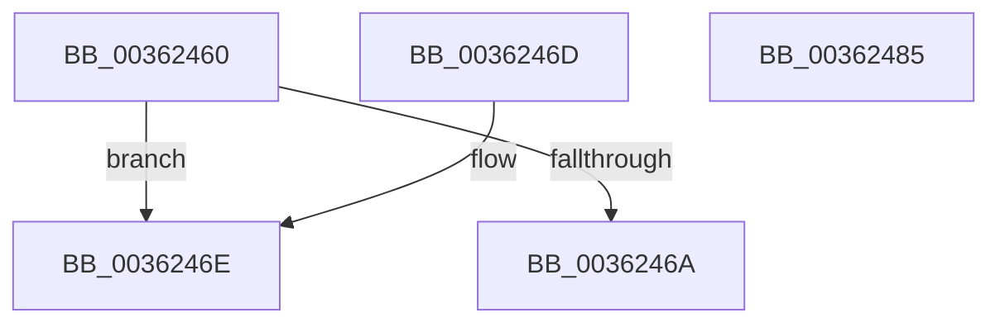

# MiIsPteInStore

- RVA: `0x00362460`–`0x00362486` (길이 `38` bytes)
- VA: `0x0000000140362460`
- 실행 섹션: `.text`
- PDB 이름 있음: `예`; PDB Function 태그: `아니요`
- unwind 정보 RVA: `0x000DB714`
- 디코드: `15`개 명령, `38/38` bytes 표시
- 미해석 바이트: `0` (있으면 어셈블리에 `.byte`로 보존)

> 이 문서는 커널 이미지의 기계어와 PDB 기호를 분석해 생성했습니다. 4번과 5번은 함수 원형과 자료형을 바이너리 사용 방식에서 추정한 C 해석이며 원본 소스 복구 결과는 아닙니다.

## 1. Dependencies

- 직접 호출 지점: **0**; 고유 호출 대상: **0**
- 직접 호출자로 확인된 함수: **9**
- RIP 상대 이미지 참조: **0**

### Outgoing calls
- 직접 디코드된 call 명령이 없습니다.

### Direct callers
- [MiResolveProtoCombine](../22/MiResolveProtoCombine_function_0022CD00.md) at `0x0022D06B`
- [MiRemoveLowestPriorityStandbyPage](../33/MiRemoveLowestPriorityStandbyPage_function_00334600.md) at `0x00334A74`
- [MiMakeFaultPfnActive](MiMakeFaultPfnActive_function_00361D00.md) at `0x00361D98`
- [MiComputeFaultCluster](MiComputeFaultCluster_function_003635B4.md) at `0x00363783`
- [MiResolvePageFileFault](MiResolvePageFileFault_function_0036D968.md) at `0x0036E7A4`
- [MiResolvePageFileFault](MiResolvePageFileFault_function_0036D968.md) at `0x0036EEC6`
- [MiIsStandbyPageCorrupted](../4D/MiIsStandbyPageCorrupted_function_004DEE50.md) at `0x004DEEB5`
- [MiCheckCommitReleaseFromVad](../66/MiCheckCommitReleaseFromVad_function_0066EB90.md) at `0x0066EECB`
- [MiReadPagefilePage](../66/MiReadPagefilePage_function_0066F78C.md) at `0x0066F878`
- [sub_006E313A](../6E/Unknown_function_006E313A.md) at `0x006E3235`

### Static image references
- 디코드된 RIP-relative 메모리 참조가 없습니다.

## 2. Other-region calls and transfers

- 다른 실행 섹션으로 향하는 call: **0**
- 별도 외부 분기/꼬리 이동을 확인하지 못했습니다.

## 3. Assembly (complete function range)

```asm
00362460  0F B6 C2                        movzx eax, dl
00362463  C0 E8 02                        shr al, 2
00362466  A8 01                           test al, 1
00362468  75 04                           jne 0x14036246e
0036246A  33 C0                           xor eax, eax
0036246C  C3                              ret
0036246D  CC                              int3
0036246E  44 8B 81 B4 04 00 00            mov r8d, dword ptr [rcx + 0x4b4]
00362475  33 C0                           xor eax, eax
00362477  48 C1 EA 0C                     shr rdx, 0xc
0036247B  83 E2 0F                        and edx, 0xf
0036247E  41 3B D0                        cmp edx, r8d
00362481  0F 94 C0                        sete al
00362484  C3                              ret
00362485  CC                              int3
```

## 4. C-style interpretation (structured pseudocode)

```c
__int64 __fastcall MiIsPteInStore(__int64 a1, __int64 a2)
{
    __int64 result;

    result = (unsigned __int8)(((unsigned __int8)(a2)) >> (2));
    if ((((unsigned __int8)(result)) & (1)) != 0) goto loc_0036246E;
    result = 0;
    return result;
loc_0036246E:
    result = 0;
    a2 = (a2) >> (12);
    a2 = (unsigned int)((a2) & (15));
    result = (((unsigned int)(a2)) == ((unsigned int)((unsigned int)(*(unsigned int *)(a1 + 1204))))) ? 1 : 0;
    return result;
}
```

## 5. (Beta) C Style

```c
int64_t MiIsPteInStore(void *Arg1, int64_t Arg2)
{
    uint8_t *arg1 = (uint8_t *)Arg1;

    int64_t result;

    result = (uint8_t)(((uint8_t)(Arg2)) >> (2));
    if ((((uint8_t)(result)) & (1)) != 0) goto loc_0036246E;
    result = 0;
    return result;
loc_0036246E:
    result = 0;
    Arg2 = (Arg2) >> (12);
    Arg2 = (uint32_t)((Arg2) & (15));
    result = (((uint32_t)(Arg2)) == ((uint32_t)((uint32_t)(*(uint32_t *)(arg1 + 0x4B4))))) ? 1 : 0;
    return result;
}
```

### 관측된 메모리 오프셋

구조체 형식이 확인되지 않은 접근은 인자 기준의 오프셋으로만 기록했습니다.

| 기준 인자 | 오프셋 표현 | 폭 (bit) | 접근 |
|---|---:|---:|---|
| `Arg1` | `+ 0x4B4` | `32` | `R` |

## 6. Execution-region graph

[열기: 2D/3D 그래프와 함수 탐색 컨트롤 패널](../../../control-panel.html?section=text&rva=0x00362460&view=graph)

- 2D 그래프는 위에서 아래로 흐르고, 3D 그래프는 빈 공간을 드래그해 회전합니다. Shift+드래그는 이동, 휠은 확대·축소, 함수 노드 선택은 대상 보고서 이동입니다.

### Static fallback


