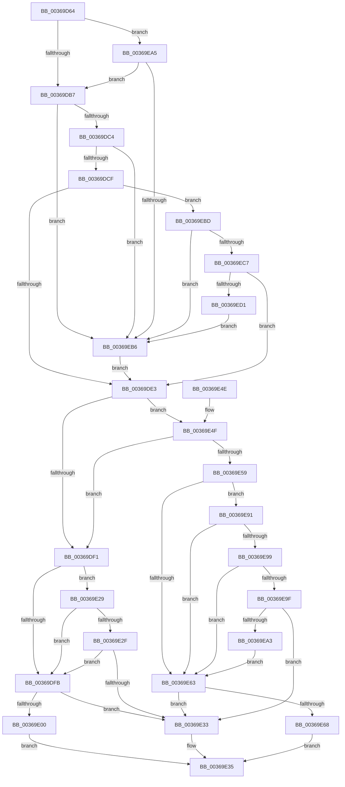

# MiIssueFlowThroughFault

- RVA: `0x00369D64`–`0x00369ED3` (길이 `367` bytes)
- VA: `0x0000000140369D64`
- 실행 섹션: `.text`
- PDB 이름 있음: `예`; PDB Function 태그: `아니요`
- unwind 정보 RVA: `0x0007A230`
- 디코드: `91`개 명령, `367/367` bytes 표시
- 미해석 바이트: `0` (있으면 어셈블리에 `.byte`로 보존)

> 이 문서는 커널 이미지의 기계어와 PDB 기호를 분석해 생성했습니다. 4번과 5번은 함수 원형과 자료형을 바이너리 사용 방식에서 추정한 C 해석이며 원본 소스 복구 결과는 아닙니다.

## 1. Dependencies

- 직접 호출 지점: **3**; 고유 호출 대상: **3**
- 직접 호출자로 확인된 함수: **1**
- RIP 상대 이미지 참조: **0**

### Outgoing calls
- `0x00369E22` → [MiResolvePageFileFault](MiResolvePageFileFault_function_0036D968.md) (function, `0x0036D968`)
- `0x00369E8A` → [MiResolveMappedFileFault](MiResolveMappedFileFault_function_0036B640.md) (function, `0x0036B640`)
- `0x00369EA8` → [PsGetIoPriorityThread](../34/PsGetIoPriorityThread_function_00343930.md) (function, `0x00343930`)

### Direct callers
- [MiHandleCollidedFault](MiHandleCollidedFault_function_00369B48.md) at `0x00369BA7`

### Static image references
- 디코드된 RIP-relative 메모리 참조가 없습니다.

## 2. Other-region calls and transfers

- 다른 실행 섹션으로 향하는 call: **0**
- 별도 외부 분기/꼬리 이동을 확인하지 못했습니다.

## 3. Assembly (complete function range)

```asm
00369D64  48 89 5C 24 08                  mov qword ptr [rsp + 8], rbx
00369D69  48 89 6C 24 10                  mov qword ptr [rsp + 0x10], rbp
00369D6E  48 89 74 24 18                  mov qword ptr [rsp + 0x18], rsi
00369D73  57                              push rdi
00369D74  41 56                           push r14
00369D76  41 57                           push r15
00369D78  48 83 EC 20                     sub rsp, 0x20
00369D7C  48 8B 74 24 68                  mov rsi, qword ptr [rsp + 0x68]
00369D81  32 DB                           xor bl, bl
00369D83  4C 8B 74 24 70                  mov r14, qword ptr [rsp + 0x70]
00369D88  49 8B E8                        mov rbp, r8
00369D8B  65 4C 8B 1C 25 88 01 00 00      mov r11, qword ptr gs:[0x188]
00369D94  4C 8B FA                        mov r15, rdx
00369D97  45 8B 91 C0 00 00 00            mov r10d, dword ptr [r9 + 0xc0]
00369D9E  48 8B F9                        mov rdi, rcx
00369DA1  48 83 26 00                     and qword ptr [rsi], 0
00369DA5  41 C7 06 02 00 00 00            mov dword ptr [r14], 2
00369DAC  41 0F BA E2 09                  bt r10d, 9
00369DB1  0F 82 EE 00 00 00               jb 0x140369ea5
00369DB7  4D 3B 99 98 00 00 00            cmp r11, qword ptr [r9 + 0x98]
00369DBE  0F 84 F2 00 00 00               je 0x140369eb6
00369DC4  41 F6 43 7D 02                  test byte ptr [r11 + 0x7d], 2
00369DC9  0F 85 E7 00 00 00               jne 0x140369eb6
00369DCF  49 8B 83 20 02 00 00            mov rax, qword ptr [r11 + 0x220]
00369DD6  83 B8 60 06 00 00 00            cmp dword ptr [rax + 0x660], 0
00369DDD  0F 85 DA 00 00 00               jne 0x140369ebd
00369DE3  48 8B 4C 24 60                  mov rcx, qword ptr [rsp + 0x60]
00369DE8  48 8B 41 28                     mov rax, qword ptr [rcx + 0x28]
00369DEC  48 85 C0                        test rax, rax
00369DEF  78 5E                           js 0x140369e4f
00369DF1  41 80 BB AE 05 00 00 01         cmp byte ptr [r11 + 0x5ae], 1
00369DF9  72 2E                           jb 0x140369e29
00369DFB  45 84 D2                        test r10b, r10b
00369DFE  78 33                           js 0x140369e33
00369E00  48 B8 FF FF FF FF FF FF FF 7F   movabs rax, 0x7fffffffffffffff
00369E0A  F0 48 21 41 18                  lock and qword ptr [rcx + 0x18], rax
00369E0F  4C 8B CE                        mov r9, rsi
00369E12  41 C7 06 01 00 00 00            mov dword ptr [r14], 1
00369E19  4C 8B C5                        mov r8, rbp
00369E1C  49 8B D7                        mov rdx, r15
00369E1F  48 8B CF                        mov rcx, rdi
00369E22  E8 41 3B 00 00                  call 0x14036d968
00369E27  EB 0C                           jmp 0x140369e35
00369E29  41 F6 C2 20                     test r10b, 0x20
00369E2D  75 CC                           jne 0x140369dfb
00369E2F  84 DB                           test bl, bl
00369E31  75 C8                           jne 0x140369dfb
00369E33  33 C0                           xor eax, eax
00369E35  48 8B 5C 24 40                  mov rbx, qword ptr [rsp + 0x40]
00369E3A  48 8B 6C 24 48                  mov rbp, qword ptr [rsp + 0x48]
00369E3F  48 8B 74 24 50                  mov rsi, qword ptr [rsp + 0x50]
00369E44  48 83 C4 20                     add rsp, 0x20
00369E48  41 5F                           pop r15
00369E4A  41 5E                           pop r14
00369E4C  5F                              pop rdi
00369E4D  C3                              ret
00369E4E  CC                              int3
00369E4F  8B 41 10                        mov eax, dword ptr [rcx + 0x10]
00369E52  48 0F BA E0 0A                  bt rax, 0xa
00369E57  73 98                           jae 0x140369df1
00369E59  41 83 BB E4 01 00 00 00         cmp dword ptr [r11 + 0x1e4], 0
00369E61  74 2E                           je 0x140369e91
00369E63  45 84 D2                        test r10b, r10b
00369E66  78 CB                           js 0x140369e33
00369E68  48 B8 FF FF FF FF FF FF FF 7F   movabs rax, 0x7fffffffffffffff
00369E72  F0 48 21 41 18                  lock and qword ptr [rcx + 0x18], rax
00369E77  4C 8B CE                        mov r9, rsi
00369E7A  41 C7 06 01 00 00 00            mov dword ptr [r14], 1
00369E81  4C 8B C5                        mov r8, rbp
00369E84  49 8B D7                        mov rdx, r15
00369E87  48 8B CF                        mov rcx, rdi
00369E8A  E8 B1 17 00 00                  call 0x14036b640
00369E8F  EB A4                           jmp 0x140369e35
00369E91  41 0F BA 63 74 0A               bt dword ptr [r11 + 0x74], 0xa
00369E97  72 CA                           jb 0x140369e63
00369E99  80 7F 44 00                     cmp byte ptr [rdi + 0x44], 0
00369E9D  75 C4                           jne 0x140369e63
00369E9F  84 DB                           test bl, bl
00369EA1  74 90                           je 0x140369e33
00369EA3  EB BE                           jmp 0x140369e63
00369EA5  49 8B CB                        mov rcx, r11
00369EA8  E8 83 9A FD FF                  call 0x140343930
00369EAD  83 F8 02                        cmp eax, 2
00369EB0  0F 8C 01 FF FF FF               jl 0x140369db7
00369EB6  B3 01                           mov bl, 1
00369EB8  E9 26 FF FF FF                  jmp 0x140369de3
00369EBD  49 83 B9 00 01 00 00 00         cmp qword ptr [r9 + 0x100], 0
00369EC5  75 EF                           jne 0x140369eb6
00369EC7  41 F6 C2 20                     test r10b, 0x20
00369ECB  0F 84 12 FF FF FF               je 0x140369de3
00369ED1  EB E3                           jmp 0x140369eb6
```

## 4. C-style interpretation (structured pseudocode)

```c
__int64 __fastcall MiIssueFlowThroughFault(__int64 a1, __int64 a2, __int64 a3, __int64 a4, __int64 a5, __int64 a6, __int64 a7)
{
    __int64 result;
    __int64 v_rbx;
    __int64 v_rsp;
    unsigned __int64 v_stack_p10;
    unsigned __int64 v_stack_p18;
    unsigned __int64 v_stack_p8;

    v_stack_p8 = v_rbx;
    v_stack_p10 = v_rbp;
    v_stack_p18 = v_rsi;
    v_rsp = (v_rsp) - (32);
    v_rbx = 0;
    *(unsigned int *)(a7) = 2;
    if (condition_is_below) goto loc_00369EA5;
loc_00369DB7:
    if ((*(unsigned __int64 *)(gs_base + (0 + 392))) == (*(unsigned __int64 *)(a4 + 152))) goto loc_00369EB6;
    if (((*(unsigned __int8 *)(*(unsigned __int64 *)(gs_base + (0 + 392)) + 125)) & (2)) != 0) goto loc_00369EB6;
    if ((*(unsigned int *)(*(unsigned __int64 *)(*(unsigned __int64 *)(gs_base + (0 + 392)) + 544) + 1632)) != 0) goto loc_00369EBD;
loc_00369DE3:
    if (sign_flag) goto loc_00369E4F;
loc_00369DF1:
    if ((*(unsigned __int8 *)(*(unsigned __int64 *)(gs_base + (0 + 392)) + 1454)) < 1) goto loc_00369E29;
loc_00369DFB:
    if (sign_flag) goto loc_00369E33;
    *(unsigned int *)(a7) = 1;
    result = MiResolvePageFileFault(a1, a2, a3, a6);
    goto loc_00369E35;
loc_00369E29:
    if ((((unsigned __int8)((unsigned int)(*(unsigned int *)(a4 + 192)))) & (32)) != 0) goto loc_00369DFB;
    if (0 != 0) goto loc_00369DFB;
loc_00369E33:
    result = 0;
loc_00369E35:
    v_rsp = (v_rsp) + (32);
    return result;
loc_00369E4F:
    if (condition_is_above_or_equal) goto loc_00369DF1;
    if ((*(unsigned int *)(*(unsigned __int64 *)(gs_base + (0 + 392)) + 484)) == 0) goto loc_00369E91;
loc_00369E63:
    if (sign_flag) goto loc_00369E33;
    *(unsigned int *)(a7) = 1;
    result = MiResolveMappedFileFault(a1, a2, v_stack_p10, v_stack_p18);
    goto loc_00369E35;
loc_00369E91:
    if (condition_is_below) goto loc_00369E63;
    if ((*(unsigned __int8 *)(a1 + 68)) != 0) goto loc_00369E63;
    if ((unsigned __int8)(v_stack_p8) == 0) goto loc_00369E33;
    goto loc_00369E63;
loc_00369EA5:
    result = PsGetIoPriorityThread(*(unsigned __int64 *)(gs_base + (0 + 392)), a2, v_stack_p10, v_stack_p18);
    if (((unsigned int)(result)) < 2) goto loc_00369DB7;
loc_00369EB6:
    goto loc_00369DE3;
loc_00369EBD:
    if ((*(unsigned __int64 *)(v_stack_p18 + 256)) != 0) goto loc_00369EB6;
    if ((((unsigned __int8)((unsigned int)(*(unsigned int *)(a4 + 192)))) & (32)) == 0) goto loc_00369DE3;
    goto loc_00369EB6;
}
```

## 5. (Beta) C Style

```c
int64_t MiIssueFlowThroughFault(void *Arg1, int64_t Arg2, int64_t Arg3, void *Arg4, void *Arg5, void *Arg6, void *Arg7)
{
    uint8_t *arg1 = (uint8_t *)Arg1;
    uint8_t *arg4 = (uint8_t *)Arg4;
    uint8_t *arg5 = (uint8_t *)Arg5;
    uint8_t *arg6 = (uint8_t *)Arg6;
    uint8_t *arg7 = (uint8_t *)Arg7;

    int64_t result;
    int64_t local_rbx;
    int64_t local_rsp;
    uint64_t v_stack_p10;
    uint64_t v_stack_p18;
    uint64_t v_stack_p8;

    v_stack_p8 = local_rbx;
    v_stack_p10 = local_rbp;
    v_stack_p18 = local_rsi;
    local_rsp = (local_rsp) - (32);
    local_rbx = 0;
    *(uint32_t *)(arg7) = 2;
    if (condition_is_below) goto loc_00369EA5;
loc_00369DB7:
    if ((*(uint64_t *)(gs_base + (0 + 0x188))) == (*(uint64_t *)(arg4 + 0x98))) goto loc_00369EB6;
    if (((*(uint8_t *)(*(uint64_t *)(gs_base + (0 + 0x188)) + 0x7D)) & (2)) != 0) goto loc_00369EB6;
    if ((*(uint32_t *)(*(uint64_t *)(*(uint64_t *)(gs_base + (0 + 0x188)) + 0x220) + 0x660)) != 0) goto loc_00369EBD;
loc_00369DE3:
    if (sign_flag) goto loc_00369E4F;
loc_00369DF1:
    if ((*(uint8_t *)(*(uint64_t *)(gs_base + (0 + 0x188)) + 0x5AE)) < 1) goto loc_00369E29;
loc_00369DFB:
    if (sign_flag) goto loc_00369E33;
    *(uint32_t *)(arg7) = 1;
    result = MiResolvePageFileFault(Arg1, Arg2, Arg3, Arg6);
    goto loc_00369E35;
loc_00369E29:
    if ((((uint8_t)((uint32_t)(*(uint32_t *)(arg4 + 0xC0)))) & (32)) != 0) goto loc_00369DFB;
    if (0 != 0) goto loc_00369DFB;
loc_00369E33:
    result = 0;
loc_00369E35:
    local_rsp = (local_rsp) + (32);
    return result;
loc_00369E4F:
    if (condition_is_above_or_equal) goto loc_00369DF1;
    if ((*(uint32_t *)(*(uint64_t *)(gs_base + (0 + 0x188)) + 0x1E4)) == 0) goto loc_00369E91;
loc_00369E63:
    if (sign_flag) goto loc_00369E33;
    *(uint32_t *)(arg7) = 1;
    result = MiResolveMappedFileFault(Arg1, Arg2, v_stack_p10, v_stack_p18);
    goto loc_00369E35;
loc_00369E91:
    if (condition_is_below) goto loc_00369E63;
    if ((*(uint8_t *)(arg1 + 0x44)) != 0) goto loc_00369E63;
    if ((uint8_t)(v_stack_p8) == 0) goto loc_00369E33;
    goto loc_00369E63;
loc_00369EA5:
    result = PsGetIoPriorityThread(*(uint64_t *)(gs_base + (0 + 0x188)), Arg2, v_stack_p10, v_stack_p18);
    if (((uint32_t)(result)) < 2) goto loc_00369DB7;
loc_00369EB6:
    goto loc_00369DE3;
loc_00369EBD:
    if ((*(uint64_t *)(v_stack_p18 + 0x100)) != 0) goto loc_00369EB6;
    if ((((uint8_t)((uint32_t)(*(uint32_t *)(arg4 + 0xC0)))) & (32)) == 0) goto loc_00369DE3;
    goto loc_00369EB6;
}
```

### 관측된 메모리 오프셋

구조체 형식이 확인되지 않은 접근은 인자 기준의 오프셋으로만 기록했습니다.

| 기준 인자 | 오프셋 표현 | 폭 (bit) | 접근 |
|---|---:|---:|---|
| `Arg1` | `+ 0x44` | `8` | `R` |
| `Arg4` | `+ 0xC0` | `32` | `R` |
| `Arg5` | `+ 0x10` | `32` | `R` |
| `Arg5` | `+ 0x18` | `64` | `R/W` |
| `Arg5` | `+ 0x28` | `64` | `R` |
| `Arg6` | `+ 0x0` | `64` | `R/W` |
| `Arg7` | `+ 0x0` | `32` | `W` |

## 6. Execution-region graph

[열기: 2D/3D 그래프와 함수 탐색 컨트롤 패널](../../../control-panel.html?section=text&rva=0x00369D64&view=graph)

- 2D 그래프는 위에서 아래로 흐르고, 3D 그래프는 빈 공간을 드래그해 회전합니다. Shift+드래그는 이동, 휠은 확대·축소, 함수 노드 선택은 대상 보고서 이동입니다.

### Static fallback


