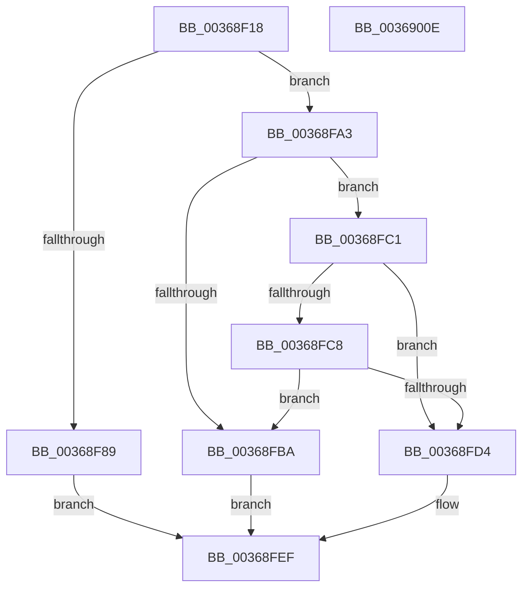

# MiKernelWriteToExecutableMemory

- RVA: `0x00368F18`–`0x0036900F` (길이 `247` bytes)
- VA: `0x0000000140368F18`
- 실행 섹션: `.text`
- PDB 이름 있음: `예`; PDB Function 태그: `아니요`
- unwind 정보 RVA: `0x00075C18`
- 디코드: `70`개 명령, `247/247` bytes 표시
- 미해석 바이트: `0` (있으면 어셈블리에 `.byte`로 보존)

> 이 문서는 커널 이미지의 기계어와 PDB 기호를 분석해 생성했습니다. 4번과 5번은 함수 원형과 자료형을 바이너리 사용 방식에서 추정한 C 해석이며 원본 소스 복구 결과는 아닙니다.

## 1. Dependencies

- 직접 호출 지점: **7**; 고유 호출 대상: **6**
- 직접 호출자로 확인된 함수: **1**
- RIP 상대 이미지 참조: **0**

### Outgoing calls
- `0x00368F78` → [MiReleaseFaultState](../27/MiReleaseFaultState_function_0027D290.md) (function, `0x0027D290`)
- `0x00368F80` → [NT_DISK::GetPnpProperty](../../page/70/NT_DISK_GetPnpProperty_function_00705A20.md) (function, `0x00705A20`)
- `0x00368F8C` → [MiForceCrashForInvalidAccess](../../page/AC/MiForceCrashForInvalidAccess_function_00ACEFA4.md) (function, `0x00ACEFA4`)
- `0x00368F9C` → [MiRelockFaultState](MiRelockFaultState_function_0036A230.md) (function, `0x0036A230`)
- `0x00368FA9` → [MiRelockFaultState](MiRelockFaultState_function_0036A230.md) (function, `0x0036A230`)
- `0x00368FCB` → [MmIsAddressValidEx](../27/MmIsAddressValidEx_function_0027FDD0.md) (function, `0x0027FDD0`)
- `0x00368FD7` → [MI_READ_PTE_LOCK_FREE](../28/MI_READ_PTE_LOCK_FREE_function_002828A0.md) (function, `0x002828A0`)

### Direct callers
- [sub_006E1C8E](../6E/Unknown_function_006E1C8E.md) at `0x006E1D0D`

### Static image references
- 디코드된 RIP-relative 메모리 참조가 없습니다.

## 2. Other-region calls and transfers

- 다른 실행 섹션으로 향하는 call: **2**
  - `0x00368F80` → [NT_DISK::GetPnpProperty](../../page/70/NT_DISK_GetPnpProperty_function_00705A20.md) (`.text` → `PAGE`)
  - `0x00368F8C` → [MiForceCrashForInvalidAccess](../../page/AC/MiForceCrashForInvalidAccess_function_00ACEFA4.md) (`.text` → `PAGE`)
- 별도 외부 분기/꼬리 이동을 확인하지 못했습니다.

## 3. Assembly (complete function range)

```asm
00368F18  48 89 5C 24 08                  mov qword ptr [rsp + 8], rbx
00368F1D  48 89 6C 24 10                  mov qword ptr [rsp + 0x10], rbp
00368F22  48 89 74 24 18                  mov qword ptr [rsp + 0x18], rsi
00368F27  57                              push rdi
00368F28  41 54                           push r12
00368F2A  41 55                           push r13
00368F2C  41 56                           push r14
00368F2E  41 57                           push r15
00368F30  48 83 EC 20                     sub rsp, 0x20
00368F34  48 8B 39                        mov rdi, qword ptr [rcx]
00368F37  48 B8 F8 FF FF FF 7F 00 00 00   movabs rax, 0x7ffffffff8
00368F41  48 C1 EF 09                     shr rdi, 9
00368F45  4D 8B E8                        mov r13, r8
00368F48  48 23 F8                        and rdi, rax
00368F4B  48 8B DA                        mov rbx, rdx
00368F4E  4C 8B F1                        mov r14, rcx
00368F51  48 B8 00 00 00 00 80 F6 FF FF   movabs rax, 0xfffff68000000000
00368F5B  4D 8B B8 10 04 00 00            mov r15, qword ptr [r8 + 0x410]
00368F62  48 8D 71 38                     lea rsi, [rcx + 0x38]
00368F66  45 33 C0                        xor r8d, r8d
00368F69  B2 11                           mov dl, 0x11
00368F6B  48 8B CE                        mov rcx, rsi
00368F6E  48 03 F8                        add rdi, rax
00368F71  4D 8B A7 70 05 00 00            mov r12, qword ptr [r15 + 0x570]
00368F78  E8 13 43 F1 FF                  call 0x14027d290
00368F7D  48 8B E8                        mov rbp, rax
00368F80  E8 9B CA 39 00                  call 0x140705a20
00368F85  85 C0                           test eax, eax
00368F87  79 1A                           jns 0x140368fa3
00368F89  49 8B CD                        mov rcx, r13
00368F8C  E8 13 60 76 00                  call 0x140acefa4
00368F91  48 8B D5                        mov rdx, rbp
00368F94  48 8B CE                        mov rcx, rsi
00368F97  BB 23 07 00 C0                  mov ebx, 0xc0000723
00368F9C  E8 8F 12 00 00                  call 0x14036a230
00368FA1  EB 4C                           jmp 0x140368fef
00368FA3  48 8B D5                        mov rdx, rbp
00368FA6  48 8B CE                        mov rcx, rsi
00368FA9  E8 82 12 00 00                  call 0x14036a230
00368FAE  49 8B 87 70 05 00 00            mov rax, qword ptr [r15 + 0x570]
00368FB5  4C 3B E0                        cmp r12, rax
00368FB8  74 07                           je 0x140368fc1
00368FBA  BB 34 04 00 C0                  mov ebx, 0xc0000434
00368FBF  EB 2E                           jmp 0x140368fef
00368FC1  41 F6 46 45 01                  test byte ptr [r14 + 0x45], 1
00368FC6  74 0C                           je 0x140368fd4
00368FC8  48 8B CF                        mov rcx, rdi
00368FCB  E8 00 6E F1 FF                  call 0x14027fdd0
00368FD0  84 C0                           test al, al
00368FD2  74 E6                           je 0x140368fba
00368FD4  48 8B CF                        mov rcx, rdi
00368FD7  E8 C4 98 F1 FF                  call 0x1402828a0
00368FDC  48 33 C3                        xor rax, rbx
00368FDF  BB 34 04 00 C0                  mov ebx, 0xc0000434
00368FE4  48 83 E0 DF                     and rax, 0xffffffffffffffdf
00368FE8  48 F7 D8                        neg rax
00368FEB  1B C9                           sbb ecx, ecx
00368FED  23 D9                           and ebx, ecx
00368FEF  48 8B 6C 24 58                  mov rbp, qword ptr [rsp + 0x58]
00368FF4  8B C3                           mov eax, ebx
00368FF6  48 8B 5C 24 50                  mov rbx, qword ptr [rsp + 0x50]
00368FFB  48 8B 74 24 60                  mov rsi, qword ptr [rsp + 0x60]
00369000  48 83 C4 20                     add rsp, 0x20
00369004  41 5F                           pop r15
00369006  41 5E                           pop r14
00369008  41 5D                           pop r13
0036900A  41 5C                           pop r12
0036900C  5F                              pop rdi
0036900D  C3                              ret
0036900E  CC                              int3
```

## 4. C-style interpretation (structured pseudocode)

```c
__int64 __fastcall MiKernelWriteToExecutableMemory(__int64 a1, __int64 a2, __int64 a3)
{
    __int64 result;
    __int64 v_rbx;
    __int64 v_rdi;
    __int64 v_rsp;
    unsigned __int64 v_stack_p10;
    unsigned __int64 v_stack_p18;
    unsigned __int64 v_stack_p8;

    v_stack_p8 = v_rbx;
    v_stack_p10 = v_rbp;
    v_stack_p18 = v_rsi;
    v_rsp = (v_rsp) - (32);
    v_rdi = (*(unsigned __int64 *)(a1)) >> (9);
    v_rdi = (v_rdi) & (result);
    a3 = 0;
    v_rdi = (v_rdi) + (result);
    result = MiReleaseFaultState(a1 + 56, 17, a3, a4);
    result = NT_DISK__GetPnpProperty(a1 + 56, 17, a3, a4);
    if (!sign_flag) goto loc_00368FA3;
    result = MiForceCrashForInvalidAccess(0, 17, a3, a4);
    result = MiRelockFaultState(a1 + 56, result, a3, a4);
    goto loc_00368FEF;
loc_00368FA3:
    result = MiRelockFaultState(a1 + 56, result, a3, a4);
    if ((*(unsigned __int64 *)(*(unsigned __int64 *)(a3 + 1040) + 1392)) == (*(unsigned __int64 *)(*(unsigned __int64 *)(a3 + 1040) + 1392))) goto loc_00368FC1;
loc_00368FBA:
    goto loc_00368FEF;
loc_00368FC1:
    if (((*(unsigned __int8 *)(a1 + 69)) & (1)) == 0) goto loc_00368FD4;
    result = MmIsAddressValidEx(v_rdi, result, a3, a4);
    if ((unsigned __int8)(result) == 0) goto loc_00368FBA;
loc_00368FD4:
    result = MI_READ_PTE_LOCK_FREE(v_rdi, result, a3, a4);
    result = (result) ^ ((unsigned int)(0xC0000434ULL));
    result = (result) & (-33);
    result = -(result);
    v_rbx = (unsigned int)(((unsigned int)(0xC0000434ULL)) & ((unsigned int)(v_rdi)));
loc_00368FEF:
    v_rsp = (v_rsp) + (32);
    return (unsigned int)((unsigned int)(v_rbx));
}
```

## 5. (Beta) C Style

```c
int64_t MiKernelWriteToExecutableMemory(void *Arg1, int64_t Arg2, void *Arg3)
{
    uint8_t *arg1 = (uint8_t *)Arg1;
    uint8_t *arg3 = (uint8_t *)Arg3;

    int64_t result;
    int64_t local_rbx;
    int64_t local_rdi;
    int64_t local_rsp;
    uint64_t v_stack_p10;
    uint64_t v_stack_p18;
    uint64_t v_stack_p8;

    v_stack_p8 = local_rbx;
    v_stack_p10 = local_rbp;
    v_stack_p18 = local_rsi;
    local_rsp = (local_rsp) - (32);
    local_rdi = (*(uint64_t *)(arg1)) >> (9);
    local_rdi = (local_rdi) & (result);
    Arg3 = 0;
    local_rdi = (local_rdi) + (result);
    result = MiReleaseFaultState(Arg1 + 56, 17, Arg3, a4);
    result = NT_DISK__GetPnpProperty(Arg1 + 56, 17, Arg3, a4);
    if (!sign_flag) goto loc_00368FA3;
    result = MiForceCrashForInvalidAccess(0, 17, Arg3, a4);
    result = MiRelockFaultState(Arg1 + 56, result, Arg3, a4);
    goto loc_00368FEF;
loc_00368FA3:
    result = MiRelockFaultState(Arg1 + 56, result, Arg3, a4);
    if ((*(uint64_t *)(*(uint64_t *)(arg3 + 0x410) + 0x570)) == (*(uint64_t *)(*(uint64_t *)(arg3 + 0x410) + 0x570))) goto loc_00368FC1;
loc_00368FBA:
    goto loc_00368FEF;
loc_00368FC1:
    if (((*(uint8_t *)(arg1 + 0x45)) & (1)) == 0) goto loc_00368FD4;
    result = MmIsAddressValidEx(local_rdi, result, Arg3, a4);
    if ((uint8_t)(result) == 0) goto loc_00368FBA;
loc_00368FD4:
    result = MI_READ_PTE_LOCK_FREE(local_rdi, result, Arg3, a4);
    result = (result) ^ ((uint32_t)(0xC0000434ULL));
    result = (result) & (-33);
    result = -(result);
    local_rbx = (uint32_t)(((uint32_t)(0xC0000434ULL)) & ((uint32_t)(local_rdi)));
loc_00368FEF:
    local_rsp = (local_rsp) + (32);
    return (uint32_t)((uint32_t)(local_rbx));
}
```

### 관측된 메모리 오프셋

구조체 형식이 확인되지 않은 접근은 인자 기준의 오프셋으로만 기록했습니다.

| 기준 인자 | 오프셋 표현 | 폭 (bit) | 접근 |
|---|---:|---:|---|
| `Arg1` | `+ 0x0` | `64` | `R` |
| `Arg1` | `+ 0x38` | `64` | `R` |
| `Arg1` | `+ 0x45` | `8` | `R` |
| `Arg3` | `+ 0x410` | `64` | `R` |

## 6. Execution-region graph

[열기: 2D/3D 그래프와 함수 탐색 컨트롤 패널](../../../control-panel.html?section=text&rva=0x00368F18&view=graph)

- 2D 그래프는 위에서 아래로 흐르고, 3D 그래프는 빈 공간을 드래그해 회전합니다. Shift+드래그는 이동, 휠은 확대·축소, 함수 노드 선택은 대상 보고서 이동입니다.

### Static fallback


