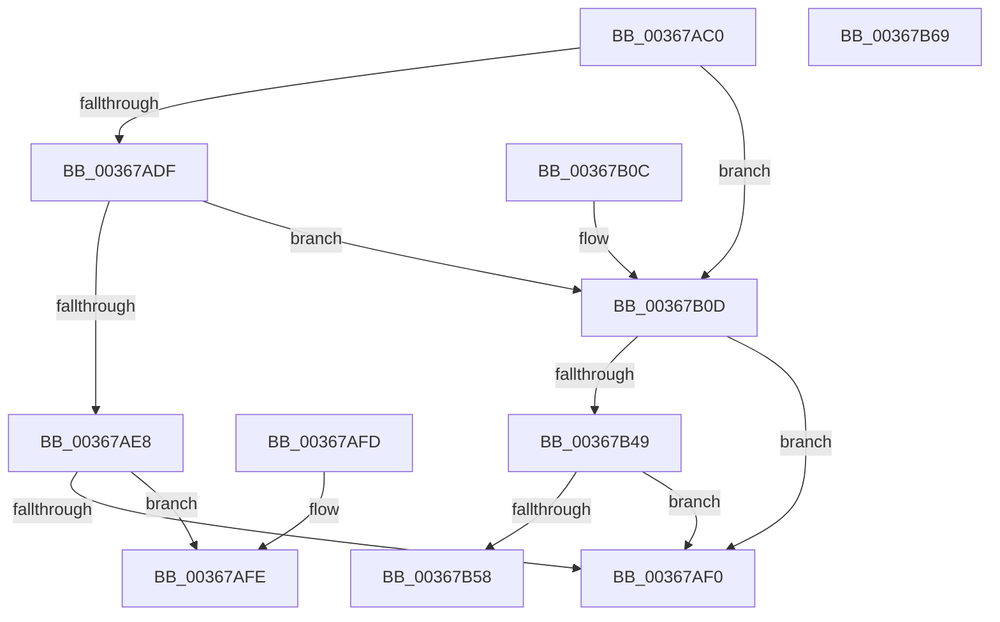

# MiLocatePagefileSubsection

- RVA: `0x00367AC0`–`0x00367B6A` (길이 `170` bytes)
- VA: `0x0000000140367AC0`
- 실행 섹션: `.text`
- PDB 이름 있음: `예`; PDB Function 태그: `아니요`
- unwind 정보 RVA: `0x0007A010`
- 디코드: `51`개 명령, `170/170` bytes 표시
- 미해석 바이트: `0` (있으면 어셈블리에 `.byte`로 보존)

> 이 문서는 커널 이미지의 기계어와 PDB 기호를 분석해 생성했습니다. 4번과 5번은 함수 원형과 자료형을 바이너리 사용 방식에서 추정한 C 해석이며 원본 소스 복구 결과는 아닙니다.

## 1. Dependencies

- 직접 호출 지점: **0**; 고유 호출 대상: **0**
- 직접 호출자로 확인된 함수: **7**
- RIP 상대 이미지 참조: **0**

### Outgoing calls
- 직접 디코드된 call 명령이 없습니다.

### Direct callers
- [sub_0024D9D1](../24/Unknown_function_0024D9D1.md) at `0x0024D9DB`
- [MiZeroCfgSystemWideBitmapWorker](MiZeroCfgSystemWideBitmapWorker_function_00367060.md) at `0x003670D9`
- [MiZeroCfgSystemWideBitmapWorker](MiZeroCfgSystemWideBitmapWorker_function_00367060.md) at `0x00367105`
- [MiSkipEntirePagefileRegions](MiSkipEntirePagefileRegions_function_00367B70.md) at `0x00367BB2`
- [sub_006DAEBA](../6D/Unknown_function_006DAEBA.md) at `0x006DAEC6`
- [sub_0088535F](../../page/88/Unknown_function_0088535F.md) at `0x0088536E`
- [MiUpdateCfgSystemWideBitmapWorker](../../page/8C/MiUpdateCfgSystemWideBitmapWorker_function_008CE650.md) at `0x008CE788`
- [MmCommitSessionMappedView](../../page/8C/MmCommitSessionMappedView_function_008CEA60.md) at `0x008CEB8D`

### Static image references
- 디코드된 RIP-relative 메모리 참조가 없습니다.

## 2. Other-region calls and transfers

- 다른 실행 섹션으로 향하는 call: **0**
- 별도 외부 분기/꼬리 이동을 확인하지 못했습니다.

## 3. Assembly (complete function range)

```asm
00367AC0  48 89 5C 24 08                  mov qword ptr [rsp + 8], rbx
00367AC5  48 89 7C 24 10                  mov qword ptr [rsp + 0x10], rdi
00367ACA  48 8B 01                        mov rax, qword ptr [rcx]
00367ACD  4C 8B DA                        mov r11, rdx
00367AD0  4C 8B 12                        mov r10, qword ptr [rdx]
00367AD3  F7 40 38 00 10 00 00            test dword ptr [rax + 0x38], 0x1000
00367ADA  8B 58 60                        mov ebx, dword ptr [rax + 0x60]
00367ADD  75 2E                           jne 0x140367b0d
00367ADF  81 79 30 00 00 00 40            cmp dword ptr [rcx + 0x30], 0x40000000
00367AE6  73 25                           jae 0x140367b0d
00367AE8  8B 41 2C                        mov eax, dword ptr [rcx + 0x2c]
00367AEB  4C 3B D0                        cmp r10, rax
00367AEE  72 0E                           jb 0x140367afe
00367AF0  33 C0                           xor eax, eax
00367AF2  48 8B 5C 24 08                  mov rbx, qword ptr [rsp + 8]
00367AF7  48 8B 7C 24 10                  mov rdi, qword ptr [rsp + 0x10]
00367AFC  C3                              ret
00367AFD  CC                              int3
00367AFE  48 8B C1                        mov rax, rcx
00367B01  48 8B 5C 24 08                  mov rbx, qword ptr [rsp + 8]
00367B06  48 8B 7C 24 10                  mov rdi, qword ptr [rsp + 0x10]
00367B0B  C3                              ret
00367B0C  CC                              int3
00367B0D  81 79 30 00 00 00 40            cmp dword ptr [rcx + 0x30], 0x40000000
00367B14  B8 00 00 02 00                  mov eax, 0x20000
00367B19  41 B9 00 00 04 00               mov r9d, 0x40000
00367B1F  44 0F 42 C8                     cmovb r9d, eax
00367B23  33 D2                           xor edx, edx
00367B25  49 8B C2                        mov rax, r10
00367B28  49 F7 F1                        div r9
00367B2B  33 D2                           xor edx, edx
00367B2D  44 8B C0                        mov r8d, eax
00367B30  48 8B F8                        mov rdi, rax
00367B33  49 8B C2                        mov rax, r10
00367B36  49 F7 F1                        div r9
00367B39  4D 8D 48 01                     lea r9, [r8 + 1]
00367B3D  48 85 D2                        test rdx, rdx
00367B40  4D 0F 44 C8                     cmove r9, r8
00367B44  4C 3B CB                        cmp r9, rbx
00367B47  77 A7                           ja 0x140367af0
00367B49  48 6B C7 58                     imul rax, rdi, 0x58
00367B4D  48 03 C8                        add rcx, rax
00367B50  8B 41 2C                        mov eax, dword ptr [rcx + 0x2c]
00367B53  48 3B D0                        cmp rdx, rax
00367B56  73 98                           jae 0x140367af0
00367B58  48 8B 5C 24 08                  mov rbx, qword ptr [rsp + 8]
00367B5D  48 8B C1                        mov rax, rcx
00367B60  48 8B 7C 24 10                  mov rdi, qword ptr [rsp + 0x10]
00367B65  49 89 13                        mov qword ptr [r11], rdx
00367B68  C3                              ret
00367B69  CC                              int3
```

## 4. C-style interpretation (structured pseudocode)

```c
__int64 __fastcall MiLocatePagefileSubsection(__int64 a1, __int64 a2)
{
    __int64 result;
    unsigned __int64 v_stack_p10;
    unsigned __int64 v_stack_p8;

    v_stack_p8 = v_rbx;
    v_stack_p10 = v_rdi;
    if (((*(unsigned int *)(*(unsigned __int64 *)(a1) + 56)) & (0x1000ULL)) != 0) goto loc_00367B0D;
    if ((*(unsigned int *)(a1 + 48)) >= 0x40000000ULL) goto loc_00367B0D;
    if ((*(unsigned __int64 *)(a2)) < ((unsigned int)(*(unsigned int *)(a1 + 44)))) goto loc_00367AFE;
loc_00367AF0:
    result = 0;
    return result;
loc_00367AFE:
    return a1;
loc_00367B0D:
    a4 = (unsigned int)(0x40000ULL);
    if ((*(unsigned int *)(a1 + 48)) < 0x40000000ULL) { a4 = (unsigned int)((unsigned int)(0x20000ULL)); }
    a2 = 0;
    a2 = 0;
    a4 = (unsigned int)((unsigned int)(*(unsigned __int64 *)(a2))) + 1;
    if (0 == 0) { a4 = (unsigned int)((unsigned int)(*(unsigned __int64 *)(a2))); }
    if (a4 > v_stack_p8) goto loc_00367AF0;
    result = (*(unsigned __int64 *)(a2)) * (*(unsigned __int64 *)(a2));
    a1 = (a1) + (result);
    if (0 >= ((unsigned int)(*(unsigned int *)(a1 + 44)))) goto loc_00367AF0;
    *(unsigned __int64 *)(a2) = 0;
    return a1;
}
```

## 5. (Beta) C Style

```c
int64_t MiLocatePagefileSubsection(void *Arg1, void *Arg2)
{
    uint8_t *arg1 = (uint8_t *)Arg1;
    uint8_t *arg2 = (uint8_t *)Arg2;

    int64_t result;
    uint64_t v_stack_p10;
    uint64_t v_stack_p8;

    v_stack_p8 = local_rbx;
    v_stack_p10 = local_rdi;
    if (((*(uint32_t *)(*(uint64_t *)(arg1) + 0x38)) & (0x1000ULL)) != 0) goto loc_00367B0D;
    if ((*(uint32_t *)(arg1 + 0x30)) >= 0x40000000ULL) goto loc_00367B0D;
    if ((*(uint64_t *)(arg2)) < ((uint32_t)(*(uint32_t *)(arg1 + 0x2C)))) goto loc_00367AFE;
loc_00367AF0:
    result = 0;
    return result;
loc_00367AFE:
    return Arg1;
loc_00367B0D:
    a4 = (uint32_t)(0x40000ULL);
    if ((*(uint32_t *)(arg1 + 0x30)) < 0x40000000ULL) { a4 = (uint32_t)((uint32_t)(0x20000ULL)); }
    Arg2 = 0;
    Arg2 = 0;
    a4 = (uint32_t)((uint32_t)(*(uint64_t *)(arg2))) + 1;
    if (0 == 0) { a4 = (uint32_t)((uint32_t)(*(uint64_t *)(arg2))); }
    if (a4 > v_stack_p8) goto loc_00367AF0;
    result = (*(uint64_t *)(arg2)) * (*(uint64_t *)(arg2));
    Arg1 = (Arg1) + (result);
    if (0 >= ((uint32_t)(*(uint32_t *)(arg1 + 0x2C)))) goto loc_00367AF0;
    *(uint64_t *)(arg2) = 0;
    return Arg1;
}
```

### 관측된 메모리 오프셋

구조체 형식이 확인되지 않은 접근은 인자 기준의 오프셋으로만 기록했습니다.

| 기준 인자 | 오프셋 표현 | 폭 (bit) | 접근 |
|---|---:|---:|---|
| `Arg1` | `+ 0x0` | `64` | `R` |
| `Arg1` | `+ 0x2C` | `32` | `R` |
| `Arg1` | `+ 0x30` | `32` | `R` |
| `Arg2` | `+ 0x0` | `64` | `R` |
| `Arg2` | `+ 0x0` | `64` | `W` |

## 6. Execution-region graph

[열기: 2D/3D 그래프와 함수 탐색 컨트롤 패널](../../../control-panel.html?section=text&rva=0x00367AC0&view=graph)

- 2D 그래프는 위에서 아래로 흐르고, 3D 그래프는 빈 공간을 드래그해 회전합니다. Shift+드래그는 이동, 휠은 확대·축소, 함수 노드 선택은 대상 보고서 이동입니다.

### Static fallback


