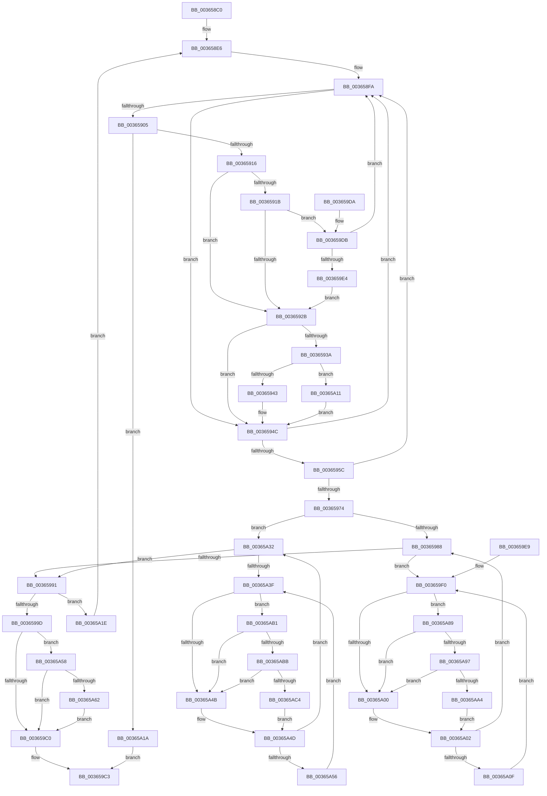

# MiLockLeafPage

- RVA: `0x003658C0`–`0x00365AD1` (길이 `529` bytes)
- VA: `0x00000001403658C0`
- 실행 섹션: `.text`
- PDB 이름 있음: `예`; PDB Function 태그: `아니요`
- unwind 정보 RVA: `0x00079F48`
- 디코드: `131`개 명령, `529/529` bytes 표시
- 미해석 바이트: `0` (있으면 어셈블리에 `.byte`로 보존)

> 이 문서는 커널 이미지의 기계어와 PDB 기호를 분석해 생성했습니다. 4번과 5번은 함수 원형과 자료형을 바이너리 사용 방식에서 추정한 C 해석이며 원본 소스 복구 결과는 아닙니다.

## 1. Dependencies

- 직접 호출 지점: **6**; 고유 호출 대상: **4**
- 직접 호출자로 확인된 함수: **22**
- RIP 상대 이미지 참조: **5**

### Outgoing calls
- `0x00365A65` → [MiReuseStandbyPage](../44/MiReuseStandbyPage_function_0044CA90.md) (function, `0x0044CA90`)
- `0x00365A6D` → [MiReleaseFreshPageLocked](../44/MiReleaseFreshPageLocked_function_0044CDD8.md) (function, `0x0044CDD8`)
- `0x00365A97` → [KiCheckVpBackingLongSpinWaitHypercall](../30/KiCheckVpBackingLongSpinWaitHypercall_function_0030F490.md) (function, `0x0030F490`)
- `0x00365AA7` → [HvlNotifyLongSpinWait](../30/HvlNotifyLongSpinWait_function_0030F460.md) (function, `0x0030F460`)
- `0x00365ABB` → [KiCheckVpBackingLongSpinWaitHypercall](../30/KiCheckVpBackingLongSpinWaitHypercall_function_0030F490.md) (function, `0x0030F490`)
- `0x00365AC7` → [HvlNotifyLongSpinWait](../30/HvlNotifyLongSpinWait_function_0030F460.md) (function, `0x0030F460`)

### Direct callers
- [MiTranslatePageForCopy](../22/MiTranslatePageForCopy_function_00228960.md) at `0x00228E64`
- [MiCombineWithExisting](../22/MiCombineWithExisting_function_0022B4B8.md) at `0x0022B591`
- [MiResolveProtoCombine](../22/MiResolveProtoCombine_function_0022CD00.md) at `0x0022CD59`
- [MiActOnPte](../24/MiActOnPte_function_00244C90.md) at `0x00244ECD`
- [MiActOnPte](../24/MiActOnPte_function_00244C90.md) at `0x00245692`
- [MiInitializeNewImageSectionProtos](../2A/MiInitializeNewImageSectionProtos_function_002ABB80.md) at `0x002ABC75`
- [MiGetWorkingSetInfoList](../2A/MiGetWorkingSetInfoList_function_002AF770.md) at `0x002B05B6`
- [MmCopyToCachedPage](../34/MmCopyToCachedPage_function_00347B44.md) at `0x00347E14`
- [MiPfPutPagesInTransition](MiPfPutPagesInTransition_function_003640EC.md) at `0x0036439A`
- [MiReplacePageOfProtoPool](MiReplacePageOfProtoPool_function_00364BB8.md) at `0x00364EE8`
- [MiSoftFaultMappedView](MiSoftFaultMappedView_function_00365364.md) at `0x0036551C`
- [MiWalkEntireImage](MiWalkEntireImage_function_00365D70.md) at `0x00366065`
- [MiZeroCfgSystemWideBitmapWorker](MiZeroCfgSystemWideBitmapWorker_function_00367060.md) at `0x0036719C`
- [MiDeleteSectionCluster](../37/MiDeleteSectionCluster_function_00373DF0.md) at `0x00374206`
- [MiReservePageFileSpaceForPage](../38/MiReservePageFileSpaceForPage_function_0038377C.md) at `0x00383ABA`
- [MiHandleSpecialPurposeMemoryCachedFault](../44/MiHandleSpecialPurposeMemoryCachedFault_function_0044C740.md) at `0x0044C8ED`
- [MiMakeImageReadOnly](../49/MiMakeImageReadOnly_function_0049CB74.md) at `0x0049CBEB`
- [MiDeletePerSessionProtos](../4A/MiDeletePerSessionProtos_function_004A0840.md) at `0x004A08AB`
- [MiDecrementLargeSubsections](../4D/MiDecrementLargeSubsections_function_004D2BE0.md) at `0x004D2C4F`
- [MiEliminateStaleExtents](../68/MiEliminateStaleExtents_function_006809A8.md) at `0x00680A01`
- [MiEnableLargeSubsection](../68/MiEnableLargeSubsection_function_00680BC4.md) at `0x00680C63`
- [MiFillFileOnlyProtoAsBad](../68/MiFillFileOnlyProtoAsBad_function_00680DB8.md) at `0x00680E01`
- [MiPurgeFileOnlyPfn](../68/MiPurgeFileOnlyPfn_function_00681CEC.md) at `0x00681D87`

### Static image references
- `0x0036591B` → RVA `0x00E2DC80` (`.data`; read)
- `0x00365953` → RVA `0x00E2DCE0` (`.data`; read)
- `0x003659A1` → RVA `0x00E30088` (`.data`; read)
- `0x003659F3` → RVA `0x00FC52AC` (`ALMOSTRO`; reference)
- `0x00365A89` → RVA `0x00FC6AB8` (`ALMOSTRO`; read)

## 2. Other-region calls and transfers

- 다른 실행 섹션으로 향하는 call: **0**
- 별도 외부 분기/꼬리 이동을 확인하지 못했습니다.

## 3. Assembly (complete function range)

```asm
003658C0  48 89 5C 24 18                  mov qword ptr [rsp + 0x18], rbx
003658C5  56                              push rsi
003658C6  57                              push rdi
003658C7  41 54                           push r12
003658C9  41 55                           push r13
003658CB  41 57                           push r15
003658CD  48 83 EC 20                     sub rsp, 0x20
003658D1  44 8B E2                        mov r12d, edx
003658D4  4C 89 74 24 58                  mov qword ptr [rsp + 0x58], r14
003658D9  48 8B F1                        mov rsi, rcx
003658DC  49 BD FF FF FF FF FF 00 00 00   movabs r13, 0xffffffffff
003658E6  48 BA 00 00 00 00 00 DE FF FF   movabs rdx, 0xffffde0000000000
003658F0  49 B8 28 00 00 00 00 DE FF FF   movabs r8, 0xffffde0000000028
003658FA  48 8B 1E                        mov rbx, qword ptr [rsi]
003658FD  48 8B C3                        mov rax, rbx
00365900  F6 C3 01                        test bl, 1
00365903  75 47                           jne 0x14036594c
00365905  25 00 0C 00 00                  and eax, 0xc00
0036590A  48 3D 00 08 00 00               cmp rax, 0x800
00365910  0F 85 04 01 00 00               jne 0x140365a1a
00365916  48 85 DB                        test rbx, rbx
00365919  74 10                           je 0x14036592b
0036591B  48 8B 05 5E 83 AC 00            mov rax, qword ptr [rip + 0xac835e]
00365922  48 85 C0                        test rax, rax
00365925  0F 85 B0 00 00 00               jne 0x1403659db
0036592B  48 8B 0D 4E 83 AC 00            mov rcx, qword ptr [rip + 0xac834e]
00365932  48 8B C3                        mov rax, rbx
00365935  48 85 C9                        test rcx, rcx
00365938  74 12                           je 0x14036594c
0036593A  F6 C3 10                        test bl, 0x10
0036593D  0F 85 CE 00 00 00               jne 0x140365a11
00365943  48 8B C1                        mov rax, rcx
00365946  48 F7 D0                        not rax
00365949  48 23 C3                        and rax, rbx
0036594C  48 C1 E8 0C                     shr rax, 0xc
00365950  49 23 C5                        and rax, r13
00365953  48 3B 05 86 83 AC 00            cmp rax, qword ptr [rip + 0xac8386]
0036595A  77 9E                           ja 0x1403658fa
0036595C  48 8D 0C 40                     lea rcx, [rax + rax*2]
00365960  48 03 C9                        add rcx, rcx
00365963  49 8B C0                        mov rax, r8
00365966  48 8B 04 C8                     mov rax, qword ptr [rax + rcx*8]
0036596A  48 C1 E8 36                     shr rax, 0x36
0036596E  0F BA E0 00                     bt eax, 0
00365972  73 86                           jae 0x1403658fa
00365974  48 8B C2                        mov rax, rdx
00365977  45 33 FF                        xor r15d, r15d
0036597A  4C 8D 34 C8                     lea r14, [rax + rcx*8]
0036597E  41 F6 C4 01                     test r12b, 1
00365982  0F 85 AA 00 00 00               jne 0x140365a32
00365988  F0 49 0F BA 6E 18 3F            lock bts qword ptr [r14 + 0x18], 0x3f
0036598F  72 5F                           jb 0x1403659f0
00365991  48 8B 06                        mov rax, qword ptr [rsi]
00365994  48 3B C3                        cmp rax, rbx
00365997  0F 85 81 00 00 00               jne 0x140365a1e
0036599D  49 8B 46 28                     mov rax, qword ptr [r14 + 0x28]
003659A1  48 8B 15 E0 A6 AC 00            mov rdx, qword ptr [rip + 0xaca6e0]
003659A8  48 C1 E8 2B                     shr rax, 0x2b
003659AC  25 FF 03 00 00                  and eax, 0x3ff
003659B1  48 8B 04 C2                     mov rax, qword ptr [rdx + rax*8]
003659B5  8B 40 04                        mov eax, dword ptr [rax + 4]
003659B8  84 C0                           test al, al
003659BA  0F 88 98 00 00 00               js 0x140365a58
003659C0  49 8B C6                        mov rax, r14
003659C3  4C 8B 74 24 58                  mov r14, qword ptr [rsp + 0x58]
003659C8  48 8B 5C 24 60                  mov rbx, qword ptr [rsp + 0x60]
003659CD  48 83 C4 20                     add rsp, 0x20
003659D1  41 5F                           pop r15
003659D3  41 5D                           pop r13
003659D5  41 5C                           pop r12
003659D7  5F                              pop rdi
003659D8  5E                              pop rsi
003659D9  C3                              ret
003659DA  CC                              int3
003659DB  48 85 C3                        test rbx, rax
003659DE  0F 84 16 FF FF FF               je 0x1403658fa
003659E4  E9 42 FF FF FF                  jmp 0x14036592b
003659E9  0F 1F 80 00 00 00 00            nop dword ptr [rax]
003659F0  41 FF C7                        inc r15d
003659F3  44 85 3D B2 F8 C5 00            test dword ptr [rip + 0xc5f8b2], r15d
003659FA  0F 84 89 00 00 00               je 0x140365a89
00365A00  F3 90                           pause
00365A02  49 8B 46 18                     mov rax, qword ptr [r14 + 0x18]
00365A06  48 85 C0                        test rax, rax
00365A09  0F 89 79 FF FF FF               jns 0x140365988
00365A0F  EB DF                           jmp 0x1403659f0
00365A11  48 83 E0 EF                     and rax, 0xffffffffffffffef
00365A15  E9 32 FF FF FF                  jmp 0x14036594c
00365A1A  33 C0                           xor eax, eax
00365A1C  EB A5                           jmp 0x1403659c3
00365A1E  48 B8 FF FF FF FF FF FF FF 7F   movabs rax, 0x7fffffffffffffff
00365A28  F0 49 21 46 18                  lock and qword ptr [r14 + 0x18], rax
00365A2D  E9 B4 FE FF FF                  jmp 0x1403658e6
00365A32  F0 49 0F BA 6E 18 3F            lock bts qword ptr [r14 + 0x18], 0x3f
00365A39  0F 83 52 FF FF FF               jae 0x140365991
00365A3F  41 FF C7                        inc r15d
00365A42  44 85 3D 63 F8 C5 00            test dword ptr [rip + 0xc5f863], r15d
00365A49  74 66                           je 0x140365ab1
00365A4B  F3 90                           pause
00365A4D  49 8B 46 18                     mov rax, qword ptr [r14 + 0x18]
00365A51  48 85 C0                        test rax, rax
00365A54  79 DC                           jns 0x140365a32
00365A56  EB E7                           jmp 0x140365a3f
00365A58  41 F6 C4 02                     test r12b, 2
00365A5C  0F 85 5E FF FF FF               jne 0x1403659c0
00365A62  49 8B CE                        mov rcx, r14
00365A65  E8 26 70 0E 00                  call 0x14044ca90
00365A6A  49 8B CE                        mov rcx, r14
00365A6D  E8 66 73 0E 00                  call 0x14044cdd8
00365A72  48 B8 FF FF FF FF FF FF FF 7F   movabs rax, 0x7fffffffffffffff
00365A7C  F0 49 21 46 18                  lock and qword ptr [r14 + 0x18], rax
00365A81  45 33 F6                        xor r14d, r14d
00365A84  E9 37 FF FF FF                  jmp 0x1403659c0
00365A89  8B 05 29 10 C6 00               mov eax, dword ptr [rip + 0xc61029]
00365A8F  A8 40                           test al, 0x40
00365A91  0F 84 69 FF FF FF               je 0x140365a00
00365A97  E8 F4 99 FA FF                  call 0x14030f490
00365A9C  84 C0                           test al, al
00365A9E  0F 84 5C FF FF FF               je 0x140365a00
00365AA4  41 8B CF                        mov ecx, r15d
00365AA7  E8 B4 99 FA FF                  call 0x14030f460
00365AAC  E9 51 FF FF FF                  jmp 0x140365a02
00365AB1  8B 05 01 10 C6 00               mov eax, dword ptr [rip + 0xc61001]
00365AB7  A8 40                           test al, 0x40
00365AB9  74 90                           je 0x140365a4b
00365ABB  E8 D0 99 FA FF                  call 0x14030f490
00365AC0  84 C0                           test al, al
00365AC2  74 87                           je 0x140365a4b
00365AC4  41 8B CF                        mov ecx, r15d
00365AC7  E8 94 99 FA FF                  call 0x14030f460
00365ACC  E9 7C FF FF FF                  jmp 0x140365a4d
```

## 4. C-style interpretation (structured pseudocode)

```c
__int64 __fastcall MiLockLeafPage(__int64 a1, int a2)
{
    __int64 result;
    __int64 v_r14;
    __int64 v_r15;
    __int64 v_rsp;
    unsigned __int64 v_stack_p10;
    unsigned __int64 v_stack_p18;

    v_stack_p18 = v_rbx;
    v_rsp = (v_rsp) - (32);
    v_stack_p10 = v_r14;
loc_003658E6:
loc_003658FA:
    if ((((unsigned __int8)(*(unsigned __int64 *)(a1))) & (1)) != 0) goto loc_0036594C;
    result = (unsigned int)((*(unsigned __int64 *)(a1)) & (0xC00ULL));
    if (result != 0x800ULL) goto loc_00365A1A;
    if (*(unsigned __int64 *)(a1) == 0) goto loc_0036592B;
    if (*(unsigned __int64 *)(v_rip + 11305822) != 0) goto loc_003659DB;
loc_0036592B:
    if (*(unsigned __int64 *)(v_rip + 11305806) == 0) goto loc_0036594C;
    if ((((unsigned __int8)(*(unsigned __int64 *)(a1))) & (16)) != 0) goto loc_00365A11;
    result = ~(*(unsigned __int64 *)(v_rip + 11305806));
    result = (result) & (*(unsigned __int64 *)(a1));
loc_0036594C:
    result = (result) >> (12);
    result = (result) & (v_r13);
    if (result > (*(unsigned __int64 *)(v_rip + 11305862))) goto loc_003658FA;
    a1 = (result + result * 2) + (result + result * 2);
    result = (*(unsigned __int64 *)(a3 + a1 * 8)) >> (54);
    if (condition_is_above_or_equal) goto loc_003658FA;
    v_r15 = 0;
    if ((((unsigned __int8)((unsigned int)(a2))) & (1)) != 0) goto loc_00365A32;
loc_00365988:
    if (condition_is_below) goto loc_003659F0;
loc_00365991:
    if ((*(unsigned __int64 *)(a1)) != (*(unsigned __int64 *)(a1))) goto loc_00365A1E;
    result = (*(unsigned __int64 *)(a2 + a1 * 8 + 40)) >> (43);
    result = (unsigned int)((result) & (0x3FFULL));
    if (sign_flag) goto loc_00365A58;
loc_003659C0:
loc_003659C3:
    v_rsp = (v_rsp) + (32);
    return a2 + a1 * 8;
loc_003659DB:
    if (((v_stack_p18) & (a2 + a1 * 8)) == 0) goto loc_003658FA;
    goto loc_0036592B;
loc_003659F0:
    v_r15 = (unsigned int)((v_r15) + 1);
    if (((*(unsigned int *)(v_rip + 12974258)) & ((unsigned int)(v_r15))) == 0) goto loc_00365A89;
loc_00365A00:
loc_00365A02:
    if (!sign_flag) goto loc_00365988;
    goto loc_003659F0;
loc_00365A11:
    result = (*(unsigned __int64 *)(v_stack_p10 + 24)) & (-17);
    goto loc_0036594C;
loc_00365A1A:
    result = 0;
    goto loc_003659C3;
loc_00365A1E:
    goto loc_003658E6;
loc_00365A32:
    if (condition_is_above_or_equal) goto loc_00365991;
loc_00365A3F:
    v_r15 = (unsigned int)((v_r15) + 1);
    if (((*(unsigned int *)(v_rip + 12974179)) & ((unsigned int)(v_r15))) == 0) goto loc_00365AB1;
loc_00365A4B:
loc_00365A4D:
    if (!sign_flag) goto loc_00365A32;
    goto loc_00365A3F;
loc_00365A58:
    if ((((unsigned __int8)((unsigned int)(a2))) & (2)) != 0) goto loc_003659C0;
    result = MiReuseStandbyPage(v_stack_p10, *(unsigned __int64 *)(v_rip + 11314912), a3, a4);
    result = MiReleaseFreshPageLocked(v_stack_p10, *(unsigned __int64 *)(v_rip + 11314912), a3, a4);
    v_r14 = 0;
    goto loc_003659C0;
loc_00365A89:
    if ((((unsigned __int8)((unsigned int)(*(unsigned int *)(v_rip + 12980265)))) & (64)) == 0) goto loc_00365A00;
    result = KiCheckVpBackingLongSpinWaitHypercall(v_stack_p10, *(unsigned __int64 *)(v_rip + 11314912), a3, a4);
    if ((unsigned __int8)(result) == 0) goto loc_00365A00;
    result = HvlNotifyLongSpinWait((unsigned int)((unsigned int)(v_r15)), *(unsigned __int64 *)(v_rip + 11314912), a3, a4);
    goto loc_00365A02;
loc_00365AB1:
    if ((((unsigned __int8)((unsigned int)(*(unsigned int *)(v_rip + 12980225)))) & (64)) == 0) goto loc_00365A4B;
    result = KiCheckVpBackingLongSpinWaitHypercall((unsigned int)((unsigned int)(v_r15)), *(unsigned __int64 *)(v_rip + 11314912), a3, a4);
    if ((unsigned __int8)(result) == 0) goto loc_00365A4B;
    result = HvlNotifyLongSpinWait((unsigned int)((unsigned int)(v_r15)), *(unsigned __int64 *)(v_rip + 11314912), a3, a4);
    goto loc_00365A4D;
}
```

## 5. (Beta) C Style

```c
int64_t MiLockLeafPage(void *Arg1, int32_t Arg2)
{
    uint8_t *arg1 = (uint8_t *)Arg1;

    int64_t result;
    int64_t local_r14;
    int64_t local_r15;
    int64_t local_rsp;
    uint64_t v_stack_p10;
    uint64_t v_stack_p18;

    v_stack_p18 = local_rbx;
    local_rsp = (local_rsp) - (32);
    v_stack_p10 = local_r14;
loc_003658E6:
loc_003658FA:
    if ((((uint8_t)(*(uint64_t *)(arg1))) & (1)) != 0) goto loc_0036594C;
    result = (uint32_t)((*(uint64_t *)(arg1)) & (0xC00ULL));
    if (result != 0x800ULL) goto loc_00365A1A;
    if (*(uint64_t *)(arg1) == 0) goto loc_0036592B;
    if (*(uint64_t *)(v_rip + 0xAC835E) != 0) goto loc_003659DB;
loc_0036592B:
    if (*(uint64_t *)(v_rip + 0xAC834E) == 0) goto loc_0036594C;
    if ((((uint8_t)(*(uint64_t *)(arg1))) & (16)) != 0) goto loc_00365A11;
    result = ~(*(uint64_t *)(v_rip + 0xAC834E));
    result = (result) & (*(uint64_t *)(arg1));
loc_0036594C:
    result = (result) >> (12);
    result = (result) & (local_r13);
    if (result > (*(uint64_t *)(v_rip + 0xAC8386))) goto loc_003658FA;
    Arg1 = (result + result * 2) + (result + result * 2);
    result = (*(uint64_t *)(a3 + arg1 * 8)) >> (54);
    if (condition_is_above_or_equal) goto loc_003658FA;
    local_r15 = 0;
    if ((((uint8_t)((uint32_t)(Arg2))) & (1)) != 0) goto loc_00365A32;
loc_00365988:
    if (condition_is_below) goto loc_003659F0;
loc_00365991:
    if ((*(uint64_t *)(arg1)) != (*(uint64_t *)(arg1))) goto loc_00365A1E;
    result = (*(uint64_t *)(Arg2 + arg1 * 8 + 0x28)) >> (43);
    result = (uint32_t)((result) & (0x3FFULL));
    if (sign_flag) goto loc_00365A58;
loc_003659C0:
loc_003659C3:
    local_rsp = (local_rsp) + (32);
    return Arg2 + Arg1 * 8;
loc_003659DB:
    if (((v_stack_p18) & (Arg2 + Arg1 * 8)) == 0) goto loc_003658FA;
    goto loc_0036592B;
loc_003659F0:
    local_r15 = (uint32_t)((local_r15) + 1);
    if (((*(uint32_t *)(v_rip + 0xC5F8B2)) & ((uint32_t)(local_r15))) == 0) goto loc_00365A89;
loc_00365A00:
loc_00365A02:
    if (!sign_flag) goto loc_00365988;
    goto loc_003659F0;
loc_00365A11:
    result = (*(uint64_t *)(v_stack_p10 + 0x18)) & (-17);
    goto loc_0036594C;
loc_00365A1A:
    result = 0;
    goto loc_003659C3;
loc_00365A1E:
    goto loc_003658E6;
loc_00365A32:
    if (condition_is_above_or_equal) goto loc_00365991;
loc_00365A3F:
    local_r15 = (uint32_t)((local_r15) + 1);
    if (((*(uint32_t *)(v_rip + 0xC5F863)) & ((uint32_t)(local_r15))) == 0) goto loc_00365AB1;
loc_00365A4B:
loc_00365A4D:
    if (!sign_flag) goto loc_00365A32;
    goto loc_00365A3F;
loc_00365A58:
    if ((((uint8_t)((uint32_t)(Arg2))) & (2)) != 0) goto loc_003659C0;
    result = MiReuseStandbyPage(v_stack_p10, *(uint64_t *)(v_rip + 0xACA6E0), a3, a4);
    result = MiReleaseFreshPageLocked(v_stack_p10, *(uint64_t *)(v_rip + 0xACA6E0), a3, a4);
    local_r14 = 0;
    goto loc_003659C0;
loc_00365A89:
    if ((((uint8_t)((uint32_t)(*(uint32_t *)(v_rip + 0xC61029)))) & (64)) == 0) goto loc_00365A00;
    result = KiCheckVpBackingLongSpinWaitHypercall(v_stack_p10, *(uint64_t *)(v_rip + 0xACA6E0), a3, a4);
    if ((uint8_t)(result) == 0) goto loc_00365A00;
    result = HvlNotifyLongSpinWait((uint32_t)((uint32_t)(local_r15)), *(uint64_t *)(v_rip + 0xACA6E0), a3, a4);
    goto loc_00365A02;
loc_00365AB1:
    if ((((uint8_t)((uint32_t)(*(uint32_t *)(v_rip + 0xC61001)))) & (64)) == 0) goto loc_00365A4B;
    result = KiCheckVpBackingLongSpinWaitHypercall((uint32_t)((uint32_t)(local_r15)), *(uint64_t *)(v_rip + 0xACA6E0), a3, a4);
    if ((uint8_t)(result) == 0) goto loc_00365A4B;
    result = HvlNotifyLongSpinWait((uint32_t)((uint32_t)(local_r15)), *(uint64_t *)(v_rip + 0xACA6E0), a3, a4);
    goto loc_00365A4D;
}
```

### 관측된 메모리 오프셋

구조체 형식이 확인되지 않은 접근은 인자 기준의 오프셋으로만 기록했습니다.

| 기준 인자 | 오프셋 표현 | 폭 (bit) | 접근 |
|---|---:|---:|---|
| `Arg1` | `+ 0x0` | `64` | `R` |

## 6. Execution-region graph

[열기: 2D/3D 그래프와 함수 탐색 컨트롤 패널](../../../control-panel.html?section=text&rva=0x003658C0&view=graph)

- 2D 그래프는 위에서 아래로 흐르고, 3D 그래프는 빈 공간을 드래그해 회전합니다. Shift+드래그는 이동, 휠은 확대·축소, 함수 노드 선택은 대상 보고서 이동입니다.

### Static fallback


