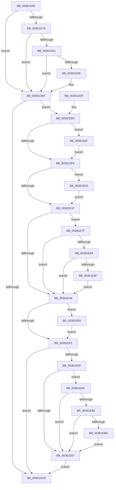

# MiMakeFaultPfnActive

- RVA: `0x00361D00`–`0x00361EF6` (길이 `502` bytes)
- VA: `0x0000000140361D00`
- 실행 섹션: `.text`
- PDB 이름 있음: `예`; PDB Function 태그: `아니요`
- unwind 정보 RVA: `0x00079D64`
- 디코드: `134`개 명령, `502/502` bytes 표시
- 미해석 바이트: `0` (있으면 어셈블리에 `.byte`로 보존)

> 이 문서는 커널 이미지의 기계어와 PDB 기호를 분석해 생성했습니다. 4번과 5번은 함수 원형과 자료형을 바이너리 사용 방식에서 추정한 C 해석이며 원본 소스 복구 결과는 아닙니다.

## 1. Dependencies

- 직접 호출 지점: **13**; 고유 호출 대상: **12**
- 직접 호출자로 확인된 함수: **1**
- RIP 상대 이미지 참조: **2**

### Outgoing calls
- `0x00361D27` → [MiAddLockedPageCharge](../28/MiAddLockedPageCharge_function_0028B550.md) (function, `0x0028B550`)
- `0x00361D6A` → [MiRemoveLockedPageChargeAndDecRef](../24/MiRemoveLockedPageChargeAndDecRef_function_002459D0.md) (function, `0x002459D0`)
- `0x00361D98` → [MiIsPteInStore](MiIsPteInStore_function_00362460.md) (function, `0x00362460`)
- `0x00361DA4` → [MiCaptureDirtyBitToPfn](../37/MiCaptureDirtyBitToPfn_function_00370DD0.md) (function, `0x00370DD0`)
- `0x00361DBA` → [MiReleasePageFileInfo](../28/MiReleasePageFileInfo_function_00283FD0.md) (function, `0x00283FD0`)
- `0x00361DEA` → [MI_READ_PTE_LOCK_FREE](../28/MI_READ_PTE_LOCK_FREE_function_002828A0.md) (function, `0x002828A0`)
- `0x00361DFD` → [MiMakeTransitionPteValid](../28/MiMakeTransitionPteValid_function_00283D60.md) (function, `0x00283D60`)
- `0x00361E12` → [MiPteInShadowRange](../23/MiPteInShadowRange_function_0023FB00.md) (function, `0x0023FB00`)
- `0x00361E75` → [MiMakeProtoReadOnly](../49/MiMakeProtoReadOnly_function_004952F8.md) (function, `0x004952F8`)
- `0x00361E9B` → [MiCheckLinearProtectedPteAccessedBit](../29/MiCheckLinearProtectedPteAccessedBit_function_00292D80.md) (function, `0x00292D80`)
- `0x00361EC9` → [MiCheckLinearProtectedPteAccessedBit](../29/MiCheckLinearProtectedPteAccessedBit_function_00292D80.md) (function, `0x00292D80`)
- `0x00361ED5` → [MiSanitizeShadowPxe](../29/MiSanitizeShadowPxe_function_00294B68.md) (function, `0x00294B68`)
- `0x00361EEC` → [MiWritePteShadow](../29/MiWritePteShadow_function_00294EAC.md) (function, `0x00294EAC`)

### Direct callers
- [MiHardFaultPageRelease](../2B/MiHardFaultPageRelease_function_002B5728.md) at `0x002B583C`

### Static image references
- `0x00361D7D` → RVA `0x00E30088` (`.data`; read)
- `0x00361E33` → RVA `0x00FC6A88` (`ALMOSTRO`; read)

## 2. Other-region calls and transfers

- 다른 실행 섹션으로 향하는 call: **0**
- 별도 외부 분기/꼬리 이동을 확인하지 못했습니다.

## 3. Assembly (complete function range)

```asm
00361D00  48 89 5C 24 10                  mov qword ptr [rsp + 0x10], rbx
00361D05  48 89 6C 24 18                  mov qword ptr [rsp + 0x18], rbp
00361D0A  56                              push rsi
00361D0B  57                              push rdi
00361D0C  41 54                           push r12
00361D0E  41 56                           push r14
00361D10  41 57                           push r15
00361D12  48 83 EC 20                     sub rsp, 0x20
00361D16  48 8B 31                        mov rsi, qword ptr [rcx]
00361D19  48 8B DA                        mov rbx, rdx
00361D1C  4C 8B F1                        mov r14, rcx
00361D1F  BA 03 00 00 00                  mov edx, 3
00361D24  48 8B CB                        mov rcx, rbx
00361D27  E8 24 98 F2 FF                  call 0x14028b550
00361D2C  48 8B 43 18                     mov rax, qword ptr [rbx + 0x18]
00361D30  48 8B CB                        mov rcx, rbx
00361D33  4C 8D 40 01                     lea r8, [rax + 1]
00361D37  4D 8B C8                        mov r9, r8
00361D3A  4C 33 C8                        xor r9, rax
00361D3D  48 B8 00 00 00 00 00 00 00 C0   movabs rax, 0xc000000000000000
00361D47  4C 23 C8                        and r9, rax
00361D4A  4D 33 C8                        xor r9, r8
00361D4D  4C 89 4B 18                     mov qword ptr [rbx + 0x18], r9
00361D51  8B 43 20                        mov eax, dword ptr [rbx + 0x20]
00361D54  89 44 24 50                     mov dword ptr [rsp + 0x50], eax
00361D58  C1 E8 10                        shr eax, 0x10
00361D5B  24 FE                           and al, 0xfe
00361D5D  0C 06                           or al, 6
00361D5F  88 44 24 52                     mov byte ptr [rsp + 0x52], al
00361D63  8B 44 24 50                     mov eax, dword ptr [rsp + 0x50]
00361D67  89 43 20                        mov dword ptr [rbx + 0x20], eax
00361D6A  E8 61 3C EE FF                  call 0x1402459d0
00361D6F  8B 43 10                        mov eax, dword ptr [rbx + 0x10]
00361D72  48 0F BA E0 0A                  bt rax, 0xa
00361D77  72 46                           jb 0x140361dbf
00361D79  48 8B 43 28                     mov rax, qword ptr [rbx + 0x28]
00361D7D  48 8B 0D 04 E3 AC 00            mov rcx, qword ptr [rip + 0xace304]
00361D84  48 8B 53 10                     mov rdx, qword ptr [rbx + 0x10]
00361D88  48 C1 E8 2B                     shr rax, 0x2b
00361D8C  25 FF 03 00 00                  and eax, 0x3ff
00361D91  48 8B 3C C1                     mov rdi, qword ptr [rcx + rax*8]
00361D95  48 8B CF                        mov rcx, rdi
00361D98  E8 C3 06 00 00                  call 0x140362460
00361D9D  85 C0                           test eax, eax
00361D9F  74 1E                           je 0x140361dbf
00361DA1  48 8B CB                        mov rcx, rbx
00361DA4  E8 27 F0 00 00                  call 0x140370dd0
00361DA9  48 85 C0                        test rax, rax
00361DAC  74 11                           je 0x140361dbf
00361DAE  41 B8 01 00 00 00               mov r8d, 1
00361DB4  48 8B D0                        mov rdx, rax
00361DB7  48 8B CF                        mov rcx, rdi
00361DBA  E8 11 22 F2 FF                  call 0x140283fd0
00361DBF  48 8B 43 28                     mov rax, qword ptr [rbx + 0x28]
00361DC3  48 85 C0                        test rax, rax
00361DC6  78 18                           js 0x140361de0
00361DC8  48 8B 5C 24 58                  mov rbx, qword ptr [rsp + 0x58]
00361DCD  48 8B 6C 24 60                  mov rbp, qword ptr [rsp + 0x60]
00361DD2  48 83 C4 20                     add rsp, 0x20
00361DD6  41 5F                           pop r15
00361DD8  41 5E                           pop r14
00361DDA  41 5C                           pop r12
00361DDC  5F                              pop rdi
00361DDD  5E                              pop rsi
00361DDE  C3                              ret
00361DDF  CC                              int3
00361DE0  48 8B B6 E8 00 00 00            mov rsi, qword ptr [rsi + 0xe8]
00361DE7  48 8B CE                        mov rcx, rsi
00361DEA  E8 B1 0A F2 FF                  call 0x1402828a0
00361DEF  48 C1 E8 05                     shr rax, 5
00361DF3  83 E0 1F                        and eax, 0x1f
00361DF6  3C 18                           cmp al, 0x18
00361DF8  74 75                           je 0x140361e6f
00361DFA  48 8B CE                        mov rcx, rsi
00361DFD  E8 5E 1F F2 FF                  call 0x140283d60
00361E02  48 8B CE                        mov rcx, rsi
00361E05  48 89 44 24 50                  mov qword ptr [rsp + 0x50], rax
00361E0A  48 8B F8                        mov rdi, rax
00361E0D  48 8B D8                        mov rbx, rax
00361E10  33 ED                           xor ebp, ebp
00361E12  E8 E9 DC ED FF                  call 0x14023fb00
00361E17  85 C0                           test eax, eax
00361E19  0F 85 B1 00 00 00               jne 0x140361ed0
00361E1F  49 BA 00 00 00 00 10 00 00 00   movabs r10, 0x1000000000
00361E29  49 BF 00 00 00 00 80 F6 FF FF   movabs r15, 0xfffff68000000000
00361E33  4C 85 15 4E 4C C6 00            test qword ptr [rip + 0xc64c4e], r10
00361E3A  49 BC 00 00 00 00 40 00 00 00   movabs r12, 0x4000000000
00361E44  75 39                           jne 0x140361e7f
00361E46  48 89 1E                        mov qword ptr [rsi], rbx
00361E49  85 ED                           test ebp, ebp
00361E4B  0F 85 95 00 00 00               jne 0x140361ee6
00361E51  49 8B 5E 30                     mov rbx, qword ptr [r14 + 0x30]
00361E55  48 85 DB                        test rbx, rbx
00361E58  0F 84 6A FF FF FF               je 0x140361dc8
00361E5E  4C 85 15 23 4C C6 00            test qword ptr [rip + 0xc64c23], r10
00361E65  75 45                           jne 0x140361eac
00361E67  48 89 3B                        mov qword ptr [rbx], rdi
00361E6A  E9 59 FF FF FF                  jmp 0x140361dc8
00361E6F  48 8B D3                        mov rdx, rbx
00361E72  48 8B CE                        mov rcx, rsi
00361E75  E8 7E 34 13 00                  call 0x1404952f8
00361E7A  E9 7B FF FF FF                  jmp 0x140361dfa
00361E7F  F6 C3 20                        test bl, 0x20
00361E82  75 C2                           jne 0x140361e46
00361E84  49 8B C7                        mov rax, r15
00361E87  49 03 C4                        add rax, r12
00361E8A  48 3B F0                        cmp rsi, rax
00361E8D  72 B7                           jb 0x140361e46
00361E8F  41 B8 80 00 00 00               mov r8d, 0x80
00361E95  48 8B D3                        mov rdx, rbx
00361E98  48 8B CE                        mov rcx, rsi
00361E9B  E8 E0 0E F3 FF                  call 0x140292d80
00361EA0  49 BA 00 00 00 00 10 00 00 00   movabs r10, 0x1000000000
00361EAA  EB 9A                           jmp 0x140361e46
00361EAC  40 F6 C7 20                     test dil, 0x20
00361EB0  75 B5                           jne 0x140361e67
00361EB2  49 8B C7                        mov rax, r15
00361EB5  49 03 C4                        add rax, r12
00361EB8  48 3B D8                        cmp rbx, rax
00361EBB  72 AA                           jb 0x140361e67
00361EBD  41 B8 80 00 00 00               mov r8d, 0x80
00361EC3  48 8B D7                        mov rdx, rdi
00361EC6  48 8B CB                        mov rcx, rbx
00361EC9  E8 B2 0E F3 FF                  call 0x140292d80
00361ECE  EB 97                           jmp 0x140361e67
00361ED0  48 8D 54 24 50                  lea rdx, [rsp + 0x50]
00361ED5  E8 8E 2C F3 FF                  call 0x140294b68
00361EDA  48 8B 5C 24 50                  mov rbx, qword ptr [rsp + 0x50]
00361EDF  8B E8                           mov ebp, eax
00361EE1  E9 39 FF FF FF                  jmp 0x140361e1f
00361EE6  48 8B D3                        mov rdx, rbx
00361EE9  48 8B CE                        mov rcx, rsi
00361EEC  E8 BB 2F F3 FF                  call 0x140294eac
00361EF1  E9 5B FF FF FF                  jmp 0x140361e51
```

## 4. C-style interpretation (structured pseudocode)

```c
__int64 __fastcall MiMakeFaultPfnActive(__int64 a1, __int64 a2)
{
    __int64 result;
    __int64 v_rbp;
    __int64 v_rsp;
    unsigned __int64 v_stack_p10;
    unsigned __int64 v_stack_p18;
    unsigned __int64 v_stack_p50;
    unsigned int v_stack_p8;
    unsigned __int8 v_stack_pA;

    v_stack_p10 = v_rbx;
    v_stack_p18 = v_rbp;
    v_rsp = (v_rsp) - (32);
    result = MiAddLockedPageCharge(a2, 3, a3, a4);
    a4 = (*(unsigned __int64 *)(a2 + 24) + 1) ^ (*(unsigned __int64 *)(a2 + 24));
    a4 = (a4) & (*(unsigned __int64 *)(a2 + 24));
    a4 = (a4) ^ (*(unsigned __int64 *)(a2 + 24) + 1);
    *(unsigned __int64 *)(a2 + 24) = a4;
    v_stack_p8 = (unsigned int)((unsigned int)(*(unsigned int *)(a2 + 32)));
    result = (unsigned int)(((unsigned int)(*(unsigned int *)(a2 + 32))) >> (16));
    result = (unsigned __int8)((result) & (254));
    result = (unsigned __int8)((result) | (6));
    v_stack_pA = (unsigned __int8)(result);
    *(unsigned int *)(a2 + 32) = (unsigned int)((unsigned int)(v_stack_p8));
    result = MiRemoveLockedPageChargeAndDecRef(a2, 3, *(unsigned __int64 *)(a2 + 24) + 1, a4);
    if (condition_is_below) goto loc_00361DBF;
    result = (*(unsigned __int64 *)(a2 + 40)) >> (43);
    result = (unsigned int)((result) & (0x3FFULL));
    result = MiIsPteInStore(*(unsigned __int64 *)(*(unsigned __int64 *)(v_rip + 11330308) + result * 8), *(unsigned __int64 *)(a2 + 16), *(unsigned __int64 *)(a2 + 24) + 1, a4);
    if ((unsigned int)(result) == 0) goto loc_00361DBF;
    result = MiCaptureDirtyBitToPfn(a2, *(unsigned __int64 *)(a2 + 16), *(unsigned __int64 *)(a2 + 24) + 1, a4);
    if (result != 0) {
        a3 = 1;
        a2 = result;
        a1 = *(unsigned __int64 *)(*(unsigned __int64 *)(v_rip + 11330308) + result * 8);
        result = MiReleasePageFileInfo(a1, a2, a3, a4);
    }
    if (sign_flag) goto loc_00361DE0;
loc_00361DC8:
    v_rsp = (v_rsp) + (32);
    return *(unsigned __int64 *)(a2 + 40);
loc_00361DE0:
    result = MI_READ_PTE_LOCK_FREE(*(unsigned __int64 *)(*(unsigned __int64 *)(a1) + 232), a2, a3, a4);
    result = (result) >> (5);
    result = (unsigned int)((result) & (31));
    if (((unsigned __int8)(result)) == 24) goto loc_00361E6F;
loc_00361DFA:
    result = MiMakeTransitionPteValid(*(unsigned __int64 *)(*(unsigned __int64 *)(a1) + 232), a2, a3, a4);
    v_stack_p50 = result;
    v_rbp = 0;
    result = MiPteInShadowRange(*(unsigned __int64 *)(*(unsigned __int64 *)(a1) + 232), a2, a3, a4);
    if ((unsigned int)(result) != 0) goto loc_00361ED0;
loc_00361E1F:
    if (((*(unsigned __int64 *)(v_rip + 12995662)) & (v_r10)) != 0) goto loc_00361E7F;
loc_00361E46:
    *(unsigned __int64 *)(*(unsigned __int64 *)(*(unsigned __int64 *)(a1) + 232)) = result;
    if (0 != 0) goto loc_00361EE6;
loc_00361E51:
    if (*(unsigned __int64 *)(a1 + 48) == 0) goto loc_00361DC8;
    if (((*(unsigned __int64 *)(v_rip + 12995619)) & (v_r10)) != 0) goto loc_00361EAC;
loc_00361E67:
    *(unsigned __int64 *)(*(unsigned __int64 *)(a1 + 48)) = result;
    goto loc_00361DC8;
loc_00361E6F:
    result = MiMakeProtoReadOnly(*(unsigned __int64 *)(*(unsigned __int64 *)(a1) + 232), *(unsigned __int64 *)(a1 + 48), a3, a4);
    goto loc_00361DFA;
loc_00361E7F:
    if ((((unsigned __int8)(*(unsigned __int64 *)(a1 + 48))) & (32)) != 0) goto loc_00361E46;
    result = (v_r15) + (v_r12);
    if ((*(unsigned __int64 *)(*(unsigned __int64 *)(a1) + 232)) < result) goto loc_00361E46;
    result = MiCheckLinearProtectedPteAccessedBit(*(unsigned __int64 *)(*(unsigned __int64 *)(a1) + 232), *(unsigned __int64 *)(a1 + 48), 128, a4);
    goto loc_00361E46;
loc_00361EAC:
    if ((((unsigned __int8)(result)) & (32)) != 0) goto loc_00361E67;
    result = (v_r15) + (v_r12);
    if ((*(unsigned __int64 *)(a1 + 48)) < result) goto loc_00361E67;
    result = MiCheckLinearProtectedPteAccessedBit(*(unsigned __int64 *)(a1 + 48), result, 128, a4);
    goto loc_00361E67;
loc_00361ED0:
    result = MiSanitizeShadowPxe(*(unsigned __int64 *)(a1 + 48), v_stack_p50, 128, a4);
    goto loc_00361E1F;
loc_00361EE6:
    result = MiWritePteShadow(*(unsigned __int64 *)(*(unsigned __int64 *)(a1) + 232), v_stack_p50, 128, a4);
    goto loc_00361E51;
}
```

## 5. (Beta) C Style

```c
int64_t MiMakeFaultPfnActive(void *Arg1, void *Arg2)
{
    uint8_t *arg1 = (uint8_t *)Arg1;
    uint8_t *arg2 = (uint8_t *)Arg2;

    int64_t result;
    int64_t local_rbp;
    int64_t local_rsp;
    uint64_t v_stack_p10;
    uint64_t v_stack_p18;
    uint64_t v_stack_p50;
    uint32_t v_stack_p8;
    uint8_t v_stack_pA;

    v_stack_p10 = local_rbx;
    v_stack_p18 = local_rbp;
    local_rsp = (local_rsp) - (32);
    result = MiAddLockedPageCharge(Arg2, 3, a3, a4);
    a4 = (*(uint64_t *)(arg2 + 0x18) + 1) ^ (*(uint64_t *)(arg2 + 0x18));
    a4 = (a4) & (*(uint64_t *)(arg2 + 0x18));
    a4 = (a4) ^ (*(uint64_t *)(arg2 + 0x18) + 1);
    *(uint64_t *)(arg2 + 0x18) = a4;
    v_stack_p8 = (uint32_t)((uint32_t)(*(uint32_t *)(arg2 + 0x20)));
    result = (uint32_t)(((uint32_t)(*(uint32_t *)(arg2 + 0x20))) >> (16));
    result = (uint8_t)((result) & (254));
    result = (uint8_t)((result) | (6));
    v_stack_pA = (uint8_t)(result);
    *(uint32_t *)(arg2 + 0x20) = (uint32_t)((uint32_t)(v_stack_p8));
    result = MiRemoveLockedPageChargeAndDecRef(Arg2, 3, *(uint64_t *)(arg2 + 0x18) + 1, a4);
    if (condition_is_below) goto loc_00361DBF;
    result = (*(uint64_t *)(arg2 + 0x28)) >> (43);
    result = (uint32_t)((result) & (0x3FFULL));
    result = MiIsPteInStore(*(uint64_t *)(*(uint64_t *)(v_rip + 0xACE304) + result * 8), *(uint64_t *)(arg2 + 0x10), *(uint64_t *)(arg2 + 0x18) + 1, a4);
    if ((uint32_t)(result) == 0) goto loc_00361DBF;
    result = MiCaptureDirtyBitToPfn(Arg2, *(uint64_t *)(arg2 + 0x10), *(uint64_t *)(arg2 + 0x18) + 1, a4);
    if (result != 0) {
        a3 = 1;
        Arg2 = result;
        Arg1 = *(uint64_t *)(*(uint64_t *)(v_rip + 0xACE304) + result * 8);
        result = MiReleasePageFileInfo(Arg1, Arg2, a3, a4);
    }
    if (sign_flag) goto loc_00361DE0;
loc_00361DC8:
    local_rsp = (local_rsp) + (32);
    return *(uint64_t *)(arg2 + 0x28);
loc_00361DE0:
    result = MI_READ_PTE_LOCK_FREE(*(uint64_t *)(*(uint64_t *)(arg1) + 0xE8), Arg2, a3, a4);
    result = (result) >> (5);
    result = (uint32_t)((result) & (31));
    if (((uint8_t)(result)) == 24) goto loc_00361E6F;
loc_00361DFA:
    result = MiMakeTransitionPteValid(*(uint64_t *)(*(uint64_t *)(arg1) + 0xE8), Arg2, a3, a4);
    v_stack_p50 = result;
    local_rbp = 0;
    result = MiPteInShadowRange(*(uint64_t *)(*(uint64_t *)(arg1) + 0xE8), Arg2, a3, a4);
    if ((uint32_t)(result) != 0) goto loc_00361ED0;
loc_00361E1F:
    if (((*(uint64_t *)(v_rip + 0xC64C4E)) & (local_r10)) != 0) goto loc_00361E7F;
loc_00361E46:
    *(uint64_t *)(*(uint64_t *)(*(uint64_t *)(arg1) + 0xE8)) = result;
    if (0 != 0) goto loc_00361EE6;
loc_00361E51:
    if (*(uint64_t *)(arg1 + 0x30) == 0) goto loc_00361DC8;
    if (((*(uint64_t *)(v_rip + 0xC64C23)) & (local_r10)) != 0) goto loc_00361EAC;
loc_00361E67:
    *(uint64_t *)(*(uint64_t *)(arg1 + 0x30)) = result;
    goto loc_00361DC8;
loc_00361E6F:
    result = MiMakeProtoReadOnly(*(uint64_t *)(*(uint64_t *)(arg1) + 0xE8), *(uint64_t *)(arg1 + 0x30), a3, a4);
    goto loc_00361DFA;
loc_00361E7F:
    if ((((uint8_t)(*(uint64_t *)(arg1 + 0x30))) & (32)) != 0) goto loc_00361E46;
    result = (local_r15) + (local_r12);
    if ((*(uint64_t *)(*(uint64_t *)(arg1) + 0xE8)) < result) goto loc_00361E46;
    result = MiCheckLinearProtectedPteAccessedBit(*(uint64_t *)(*(uint64_t *)(arg1) + 0xE8), *(uint64_t *)(arg1 + 0x30), 128, a4);
    goto loc_00361E46;
loc_00361EAC:
    if ((((uint8_t)(result)) & (32)) != 0) goto loc_00361E67;
    result = (local_r15) + (local_r12);
    if ((*(uint64_t *)(arg1 + 0x30)) < result) goto loc_00361E67;
    result = MiCheckLinearProtectedPteAccessedBit(*(uint64_t *)(arg1 + 0x30), result, 128, a4);
    goto loc_00361E67;
loc_00361ED0:
    result = MiSanitizeShadowPxe(*(uint64_t *)(arg1 + 0x30), v_stack_p50, 128, a4);
    goto loc_00361E1F;
loc_00361EE6:
    result = MiWritePteShadow(*(uint64_t *)(*(uint64_t *)(arg1) + 0xE8), v_stack_p50, 128, a4);
    goto loc_00361E51;
}
```

### 관측된 메모리 오프셋

구조체 형식이 확인되지 않은 접근은 인자 기준의 오프셋으로만 기록했습니다.

| 기준 인자 | 오프셋 표현 | 폭 (bit) | 접근 |
|---|---:|---:|---|
| `Arg1` | `+ 0x0` | `64` | `R` |
| `Arg1` | `+ 0x30` | `64` | `R` |
| `Arg2` | `+ 0x10` | `32` | `R` |
| `Arg2` | `+ 0x10` | `64` | `R` |
| `Arg2` | `+ 0x18` | `64` | `R` |
| `Arg2` | `+ 0x18` | `64` | `W` |
| `Arg2` | `+ 0x20` | `32` | `R` |
| `Arg2` | `+ 0x20` | `32` | `W` |
| `Arg2` | `+ 0x28` | `64` | `R` |

## 6. Execution-region graph

[열기: 2D/3D 그래프와 함수 탐색 컨트롤 패널](../../../control-panel.html?section=text&rva=0x00361D00&view=graph)

- 2D 그래프는 위에서 아래로 흐르고, 3D 그래프는 빈 공간을 드래그해 회전합니다. Shift+드래그는 이동, 휠은 확대·축소, 함수 노드 선택은 대상 보고서 이동입니다.

### Static fallback


