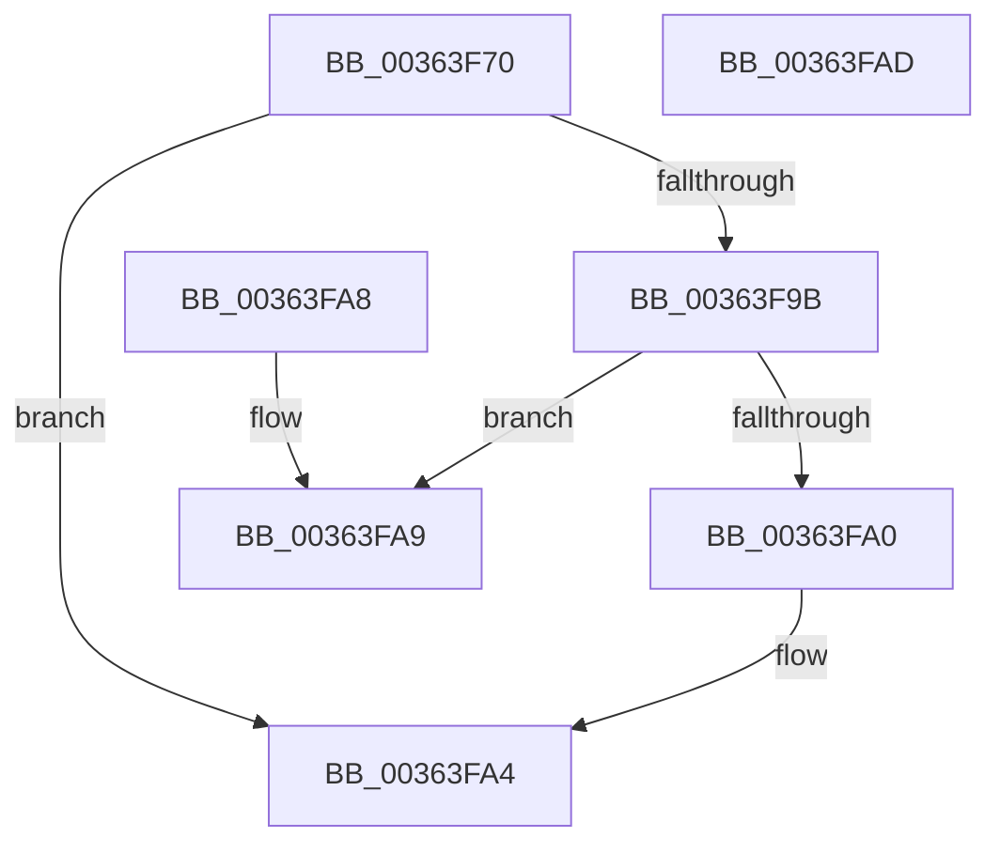

# MiMakeTransitionPte

- RVA: `0x00363F70`–`0x00363FAE` (길이 `62` bytes)
- VA: `0x0000000140363F70`
- 실행 섹션: `.text`
- PDB 이름 있음: `예`; PDB Function 태그: `아니요`
- unwind 정보 RVA: `0x000DB714`
- 디코드: `19`개 명령, `62/62` bytes 표시
- 미해석 바이트: `0` (있으면 어셈블리에 `.byte`로 보존)

> 이 문서는 커널 이미지의 기계어와 PDB 기호를 분석해 생성했습니다. 4번과 5번은 함수 원형과 자료형을 바이너리 사용 방식에서 추정한 C 해석이며 원본 소스 복구 결과는 아닙니다.

## 1. Dependencies

- 직접 호출 지점: **0**; 고유 호출 대상: **0**
- 직접 호출자로 확인된 함수: **17**
- RIP 상대 이미지 참조: **1**

### Outgoing calls
- 직접 디코드된 call 명령이 없습니다.

### Direct callers
- [MmProtectMdlSystemAddress](../22/MmProtectMdlSystemAddress_function_00227B50.md) at `0x00227D86`
- [MiCombineInitialInstance](../22/MiCombineInitialInstance_function_0022BC0C.md) at `0x0022C542`
- [MiOutPageSingleKernelStack](../2A/MiOutPageSingleKernelStack_function_002A1790.md) at `0x002A1974`
- [MiOutPageSingleKernelStack](../2A/MiOutPageSingleKernelStack_function_002A1790.md) at `0x002A1B56`
- [MiInitializeTransitionPfn](../2A/MiInitializeTransitionPfn_function_002AC2E8.md) at `0x002AC3EB`
- [MiBuildMdlForMappedFileFault](MiBuildMdlForMappedFileFault_function_0036380C.md) at `0x00363BF7`
- [MiDuplicateCloneLeaf](../38/MiDuplicateCloneLeaf_function_003825F0.md) at `0x00382713`
- [MiMakeOutswappedPageResident](../43/MiMakeOutswappedPageResident_function_00431AD0.md) at `0x00431F35`
- [MiExclusiveInsertPfnChainInList](../44/MiExclusiveInsertPfnChainInList_function_00445C48.md) at `0x00445DF8`
- [MiBuildForkPageTable](../4A/MiBuildForkPageTable_function_004ACF5C.md) at `0x004AD152`
- [MiTrimSystemImagePages](../4B/MiTrimSystemImagePages_function_004B18FC.md) at `0x004B1992`
- [MiSwitchToTransition](../4C/MiSwitchToTransition_function_004C0F5C.md) at `0x004C1561`
- [MiProtectAweRegion](../4C/MiProtectAweRegion_function_004CE62C.md) at `0x004CEBBC`
- [MiPageBootRegistry](../66/MiPageBootRegistry_function_0066E82C.md) at `0x0066EA0B`
- [MiInitializeNewPfns](../67/MiInitializeNewPfns_function_00670E94.md) at `0x0067102F`
- [sub_006D9212](../6D/Unknown_function_006D9212.md) at `0x006D928B`
- [sub_006E82CE](../6E/Unknown_function_006E82CE.md) at `0x006E8465`
- [sub_006F91FE](../6F/Unknown_function_006F91FE.md) at `0x006F9307`

### Static image references
- `0x00363F80` → RVA `0x00E2DC80` (`.data`; read)

## 2. Other-region calls and transfers

- 다른 실행 섹션으로 향하는 call: **0**
- 별도 외부 분기/꼬리 이동을 확인하지 못했습니다.

## 3. Assembly (complete function range)

```asm
00363F70  48 B8 FF FF FF FF FF 00 00 00   movabs rax, 0xffffffffff
00363F7A  83 E2 1F                        and edx, 0x1f
00363F7D  48 23 C8                        and rcx, rax
00363F80  48 8B 05 F9 9C AC 00            mov rax, qword ptr [rip + 0xac9cf9]
00363F87  48 C1 E1 07                     shl rcx, 7
00363F8B  48 0B CA                        or rcx, rdx
00363F8E  48 83 C9 40                     or rcx, 0x40
00363F92  48 C1 E1 05                     shl rcx, 5
00363F96  48 85 C0                        test rax, rax
00363F99  74 09                           je 0x140363fa4
00363F9B  48 85 C1                        test rcx, rax
00363F9E  74 09                           je 0x140363fa9
00363FA0  48 83 C9 10                     or rcx, 0x10
00363FA4  48 8B C1                        mov rax, rcx
00363FA7  C3                              ret
00363FA8  CC                              int3
00363FA9  48 0B C1                        or rax, rcx
00363FAC  C3                              ret
00363FAD  CC                              int3
```

## 4. C-style interpretation (structured pseudocode)

```c
__int64 __fastcall MiMakeTransitionPte(__int64 a1, int a2)
{
    __int64 result;

    a2 = (unsigned int)((a2) & (31));
    a1 = (a1) & (result);
    a1 = (a1) << (7);
    a1 = (a1) | (a2);
    a1 = (a1) | (64);
    a1 = (a1) << (5);
    if (*(unsigned __int64 *)(v_rip + 11312377) == 0) goto loc_00363FA4;
    if (((a1) & (*(unsigned __int64 *)(v_rip + 11312377))) == 0) goto loc_00363FA9;
    a1 = (a1) | (16);
loc_00363FA4:
    return a1;
loc_00363FA9:
    result = (a1) | (a1);
    return result;
}
```

## 5. (Beta) C Style

```c
int64_t MiMakeTransitionPte(int64_t Arg1, int32_t Arg2)
{
    int64_t result;

    Arg2 = (uint32_t)((Arg2) & (31));
    Arg1 = (Arg1) & (result);
    Arg1 = (Arg1) << (7);
    Arg1 = (Arg1) | (Arg2);
    Arg1 = (Arg1) | (64);
    Arg1 = (Arg1) << (5);
    if (*(uint64_t *)(v_rip + 0xAC9CF9) == 0) goto loc_00363FA4;
    if (((Arg1) & (*(uint64_t *)(v_rip + 0xAC9CF9))) == 0) goto loc_00363FA9;
    Arg1 = (Arg1) | (16);
loc_00363FA4:
    return Arg1;
loc_00363FA9:
    result = (Arg1) | (Arg1);
    return result;
}
```

## 6. Execution-region graph

[열기: 2D/3D 그래프와 함수 탐색 컨트롤 패널](../../../control-panel.html?section=text&rva=0x00363F70&view=graph)

- 2D 그래프는 위에서 아래로 흐르고, 3D 그래프는 빈 공간을 드래그해 회전합니다. Shift+드래그는 이동, 휠은 확대·축소, 함수 노드 선택은 대상 보고서 이동입니다.

### Static fallback


