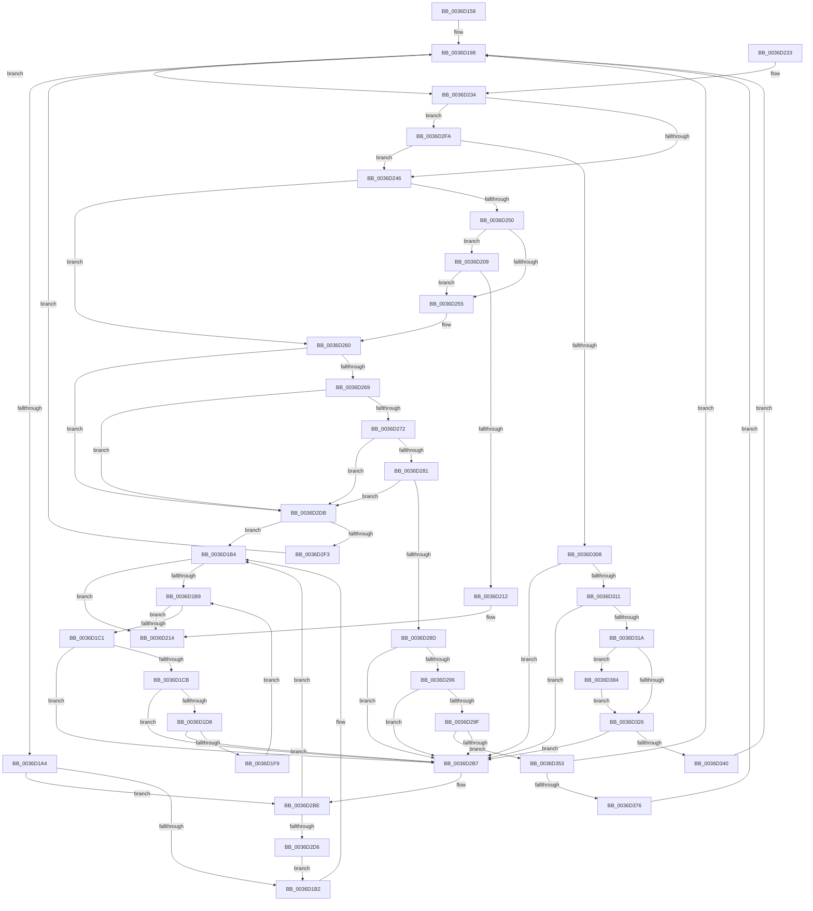

# MiPfCoalesceAndIssueIOs

- RVA: `0x0036D158`–`0x0036D38F` (길이 `567` bytes)
- VA: `0x000000014036D158`
- 실행 섹션: `.text`
- PDB 이름 있음: `예`; PDB Function 태그: `아니요`
- unwind 정보 RVA: `0x0007A5B0`
- 디코드: `160`개 명령, `567/567` bytes 표시
- 미해석 바이트: `0` (있으면 어셈블리에 `.byte`로 보존)

> 이 문서는 커널 이미지의 기계어와 PDB 기호를 분석해 생성했습니다. 4번과 5번은 함수 원형과 자료형을 바이너리 사용 방식에서 추정한 C 해석이며 원본 소스 복구 결과는 아닙니다.

## 1. Dependencies

- 직접 호출 지점: **4**; 고유 호출 대상: **2**
- 직접 호출자로 확인된 함수: **3**
- RIP 상대 이미지 참조: **0**

### Outgoing calls
- `0x0036D1E7` → [MiIssueHardFaultIo](../38/MiIssueHardFaultIo_function_003812EC.md) (function, `0x003812EC`)
- `0x0036D2C7` → [MiPfIssueCoalesceCandidates](MiPfIssueCoalesceCandidates_function_0036B4D4.md) (function, `0x0036B4D4`)
- `0x0036D2E4` → [MiPfIssueCoalesceCandidates](MiPfIssueCoalesceCandidates_function_0036B4D4.md) (function, `0x0036B4D4`)
- `0x0036D32E` → [MiIssueHardFaultIo](../38/MiIssueHardFaultIo_function_003812EC.md) (function, `0x003812EC`)

### Direct callers
- [MiPfCompletePrefetchIos](MiPfCompletePrefetchIos_function_0036C4B0.md) at `0x0036C4DD`
- [sub_0036C6B5](Unknown_function_0036C6B5.md) at `0x0036C9CB`
- [sub_0036CB1C](Unknown_function_0036CB1C.md) at `0x0036CB27`

### Static image references
- 디코드된 RIP-relative 메모리 참조가 없습니다.

## 2. Other-region calls and transfers

- 다른 실행 섹션으로 향하는 call: **0**
- 별도 외부 분기/꼬리 이동을 확인하지 못했습니다.

## 3. Assembly (complete function range)

```asm
0036D158  48 89 5C 24 08                  mov qword ptr [rsp + 8], rbx
0036D15D  48 89 74 24 10                  mov qword ptr [rsp + 0x10], rsi
0036D162  48 89 7C 24 18                  mov qword ptr [rsp + 0x18], rdi
0036D167  55                              push rbp
0036D168  41 54                           push r12
0036D16A  41 55                           push r13
0036D16C  41 56                           push r14
0036D16E  41 57                           push r15
0036D170  48 8B EC                        mov rbp, rsp
0036D173  48 83 EC 30                     sub rsp, 0x30
0036D177  48 8D 45 F0                     lea rax, [rbp - 0x10]
0036D17B  33 FF                           xor edi, edi
0036D17D  48 89 45 F8                     mov qword ptr [rbp - 8], rax
0036D181  45 33 E4                        xor r12d, r12d
0036D184  48 8D 45 F0                     lea rax, [rbp - 0x10]
0036D188  49 8B F0                        mov rsi, r8
0036D18B  48 89 45 F0                     mov qword ptr [rbp - 0x10], rax
0036D18F  4C 8B F2                        mov r14, rdx
0036D192  4C 8B F9                        mov r15, rcx
0036D195  45 33 ED                        xor r13d, r13d
0036D198  49 8B 1F                        mov rbx, qword ptr [r15]
0036D19B  49 3B DF                        cmp rbx, r15
0036D19E  0F 85 90 00 00 00               jne 0x14036d234
0036D1A4  48 8D 45 F0                     lea rax, [rbp - 0x10]
0036D1A8  48 39 45 F0                     cmp qword ptr [rbp - 0x10], rax
0036D1AC  0F 85 0C 01 00 00               jne 0x14036d2be
0036D1B2  33 FF                           xor edi, edi
0036D1B4  48 85 F6                        test rsi, rsi
0036D1B7  75 5B                           jne 0x14036d214
0036D1B9  49 8B 1F                        mov rbx, qword ptr [r15]
0036D1BC  49 3B DF                        cmp rbx, r15
0036D1BF  74 53                           je 0x14036d214
0036D1C1  4C 39 7B 08                     cmp qword ptr [rbx + 8], r15
0036D1C5  0F 85 EC 00 00 00               jne 0x14036d2b7
0036D1CB  48 8B 03                        mov rax, qword ptr [rbx]
0036D1CE  48 39 58 08                     cmp qword ptr [rax + 8], rbx
0036D1D2  0F 85 DF 00 00 00               jne 0x14036d2b7
0036D1D8  49 89 07                        mov qword ptr [r15], rax
0036D1DB  45 33 C0                        xor r8d, r8d
0036D1DE  33 D2                           xor edx, edx
0036D1E0  4C 89 78 08                     mov qword ptr [rax + 8], r15
0036D1E4  48 8B CB                        mov rcx, rbx
0036D1E7  E8 00 41 01 00                  call 0x1403812ec
0036D1EC  49 8B 46 08                     mov rax, qword ptr [r14 + 8]
0036D1F0  4C 39 30                        cmp qword ptr [rax], r14
0036D1F3  0F 85 BE 00 00 00               jne 0x14036d2b7
0036D1F9  4C 89 33                        mov qword ptr [rbx], r14
0036D1FC  48 89 43 08                     mov qword ptr [rbx + 8], rax
0036D200  48 89 18                        mov qword ptr [rax], rbx
0036D203  49 89 5E 08                     mov qword ptr [r14 + 8], rbx
0036D207  EB B0                           jmp 0x14036d1b9
0036D209  48 81 3E 00 00 10 00            cmp qword ptr [rsi], 0x100000
0036D210  73 43                           jae 0x14036d255
0036D212  33 FF                           xor edi, edi
0036D214  48 8B 5C 24 60                  mov rbx, qword ptr [rsp + 0x60]
0036D219  8B C7                           mov eax, edi
0036D21B  48 8B 7C 24 70                  mov rdi, qword ptr [rsp + 0x70]
0036D220  48 8B 74 24 68                  mov rsi, qword ptr [rsp + 0x68]
0036D225  48 83 C4 30                     add rsp, 0x30
0036D229  41 5F                           pop r15
0036D22B  41 5E                           pop r14
0036D22D  41 5D                           pop r13
0036D22F  41 5C                           pop r12
0036D231  5D                              pop rbp
0036D232  C3                              ret
0036D233  CC                              int3
0036D234  8B 8B B8 00 00 00               mov ecx, dword ptr [rbx + 0xb8]
0036D23A  81 F9 00 00 10 00               cmp ecx, 0x100000
0036D240  0F 83 B4 00 00 00               jae 0x14036d2fa
0036D246  48 8D 45 F0                     lea rax, [rbp - 0x10]
0036D24A  48 39 45 F0                     cmp qword ptr [rbp - 0x10], rax
0036D24E  75 10                           jne 0x14036d260
0036D250  48 85 F6                        test rsi, rsi
0036D253  75 B4                           jne 0x14036d209
0036D255  4C 8B 63 60                     mov r12, qword ptr [rbx + 0x60]
0036D259  4C 8B AB C8 00 00 00            mov r13, qword ptr [rbx + 0xc8]
0036D260  48 8B 43 60                     mov rax, qword ptr [rbx + 0x60]
0036D264  4C 3B E0                        cmp r12, rax
0036D267  7F 72                           jg 0x14036d2db
0036D269  4C 3B AB C8 00 00 00            cmp r13, qword ptr [rbx + 0xc8]
0036D270  75 69                           jne 0x14036d2db
0036D272  49 2B C4                        sub rax, r12
0036D275  44 8D 04 01                     lea r8d, [rcx + rax]
0036D279  48 3D 00 00 02 00               cmp rax, 0x20000
0036D27F  77 5A                           ja 0x14036d2db
0036D281  41 8D 0C 38                     lea ecx, [r8 + rdi]
0036D285  81 F9 00 00 10 00               cmp ecx, 0x100000
0036D28B  77 4E                           ja 0x14036d2db
0036D28D  48 8B 03                        mov rax, qword ptr [rbx]
0036D290  48 39 58 08                     cmp qword ptr [rax + 8], rbx
0036D294  75 21                           jne 0x14036d2b7
0036D296  48 8B 53 08                     mov rdx, qword ptr [rbx + 8]
0036D29A  48 39 1A                        cmp qword ptr [rdx], rbx
0036D29D  75 18                           jne 0x14036d2b7
0036D29F  48 89 02                        mov qword ptr [rdx], rax
0036D2A2  48 89 50 08                     mov qword ptr [rax + 8], rdx
0036D2A6  48 8D 55 F0                     lea rdx, [rbp - 0x10]
0036D2AA  48 8B 45 F8                     mov rax, qword ptr [rbp - 8]
0036D2AE  48 39 10                        cmp qword ptr [rax], rdx
0036D2B1  0F 84 9C 00 00 00               je 0x14036d353
0036D2B7  B9 03 00 00 00                  mov ecx, 3
0036D2BC  CD 29                           int 0x29
0036D2BE  4D 8B C6                        mov r8, r14
0036D2C1  48 8D 4D F0                     lea rcx, [rbp - 0x10]
0036D2C5  8B D7                           mov edx, edi
0036D2C7  E8 08 E2 FF FF                  call 0x14036b4d4
0036D2CC  8B F8                           mov edi, eax
0036D2CE  85 C0                           test eax, eax
0036D2D0  0F 88 DE FE FF FF               js 0x14036d1b4
0036D2D6  E9 D7 FE FF FF                  jmp 0x14036d1b2
0036D2DB  4D 8B C6                        mov r8, r14
0036D2DE  48 8D 4D F0                     lea rcx, [rbp - 0x10]
0036D2E2  8B D7                           mov edx, edi
0036D2E4  E8 EB E1 FF FF                  call 0x14036b4d4
0036D2E9  8B F8                           mov edi, eax
0036D2EB  85 C0                           test eax, eax
0036D2ED  0F 88 C1 FE FF FF               js 0x14036d1b4
0036D2F3  33 FF                           xor edi, edi
0036D2F5  E9 9E FE FF FF                  jmp 0x14036d198
0036D2FA  48 8D 45 F0                     lea rax, [rbp - 0x10]
0036D2FE  48 39 45 F0                     cmp qword ptr [rbp - 0x10], rax
0036D302  0F 85 3E FF FF FF               jne 0x14036d246
0036D308  48 8B 03                        mov rax, qword ptr [rbx]
0036D30B  48 39 58 08                     cmp qword ptr [rax + 8], rbx
0036D30F  75 A6                           jne 0x14036d2b7
0036D311  48 8B 4B 08                     mov rcx, qword ptr [rbx + 8]
0036D315  48 39 19                        cmp qword ptr [rcx], rbx
0036D318  75 9D                           jne 0x14036d2b7
0036D31A  48 89 01                        mov qword ptr [rcx], rax
0036D31D  48 89 48 08                     mov qword ptr [rax + 8], rcx
0036D321  48 85 F6                        test rsi, rsi
0036D324  75 5E                           jne 0x14036d384
0036D326  45 33 C0                        xor r8d, r8d
0036D329  33 D2                           xor edx, edx
0036D32B  48 8B CB                        mov rcx, rbx
0036D32E  E8 B9 3F 01 00                  call 0x1403812ec
0036D333  49 8B 46 08                     mov rax, qword ptr [r14 + 8]
0036D337  4C 39 30                        cmp qword ptr [rax], r14
0036D33A  0F 85 77 FF FF FF               jne 0x14036d2b7
0036D340  4C 89 33                        mov qword ptr [rbx], r14
0036D343  48 89 43 08                     mov qword ptr [rbx + 8], rax
0036D347  48 89 18                        mov qword ptr [rax], rbx
0036D34A  49 89 5E 08                     mov qword ptr [r14 + 8], rbx
0036D34E  E9 45 FE FF FF                  jmp 0x14036d198
0036D353  48 89 43 08                     mov qword ptr [rbx + 8], rax
0036D357  48 8D 55 F0                     lea rdx, [rbp - 0x10]
0036D35B  48 89 13                        mov qword ptr [rbx], rdx
0036D35E  8B F9                           mov edi, ecx
0036D360  48 89 18                        mov qword ptr [rax], rbx
0036D363  41 8B C0                        mov eax, r8d
0036D366  4C 03 E0                        add r12, rax
0036D369  48 89 5D F8                     mov qword ptr [rbp - 8], rbx
0036D36D  48 85 F6                        test rsi, rsi
0036D370  0F 84 22 FE FF FF               je 0x14036d198
0036D376  8B 83 B8 00 00 00               mov eax, dword ptr [rbx + 0xb8]
0036D37C  48 29 06                        sub qword ptr [rsi], rax
0036D37F  E9 14 FE FF FF                  jmp 0x14036d198
0036D384  8B 83 B8 00 00 00               mov eax, dword ptr [rbx + 0xb8]
0036D38A  48 29 06                        sub qword ptr [rsi], rax
0036D38D  EB 97                           jmp 0x14036d326
```

## 4. C-style interpretation (structured pseudocode)

```c
__int64 __fastcall MiPfCoalesceAndIssueIOs(__int64 a1, __int64 a2, __int64 a3)
{
    __int64 result;
    __int64 v_r12;
    __int64 v_r13;
    __int64 v_rdi;
    __int64 v_rsp;
    unsigned __int64 v_stack_m30;
    unsigned __int64 v_stack_m38;
    unsigned __int64 v_stack_p10;
    unsigned __int64 v_stack_p18;
    unsigned __int64 v_stack_p8;

    v_stack_p8 = v_rbx;
    v_stack_p10 = v_rsi;
    v_stack_p18 = v_rdi;
    v_rsp = (v_rsp) - (48);
    v_rdi = 0;
    v_stack_m30 = v_stack_m38;
    v_r12 = 0;
    v_stack_m38 = v_stack_m38;
    v_r13 = 0;
loc_0036D198:
    if ((*(unsigned __int64 *)(a1)) != a1) goto loc_0036D234;
    if (v_stack_m38 != v_stack_m38) goto loc_0036D2BE;
loc_0036D1B2:
    v_rdi = 0;
loc_0036D1B4:
    if (a3 != 0) goto loc_0036D214;
loc_0036D1B9:
    if ((*(unsigned __int64 *)(a1)) == a1) goto loc_0036D214;
    if ((*(unsigned __int64 *)(*(unsigned __int64 *)(a1) + 8)) != a1) goto loc_0036D2B7;
    if ((*(unsigned __int64 *)(*(unsigned __int64 *)(*(unsigned __int64 *)(a1)) + 8)) != (*(unsigned __int64 *)(a1))) goto loc_0036D2B7;
    *(unsigned __int64 *)(a1) = *(unsigned __int64 *)(*(unsigned __int64 *)(a1));
    a3 = 0;
    a2 = 0;
    *(unsigned __int64 *)(*(unsigned __int64 *)(*(unsigned __int64 *)(a1)) + 8) = a1;
    result = MiIssueHardFaultIo(*(unsigned __int64 *)(a1), a2, a3, a4);
    if ((*(unsigned __int64 *)(*(unsigned __int64 *)(a2 + 8))) != 0) goto loc_0036D2B7;
    *(unsigned __int64 *)(*(unsigned __int64 *)(a1)) = 0;
    *(unsigned __int64 *)(*(unsigned __int64 *)(a1) + 8) = *(unsigned __int64 *)(a2 + 8);
    *(unsigned __int64 *)(*(unsigned __int64 *)(a2 + 8)) = *(unsigned __int64 *)(a1);
    *(unsigned __int64 *)(a2 + 8) = *(unsigned __int64 *)(a1);
    goto loc_0036D1B9;
loc_0036D209:
    if ((*(unsigned __int64 *)(a3)) >= 0x100000ULL) goto loc_0036D255;
    v_rdi = 0;
loc_0036D214:
    v_rsp = (v_rsp) + (48);
    return 0;
loc_0036D234:
    if (((unsigned int)((unsigned int)(*(unsigned int *)(v_stack_p8 + 184)))) >= 0x100000ULL) goto loc_0036D2FA;
loc_0036D246:
    if (v_stack_m38 != v_stack_m38) goto loc_0036D260;
    if (v_stack_p10 != 0) goto loc_0036D209;
loc_0036D255:
loc_0036D260:
    if ((*(unsigned __int64 *)(v_stack_p8 + 96)) > (*(unsigned __int64 *)(v_stack_p8 + 96))) goto loc_0036D2DB;
    if ((*(unsigned __int64 *)(v_stack_p8 + 200)) != (*(unsigned __int64 *)(v_stack_p8 + 200))) goto loc_0036D2DB;
    result = (*(unsigned __int64 *)(v_stack_p8 + 96)) - (*(unsigned __int64 *)(v_stack_p8 + 96));
    if (result > 0x20000ULL) goto loc_0036D2DB;
    if (((unsigned int)((unsigned int)(*(unsigned int *)(v_stack_p8 + 184)) + result * 1 + v_stack_p18 * 1)) > 0x100000ULL) goto loc_0036D2DB;
    if ((*(unsigned __int64 *)(*(unsigned __int64 *)(v_stack_p8) + 8)) != v_stack_p8) goto loc_0036D2B7;
    if ((*(unsigned __int64 *)(*(unsigned __int64 *)(v_stack_p8 + 8))) != v_stack_p8) goto loc_0036D2B7;
    *(unsigned __int64 *)(*(unsigned __int64 *)(v_stack_p8 + 8)) = *(unsigned __int64 *)(v_stack_p8);
    *(unsigned __int64 *)(*(unsigned __int64 *)(v_stack_p8) + 8) = *(unsigned __int64 *)(v_stack_p8 + 8);
    if ((*(unsigned __int64 *)(v_stack_m30)) == v_stack_m38) goto loc_0036D353;
loc_0036D2B7:
loc_0036D2BE:
    result = MiPfIssueCoalesceCandidates(v_stack_m38, (unsigned int)((unsigned int)(v_stack_p18)), 0, a4);
    if (sign_flag) goto loc_0036D1B4;
    goto loc_0036D1B2;
loc_0036D2DB:
    result = MiPfIssueCoalesceCandidates(v_stack_m38, (unsigned int)((unsigned int)((unsigned int)((unsigned int)(result)))), 0, a4);
    if (sign_flag) goto loc_0036D1B4;
    v_rdi = 0;
    goto loc_0036D198;
loc_0036D2FA:
    if (v_stack_m38 != v_stack_m38) goto loc_0036D246;
    if ((*(unsigned __int64 *)(*(unsigned __int64 *)(v_stack_p8) + 8)) != v_stack_p8) goto loc_0036D2B7;
    if ((*(unsigned __int64 *)(*(unsigned __int64 *)(v_stack_p8 + 8))) != v_stack_p8) goto loc_0036D2B7;
    *(unsigned __int64 *)(*(unsigned __int64 *)(v_stack_p8 + 8)) = *(unsigned __int64 *)(v_stack_p8);
    *(unsigned __int64 *)(*(unsigned __int64 *)(v_stack_p8) + 8) = *(unsigned __int64 *)(v_stack_p8 + 8);
    if (v_stack_p10 != 0) goto loc_0036D384;
loc_0036D326:
    a3 = 0;
    a2 = 0;
    result = MiIssueHardFaultIo(v_stack_p8, a2, a3, a4);
    if ((*(unsigned __int64 *)(*(unsigned __int64 *)(a2 + 8))) != 0) goto loc_0036D2B7;
    *(unsigned __int64 *)(v_stack_p8) = 0;
    *(unsigned __int64 *)(v_stack_p8 + 8) = *(unsigned __int64 *)(a2 + 8);
    *(unsigned __int64 *)(*(unsigned __int64 *)(a2 + 8)) = v_stack_p8;
    *(unsigned __int64 *)(a2 + 8) = v_stack_p8;
    goto loc_0036D198;
loc_0036D353:
    *(unsigned __int64 *)(v_stack_p8 + 8) = *(unsigned __int64 *)(a2 + 8);
    *(unsigned __int64 *)(v_stack_p8) = v_stack_m38;
    *(unsigned __int64 *)(*(unsigned __int64 *)(a2 + 8)) = v_stack_p8;
    v_r12 = (*(unsigned __int64 *)(v_stack_p8 + 96)) + (0);
    v_stack_m30 = v_stack_p8;
    if (v_stack_p10 == 0) goto loc_0036D198;
    goto loc_0036D198;
loc_0036D384:
    goto loc_0036D326;
}
```

## 5. (Beta) C Style

```c
int64_t MiPfCoalesceAndIssueIOs(void *Arg1, void *Arg2, int64_t Arg3)
{
    uint8_t *arg1 = (uint8_t *)Arg1;
    uint8_t *arg2 = (uint8_t *)Arg2;

    int64_t result;
    int64_t local_r12;
    int64_t local_r13;
    int64_t local_rdi;
    int64_t local_rsp;
    uint64_t v_stack_m30;
    uint64_t v_stack_m38;
    uint64_t v_stack_p10;
    uint64_t v_stack_p18;
    uint64_t v_stack_p8;

    v_stack_p8 = local_rbx;
    v_stack_p10 = local_rsi;
    v_stack_p18 = local_rdi;
    local_rsp = (local_rsp) - (48);
    local_rdi = 0;
    v_stack_m30 = v_stack_m38;
    local_r12 = 0;
    v_stack_m38 = v_stack_m38;
    local_r13 = 0;
loc_0036D198:
    if ((*(uint64_t *)(arg1)) != Arg1) goto loc_0036D234;
    if (v_stack_m38 != v_stack_m38) goto loc_0036D2BE;
loc_0036D1B2:
    local_rdi = 0;
loc_0036D1B4:
    if (Arg3 != 0) goto loc_0036D214;
loc_0036D1B9:
    if ((*(uint64_t *)(arg1)) == Arg1) goto loc_0036D214;
    if ((*(uint64_t *)(*(uint64_t *)(arg1) + 0x8)) != Arg1) goto loc_0036D2B7;
    if ((*(uint64_t *)(*(uint64_t *)(*(uint64_t *)(arg1)) + 0x8)) != (*(uint64_t *)(arg1))) goto loc_0036D2B7;
    *(uint64_t *)(arg1) = *(uint64_t *)(*(uint64_t *)(arg1));
    Arg3 = 0;
    Arg2 = 0;
    *(void **)(*(uint64_t *)(*(uint64_t *)(arg1)) + 0x8) = Arg1;
    result = MiIssueHardFaultIo(*(uint64_t *)(arg1), Arg2, Arg3, a4);
    if ((*(uint64_t *)(*(uint64_t *)(arg2 + 0x8))) != 0) goto loc_0036D2B7;
    *(uint64_t *)(*(uint64_t *)(arg1)) = 0;
    *(uint64_t *)(*(uint64_t *)(arg1) + 0x8) = *(uint64_t *)(arg2 + 0x8);
    *(uint64_t *)(*(uint64_t *)(arg2 + 0x8)) = *(uint64_t *)(arg1);
    *(uint64_t *)(arg2 + 0x8) = *(uint64_t *)(arg1);
    goto loc_0036D1B9;
loc_0036D209:
    if ((*(uint64_t *)(Arg3)) >= 0x100000ULL) goto loc_0036D255;
    local_rdi = 0;
loc_0036D214:
    local_rsp = (local_rsp) + (48);
    return 0;
loc_0036D234:
    if (((uint32_t)((uint32_t)(*(uint32_t *)(v_stack_p8 + 0xB8)))) >= 0x100000ULL) goto loc_0036D2FA;
loc_0036D246:
    if (v_stack_m38 != v_stack_m38) goto loc_0036D260;
    if (v_stack_p10 != 0) goto loc_0036D209;
loc_0036D255:
loc_0036D260:
    if ((*(uint64_t *)(v_stack_p8 + 0x60)) > (*(uint64_t *)(v_stack_p8 + 0x60))) goto loc_0036D2DB;
    if ((*(uint64_t *)(v_stack_p8 + 0xC8)) != (*(uint64_t *)(v_stack_p8 + 0xC8))) goto loc_0036D2DB;
    result = (*(uint64_t *)(v_stack_p8 + 0x60)) - (*(uint64_t *)(v_stack_p8 + 0x60));
    if (result > 0x20000ULL) goto loc_0036D2DB;
    if (((uint32_t)((uint32_t)(*(uint32_t *)(v_stack_p8 + 0xB8)) + result * 1 + v_stack_p18 * 1)) > 0x100000ULL) goto loc_0036D2DB;
    if ((*(uint64_t *)(*(uint64_t *)(v_stack_p8) + 0x8)) != v_stack_p8) goto loc_0036D2B7;
    if ((*(uint64_t *)(*(uint64_t *)(v_stack_p8 + 0x8))) != v_stack_p8) goto loc_0036D2B7;
    *(uint64_t *)(*(uint64_t *)(v_stack_p8 + 0x8)) = *(uint64_t *)(v_stack_p8);
    *(uint64_t *)(*(uint64_t *)(v_stack_p8) + 0x8) = *(uint64_t *)(v_stack_p8 + 0x8);
    if ((*(uint64_t *)(v_stack_m30)) == v_stack_m38) goto loc_0036D353;
loc_0036D2B7:
loc_0036D2BE:
    result = MiPfIssueCoalesceCandidates(v_stack_m38, (uint32_t)((uint32_t)(v_stack_p18)), 0, a4);
    if (sign_flag) goto loc_0036D1B4;
    goto loc_0036D1B2;
loc_0036D2DB:
    result = MiPfIssueCoalesceCandidates(v_stack_m38, (uint32_t)((uint32_t)((uint32_t)((uint32_t)(result)))), 0, a4);
    if (sign_flag) goto loc_0036D1B4;
    local_rdi = 0;
    goto loc_0036D198;
loc_0036D2FA:
    if (v_stack_m38 != v_stack_m38) goto loc_0036D246;
    if ((*(uint64_t *)(*(uint64_t *)(v_stack_p8) + 0x8)) != v_stack_p8) goto loc_0036D2B7;
    if ((*(uint64_t *)(*(uint64_t *)(v_stack_p8 + 0x8))) != v_stack_p8) goto loc_0036D2B7;
    *(uint64_t *)(*(uint64_t *)(v_stack_p8 + 0x8)) = *(uint64_t *)(v_stack_p8);
    *(uint64_t *)(*(uint64_t *)(v_stack_p8) + 0x8) = *(uint64_t *)(v_stack_p8 + 0x8);
    if (v_stack_p10 != 0) goto loc_0036D384;
loc_0036D326:
    Arg3 = 0;
    Arg2 = 0;
    result = MiIssueHardFaultIo(v_stack_p8, Arg2, Arg3, a4);
    if ((*(uint64_t *)(*(uint64_t *)(arg2 + 0x8))) != 0) goto loc_0036D2B7;
    *(uint64_t *)(v_stack_p8) = 0;
    *(uint64_t *)(v_stack_p8 + 0x8) = *(uint64_t *)(arg2 + 0x8);
    *(uint64_t *)(*(uint64_t *)(arg2 + 0x8)) = v_stack_p8;
    *(uint64_t *)(arg2 + 0x8) = v_stack_p8;
    goto loc_0036D198;
loc_0036D353:
    *(uint64_t *)(v_stack_p8 + 0x8) = *(uint64_t *)(arg2 + 0x8);
    *(uint64_t *)(v_stack_p8) = v_stack_m38;
    *(uint64_t *)(*(uint64_t *)(arg2 + 0x8)) = v_stack_p8;
    local_r12 = (*(uint64_t *)(v_stack_p8 + 0x60)) + (0);
    v_stack_m30 = v_stack_p8;
    if (v_stack_p10 == 0) goto loc_0036D198;
    goto loc_0036D198;
loc_0036D384:
    goto loc_0036D326;
}
```

### 관측된 메모리 오프셋

구조체 형식이 확인되지 않은 접근은 인자 기준의 오프셋으로만 기록했습니다.

| 기준 인자 | 오프셋 표현 | 폭 (bit) | 접근 |
|---|---:|---:|---|
| `Arg1` | `+ 0x0` | `64` | `R` |
| `Arg1` | `+ 0x0` | `64` | `W` |
| `Arg2` | `+ 0x8` | `64` | `R` |
| `Arg2` | `+ 0x8` | `64` | `W` |

## 6. Execution-region graph

[열기: 2D/3D 그래프와 함수 탐색 컨트롤 패널](../../../control-panel.html?section=text&rva=0x0036D158&view=graph)

- 2D 그래프는 위에서 아래로 흐르고, 3D 그래프는 빈 공간을 드래그해 회전합니다. Shift+드래그는 이동, 휠은 확대·축소, 함수 노드 선택은 대상 보고서 이동입니다.

### Static fallback


