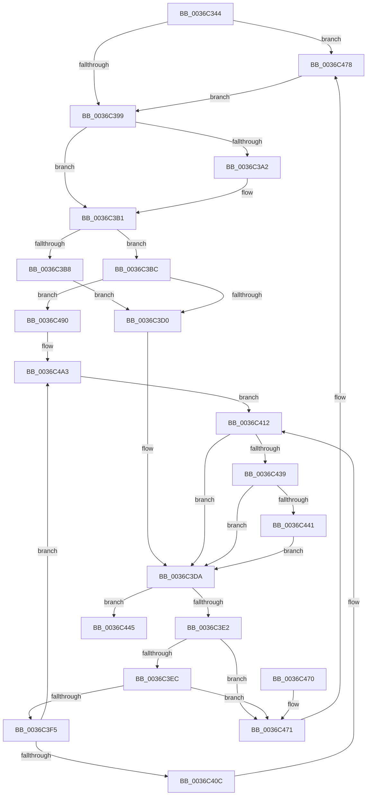

# MiPfCompleteCoalescedIo

- RVA: `0x0036C344`–`0x0036C4AA` (길이 `358` bytes)
- VA: `0x000000014036C344`
- 실행 섹션: `.text`
- PDB 이름 있음: `예`; PDB Function 태그: `아니요`
- unwind 정보 RVA: `0x0007A3D0`
- 디코드: `97`개 명령, `358/358` bytes 표시
- 미해석 바이트: `0` (있으면 어셈블리에 `.byte`로 보존)

> 이 문서는 커널 이미지의 기계어와 PDB 기호를 분석해 생성했습니다. 4번과 5번은 함수 원형과 자료형을 바이너리 사용 방식에서 추정한 C 해석이며 원본 소스 복구 결과는 아닙니다.

## 1. Dependencies

- 직접 호출 지점: **7**; 고유 호출 대상: **7**
- 직접 호출자로 확인된 함수: **4**
- RIP 상대 이미지 참조: **0**

### Outgoing calls
- `0x0036C37A` → [KeWaitForSingleObject](../20/KeWaitForSingleObject_function_0020E6B0.md) (function, `0x0020E6B0`)
- `0x0036C3AC` → [MmUnmapLockedPages](../24/MmUnmapLockedPages_function_00246E60.md) (function, `0x00246E60`)
- `0x0036C41F` → [KeSetEvent](../33/KeSetEvent_function_0033F310.md) (function, `0x0033F310`)
- `0x0036C42A` → [MiPfCompleteInPageSupport](MiPfCompleteInPageSupport_function_0036D738.md) (function, `0x0036D738`)
- `0x0036C44A` → [ExFreePoolWithTag](../../poolcode/B8/ExFreePoolWithTag_function_00B82870.md) (function, `0x00B82870`)
- `0x0036C47B` → [MiRetardMdl](../40/MiRetardMdl_function_0040494C.md) (function, `0x0040494C`)
- `0x0036C49D` → [KeBugCheckEx](../4F/KeBugCheckEx_function_004FD660.md) (function, `0x004FD660`)

### Direct callers
- [MiPfCompletePrefetchIos](MiPfCompletePrefetchIos_function_0036C4B0.md) at `0x0036C546`
- [sub_0036CB1C](Unknown_function_0036CB1C.md) at `0x0036CBA6`
- [sub_0036CFD7](Unknown_function_0036CFD7.md) at `0x0036D068`
- [MmWaitForCacheManagerPrefetch](MmWaitForCacheManagerPrefetch_function_0036D644.md) at `0x0036D722`

### Static image references
- 디코드된 RIP-relative 메모리 참조가 없습니다.

## 2. Other-region calls and transfers

- 다른 실행 섹션으로 향하는 call: **1**
  - `0x0036C44A` → [ExFreePoolWithTag](../../poolcode/B8/ExFreePoolWithTag_function_00B82870.md) (`.text` → `POOLCODE`)
- 별도 외부 분기/꼬리 이동을 확인하지 못했습니다.

## 3. Assembly (complete function range)

```asm
0036C344  48 8B C4                        mov rax, rsp
0036C347  48 89 58 08                     mov qword ptr [rax + 8], rbx
0036C34B  48 89 68 10                     mov qword ptr [rax + 0x10], rbp
0036C34F  48 89 70 18                     mov qword ptr [rax + 0x18], rsi
0036C353  48 89 78 20                     mov qword ptr [rax + 0x20], rdi
0036C357  41 55                           push r13
0036C359  41 56                           push r14
0036C35B  41 57                           push r15
0036C35D  48 83 EC 30                     sub rsp, 0x30
0036C361  33 ED                           xor ebp, ebp
0036C363  4C 8B FA                        mov r15, rdx
0036C366  48 21 68 D8                     and qword ptr [rax - 0x28], rbp
0036C36A  48 8B D9                        mov rbx, rcx
0036C36D  48 83 C1 20                     add rcx, 0x20
0036C371  45 33 C9                        xor r9d, r9d
0036C374  45 33 C0                        xor r8d, r8d
0036C377  8D 55 09                        lea edx, [rbp + 9]
0036C37A  E8 31 23 EA FF                  call 0x14020e6b0
0036C37F  66 0F BA A3 1A 01 00 00 09      bt word ptr [rbx + 0x11a], 9
0036C388  48 8D B3 10 01 00 00            lea rsi, [rbx + 0x110]
0036C38F  4C 8D 73 50                     lea r14, [rbx + 0x50]
0036C393  0F 82 DF 00 00 00               jb 0x14036c478
0036C399  F6 83 1A 01 00 00 01            test byte ptr [rbx + 0x11a], 1
0036C3A0  74 0F                           je 0x14036c3b1
0036C3A2  48 8B 8B 28 01 00 00            mov rcx, qword ptr [rbx + 0x128]
0036C3A9  48 8B D6                        mov rdx, rsi
0036C3AC  E8 AF AA ED FF                  call 0x140246e60
0036C3B1  41 8B 06                        mov eax, dword ptr [r14]
0036C3B4  85 C0                           test eax, eax
0036C3B6  79 04                           jns 0x14036c3bc
0036C3B8  8B E8                           mov ebp, eax
0036C3BA  EB 14                           jmp 0x14036c3d0
0036C3BC  44 8B 8B 38 01 00 00            mov r9d, dword ptr [rbx + 0x138]
0036C3C3  4C 8B 43 58                     mov r8, qword ptr [rbx + 0x58]
0036C3C7  4D 3B C1                        cmp r8, r9
0036C3CA  0F 85 C0 00 00 00               jne 0x14036c490
0036C3D0  48 8D 73 10                     lea rsi, [rbx + 0x10]
0036C3D4  41 BD 00 00 00 80               mov r13d, 0x80000000
0036C3DA  48 8B 3E                        mov rdi, qword ptr [rsi]
0036C3DD  48 3B FE                        cmp rdi, rsi
0036C3E0  74 63                           je 0x14036c445
0036C3E2  48 39 77 08                     cmp qword ptr [rdi + 8], rsi
0036C3E6  0F 85 85 00 00 00               jne 0x14036c471
0036C3EC  48 8B 07                        mov rax, qword ptr [rdi]
0036C3EF  48 39 78 08                     cmp qword ptr [rax + 8], rdi
0036C3F3  75 7C                           jne 0x14036c471
0036C3F5  48 89 06                        mov qword ptr [rsi], rax
0036C3F8  48 89 70 08                     mov qword ptr [rax + 8], rsi
0036C3FC  41 8B 06                        mov eax, dword ptr [r14]
0036C3FF  89 47 50                        mov dword ptr [rdi + 0x50], eax
0036C402  41 83 3E 00                     cmp dword ptr [r14], 0
0036C406  0F 8C 97 00 00 00               jl 0x14036c4a3
0036C40C  8B 87 B8 00 00 00               mov eax, dword ptr [rdi + 0xb8]
0036C412  48 8D 4F 20                     lea rcx, [rdi + 0x20]
0036C416  48 89 47 58                     mov qword ptr [rdi + 0x58], rax
0036C41A  45 33 C0                        xor r8d, r8d
0036C41D  33 D2                           xor edx, edx
0036C41F  E8 EC 2E FD FF                  call 0x14033f310
0036C424  49 8B D7                        mov rdx, r15
0036C427  48 8B CF                        mov rcx, rdi
0036C42A  E8 09 13 00 00                  call 0x14036d738
0036C42F  8B C8                           mov ecx, eax
0036C431  41 03 C5                        add eax, r13d
0036C434  41 85 C5                        test r13d, eax
0036C437  75 A1                           jne 0x14036c3da
0036C439  81 F9 34 04 00 C0               cmp ecx, 0xc0000434
0036C43F  74 99                           je 0x14036c3da
0036C441  8B E9                           mov ebp, ecx
0036C443  EB 95                           jmp 0x14036c3da
0036C445  33 D2                           xor edx, edx
0036C447  48 8B CB                        mov rcx, rbx
0036C44A  E8 21 64 81 00                  call 0x140b82870
0036C44F  48 8B 5C 24 50                  mov rbx, qword ptr [rsp + 0x50]
0036C454  8B C5                           mov eax, ebp
0036C456  48 8B 6C 24 58                  mov rbp, qword ptr [rsp + 0x58]
0036C45B  48 8B 74 24 60                  mov rsi, qword ptr [rsp + 0x60]
0036C460  48 8B 7C 24 68                  mov rdi, qword ptr [rsp + 0x68]
0036C465  48 83 C4 30                     add rsp, 0x30
0036C469  41 5F                           pop r15
0036C46B  41 5E                           pop r14
0036C46D  41 5D                           pop r13
0036C46F  C3                              ret
0036C470  CC                              int3
0036C471  B9 03 00 00 00                  mov ecx, 3
0036C476  CD 29                           int 0x29
0036C478  48 8B CE                        mov rcx, rsi
0036C47B  E8 CC 84 09 00                  call 0x14040494c
0036C480  48 21 6B 58                     and qword ptr [rbx + 0x58], rbp
0036C484  41 C7 06 9A 00 00 C0            mov dword ptr [r14], 0xc000009a
0036C48B  E9 09 FF FF FF                  jmp 0x14036c399
0036C490  BA 05 00 00 00                  mov edx, 5
0036C495  48 89 5C 24 20                  mov qword ptr [rsp + 0x20], rbx
0036C49A  8D 4A 75                        lea ecx, [rdx + 0x75]
0036C49D  E8 BE 11 19 00                  call 0x1404fd660
0036C4A2  CC                              int3
0036C4A3  33 C0                           xor eax, eax
0036C4A5  E9 68 FF FF FF                  jmp 0x14036c412
```

## 4. C-style interpretation (structured pseudocode)

```c
__int64 __fastcall MiPfCompleteCoalescedIo(__int64 a1, __int64 a2, int a3, int a4)
{
    __int64 result;
    __int64 v_rbp;
    __int64 v_rsp;
    unsigned __int64 v_stack_p10;
    unsigned __int64 v_stack_p18;
    unsigned __int64 v_stack_p20;
    unsigned __int64 v_stack_p8;

    *(unsigned __int64 *)(v_rsp + 8) = v_rbx;
    *(unsigned __int64 *)(v_rsp + 16) = v_rbp;
    *(unsigned __int64 *)(v_rsp + 24) = v_rsi;
    *(unsigned __int64 *)(v_rsp + 32) = v_rdi;
    v_rsp = (v_rsp) - (48);
    v_rbp = 0;
    a1 = (a1) + (32);
    a4 = 0;
    a3 = 0;
    result = KeWaitForSingleObject(a1, v_rbp + 9, a3, a4);
    if (condition_is_below) goto loc_0036C478;
loc_0036C399:
    if (((*(unsigned __int8 *)(a1 + 282)) & (1)) != 0) {
        a1 = *(unsigned __int64 *)(a1 + 296);
        a2 = a1 + 272;
        result = MmUnmapLockedPages(a1, a2, a3, a4);
    }
    if (!sign_flag) goto loc_0036C3BC;
    goto loc_0036C3D0;
loc_0036C3BC:
    if ((*(unsigned __int64 *)(a1 + 88)) != ((unsigned int)(*(unsigned int *)(a1 + 312)))) goto loc_0036C490;
loc_0036C3D0:
loc_0036C3DA:
    if ((*(unsigned __int64 *)(a1 + 16)) == (a1 + 16)) goto loc_0036C445;
    if ((*(unsigned __int64 *)(*(unsigned __int64 *)(a1 + 16) + 8)) != (a1 + 16)) goto loc_0036C471;
    if ((*(unsigned __int64 *)(*(unsigned __int64 *)(*(unsigned __int64 *)(a1 + 16)) + 8)) != (*(unsigned __int64 *)(a1 + 16))) goto loc_0036C471;
    *(unsigned __int64 *)(a1 + 16) = *(unsigned __int64 *)(*(unsigned __int64 *)(a1 + 16));
    *(unsigned __int64 *)(*(unsigned __int64 *)(*(unsigned __int64 *)(a1 + 16)) + 8) = a1 + 16;
    *(unsigned int *)(*(unsigned __int64 *)(a1 + 16) + 80) = (unsigned int)((unsigned int)(*(unsigned int *)(a1 + 80)));
    if ((*(unsigned int *)(a1 + 80)) < 0) goto loc_0036C4A3;
loc_0036C412:
    *(unsigned __int64 *)(*(unsigned __int64 *)(a1 + 16) + 88) = (unsigned int)(*(unsigned int *)(*(unsigned __int64 *)(a1 + 16) + 184));
    a3 = 0;
    a2 = 0;
    result = KeSetEvent(*(unsigned __int64 *)(a1 + 16) + 32, a2, a3, (unsigned int)(*(unsigned int *)(a1 + 312)));
    result = MiPfCompleteInPageSupport(*(unsigned __int64 *)(a1 + 16), 0, a3, (unsigned int)(*(unsigned int *)(a1 + 312)));
    result = (unsigned int)((result) + ((unsigned int)((unsigned int)(0x80000000ULL))));
    if ((((unsigned int)((unsigned int)(0x80000000ULL))) & ((unsigned int)(result))) != 0) goto loc_0036C3DA;
    if (((unsigned int)((unsigned int)((unsigned int)(result)))) == 0xC0000434ULL) goto loc_0036C3DA;
    goto loc_0036C3DA;
loc_0036C445:
    a2 = 0;
    result = ExFreePoolWithTag(a1, a2, a3, (unsigned int)(*(unsigned int *)(a1 + 312)));
    v_rsp = (v_rsp) + (48);
    return (unsigned int)((unsigned int)((unsigned int)((unsigned int)((unsigned int)((unsigned int)(result))))));
loc_0036C471:
loc_0036C478:
    result = MiRetardMdl(v_stack_p18, a2, a3, (unsigned int)(*(unsigned int *)(a1 + 312)));
    *(unsigned int *)(a1 + 80) = 0xC000009AULL;
    goto loc_0036C399;
loc_0036C490:
    v_stack_p20 = v_stack_p8;
    result = KeBugCheckEx(5 + 117, 5, a3, (unsigned int)(*(unsigned int *)(a1 + 312)));
loc_0036C4A3:
    result = 0;
    goto loc_0036C412;
}
```

## 5. (Beta) C Style

```c
int64_t MiPfCompleteCoalescedIo(void *Arg1, int64_t Arg2, int32_t Arg3, int32_t Arg4)
{
    uint8_t *arg1 = (uint8_t *)Arg1;

    int64_t result;
    int64_t local_rbp;
    int64_t local_rsp;
    uint64_t v_stack_p10;
    uint64_t v_stack_p18;
    uint64_t v_stack_p20;
    uint64_t v_stack_p8;

    *(uint64_t *)(local_rsp + 0x8) = local_rbx;
    *(uint64_t *)(local_rsp + 0x10) = local_rbp;
    *(uint64_t *)(local_rsp + 0x18) = local_rsi;
    *(uint64_t *)(local_rsp + 0x20) = local_rdi;
    local_rsp = (local_rsp) - (48);
    local_rbp = 0;
    Arg1 = (Arg1) + (32);
    Arg4 = 0;
    Arg3 = 0;
    result = KeWaitForSingleObject(Arg1, local_rbp + 9, Arg3, Arg4);
    if (condition_is_below) goto loc_0036C478;
loc_0036C399:
    if (((*(uint8_t *)(arg1 + 0x11A)) & (1)) != 0) {
        Arg1 = *(uint64_t *)(arg1 + 0x128);
        Arg2 = Arg1 + 272;
        result = MmUnmapLockedPages(Arg1, Arg2, Arg3, Arg4);
    }
    if (!sign_flag) goto loc_0036C3BC;
    goto loc_0036C3D0;
loc_0036C3BC:
    if ((*(uint64_t *)(arg1 + 0x58)) != ((uint32_t)(*(uint32_t *)(arg1 + 0x138)))) goto loc_0036C490;
loc_0036C3D0:
loc_0036C3DA:
    if ((*(uint64_t *)(arg1 + 0x10)) == (Arg1 + 16)) goto loc_0036C445;
    if ((*(uint64_t *)(*(uint64_t *)(arg1 + 0x10) + 0x8)) != (Arg1 + 16)) goto loc_0036C471;
    if ((*(uint64_t *)(*(uint64_t *)(*(uint64_t *)(arg1 + 0x10)) + 0x8)) != (*(uint64_t *)(arg1 + 0x10))) goto loc_0036C471;
    *(uint64_t *)(arg1 + 0x10) = *(uint64_t *)(*(uint64_t *)(arg1 + 0x10));
    *(void **)(*(uint64_t *)(*(uint64_t *)(arg1 + 0x10)) + 0x8) = Arg1 + 16;
    *(uint32_t *)(*(uint64_t *)(arg1 + 0x10) + 0x50) = (uint32_t)((uint32_t)(*(uint32_t *)(arg1 + 0x50)));
    if ((*(uint32_t *)(arg1 + 0x50)) < 0) goto loc_0036C4A3;
loc_0036C412:
    *(uint64_t *)(*(uint64_t *)(arg1 + 0x10) + 0x58) = (uint32_t)(*(uint32_t *)(*(uint64_t *)(arg1 + 0x10) + 0xB8));
    Arg3 = 0;
    Arg2 = 0;
    result = KeSetEvent(*(uint64_t *)(arg1 + 0x10) + 32, Arg2, Arg3, (uint32_t)(*(uint32_t *)(arg1 + 0x138)));
    result = MiPfCompleteInPageSupport(*(uint64_t *)(arg1 + 0x10), 0, Arg3, (uint32_t)(*(uint32_t *)(arg1 + 0x138)));
    result = (uint32_t)((result) + ((uint32_t)((uint32_t)(0x80000000ULL))));
    if ((((uint32_t)((uint32_t)(0x80000000ULL))) & ((uint32_t)(result))) != 0) goto loc_0036C3DA;
    if (((uint32_t)((uint32_t)((uint32_t)(result)))) == 0xC0000434ULL) goto loc_0036C3DA;
    goto loc_0036C3DA;
loc_0036C445:
    Arg2 = 0;
    result = ExFreePoolWithTag(Arg1, Arg2, Arg3, (uint32_t)(*(uint32_t *)(arg1 + 0x138)));
    local_rsp = (local_rsp) + (48);
    return (uint32_t)((uint32_t)((uint32_t)((uint32_t)((uint32_t)((uint32_t)(result))))));
loc_0036C471:
loc_0036C478:
    result = MiRetardMdl(v_stack_p18, Arg2, Arg3, (uint32_t)(*(uint32_t *)(arg1 + 0x138)));
    *(uint32_t *)(arg1 + 0x50) = 0xC000009AULL;
    goto loc_0036C399;
loc_0036C490:
    v_stack_p20 = v_stack_p8;
    result = KeBugCheckEx(5 + 117, 5, Arg3, (uint32_t)(*(uint32_t *)(arg1 + 0x138)));
loc_0036C4A3:
    result = 0;
    goto loc_0036C412;
}
```

### 관측된 메모리 오프셋

구조체 형식이 확인되지 않은 접근은 인자 기준의 오프셋으로만 기록했습니다.

| 기준 인자 | 오프셋 표현 | 폭 (bit) | 접근 |
|---|---:|---:|---|
| `Arg1` | `+ 0x0` | `32` | `R` |
| `Arg1` | `+ 0x0` | `32` | `W` |
| `Arg1` | `+ 0x0` | `64` | `R` |
| `Arg1` | `+ 0x0` | `64` | `W` |
| `Arg1` | `+ 0x10` | `64` | `R` |
| `Arg1` | `+ 0x50` | `64` | `R` |
| `Arg1` | `+ 0x58` | `64` | `R` |
| `Arg1` | `+ 0x58` | `64` | `R/W` |
| `Arg1` | `+ 0x110` | `64` | `R` |
| `Arg1` | `+ 0x11A` | `8` | `R` |
| `Arg1` | `+ 0x11A` | `16` | `R` |
| `Arg1` | `+ 0x128` | `64` | `R` |
| `Arg1` | `+ 0x138` | `32` | `R` |

## 6. Execution-region graph

[열기: 2D/3D 그래프와 함수 탐색 컨트롤 패널](../../../control-panel.html?section=text&rva=0x0036C344&view=graph)

- 2D 그래프는 위에서 아래로 흐르고, 3D 그래프는 빈 공간을 드래그해 회전합니다. Shift+드래그는 이동, 휠은 확대·축소, 함수 노드 선택은 대상 보고서 이동입니다.

### Static fallback


