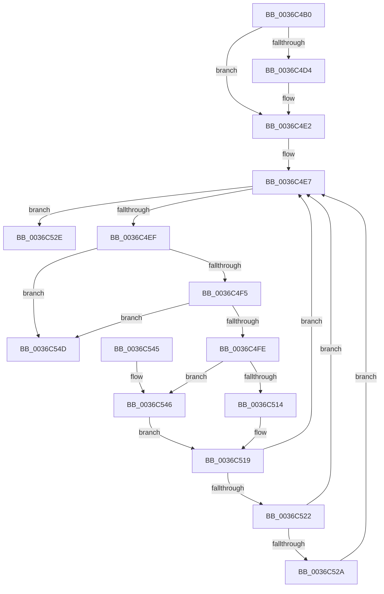

# MiPfCompletePrefetchIos

- RVA: `0x0036C4B0`–`0x0036C554` (길이 `164` bytes)
- VA: `0x000000014036C4B0`
- 실행 섹션: `.text`
- PDB 이름 있음: `예`; PDB Function 태그: `아니요`
- unwind 정보 RVA: `0x0007A3F0`
- 디코드: `51`개 명령, `164/164` bytes 표시
- 미해석 바이트: `0` (있으면 어셈블리에 `.byte`로 보존)

> 이 문서는 커널 이미지의 기계어와 PDB 기호를 분석해 생성했습니다. 4번과 5번은 함수 원형과 자료형을 바이너리 사용 방식에서 추정한 C 해석이며 원본 소스 복구 결과는 아닙니다.

## 1. Dependencies

- 직접 호출 지점: **3**; 고유 호출 대상: **3**
- 직접 호출자로 확인된 함수: **2**
- RIP 상대 이미지 참조: **0**

### Outgoing calls
- `0x0036C4DD` → [MiPfCoalesceAndIssueIOs](MiPfCoalesceAndIssueIOs_function_0036D158.md) (function, `0x0036D158`)
- `0x0036C514` → [MiPfCompleteInPageSupport](MiPfCompleteInPageSupport_function_0036D738.md) (function, `0x0036D738`)
- `0x0036C546` → [MiPfCompleteCoalescedIo](MiPfCompleteCoalescedIo_function_0036C344.md) (function, `0x0036C344`)

### Direct callers
- [MmPrefetchPagesEx](../../page/93/MmPrefetchPagesEx_function_0093C9A0.md) at `0x0093CC44`
- [MiPrefetchControlArea](../../page/93/MiPrefetchControlArea_function_0093E830.md) at `0x0093E987`

### Static image references
- 디코드된 RIP-relative 메모리 참조가 없습니다.

## 2. Other-region calls and transfers

- 다른 실행 섹션으로 향하는 call: **0**
- 별도 외부 분기/꼬리 이동을 확인하지 못했습니다.

## 3. Assembly (complete function range)

```asm
0036C4B0  48 89 5C 24 08                  mov qword ptr [rsp + 8], rbx
0036C4B5  48 89 6C 24 10                  mov qword ptr [rsp + 0x10], rbp
0036C4BA  48 89 74 24 18                  mov qword ptr [rsp + 0x18], rsi
0036C4BF  57                              push rdi
0036C4C0  48 83 EC 20                     sub rsp, 0x20
0036C4C4  33 FF                           xor edi, edi
0036C4C6  49 8B F0                        mov rsi, r8
0036C4C9  48 8B C2                        mov rax, rdx
0036C4CC  48 8B D9                        mov rbx, rcx
0036C4CF  48 85 D2                        test rdx, rdx
0036C4D2  74 0E                           je 0x14036c4e2
0036C4D4  48 8B D1                        mov rdx, rcx
0036C4D7  45 33 C0                        xor r8d, r8d
0036C4DA  48 8B C8                        mov rcx, rax
0036C4DD  E8 76 0C 00 00                  call 0x14036d158
0036C4E2  BD 00 00 00 80                  mov ebp, 0x80000000
0036C4E7  48 8B 0B                        mov rcx, qword ptr [rbx]
0036C4EA  48 3B CB                        cmp rcx, rbx
0036C4ED  74 3F                           je 0x14036c52e
0036C4EF  48 39 59 08                     cmp qword ptr [rcx + 8], rbx
0036C4F3  75 58                           jne 0x14036c54d
0036C4F5  48 8B 01                        mov rax, qword ptr [rcx]
0036C4F8  48 39 48 08                     cmp qword ptr [rax + 8], rcx
0036C4FC  75 4F                           jne 0x14036c54d
0036C4FE  48 89 03                        mov qword ptr [rbx], rax
0036C501  48 8B D6                        mov rdx, rsi
0036C504  48 89 58 08                     mov qword ptr [rax + 8], rbx
0036C508  8B 81 C0 00 00 00               mov eax, dword ptr [rcx + 0xc0]
0036C50E  0F BA E0 18                     bt eax, 0x18
0036C512  72 32                           jb 0x14036c546
0036C514  E8 1F 12 00 00                  call 0x14036d738
0036C519  8B C8                           mov ecx, eax
0036C51B  8D 04 28                        lea eax, [rax + rbp]
0036C51E  85 C5                           test ebp, eax
0036C520  75 C5                           jne 0x14036c4e7
0036C522  81 F9 34 04 00 C0               cmp ecx, 0xc0000434
0036C528  74 BD                           je 0x14036c4e7
0036C52A  8B F9                           mov edi, ecx
0036C52C  EB B9                           jmp 0x14036c4e7
0036C52E  48 8B 5C 24 30                  mov rbx, qword ptr [rsp + 0x30]
0036C533  8B C7                           mov eax, edi
0036C535  48 8B 6C 24 38                  mov rbp, qword ptr [rsp + 0x38]
0036C53A  48 8B 74 24 40                  mov rsi, qword ptr [rsp + 0x40]
0036C53F  48 83 C4 20                     add rsp, 0x20
0036C543  5F                              pop rdi
0036C544  C3                              ret
0036C545  CC                              int3
0036C546  E8 F9 FD FF FF                  call 0x14036c344
0036C54B  EB CC                           jmp 0x14036c519
0036C54D  B9 03 00 00 00                  mov ecx, 3
0036C552  CD 29                           int 0x29
```

## 4. C-style interpretation (structured pseudocode)

```c
__int64 __fastcall MiPfCompletePrefetchIos(__int64 a1, __int64 a2, __int64 a3)
{
    __int64 result;
    __int64 v_rdi;
    __int64 v_rsp;
    unsigned __int64 v_stack_p10;
    unsigned __int64 v_stack_p18;
    unsigned __int64 v_stack_p8;

    v_stack_p8 = v_rbx;
    v_stack_p10 = v_rbp;
    v_stack_p18 = v_rsi;
    v_rsp = (v_rsp) - (32);
    v_rdi = 0;
    result = a2;
    if (a2 != 0) {
        a2 = a1;
        a3 = 0;
        a1 = a2;
        result = MiPfCoalesceAndIssueIOs(a1, a2, a3, a4);
    }
loc_0036C4E7:
    if ((*(unsigned __int64 *)(a1)) == a1) goto loc_0036C52E;
    if ((*(unsigned __int64 *)(*(unsigned __int64 *)(a1) + 8)) != a1) goto loc_0036C54D;
    if ((*(unsigned __int64 *)(*(unsigned __int64 *)(*(unsigned __int64 *)(a1)) + 8)) != (*(unsigned __int64 *)(a1))) goto loc_0036C54D;
    *(unsigned __int64 *)(a1) = *(unsigned __int64 *)(*(unsigned __int64 *)(a1));
    *(unsigned __int64 *)(*(unsigned __int64 *)(*(unsigned __int64 *)(a1)) + 8) = a1;
    if ((*(unsigned __int64 *)(*(unsigned __int64 *)(*(unsigned __int64 *)(a1)) + 8)) < (*(unsigned __int64 *)(a1))) goto loc_0036C546;
    result = MiPfCompleteInPageSupport(*(unsigned __int64 *)(a1), 0, a3, a4);
loc_0036C519:
    if ((((unsigned int)((unsigned int)(0x80000000ULL))) & ((unsigned int)(result + (unsigned int)(0x80000000ULL) * 1))) != 0) goto loc_0036C4E7;
    if (((unsigned int)((unsigned int)((unsigned int)(result)))) == 0xC0000434ULL) goto loc_0036C4E7;
    goto loc_0036C4E7;
loc_0036C52E:
    v_rsp = (v_rsp) + (32);
    return (unsigned int)((unsigned int)((unsigned int)((unsigned int)((unsigned int)((unsigned int)(result))))));
loc_0036C546:
    result = MiPfCompleteCoalescedIo((unsigned int)((unsigned int)(result)), 0, a3, a4);
    goto loc_0036C519;
loc_0036C54D:
    return result;
}
```

## 5. (Beta) C Style

```c
int64_t MiPfCompletePrefetchIos(void *Arg1, int64_t Arg2, int64_t Arg3)
{
    uint8_t *arg1 = (uint8_t *)Arg1;

    int64_t result;
    int64_t local_rdi;
    int64_t local_rsp;
    uint64_t v_stack_p10;
    uint64_t v_stack_p18;
    uint64_t v_stack_p8;

    v_stack_p8 = local_rbx;
    v_stack_p10 = local_rbp;
    v_stack_p18 = local_rsi;
    local_rsp = (local_rsp) - (32);
    local_rdi = 0;
    result = Arg2;
    if (Arg2 != 0) {
        Arg2 = Arg1;
        Arg3 = 0;
        Arg1 = Arg2;
        result = MiPfCoalesceAndIssueIOs(Arg1, Arg2, Arg3, a4);
    }
loc_0036C4E7:
    if ((*(uint64_t *)(arg1)) == Arg1) goto loc_0036C52E;
    if ((*(uint64_t *)(*(uint64_t *)(arg1) + 0x8)) != Arg1) goto loc_0036C54D;
    if ((*(uint64_t *)(*(uint64_t *)(*(uint64_t *)(arg1)) + 0x8)) != (*(uint64_t *)(arg1))) goto loc_0036C54D;
    *(uint64_t *)(arg1) = *(uint64_t *)(*(uint64_t *)(arg1));
    *(void **)(*(uint64_t *)(*(uint64_t *)(arg1)) + 0x8) = Arg1;
    if ((*(uint64_t *)(*(uint64_t *)(*(uint64_t *)(arg1)) + 0x8)) < (*(uint64_t *)(arg1))) goto loc_0036C546;
    result = MiPfCompleteInPageSupport(*(uint64_t *)(arg1), 0, Arg3, a4);
loc_0036C519:
    if ((((uint32_t)((uint32_t)(0x80000000ULL))) & ((uint32_t)(result + (uint32_t)(0x80000000ULL) * 1))) != 0) goto loc_0036C4E7;
    if (((uint32_t)((uint32_t)((uint32_t)(result)))) == 0xC0000434ULL) goto loc_0036C4E7;
    goto loc_0036C4E7;
loc_0036C52E:
    local_rsp = (local_rsp) + (32);
    return (uint32_t)((uint32_t)((uint32_t)((uint32_t)((uint32_t)((uint32_t)(result))))));
loc_0036C546:
    result = MiPfCompleteCoalescedIo((uint32_t)((uint32_t)(result)), 0, Arg3, a4);
    goto loc_0036C519;
loc_0036C54D:
    return result;
}
```

### 관측된 메모리 오프셋

구조체 형식이 확인되지 않은 접근은 인자 기준의 오프셋으로만 기록했습니다.

| 기준 인자 | 오프셋 표현 | 폭 (bit) | 접근 |
|---|---:|---:|---|
| `Arg1` | `+ 0x0` | `64` | `R` |
| `Arg1` | `+ 0x0` | `64` | `W` |

## 6. Execution-region graph

[열기: 2D/3D 그래프와 함수 탐색 컨트롤 패널](../../../control-panel.html?section=text&rva=0x0036C4B0&view=graph)

- 2D 그래프는 위에서 아래로 흐르고, 3D 그래프는 빈 공간을 드래그해 회전합니다. Shift+드래그는 이동, 휠은 확대·축소, 함수 노드 선택은 대상 보고서 이동입니다.

### Static fallback


