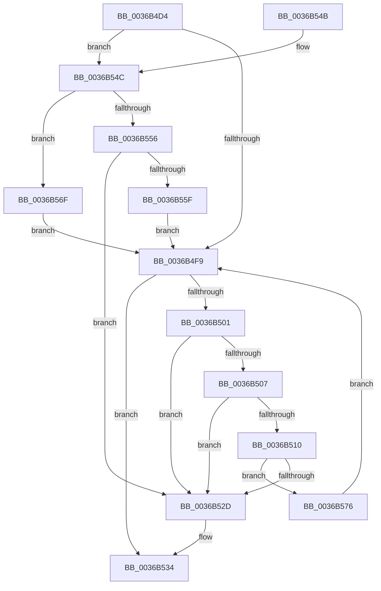

# MiPfIssueCoalesceCandidates

- RVA: `0x0036B4D4`–`0x0036B589` (길이 `181` bytes)
- VA: `0x000000014036B4D4`
- 실행 섹션: `.text`
- PDB 이름 있음: `예`; PDB Function 태그: `아니요`
- unwind 정보 RVA: `0x0007A380`
- 디코드: `56`개 명령, `181/181` bytes 표시
- 미해석 바이트: `0` (있으면 어셈블리에 `.byte`로 보존)

> 이 문서는 커널 이미지의 기계어와 PDB 기호를 분석해 생성했습니다. 4번과 5번은 함수 원형과 자료형을 바이너리 사용 방식에서 추정한 C 해석이며 원본 소스 복구 결과는 아닙니다.

## 1. Dependencies

- 직접 호출 지점: **2**; 고유 호출 대상: **2**
- 직접 호출자로 확인된 함수: **2**
- RIP 상대 이미지 참조: **0**

### Outgoing calls
- `0x0036B51F` → [MiIssueHardFaultIo](../38/MiIssueHardFaultIo_function_003812EC.md) (function, `0x003812EC`)
- `0x0036B54C` → [MiPfIssueCoalescedSupport](MiPfIssueCoalescedSupport_function_0036AE14.md) (function, `0x0036AE14`)

### Direct callers
- [sub_0036CEB4](Unknown_function_0036CEB4.md) at `0x0036CF03`
- [MiPfCoalesceAndIssueIOs](MiPfCoalesceAndIssueIOs_function_0036D158.md) at `0x0036D2C7`
- [MiPfCoalesceAndIssueIOs](MiPfCoalesceAndIssueIOs_function_0036D158.md) at `0x0036D2E4`

### Static image references
- 디코드된 RIP-relative 메모리 참조가 없습니다.

## 2. Other-region calls and transfers

- 다른 실행 섹션으로 향하는 call: **0**
- 별도 외부 분기/꼬리 이동을 확인하지 못했습니다.

## 3. Assembly (complete function range)

```asm
0036B4D4  48 89 5C 24 08                  mov qword ptr [rsp + 8], rbx
0036B4D9  48 89 6C 24 10                  mov qword ptr [rsp + 0x10], rbp
0036B4DE  48 89 74 24 18                  mov qword ptr [rsp + 0x18], rsi
0036B4E3  57                              push rdi
0036B4E4  48 83 EC 20                     sub rsp, 0x20
0036B4E8  48 8B 41 08                     mov rax, qword ptr [rcx + 8]
0036B4EC  33 ED                           xor ebp, ebp
0036B4EE  49 8B F8                        mov rdi, r8
0036B4F1  48 8B F1                        mov rsi, rcx
0036B4F4  48 39 01                        cmp qword ptr [rcx], rax
0036B4F7  75 53                           jne 0x14036b54c
0036B4F9  48 8B 1E                        mov rbx, qword ptr [rsi]
0036B4FC  48 3B DE                        cmp rbx, rsi
0036B4FF  74 33                           je 0x14036b534
0036B501  48 39 73 08                     cmp qword ptr [rbx + 8], rsi
0036B505  75 26                           jne 0x14036b52d
0036B507  48 8B 03                        mov rax, qword ptr [rbx]
0036B50A  48 39 58 08                     cmp qword ptr [rax + 8], rbx
0036B50E  75 1D                           jne 0x14036b52d
0036B510  48 89 06                        mov qword ptr [rsi], rax
0036B513  45 33 C0                        xor r8d, r8d
0036B516  33 D2                           xor edx, edx
0036B518  48 89 70 08                     mov qword ptr [rax + 8], rsi
0036B51C  48 8B CB                        mov rcx, rbx
0036B51F  E8 C8 5D 01 00                  call 0x1403812ec
0036B524  48 8B 47 08                     mov rax, qword ptr [rdi + 8]
0036B528  48 39 38                        cmp qword ptr [rax], rdi
0036B52B  74 49                           je 0x14036b576
0036B52D  B9 03 00 00 00                  mov ecx, 3
0036B532  CD 29                           int 0x29
0036B534  48 8B 5C 24 30                  mov rbx, qword ptr [rsp + 0x30]
0036B539  8B C5                           mov eax, ebp
0036B53B  48 8B 6C 24 38                  mov rbp, qword ptr [rsp + 0x38]
0036B540  48 8B 74 24 40                  mov rsi, qword ptr [rsp + 0x40]
0036B545  48 83 C4 20                     add rsp, 0x20
0036B549  5F                              pop rdi
0036B54A  C3                              ret
0036B54B  CC                              int3
0036B54C  E8 C3 F8 FF FF                  call 0x14036ae14
0036B551  48 85 C0                        test rax, rax
0036B554  74 19                           je 0x14036b56f
0036B556  48 8B 4F 08                     mov rcx, qword ptr [rdi + 8]
0036B55A  48 39 39                        cmp qword ptr [rcx], rdi
0036B55D  75 CE                           jne 0x14036b52d
0036B55F  48 89 38                        mov qword ptr [rax], rdi
0036B562  48 89 48 08                     mov qword ptr [rax + 8], rcx
0036B566  48 89 01                        mov qword ptr [rcx], rax
0036B569  48 89 47 08                     mov qword ptr [rdi + 8], rax
0036B56D  EB 8A                           jmp 0x14036b4f9
0036B56F  BD 9A 00 00 C0                  mov ebp, 0xc000009a
0036B574  EB 83                           jmp 0x14036b4f9
0036B576  48 89 3B                        mov qword ptr [rbx], rdi
0036B579  48 89 43 08                     mov qword ptr [rbx + 8], rax
0036B57D  48 89 18                        mov qword ptr [rax], rbx
0036B580  48 89 5F 08                     mov qword ptr [rdi + 8], rbx
0036B584  E9 70 FF FF FF                  jmp 0x14036b4f9
```

## 4. C-style interpretation (structured pseudocode)

```c
__int64 __fastcall MiPfIssueCoalesceCandidates(__int64 a1, int a2, __int64 a3)
{
    __int64 result;
    __int64 v_rbp;
    __int64 v_rsp;
    unsigned __int64 v_stack_p10;
    unsigned __int64 v_stack_p18;
    unsigned __int64 v_stack_p8;

    v_stack_p8 = v_rbx;
    v_stack_p10 = v_rbp;
    v_stack_p18 = v_rsi;
    v_rsp = (v_rsp) - (32);
    v_rbp = 0;
    if ((*(unsigned __int64 *)(a1)) != (*(unsigned __int64 *)(a1 + 8))) goto loc_0036B54C;
loc_0036B4F9:
    if ((*(unsigned __int64 *)(a1)) == a1) goto loc_0036B534;
    if ((*(unsigned __int64 *)(*(unsigned __int64 *)(a1) + 8)) != a1) goto loc_0036B52D;
    if ((*(unsigned __int64 *)(*(unsigned __int64 *)(*(unsigned __int64 *)(a1)) + 8)) != (*(unsigned __int64 *)(a1))) goto loc_0036B52D;
    *(unsigned __int64 *)(a1) = *(unsigned __int64 *)(*(unsigned __int64 *)(a1));
    a3 = 0;
    a2 = 0;
    *(unsigned __int64 *)(*(unsigned __int64 *)(*(unsigned __int64 *)(a1)) + 8) = a1;
    result = MiIssueHardFaultIo(*(unsigned __int64 *)(a1), a2, a3, a4);
    if ((*(unsigned __int64 *)(*(unsigned __int64 *)(a3 + 8))) == 0) goto loc_0036B576;
loc_0036B52D:
loc_0036B534:
    v_rsp = (v_rsp) + (32);
    return 0;
loc_0036B54C:
    result = MiPfIssueCoalescedSupport(3, a2, a3, a4);
    if (result == 0) goto loc_0036B56F;
    if ((*(unsigned __int64 *)(*(unsigned __int64 *)(a3 + 8))) != 0) goto loc_0036B52D;
    *(unsigned __int64 *)(result) = 0;
    *(unsigned __int64 *)(result + 8) = *(unsigned __int64 *)(a3 + 8);
    *(unsigned __int64 *)(*(unsigned __int64 *)(a3 + 8)) = result;
    *(unsigned __int64 *)(a3 + 8) = result;
    goto loc_0036B4F9;
loc_0036B56F:
    goto loc_0036B4F9;
loc_0036B576:
    *(unsigned __int64 *)(v_stack_p8) = 0;
    *(unsigned __int64 *)(v_stack_p8 + 8) = result;
    *(unsigned __int64 *)(result) = v_stack_p8;
    *(unsigned __int64 *)(a3 + 8) = v_stack_p8;
    goto loc_0036B4F9;
}
```

## 5. (Beta) C Style

```c
int64_t MiPfIssueCoalesceCandidates(void *Arg1, int32_t Arg2, void *Arg3)
{
    uint8_t *arg1 = (uint8_t *)Arg1;
    uint8_t *arg3 = (uint8_t *)Arg3;

    int64_t result;
    int64_t local_rbp;
    int64_t local_rsp;
    uint64_t v_stack_p10;
    uint64_t v_stack_p18;
    uint64_t v_stack_p8;

    v_stack_p8 = local_rbx;
    v_stack_p10 = local_rbp;
    v_stack_p18 = local_rsi;
    local_rsp = (local_rsp) - (32);
    local_rbp = 0;
    if ((*(uint64_t *)(arg1)) != (*(uint64_t *)(arg1 + 0x8))) goto loc_0036B54C;
loc_0036B4F9:
    if ((*(uint64_t *)(arg1)) == Arg1) goto loc_0036B534;
    if ((*(uint64_t *)(*(uint64_t *)(arg1) + 0x8)) != Arg1) goto loc_0036B52D;
    if ((*(uint64_t *)(*(uint64_t *)(*(uint64_t *)(arg1)) + 0x8)) != (*(uint64_t *)(arg1))) goto loc_0036B52D;
    *(uint64_t *)(arg1) = *(uint64_t *)(*(uint64_t *)(arg1));
    Arg3 = 0;
    Arg2 = 0;
    *(void **)(*(uint64_t *)(*(uint64_t *)(arg1)) + 0x8) = Arg1;
    result = MiIssueHardFaultIo(*(uint64_t *)(arg1), Arg2, Arg3, a4);
    if ((*(uint64_t *)(*(uint64_t *)(arg3 + 0x8))) == 0) goto loc_0036B576;
loc_0036B52D:
loc_0036B534:
    local_rsp = (local_rsp) + (32);
    return 0;
loc_0036B54C:
    result = MiPfIssueCoalescedSupport(3, Arg2, Arg3, a4);
    if (result == 0) goto loc_0036B56F;
    if ((*(uint64_t *)(*(uint64_t *)(arg3 + 0x8))) != 0) goto loc_0036B52D;
    *(uint64_t *)(result) = 0;
    *(uint64_t *)(result + 0x8) = *(uint64_t *)(arg3 + 0x8);
    *(uint64_t *)(*(uint64_t *)(arg3 + 0x8)) = result;
    *(uint64_t *)(arg3 + 0x8) = result;
    goto loc_0036B4F9;
loc_0036B56F:
    goto loc_0036B4F9;
loc_0036B576:
    *(uint64_t *)(v_stack_p8) = 0;
    *(uint64_t *)(v_stack_p8 + 0x8) = result;
    *(uint64_t *)(result) = v_stack_p8;
    *(uint64_t *)(arg3 + 0x8) = v_stack_p8;
    goto loc_0036B4F9;
}
```

### 관측된 메모리 오프셋

구조체 형식이 확인되지 않은 접근은 인자 기준의 오프셋으로만 기록했습니다.

| 기준 인자 | 오프셋 표현 | 폭 (bit) | 접근 |
|---|---:|---:|---|
| `Arg1` | `+ 0x0` | `64` | `R` |
| `Arg1` | `+ 0x0` | `64` | `W` |
| `Arg1` | `+ 0x8` | `64` | `R` |
| `Arg3` | `+ 0x8` | `64` | `R` |
| `Arg3` | `+ 0x8` | `64` | `W` |

## 6. Execution-region graph

[열기: 2D/3D 그래프와 함수 탐색 컨트롤 패널](../../../control-panel.html?section=text&rva=0x0036B4D4&view=graph)

- 2D 그래프는 위에서 아래로 흐르고, 3D 그래프는 빈 공간을 드래그해 회전합니다. Shift+드래그는 이동, 휠은 확대·축소, 함수 노드 선택은 대상 보고서 이동입니다.

### Static fallback


