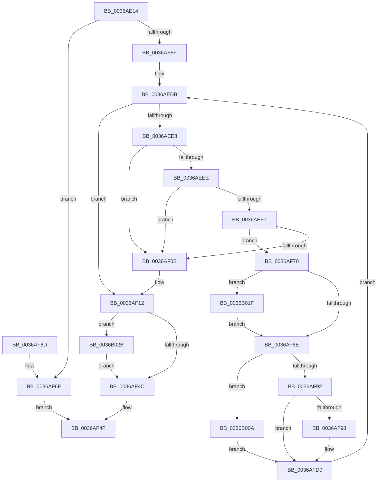

# MiPfIssueCoalescedSupport

- RVA: `0x0036AE14`–`0x0036B045` (길이 `561` bytes)
- VA: `0x000000014036AE14`
- 실행 섹션: `.text`
- PDB 이름 있음: `예`; PDB Function 태그: `아니요`
- unwind 정보 RVA: `0x0007A314`
- 디코드: `138`개 명령, `561/561` bytes 표시
- 미해석 바이트: `0` (있으면 어셈블리에 `.byte`로 보존)

> 이 문서는 커널 이미지의 기계어와 PDB 기호를 분석해 생성했습니다. 4번과 5번은 함수 원형과 자료형을 바이너리 사용 방식에서 추정한 C 해석이며 원본 소스 복구 결과는 아닙니다.

## 1. Dependencies

- 직접 호출 지점: **5**; 고유 호출 대상: **5**
- 직접 호출자로 확인된 함수: **2**
- RIP 상대 이미지 참조: **2**

### Outgoing calls
- `0x0036AE4C` → [MiAllocatePool](../35/MiAllocatePool_function_0035B540.md) (function, `0x0035B540`)
- `0x0036AE67` → [MiInitializeInPageSupport](MiInitializeInPageSupport_function_00362728.md) (function, `0x00362728`)
- `0x0036AF3F` → [IoPageReadEx](../29/IoPageReadEx_function_0029ABF0.md) (function, `0x0029ABF0`)
- `0x0036AFEC` → [memcpy](../6C/memcpy_function_006C6840.md) (function, `0x006C6840`)
- `0x0036B03B` → [KeSetEvent](../33/KeSetEvent_function_0033F310.md) (function, `0x0033F310`)

### Direct callers
- [MiPfIssueCoalesceCandidates](MiPfIssueCoalesceCandidates_function_0036B4D4.md) at `0x0036B54C`
- [sub_0036CEB4](Unknown_function_0036CEB4.md) at `0x0036CF98`

### Static image references
- `0x0036AED4` → RVA `0x00FC6C08` (`ALMOSTRO`; read)
- `0x0036AFA6` → RVA `0x00E37438` (`.data`; read)

## 2. Other-region calls and transfers

- 다른 실행 섹션으로 향하는 call: **0**
- 별도 외부 분기/꼬리 이동을 확인하지 못했습니다.

## 3. Assembly (complete function range)

```asm
0036AE14  48 89 5C 24 08                  mov qword ptr [rsp + 8], rbx
0036AE19  48 89 6C 24 10                  mov qword ptr [rsp + 0x10], rbp
0036AE1E  48 89 74 24 20                  mov qword ptr [rsp + 0x20], rsi
0036AE23  57                              push rdi
0036AE24  41 54                           push r12
0036AE26  41 55                           push r13
0036AE28  41 56                           push r14
0036AE2A  41 57                           push r15
0036AE2C  48 83 EC 40                     sub rsp, 0x40
0036AE30  8B C2                           mov eax, edx
0036AE32  8B FA                           mov edi, edx
0036AE34  C1 E8 0C                        shr eax, 0xc
0036AE37  4C 8B F9                        mov r15, rcx
0036AE3A  B9 40 00 00 00                  mov ecx, 0x40
0036AE3F  41 B8 4D 69 43 73               mov r8d, 0x7343694d
0036AE45  8D 14 C5 40 01 00 00            lea edx, [rax*8 + 0x140]
0036AE4C  E8 EF 06 FF FF                  call 0x14035b540
0036AE51  33 DB                           xor ebx, ebx
0036AE53  48 8B F0                        mov rsi, rax
0036AE56  48 85 C0                        test rax, rax
0036AE59  0F 84 0F 01 00 00               je 0x14036af6e
0036AE5F  45 33 C0                        xor r8d, r8d
0036AE62  33 D2                           xor edx, edx
0036AE64  48 8B C8                        mov rcx, rax
0036AE67  E8 BC 78 FF FF                  call 0x140362728
0036AE6C  8B 86 C0 00 00 00               mov eax, dword ptr [rsi + 0xc0]
0036AE72  4C 8D A6 40 01 00 00            lea r12, [rsi + 0x140]
0036AE79  0F BA E8 18                     bts eax, 0x18
0036AE7D  48 89 9C 24 80 00 00 00         mov qword ptr [rsp + 0x80], rbx
0036AE85  89 86 C0 00 00 00               mov dword ptr [rsi + 0xc0], eax
0036AE8B  8B EB                           mov ebp, ebx
0036AE8D  48 89 9E 10 01 00 00            mov qword ptr [rsi + 0x110], rbx
0036AE94  48 8D 87 FF 0F 00 00            lea rax, [rdi + 0xfff]
0036AE9B  48 C1 E8 0C                     shr rax, 0xc
0036AE9F  66 83 C0 06                     add ax, 6
0036AEA3  66 89 9E 1A 01 00 00            mov word ptr [rsi + 0x11a], bx
0036AEAA  66 C1 E0 03                     shl ax, 3
0036AEAE  66 89 86 18 01 00 00            mov word ptr [rsi + 0x118], ax
0036AEB5  B8 42 40 00 00                  mov eax, 0x4042
0036AEBA  48 89 9E 30 01 00 00            mov qword ptr [rsi + 0x130], rbx
0036AEC1  89 9E 3C 01 00 00               mov dword ptr [rsi + 0x13c], ebx
0036AEC7  89 BE 38 01 00 00               mov dword ptr [rsi + 0x138], edi
0036AECD  66 09 86 1A 01 00 00            or word ptr [rsi + 0x11a], ax
0036AED4  4C 8B 2D 2D BD C5 00            mov r13, qword ptr [rip + 0xc5bd2d]
0036AEDB  4D 8B 37                        mov r14, qword ptr [r15]
0036AEDE  BA FF BF FF FF                  mov edx, 0xffffbfff
0036AEE3  4D 3B F7                        cmp r14, r15
0036AEE6  74 2A                           je 0x14036af12
0036AEE8  4D 39 7E 08                     cmp qword ptr [r14 + 8], r15
0036AEEC  75 1D                           jne 0x14036af0b
0036AEEE  49 8B 06                        mov rax, qword ptr [r14]
0036AEF1  4C 39 70 08                     cmp qword ptr [rax + 8], r14
0036AEF5  75 14                           jne 0x14036af0b
0036AEF7  49 89 07                        mov qword ptr [r15], rax
0036AEFA  4C 89 78 08                     mov qword ptr [rax + 8], r15
0036AEFE  48 8D 46 10                     lea rax, [rsi + 0x10]
0036AF02  48 8B 48 08                     mov rcx, qword ptr [rax + 8]
0036AF06  48 39 01                        cmp qword ptr [rcx], rax
0036AF09  74 65                           je 0x14036af70
0036AF0B  B9 03 00 00 00                  mov ecx, 3
0036AF10  CD 29                           int 0x29
0036AF12  48 83 64 24 30 00               and qword ptr [rsp + 0x30], 0
0036AF18  48 8D 7E 50                     lea rdi, [rsi + 0x50]
0036AF1C  C7 44 24 28 06 00 00 00         mov dword ptr [rsp + 0x28], 6
0036AF24  48 8D 96 10 01 00 00            lea rdx, [rsi + 0x110]
0036AF2B  4C 8D 4E 20                     lea r9, [rsi + 0x20]
0036AF2F  48 89 7C 24 20                  mov qword ptr [rsp + 0x20], rdi
0036AF34  4C 8D 84 24 80 00 00 00         lea r8, [rsp + 0x80]
0036AF3C  49 8B CD                        mov rcx, r13
0036AF3F  E8 AC FC F2 FF                  call 0x14029abf0
0036AF44  85 C0                           test eax, eax
0036AF46  0F 88 DF 00 00 00               js 0x14036b02b
0036AF4C  48 8B C6                        mov rax, rsi
0036AF4F  4C 8D 5C 24 40                  lea r11, [rsp + 0x40]
0036AF54  49 8B 5B 30                     mov rbx, qword ptr [r11 + 0x30]
0036AF58  49 8B 6B 38                     mov rbp, qword ptr [r11 + 0x38]
0036AF5C  49 8B 73 48                     mov rsi, qword ptr [r11 + 0x48]
0036AF60  49 8B E3                        mov rsp, r11
0036AF63  41 5F                           pop r15
0036AF65  41 5E                           pop r14
0036AF67  41 5D                           pop r13
0036AF69  41 5C                           pop r12
0036AF6B  5F                              pop rdi
0036AF6C  C3                              ret
0036AF6D  CC                              int3
0036AF6E  EB DF                           jmp 0x14036af4f
0036AF70  49 89 06                        mov qword ptr [r14], rax
0036AF73  49 89 4E 08                     mov qword ptr [r14 + 8], rcx
0036AF77  4C 89 31                        mov qword ptr [rcx], r14
0036AF7A  4C 89 70 08                     mov qword ptr [rax + 8], r14
0036AF7E  66 41 0F BA A6 1A 01 00 00 0E   bt word ptr [r14 + 0x11a], 0xe
0036AF88  0F 83 91 00 00 00               jae 0x14036b01f
0036AF8E  85 ED                           test ebp, ebp
0036AF90  74 78                           je 0x14036b00a
0036AF92  49 3B 5E 60                     cmp rbx, qword ptr [r14 + 0x60]
0036AF96  74 38                           je 0x14036afd0
0036AF98  66 21 96 1A 01 00 00            and word ptr [rsi + 0x11a], dx
0036AF9F  49 8B FC                        mov rdi, r12
0036AFA2  45 8B 46 60                     mov r8d, dword ptr [r14 + 0x60]
0036AFA6  48 8B 05 8B C4 AC 00            mov rax, qword ptr [rip + 0xacc48b]
0036AFAD  44 2B C3                        sub r8d, ebx
0036AFB0  41 8B D0                        mov edx, r8d
0036AFB3  C1 EA 0C                        shr edx, 0xc
0036AFB6  C1 E2 03                        shl edx, 3
0036AFB9  48 C1 EA 03                     shr rdx, 3
0036AFBD  48 8B CA                        mov rcx, rdx
0036AFC0  F3 48 AB                        rep stosq qword ptr [rdi], rax
0036AFC3  41 8B C0                        mov eax, r8d
0036AFC6  4D 8D 24 D4                     lea r12, [r12 + rdx*8]
0036AFCA  48 03 D8                        add rbx, rax
0036AFCD  41 03 E8                        add ebp, r8d
0036AFD0  41 8B 86 B8 00 00 00            mov eax, dword ptr [r14 + 0xb8]
0036AFD7  49 8D 96 40 01 00 00            lea rdx, [r14 + 0x140]
0036AFDE  C1 E8 0C                        shr eax, 0xc
0036AFE1  49 8B CC                        mov rcx, r12
0036AFE4  C1 E0 03                        shl eax, 3
0036AFE7  44 8B C0                        mov r8d, eax
0036AFEA  8B F8                           mov edi, eax
0036AFEC  E8 4F B8 35 00                  call 0x1406c6840
0036AFF1  41 8B 86 B8 00 00 00            mov eax, dword ptr [r14 + 0xb8]
0036AFF8  48 C1 EF 03                     shr rdi, 3
0036AFFC  48 03 D8                        add rbx, rax
0036AFFF  03 E8                           add ebp, eax
0036B001  4D 8D 24 FC                     lea r12, [r12 + rdi*8]
0036B005  E9 D1 FE FF FF                  jmp 0x14036aedb
0036B00A  49 8B 5E 60                     mov rbx, qword ptr [r14 + 0x60]
0036B00E  4D 8B AE C8 00 00 00            mov r13, qword ptr [r14 + 0xc8]
0036B015  48 89 9C 24 80 00 00 00         mov qword ptr [rsp + 0x80], rbx
0036B01D  EB B1                           jmp 0x14036afd0
0036B01F  66 21 96 1A 01 00 00            and word ptr [rsi + 0x11a], dx
0036B026  E9 63 FF FF FF                  jmp 0x14036af8e
0036B02B  48 83 66 58 00                  and qword ptr [rsi + 0x58], 0
0036B030  48 8D 4E 20                     lea rcx, [rsi + 0x20]
0036B034  45 33 C0                        xor r8d, r8d
0036B037  89 07                           mov dword ptr [rdi], eax
0036B039  33 D2                           xor edx, edx
0036B03B  E8 D0 42 FD FF                  call 0x14033f310
0036B040  E9 07 FF FF FF                  jmp 0x14036af4c
```

## 4. C-style interpretation (structured pseudocode)

```c
__int64 __fastcall MiPfIssueCoalescedSupport(__int64 a1, int a2)
{
    __int64 result;
    __int64 v_r12;
    __int64 v_rbp;
    __int64 v_rbx;
    __int64 v_rdi;
    __int64 v_rsp;
    unsigned __int64 v_stack_m28;
    unsigned __int64 v_stack_m38;
    unsigned int v_stack_m40;
    unsigned __int64 v_stack_m48;
    unsigned __int64 v_stack_p10;
    unsigned __int64 v_stack_p18;
    unsigned __int64 v_stack_p20;
    unsigned __int64 v_stack_p40;
    unsigned __int64 v_stack_p8;

    v_stack_p8 = v_rbx;
    v_stack_p10 = v_rbp;
    v_stack_p20 = v_rsi;
    v_rsp = (v_rsp) - (64);
    result = (unsigned int)(((unsigned int)(a2)) >> (12));
    result = MiAllocatePool(64, result * 8 + 320, (unsigned int)(0x7343694DULL), a4);
    v_rbx = 0;
    if (result == 0) goto loc_0036AF6E;
    a3 = 0;
    a2 = 0;
    result = MiInitializeInPageSupport(result, a2, a3, a4);
    v_stack_p18 = 0;
    *(unsigned int *)(result + 192) = (unsigned int)((unsigned int)(*(unsigned int *)(result + 192)));
    *(unsigned __int64 *)(result + 272) = 0;
    result = ((unsigned int)(a2) + 4095) >> (12);
    result = (unsigned __int16)((result) + (6));
    *(unsigned __int16 *)(result + 282) = 0;
    result = (unsigned __int16)((result) << (3));
    *(unsigned __int16 *)(result + 280) = (unsigned __int16)(result);
    *(unsigned __int64 *)(result + 304) = 0;
    *(unsigned int *)(result + 316) = 0;
    *(unsigned int *)(result + 312) = (unsigned int)((unsigned int)(a2));
loc_0036AEDB:
    if ((*(unsigned __int64 *)(a1)) == a1) goto loc_0036AF12;
    if ((*(unsigned __int64 *)(*(unsigned __int64 *)(a1) + 8)) != a1) goto loc_0036AF0B;
    if ((*(unsigned __int64 *)(*(unsigned __int64 *)(*(unsigned __int64 *)(a1)) + 8)) != (*(unsigned __int64 *)(a1))) goto loc_0036AF0B;
    *(unsigned __int64 *)(a1) = *(unsigned __int64 *)(*(unsigned __int64 *)(a1));
    *(unsigned __int64 *)(*(unsigned __int64 *)(*(unsigned __int64 *)(a1)) + 8) = a1;
    if ((*(unsigned __int64 *)(*(unsigned __int64 *)(result + 16 + 8))) == (result + 16)) goto loc_0036AF70;
loc_0036AF0B:
loc_0036AF12:
    v_stack_m40 = 6;
    v_stack_m48 = result + 80;
    result = IoPageReadEx(*(unsigned __int64 *)(v_rip + 12959021), result + 272, v_stack_p18, result + 32);
    if (sign_flag) goto loc_0036B02B;
loc_0036AF4C:
loc_0036AF4F:
    return result;
loc_0036AF6E:
    goto loc_0036AF4F;
loc_0036AF70:
    *(unsigned __int64 *)(*(unsigned __int64 *)(a1)) = result;
    *(unsigned __int64 *)(*(unsigned __int64 *)(a1) + 8) = *(unsigned __int64 *)(v_rip + 12959021);
    *(unsigned __int64 *)(*(unsigned __int64 *)(v_rip + 12959021)) = *(unsigned __int64 *)(a1);
    *(unsigned __int64 *)(result + 8) = *(unsigned __int64 *)(a1);
    if (condition_is_above_or_equal) goto loc_0036B01F;
loc_0036AF8E:
    if ((unsigned int)(*(unsigned __int64 *)(v_stack_m28 + 56)) == 0) goto loc_0036B00A;
    v_rbx = *(unsigned __int64 *)(v_stack_m28 + 48);
    v_rdi = result + 80;
    v_rbp = *(unsigned __int64 *)(v_stack_m28 + 56);
    v_r12 = result + 320;
    if ((*(unsigned __int64 *)(v_stack_m28 + 48)) != (*(unsigned __int64 *)(*(unsigned __int64 *)(a1) + 96))) {
        v_rdi = result + 320;
        a3 = *(unsigned int *)(*(unsigned __int64 *)(a1) + 96);
        result = *(unsigned __int64 *)(v_rip + 11322507);
        a3 = (unsigned int)((a3) - ((unsigned int)(*(unsigned __int64 *)(v_stack_m28 + 48))));
        a2 = (unsigned int)(a3);
        a2 = (unsigned int)((a2) >> (12));
        a2 = (unsigned int)((a2) << (3));
        a2 = (a2) >> (3);
        a1 = a2;
        result = (unsigned int)(a3);
        v_r12 = result + 320 + a2 * 8;
        v_rbx = (*(unsigned __int64 *)(v_stack_m28 + 48)) + (result);
        v_rbp = (unsigned int)((*(unsigned __int64 *)(v_stack_m28 + 56)) + ((unsigned int)(a3)));
    }
    result = (unsigned int)(((unsigned int)(*(unsigned int *)(*(unsigned __int64 *)(a1) + 184))) >> (12));
    result = (unsigned int)((result) << (3));
    result = memcpy(v_r12, *(unsigned __int64 *)(a1) + 320, (unsigned int)((unsigned int)(result)), result + 32);
    v_rdi = ((unsigned int)((unsigned int)(result))) >> (3);
    v_rbx = (v_rbx) + ((unsigned int)(*(unsigned int *)(*(unsigned __int64 *)(a1) + 184)));
    v_rbp = (unsigned int)((v_rbp) + ((unsigned int)((unsigned int)(*(unsigned int *)(*(unsigned __int64 *)(a1) + 184)))));
    goto loc_0036AEDB;
loc_0036B00A:
    v_stack_p40 = *(unsigned __int64 *)(*(unsigned __int64 *)(a1) + 96);
    goto loc_0036AFD0;
loc_0036B01F:
    goto loc_0036AF8E;
loc_0036B02B:
    a3 = 0;
    *(unsigned int *)(v_rdi) = (unsigned int)((unsigned int)(*(unsigned int *)(*(unsigned __int64 *)(a1) + 184)));
    a2 = 0;
    result = KeSetEvent(*(unsigned __int64 *)(v_stack_m28 + 72) + 32, a2, a3, result + 32);
    goto loc_0036AF4C;
}
```

## 5. (Beta) C Style

```c
int64_t MiPfIssueCoalescedSupport(void *Arg1, void *Arg2)
{
    uint8_t *arg1 = (uint8_t *)Arg1;
    uint8_t *arg2 = (uint8_t *)Arg2;

    int64_t result;
    int64_t local_r12;
    int64_t local_rbp;
    int64_t local_rbx;
    int64_t local_rdi;
    int64_t local_rsp;
    uint64_t v_stack_m28;
    uint64_t v_stack_m38;
    uint32_t v_stack_m40;
    uint64_t v_stack_m48;
    uint64_t v_stack_p10;
    uint64_t v_stack_p18;
    uint64_t v_stack_p20;
    uint64_t v_stack_p40;
    uint64_t v_stack_p8;

    v_stack_p8 = local_rbx;
    v_stack_p10 = local_rbp;
    v_stack_p20 = local_rsi;
    local_rsp = (local_rsp) - (64);
    result = (uint32_t)(((uint32_t)(Arg2)) >> (12));
    result = MiAllocatePool(64, result * 8 + 320, (uint32_t)(0x7343694DULL), a4);
    local_rbx = 0;
    if (result == 0) goto loc_0036AF6E;
    a3 = 0;
    Arg2 = 0;
    result = MiInitializeInPageSupport(result, Arg2, a3, a4);
    v_stack_p18 = 0;
    *(uint32_t *)(result + 0xC0) = (uint32_t)((uint32_t)(*(uint32_t *)(result + 0xC0)));
    *(uint64_t *)(result + 0x110) = 0;
    result = ((uint32_t)(Arg2) + 4095) >> (12);
    result = (uint16_t)((result) + (6));
    *(uint16_t *)(result + 0x11A) = 0;
    result = (uint16_t)((result) << (3));
    *(uint16_t *)(result + 0x118) = (uint16_t)(result);
    *(uint64_t *)(result + 0x130) = 0;
    *(uint32_t *)(result + 0x13C) = 0;
    *(uint32_t *)(result + 0x138) = (uint32_t)((uint32_t)(Arg2));
loc_0036AEDB:
    if ((*(uint64_t *)(arg1)) == Arg1) goto loc_0036AF12;
    if ((*(uint64_t *)(*(uint64_t *)(arg1) + 0x8)) != Arg1) goto loc_0036AF0B;
    if ((*(uint64_t *)(*(uint64_t *)(*(uint64_t *)(arg1)) + 0x8)) != (*(uint64_t *)(arg1))) goto loc_0036AF0B;
    *(uint64_t *)(arg1) = *(uint64_t *)(*(uint64_t *)(arg1));
    *(void **)(*(uint64_t *)(*(uint64_t *)(arg1)) + 0x8) = Arg1;
    if ((*(uint64_t *)(*(uint64_t *)(result + 0x10 + 0x8))) == (result + 16)) goto loc_0036AF70;
loc_0036AF0B:
loc_0036AF12:
    v_stack_m40 = 6;
    v_stack_m48 = result + 80;
    result = IoPageReadEx(*(uint64_t *)(v_rip + 0xC5BD2D), result + 272, v_stack_p18, result + 32);
    if (sign_flag) goto loc_0036B02B;
loc_0036AF4C:
loc_0036AF4F:
    return result;
loc_0036AF6E:
    goto loc_0036AF4F;
loc_0036AF70:
    *(uint64_t *)(*(uint64_t *)(arg1)) = result;
    *(uint64_t *)(*(uint64_t *)(arg1) + 0x8) = *(uint64_t *)(v_rip + 0xC5BD2D);
    *(uint64_t *)(*(uint64_t *)(v_rip + 0xC5BD2D)) = *(uint64_t *)(arg1);
    *(uint64_t *)(result + 0x8) = *(uint64_t *)(arg1);
    if (condition_is_above_or_equal) goto loc_0036B01F;
loc_0036AF8E:
    if ((uint32_t)(*(uint64_t *)(v_stack_m28 + 0x38)) == 0) goto loc_0036B00A;
    local_rbx = *(uint64_t *)(v_stack_m28 + 0x30);
    local_rdi = result + 80;
    local_rbp = *(uint64_t *)(v_stack_m28 + 0x38);
    local_r12 = result + 320;
    if ((*(uint64_t *)(v_stack_m28 + 0x30)) != (*(uint64_t *)(*(uint64_t *)(arg1) + 0x60))) {
        local_rdi = result + 320;
        a3 = *(uint32_t *)(*(uint64_t *)(arg1) + 0x60);
        result = *(uint64_t *)(v_rip + 0xACC48B);
        a3 = (uint32_t)((a3) - ((uint32_t)(*(uint64_t *)(v_stack_m28 + 0x30))));
        Arg2 = (uint32_t)(a3);
        Arg2 = (uint32_t)((Arg2) >> (12));
        Arg2 = (uint32_t)((Arg2) << (3));
        Arg2 = (Arg2) >> (3);
        Arg1 = Arg2;
        result = (uint32_t)(a3);
        local_r12 = result + 320 + Arg2 * 8;
        local_rbx = (*(uint64_t *)(v_stack_m28 + 0x30)) + (result);
        local_rbp = (uint32_t)((*(uint64_t *)(v_stack_m28 + 0x38)) + ((uint32_t)(a3)));
    }
    result = (uint32_t)(((uint32_t)(*(uint32_t *)(*(uint64_t *)(arg1) + 0xB8))) >> (12));
    result = (uint32_t)((result) << (3));
    result = memcpy(local_r12, *(uint64_t *)(arg1) + 320, (uint32_t)((uint32_t)(result)), result + 32);
    local_rdi = ((uint32_t)((uint32_t)(result))) >> (3);
    local_rbx = (local_rbx) + ((uint32_t)(*(uint32_t *)(*(uint64_t *)(arg1) + 0xB8)));
    local_rbp = (uint32_t)((local_rbp) + ((uint32_t)((uint32_t)(*(uint32_t *)(*(uint64_t *)(arg1) + 0xB8)))));
    goto loc_0036AEDB;
loc_0036B00A:
    v_stack_p40 = *(uint64_t *)(*(uint64_t *)(arg1) + 0x60);
    goto loc_0036AFD0;
loc_0036B01F:
    goto loc_0036AF8E;
loc_0036B02B:
    a3 = 0;
    *(uint32_t *)(local_rdi) = (uint32_t)((uint32_t)(*(uint32_t *)(*(uint64_t *)(arg1) + 0xB8)));
    Arg2 = 0;
    result = KeSetEvent(*(uint64_t *)(v_stack_m28 + 0x48) + 32, Arg2, a3, result + 32);
    goto loc_0036AF4C;
}
```

### 관측된 메모리 오프셋

구조체 형식이 확인되지 않은 접근은 인자 기준의 오프셋으로만 기록했습니다.

| 기준 인자 | 오프셋 표현 | 폭 (bit) | 접근 |
|---|---:|---:|---|
| `Arg1` | `+ 0x0` | `64` | `R` |
| `Arg1` | `+ 0x0` | `64` | `W` |
| `Arg2` | `+ 0xFFF` | `64` | `R` |

## 6. Execution-region graph

[열기: 2D/3D 그래프와 함수 탐색 컨트롤 패널](../../../control-panel.html?section=text&rva=0x0036AE14&view=graph)

- 2D 그래프는 위에서 아래로 흐르고, 3D 그래프는 빈 공간을 드래그해 회전합니다. Shift+드래그는 이동, 휠은 확대·축소, 함수 노드 선택은 대상 보고서 이동입니다.

### Static fallback


