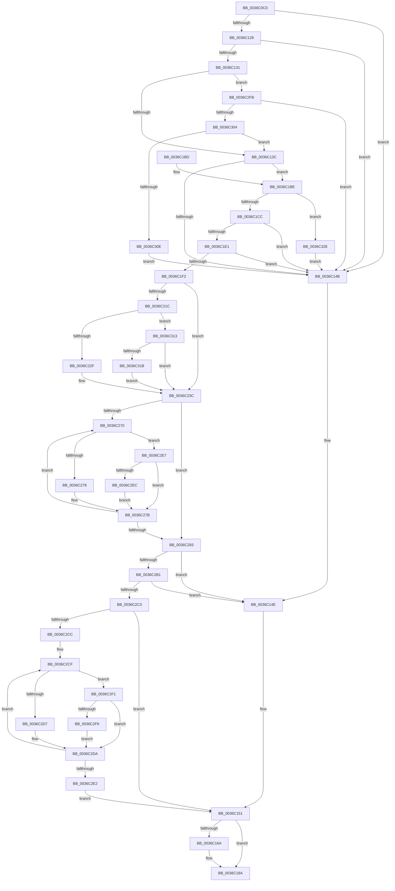

# MiPickClusterForMappedFileFault

- RVA: `0x0036C0C0`–`0x0036C33B` (길이 `635` bytes)
- VA: `0x000000014036C0C0`
- 실행 섹션: `.text`
- PDB 이름 있음: `예`; PDB Function 태그: `아니요`
- unwind 정보 RVA: `0x0007A3B4`
- 디코드: `165`개 명령, `635/635` bytes 표시
- 미해석 바이트: `0` (있으면 어셈블리에 `.byte`로 보존)

> 이 문서는 커널 이미지의 기계어와 PDB 기호를 분석해 생성했습니다. 4번과 5번은 함수 원형과 자료형을 바이너리 사용 방식에서 추정한 C 해석이며 원본 소스 복구 결과는 아닙니다.

## 1. Dependencies

- 직접 호출 지점: **2**; 고유 호출 대상: **2**
- 직접 호출자로 확인된 함수: **1**
- RIP 상대 이미지 참조: **2**

### Outgoing calls
- `0x0036C182` → [MiObtainFaultCharges](../28/MiObtainFaultCharges_function_0028AEB0.md) (function, `0x0028AEB0`)
- `0x0036C1D4` → [MiSufficientAvailablePages](MiSufficientAvailablePages_function_0036D0B0.md) (function, `0x0036D0B0`)

### Direct callers
- [MiResolveMappedFileFault](MiResolveMappedFileFault_function_0036B640.md) at `0x0036BA84`

### Static image references
- `0x0036C1BE` → RVA `0x00E37398` (`.data`; read)
- `0x0036C330` → RVA `0x00E37398` (`.data`; write)

## 2. Other-region calls and transfers

- 다른 실행 섹션으로 향하는 call: **0**
- 별도 외부 분기/꼬리 이동을 확인하지 못했습니다.

## 3. Assembly (complete function range)

```asm
0036C0C0  4C 89 4C 24 20                  mov qword ptr [rsp + 0x20], r9
0036C0C5  4C 89 44 24 18                  mov qword ptr [rsp + 0x18], r8
0036C0CA  48 89 4C 24 08                  mov qword ptr [rsp + 8], rcx
0036C0CF  53                              push rbx
0036C0D0  55                              push rbp
0036C0D1  56                              push rsi
0036C0D2  57                              push rdi
0036C0D3  41 54                           push r12
0036C0D5  41 55                           push r13
0036C0D7  41 56                           push r14
0036C0D9  41 57                           push r15
0036C0DB  48 83 EC 38                     sub rsp, 0x38
0036C0DF  48 8B BA D0 00 00 00            mov rdi, qword ptr [rdx + 0xd0]
0036C0E6  4D 8B F0                        mov r14, r8
0036C0E9  48 8B 9A A8 00 00 00            mov rbx, qword ptr [rdx + 0xa8]
0036C0F0  4C 8B C1                        mov r8, rcx
0036C0F3  65 48 8B 04 25 88 01 00 00      mov rax, qword ptr gs:[0x188]
0036C0FC  33 F6                           xor esi, esi
0036C0FE  48 8B AA E8 00 00 00            mov rbp, qword ptr [rdx + 0xe8]
0036C105  41 BF 01 00 00 00               mov r15d, 1
0036C10B  48 8B 0F                        mov rcx, qword ptr [rdi]
0036C10E  4C 8B E2                        mov r12, rdx
0036C111  48 89 8C 24 88 00 00 00         mov qword ptr [rsp + 0x88], rcx
0036C119  45 8B EF                        mov r13d, r15d
0036C11C  48 89 44 24 20                  mov qword ptr [rsp + 0x20], rax
0036C121  48 0F BA E3 0A                  bt rbx, 0xa
0036C126  73 23                           jae 0x14036c14b
0036C128  40 38 B0 AD 05 00 00            cmp byte ptr [rax + 0x5ad], sil
0036C12F  75 1A                           jne 0x14036c14b
0036C131  8B 41 38                        mov eax, dword ptr [rcx + 0x38]
0036C134  A8 08                           test al, 8
0036C136  0F 85 BF 01 00 00               jne 0x14036c2fb
0036C13C  49 8B 80 40 49 00 00            mov rax, qword ptr [r8 + 0x4940]
0036C143  48 3D A0 00 00 00               cmp rax, 0xa0
0036C149  7D 73                           jge 0x14036c1be
0036C14B  4C 8B F5                        mov r14, rbp
0036C14E  48 8B FD                        mov rdi, rbp
0036C151  48 8B 9C 24 A0 00 00 00         mov rbx, qword ptr [rsp + 0xa0]
0036C159  49 8D 55 FF                     lea rdx, [r13 - 1]
0036C15D  48 83 FB FF                     cmp rbx, -1
0036C161  49 0F 44 D5                     cmove rdx, r13
0036C165  48 85 D2                        test rdx, rdx
0036C168  74 20                           je 0x14036c18a
0036C16A  48 8B 8C 24 80 00 00 00         mov rcx, qword ptr [rsp + 0x80]
0036C172  48 83 FB FF                     cmp rbx, -1
0036C176  B8 03 00 00 00                  mov eax, 3
0036C17B  44 0F 44 F8                     cmove r15d, eax
0036C17F  45 8B C7                        mov r8d, r15d
0036C182  E8 29 ED F1 FF                  call 0x14028aeb0
0036C187  48 8B F0                        mov rsi, rax
0036C18A  48 8B 8C 24 A8 00 00 00         mov rcx, qword ptr [rsp + 0xa8]
0036C192  48 8D 46 01                     lea rax, [rsi + 1]
0036C196  48 83 FB FF                     cmp rbx, -1
0036C19A  48 0F 44 C6                     cmove rax, rsi
0036C19E  48 89 39                        mov qword ptr [rcx], rdi
0036C1A1  48 8B 8C 24 B0 00 00 00         mov rcx, qword ptr [rsp + 0xb0]
0036C1A9  4C 89 31                        mov qword ptr [rcx], r14
0036C1AC  48 83 C4 38                     add rsp, 0x38
0036C1B0  41 5F                           pop r15
0036C1B2  41 5E                           pop r14
0036C1B4  41 5D                           pop r13
0036C1B6  41 5C                           pop r12
0036C1B8  5F                              pop rdi
0036C1B9  5E                              pop rsi
0036C1BA  5D                              pop rbp
0036C1BB  5B                              pop rbx
0036C1BC  C3                              ret
0036C1BD  CC                              int3
0036C1BE  8B 05 D4 B1 AC 00               mov eax, dword ptr [rip + 0xacb1d4]
0036C1C4  85 C0                           test eax, eax
0036C1C6  0F 85 62 01 00 00               jne 0x14036c32e
0036C1CC  BA 40 01 00 00                  mov edx, 0x140
0036C1D1  49 8B C8                        mov rcx, r8
0036C1D4  E8 D7 0E 00 00                  call 0x14036d0b0
0036C1D9  85 C0                           test eax, eax
0036C1DB  0F 84 6A FF FF FF               je 0x14036c14b
0036C1E1  41 8B 94 24 B8 00 00 00         mov edx, dword ptr [r12 + 0xb8]
0036C1E9  41 3B D7                        cmp edx, r15d
0036C1EC  0F 84 59 FF FF FF               je 0x14036c14b
0036C1F2  8B 4F 34                        mov ecx, dword ptr [rdi + 0x34]
0036C1F5  41 B9 08 00 00 00               mov r9d, 8
0036C1FB  8B 47 2C                        mov eax, dword ptr [rdi + 0x2c]
0036C1FE  81 E1 FF FF FF 3F               and ecx, 0x3fffffff
0036C204  4C 8B 84 24 98 00 00 00         mov r8, qword ptr [rsp + 0x98]
0036C20C  48 2B C1                        sub rax, rcx
0036C20F  49 8D 48 F8                     lea rcx, [r8 - 8]
0036C213  48 8D 0C C1                     lea rcx, [rcx + rax*8]
0036C217  4D 85 F6                        test r14, r14
0036C21A  75 20                           jne 0x14036c23c
0036C21C  48 8B 84 24 88 00 00 00         mov rax, qword ptr [rsp + 0x88]
0036C224  8B 40 38                        mov eax, dword ptr [rax + 0x38]
0036C227  A8 20                           test al, 0x20
0036C229  0F 84 E4 00 00 00               je 0x14036c313
0036C22F  8B 47 20                        mov eax, dword ptr [rdi + 0x20]
0036C232  41 8D 51 FC                     lea edx, [r9 - 4]
0036C236  84 C2                           test dl, al
0036C238  41 0F 45 D1                     cmovne edx, r9d
0036C23C  8B C2                           mov eax, edx
0036C23E  4C 8D 75 F8                     lea r14, [rbp - 8]
0036C242  48 8D 14 C5 00 00 00 00         lea rdx, [rax*8]
0036C24A  48 8B C5                        mov rax, rbp
0036C24D  4C 03 F2                        add r14, rdx
0036C250  49 3B CE                        cmp rcx, r14
0036C253  4C 0F 46 F1                     cmovbe r14, rcx
0036C257  48 83 E0 F8                     and rax, 0xfffffffffffffff8
0036C25B  48 0D F8 0F 00 00               or rax, 0xff8
0036C261  4C 3B F0                        cmp r14, rax
0036C264  4C 0F 47 F0                     cmova r14, rax
0036C268  49 8B CE                        mov rcx, r14
0036C26B  4C 3B F5                        cmp r14, rbp
0036C26E  76 13                           jbe 0x14036c283
0036C270  48 8B 01                        mov rax, qword ptr [rcx]
0036C273  48 3B C3                        cmp rax, rbx
0036C276  75 6F                           jne 0x14036c2e7
0036C278  4D 03 EF                        add r13, r15
0036C27B  49 2B C9                        sub rcx, r9
0036C27E  48 3B CD                        cmp rcx, rbp
0036C281  77 ED                           ja 0x14036c270
0036C283  49 8B FE                        mov rdi, r14
0036C286  48 8B C5                        mov rax, rbp
0036C289  48 2B FA                        sub rdi, rdx
0036C28C  49 03 F9                        add rdi, r9
0036C28F  49 3B F8                        cmp rdi, r8
0036C292  49 0F 42 F8                     cmovb rdi, r8
0036C296  48 25 00 F0 FF FF               and rax, 0xfffffffffffff000
0036C29C  48 3B F8                        cmp rdi, rax
0036C29F  48 0F 42 F8                     cmovb rdi, rax
0036C2A3  48 39 B4 24 90 00 00 00         cmp qword ptr [rsp + 0x90], rsi
0036C2AB  0F 85 9D FE FF FF               jne 0x14036c14e
0036C2B1  41 8B 84 24 C0 00 00 00         mov eax, dword ptr [r12 + 0xc0]
0036C2B9  0F BA E0 08                     bt eax, 8
0036C2BD  0F 82 8B FE FF FF               jb 0x14036c14e
0036C2C3  48 3B FD                        cmp rdi, rbp
0036C2C6  0F 83 85 FE FF FF               jae 0x14036c151
0036C2CC  48 8B CF                        mov rcx, rdi
0036C2CF  48 8B 01                        mov rax, qword ptr [rcx]
0036C2D2  48 3B C3                        cmp rax, rbx
0036C2D5  75 1A                           jne 0x14036c2f1
0036C2D7  4D 03 EF                        add r13, r15
0036C2DA  49 03 C9                        add rcx, r9
0036C2DD  48 3B CD                        cmp rcx, rbp
0036C2E0  72 ED                           jb 0x14036c2cf
0036C2E2  E9 6A FE FF FF                  jmp 0x14036c151
0036C2E7  49 3B CE                        cmp rcx, r14
0036C2EA  75 8F                           jne 0x14036c27b
0036C2EC  4D 2B F1                        sub r14, r9
0036C2EF  EB 8A                           jmp 0x14036c27b
0036C2F1  48 3B CF                        cmp rcx, rdi
0036C2F4  75 E4                           jne 0x14036c2da
0036C2F6  49 03 F9                        add rdi, r9
0036C2F9  EB DF                           jmp 0x14036c2da
0036C2FB  4D 85 F6                        test r14, r14
0036C2FE  0F 84 47 FE FF FF               je 0x14036c14b
0036C304  41 80 3E 02                     cmp byte ptr [r14], 2
0036C308  0F 84 2E FE FF FF               je 0x14036c13c
0036C30E  E9 38 FE FF FF                  jmp 0x14036c14b
0036C313  85 D2                           test edx, edx
0036C315  0F 85 21 FF FF FF               jne 0x14036c23c
0036C31B  48 8B 54 24 20                  mov rdx, qword ptr [rsp + 0x20]
0036C320  8B 92 98 05 00 00               mov edx, dword ptr [rdx + 0x598]
0036C326  41 03 D7                        add edx, r15d
0036C329  E9 0E FF FF FF                  jmp 0x14036c23c
0036C32E  FF C8                           dec eax
0036C330  89 05 62 B0 AC 00               mov dword ptr [rip + 0xacb062], eax
0036C336  E9 10 FE FF FF                  jmp 0x14036c14b
```

## 4. C-style interpretation (structured pseudocode)

```c
__int64 __fastcall MiPickClusterForMappedFileFault(__int64 a1, __int64 a2, __int64 a3, __int64 a4, __int64 a5, __int64 a6, __int64 a7)
{
    __int64 result;
    __int64 v_r13;
    __int64 v_r14;
    __int64 v_r15;
    __int64 v_rdi;
    __int64 v_rsi;
    __int64 v_rsp;
    unsigned __int64 v_stack_m58;
    unsigned __int64 v_stack_p10;
    unsigned __int64 v_stack_p18;
    unsigned __int64 v_stack_p20;
    unsigned __int64 v_stack_p8;
    unsigned __int64 v_stack_p88;
    unsigned __int64 v_stack_p90;
    unsigned __int64 v_stack_p98;

    v_stack_p20 = a4;
    v_stack_p18 = a3;
    v_stack_p8 = a1;
    v_rsp = (v_rsp) - (56);
    v_rsi = 0;
    v_stack_p10 = *(unsigned __int64 *)(*(unsigned __int64 *)(a2 + 208));
    v_stack_m58 = *(unsigned __int64 *)(gs_base + (0 + 392));
    if (condition_is_above_or_equal) goto loc_0036C14B;
    if ((*(unsigned __int8 *)(*(unsigned __int64 *)(gs_base + (0 + 392)) + 1453)) != 0) goto loc_0036C14B;
    if ((((unsigned __int8)((unsigned int)(*(unsigned int *)(*(unsigned __int64 *)(*(unsigned __int64 *)(a2 + 208)) + 56)))) & (8)) != 0) goto loc_0036C2FB;
loc_0036C13C:
    if ((*(unsigned __int64 *)(a1 + 18752)) >= 160) goto loc_0036C1BE;
loc_0036C14B:
loc_0036C14E:
loc_0036C151:
    a2 = 1 - 1;
    if (a5 == -1) { a2 = 1; }
    result = *(unsigned __int64 *)(a1 + 18752);
    v_r15 = 1;
    if (a2 != 0) {
        a1 = v_stack_p8;
        result = 3;
        v_r15 = 1;
        if (a5 == -1) { v_r15 = (unsigned int)(result); }
        a3 = (unsigned int)(v_r15);
        result = MiObtainFaultCharges(a1, a2, a3, a4);
        v_rsi = result;
    }
    result = v_rsi + 1;
    if (a5 == -1) { result = v_rsi; }
    *(unsigned __int64 *)(a6) = *(unsigned __int64 *)(a2 + 232);
    *(unsigned __int64 *)(a7) = *(unsigned __int64 *)(a2 + 232);
    v_rsp = (v_rsp) + (56);
    return result;
loc_0036C1BE:
    if ((unsigned int)((unsigned int)(*(unsigned int *)(v_rip + 11317716))) != 0) goto loc_0036C32E;
    result = MiSufficientAvailablePages(a3, 320, a3, a4);
    if ((unsigned int)(result) == 0) goto loc_0036C14B;
    if (((unsigned int)((unsigned int)(*(unsigned int *)(a2 + 184)))) == ((unsigned int)(v_r15))) goto loc_0036C14B;
    a1 = (unsigned int)(((unsigned int)(*(unsigned int *)(*(unsigned __int64 *)(a2 + 232) + 52))) & (0x3FFFFFFFULL));
    result = ((unsigned int)(*(unsigned int *)(*(unsigned __int64 *)(a2 + 232) + 44))) - (a1);
    if (*(unsigned __int64 *)(a2 + 232) != 0) goto loc_0036C23C;
    if ((((unsigned __int8)((unsigned int)(*(unsigned int *)(v_stack_p88 + 56)))) & (32)) == 0) goto loc_0036C313;
    a2 = 8 - 4;
    if ((((unsigned __int8)(8 - 4)) & ((unsigned __int8)((unsigned int)(*(unsigned int *)(*(unsigned __int64 *)(a2 + 232) + 32))))) != 0) { a2 = 8; }
loc_0036C23C:
    v_r14 = (*(unsigned __int64 *)(a2 + 232) - 8) + ((unsigned int)((unsigned int)(a2)) * 8);
    if ((v_stack_p98 - 8 + result * 8) <= v_r14) { v_r14 = v_stack_p98 - 8 + result * 8; }
    result = (*(unsigned __int64 *)(a2 + 232)) & (-8);
    result = (result) | (0xFF8ULL);
    if (v_r14 > result) { v_r14 = result; }
    if (v_r14 <= (*(unsigned __int64 *)(a2 + 232))) goto loc_0036C283;
loc_0036C270:
    if ((*(unsigned __int64 *)(v_r14)) != a5) goto loc_0036C2E7;
    v_r13 = (1) + (v_r15);
loc_0036C27B:
    a1 = (v_r14) - (8);
    if (a1 > (*(unsigned __int64 *)(a2 + 232))) goto loc_0036C270;
loc_0036C283:
    v_rdi = (v_r14) - ((unsigned int)((unsigned int)(a2)) * 8);
    v_rdi = (v_rdi) + (8);
    if (v_rdi < v_stack_p98) { v_rdi = v_stack_p98; }
    result = (*(unsigned __int64 *)(a2 + 232)) & (0xFFFFFFFFFFFFF000ULL);
    if (v_rdi < result) { v_rdi = result; }
    if (v_stack_p90 != v_rsi) goto loc_0036C14E;
    if (v_stack_p90 < v_rsi) goto loc_0036C14E;
    if (v_rdi >= (*(unsigned __int64 *)(a2 + 232))) goto loc_0036C151;
loc_0036C2CF:
    if ((*(unsigned __int64 *)(v_rdi)) != a5) goto loc_0036C2F1;
    v_r13 = (v_r13) + (v_r15);
loc_0036C2DA:
    a1 = (v_rdi) + (8);
    if (a1 < (*(unsigned __int64 *)(a2 + 232))) goto loc_0036C2CF;
    goto loc_0036C151;
loc_0036C2E7:
    if (a1 != v_r14) goto loc_0036C27B;
    v_r14 = (v_r14) - (8);
    goto loc_0036C27B;
loc_0036C2F1:
    if (a1 != v_rdi) goto loc_0036C2DA;
    v_rdi = (v_rdi) + (8);
    goto loc_0036C2DA;
loc_0036C2FB:
    if (v_r14 == 0) goto loc_0036C14B;
    if ((*(unsigned __int8 *)(v_r14)) == 2) goto loc_0036C13C;
    goto loc_0036C14B;
loc_0036C313:
    if ((unsigned int)((unsigned int)((unsigned int)(a2)) * 8) != 0) goto loc_0036C23C;
    a2 = (unsigned int)(((unsigned int)(*(unsigned int *)(v_stack_p20 + 1432))) + ((unsigned int)(v_r15)));
    goto loc_0036C23C;
loc_0036C32E:
    result = (unsigned int)((*(unsigned __int64 *)(v_rdi)) - 1);
    *(unsigned int *)(v_rip + 11317346) = (unsigned int)(result);
    goto loc_0036C14B;
}
```

## 5. (Beta) C Style

```c
int64_t MiPickClusterForMappedFileFault(void *Arg1, void *Arg2, int64_t Arg3, int64_t Arg4, int64_t Arg5, void *Arg6, void *Arg7)
{
    uint8_t *arg1 = (uint8_t *)Arg1;
    uint8_t *arg2 = (uint8_t *)Arg2;
    uint8_t *arg6 = (uint8_t *)Arg6;
    uint8_t *arg7 = (uint8_t *)Arg7;

    int64_t result;
    int64_t local_r13;
    int64_t local_r14;
    int64_t local_r15;
    int64_t local_rdi;
    int64_t local_rsi;
    int64_t local_rsp;
    uint64_t v_stack_m58;
    uint64_t v_stack_p10;
    uint64_t v_stack_p18;
    uint64_t v_stack_p20;
    uint64_t v_stack_p8;
    uint64_t v_stack_p88;
    uint64_t v_stack_p90;
    uint64_t v_stack_p98;

    v_stack_p20 = Arg4;
    v_stack_p18 = Arg3;
    v_stack_p8 = Arg1;
    local_rsp = (local_rsp) - (56);
    local_rsi = 0;
    v_stack_p10 = *(uint64_t *)(*(uint64_t *)(arg2 + 0xD0));
    v_stack_m58 = *(uint64_t *)(gs_base + (0 + 0x188));
    if (condition_is_above_or_equal) goto loc_0036C14B;
    if ((*(uint8_t *)(*(uint64_t *)(gs_base + (0 + 0x188)) + 0x5AD)) != 0) goto loc_0036C14B;
    if ((((uint8_t)((uint32_t)(*(uint32_t *)(*(uint64_t *)(*(uint64_t *)(arg2 + 0xD0)) + 0x38)))) & (8)) != 0) goto loc_0036C2FB;
loc_0036C13C:
    if ((*(uint64_t *)(arg1 + 0x4940)) >= 160) goto loc_0036C1BE;
loc_0036C14B:
loc_0036C14E:
loc_0036C151:
    Arg2 = 1 - 1;
    if (Arg5 == -1) { Arg2 = 1; }
    result = *(uint64_t *)(arg1 + 0x4940);
    local_r15 = 1;
    if (Arg2 != NULL) {
        Arg1 = v_stack_p8;
        result = 3;
        local_r15 = 1;
        if (Arg5 == -1) { local_r15 = (uint32_t)(result); }
        Arg3 = (uint32_t)(local_r15);
        result = MiObtainFaultCharges(Arg1, Arg2, Arg3, Arg4);
        local_rsi = result;
    }
    result = local_rsi + 1;
    if (Arg5 == -1) { result = local_rsi; }
    *(uint64_t *)(arg6) = *(uint64_t *)(arg2 + 0xE8);
    *(uint64_t *)(arg7) = *(uint64_t *)(arg2 + 0xE8);
    local_rsp = (local_rsp) + (56);
    return result;
loc_0036C1BE:
    if ((uint32_t)((uint32_t)(*(uint32_t *)(v_rip + 0xACB1D4))) != 0) goto loc_0036C32E;
    result = MiSufficientAvailablePages(Arg3, 320, Arg3, Arg4);
    if ((uint32_t)(result) == 0) goto loc_0036C14B;
    if (((uint32_t)((uint32_t)(*(uint32_t *)(arg2 + 0xB8)))) == ((uint32_t)(local_r15))) goto loc_0036C14B;
    Arg1 = (uint32_t)(((uint32_t)(*(uint32_t *)(*(uint64_t *)(arg2 + 0xE8) + 0x34))) & (0x3FFFFFFFULL));
    result = ((uint32_t)(*(uint32_t *)(*(uint64_t *)(arg2 + 0xE8) + 0x2C))) - (Arg1);
    if (*(uint64_t *)(arg2 + 0xE8) != 0) goto loc_0036C23C;
    if ((((uint8_t)((uint32_t)(*(uint32_t *)(v_stack_p88 + 0x38)))) & (32)) == 0) goto loc_0036C313;
    Arg2 = 8 - 4;
    if ((((uint8_t)(8 - 4)) & ((uint8_t)((uint32_t)(*(uint32_t *)(*(uint64_t *)(arg2 + 0xE8) + 0x20))))) != 0) { Arg2 = 8; }
loc_0036C23C:
    local_r14 = (*(uint64_t *)(arg2 + 0xE8) - 8) + ((uint32_t)((uint32_t)(Arg2)) * 8);
    if ((v_stack_p98 - 8 + result * 8) <= local_r14) { local_r14 = v_stack_p98 - 8 + result * 8; }
    result = (*(uint64_t *)(arg2 + 0xE8)) & (-8);
    result = (result) | (0xFF8ULL);
    if (local_r14 > result) { local_r14 = result; }
    if (local_r14 <= (*(uint64_t *)(arg2 + 0xE8))) goto loc_0036C283;
loc_0036C270:
    if ((*(uint64_t *)(local_r14)) != Arg5) goto loc_0036C2E7;
    local_r13 = (1) + (local_r15);
loc_0036C27B:
    Arg1 = (local_r14) - (8);
    if (Arg1 > (*(uint64_t *)(arg2 + 0xE8))) goto loc_0036C270;
loc_0036C283:
    local_rdi = (local_r14) - ((uint32_t)((uint32_t)(Arg2)) * 8);
    local_rdi = (local_rdi) + (8);
    if (local_rdi < v_stack_p98) { local_rdi = v_stack_p98; }
    result = (*(uint64_t *)(arg2 + 0xE8)) & (0xFFFFFFFFFFFFF000ULL);
    if (local_rdi < result) { local_rdi = result; }
    if (v_stack_p90 != local_rsi) goto loc_0036C14E;
    if (v_stack_p90 < local_rsi) goto loc_0036C14E;
    if (local_rdi >= (*(uint64_t *)(arg2 + 0xE8))) goto loc_0036C151;
loc_0036C2CF:
    if ((*(uint64_t *)(local_rdi)) != Arg5) goto loc_0036C2F1;
    local_r13 = (local_r13) + (local_r15);
loc_0036C2DA:
    Arg1 = (local_rdi) + (8);
    if (Arg1 < (*(uint64_t *)(arg2 + 0xE8))) goto loc_0036C2CF;
    goto loc_0036C151;
loc_0036C2E7:
    if (Arg1 != local_r14) goto loc_0036C27B;
    local_r14 = (local_r14) - (8);
    goto loc_0036C27B;
loc_0036C2F1:
    if (Arg1 != local_rdi) goto loc_0036C2DA;
    local_rdi = (local_rdi) + (8);
    goto loc_0036C2DA;
loc_0036C2FB:
    if (local_r14 == 0) goto loc_0036C14B;
    if ((*(uint8_t *)(local_r14)) == 2) goto loc_0036C13C;
    goto loc_0036C14B;
loc_0036C313:
    if ((uint32_t)((uint32_t)((uint32_t)(Arg2)) * 8) != 0) goto loc_0036C23C;
    Arg2 = (uint32_t)(((uint32_t)(*(uint32_t *)(v_stack_p20 + 0x598))) + ((uint32_t)(local_r15)));
    goto loc_0036C23C;
loc_0036C32E:
    result = (uint32_t)((*(uint64_t *)(local_rdi)) - 1);
    *(uint32_t *)(v_rip + 0xACB062) = (uint32_t)(result);
    goto loc_0036C14B;
}
```

### 관측된 메모리 오프셋

구조체 형식이 확인되지 않은 접근은 인자 기준의 오프셋으로만 기록했습니다.

| 기준 인자 | 오프셋 표현 | 폭 (bit) | 접근 |
|---|---:|---:|---|
| `Arg1` | `+ 0x4940` | `64` | `R` |
| `Arg2` | `+ 0xA8` | `64` | `R` |
| `Arg2` | `+ 0xB8` | `32` | `R` |
| `Arg2` | `+ 0xC0` | `32` | `R` |
| `Arg2` | `+ 0xD0` | `64` | `R` |
| `Arg2` | `+ 0xE8` | `64` | `R` |
| `Arg6` | `+ 0x0` | `64` | `W` |
| `Arg7` | `+ 0x0` | `64` | `W` |

## 6. Execution-region graph

[열기: 2D/3D 그래프와 함수 탐색 컨트롤 패널](../../../control-panel.html?section=text&rva=0x0036C0C0&view=graph)

- 2D 그래프는 위에서 아래로 흐르고, 3D 그래프는 빈 공간을 드래그해 회전합니다. Shift+드래그는 이동, 휠은 확대·축소, 함수 노드 선택은 대상 보고서 이동입니다.

### Static fallback


