# MiPrefetchPreallocatePages

- RVA: `0x0036B1F0`–`0x0036B4CC` (길이 `732` bytes)
- VA: `0x000000014036B1F0`
- 실행 섹션: `.text`
- PDB 이름 있음: `예`; PDB Function 태그: `아니요`
- unwind 정보 RVA: `0x0007A364`
- 디코드: `189`개 명령, `732/732` bytes 표시
- 미해석 바이트: `0` (있으면 어셈블리에 `.byte`로 보존)

> 이 문서는 커널 이미지의 기계어와 PDB 기호를 분석해 생성했습니다. 4번과 5번은 함수 원형과 자료형을 바이너리 사용 방식에서 추정한 C 해석이며 원본 소스 복구 결과는 아닙니다.

## 1. Dependencies

- 직접 호출 지점: **13**; 고유 호출 대상: **11**
- 직접 호출자로 확인된 함수: **1**
- RIP 상대 이미지 참조: **1**

### Outgoing calls
- `0x0036B2BA` → [MiObtainReferencedVadEx](../31/MiObtainReferencedVadEx_function_00316690.md) (function, `0x00316690`)
- `0x0036B32E` → [MiProtectionToCacheAttribute](../2B/MiProtectionToCacheAttribute_function_002B8530.md) (function, `0x002B8530`)
- `0x0036B362` → [MiUnlockAndDereferenceVadShared](../2A/MiUnlockAndDereferenceVadShared_function_002AEF10.md) (function, `0x002AEF10`)
- `0x0036B378` → [MI_NODE_FROM_PFN](../2B/MI_NODE_FROM_PFN_function_002B0F30.md) (function, `0x002B0F30`)
- `0x0036B39D` → [MiPrefetchReleasePreallocatedPages](../4B/MiPrefetchReleasePreallocatedPages_function_004BE374.md) (function, `0x004BE374`)
- `0x0036B3C0` → [MiAcquireNonPagedResources](../28/MiAcquireNonPagedResources_function_00286C60.md) (function, `0x00286C60`)
- `0x0036B3E4` → [MiThreadIdealNode](../3D/MiThreadIdealNode_function_003D3480.md) (function, `0x003D3480`)
- `0x0036B404` → [KiRaiseIrqlProcessIrqlFlags](../4F/KiRaiseIrqlProcessIrqlFlags_function_004F56FC.md) (function, `0x004F56FC`)
- `0x0036B43B` → [MiGetLargePage](../31/MiGetLargePage_function_0031E210.md) (function, `0x0031E210`)
- `0x0036B44B` → [MiConvertLargeActivePageToChain](../31/MiConvertLargeActivePageToChain_function_0031D980.md) (function, `0x0031D980`)
- `0x0036B477` → [KiLowerIrqlProcessIrqlFlags](../4F/KiLowerIrqlProcessIrqlFlags_function_004F5698.md) (function, `0x004F5698`)
- `0x0036B490` → [MiUnlockAndDereferenceVadShared](../2A/MiUnlockAndDereferenceVadShared_function_002AEF10.md) (function, `0x002AEF10`)
- `0x0036B4AD` → [MiPrefetchReleasePreallocatedPages](../4B/MiPrefetchReleasePreallocatedPages_function_004BE374.md) (function, `0x004BE374`)

### Direct callers
- [sub_0036CB1C](Unknown_function_0036CB1C.md) at `0x0036CBD2`

### Static image references
- `0x0036B3F8` → RVA `0x00FC6D20` (`ALMOSTRO`; read)

## 2. Other-region calls and transfers

- 다른 실행 섹션으로 향하는 call: **0**
- 별도 외부 분기/꼬리 이동을 확인하지 못했습니다.

## 3. Assembly (complete function range)

```asm
0036B1F0  49 83 F9 01                     cmp r9, 1
0036B1F4  0F 84 D0 02 00 00               je 0x14036b4ca
0036B1FA  48 8B C4                        mov rax, rsp
0036B1FD  48 89 58 08                     mov qword ptr [rax + 8], rbx
0036B201  48 89 68 10                     mov qword ptr [rax + 0x10], rbp
0036B205  48 89 70 18                     mov qword ptr [rax + 0x18], rsi
0036B209  57                              push rdi
0036B20A  41 56                           push r14
0036B20C  41 57                           push r15
0036B20E  48 83 EC 40                     sub rsp, 0x40
0036B212  83 60 20 00                     and dword ptr [rax + 0x20], 0
0036B216  4D 8B F1                        mov r14, r9
0036B219  41 8B 81 B8 00 00 00            mov eax, dword ptr [r9 + 0xb8]
0036B220  4D 8B F8                        mov r15, r8
0036B223  48 8B B4 24 88 00 00 00         mov rsi, qword ptr [rsp + 0x88]
0036B22B  48 8B EA                        mov rbp, rdx
0036B22E  48 8B F9                        mov rdi, rcx
0036B231  A8 0F                           test al, 0xf
0036B233  0F 85 79 02 00 00               jne 0x14036b4b2
0036B239  48 8B 84 24 80 00 00 00         mov rax, qword ptr [rsp + 0x80]
0036B241  48 8B D6                        mov rdx, rsi
0036B244  48 81 E2 00 00 E0 FF            and rdx, 0xffffffffffe00000
0036B24B  48 8B 48 08                     mov rcx, qword ptr [rax + 8]
0036B24F  48 03 08                        add rcx, qword ptr [rax]
0036B252  48 8B 07                        mov rax, qword ptr [rdi]
0036B255  48 85 C0                        test rax, rax
0036B258  74 09                           je 0x14036b263
0036B25A  48 3B D0                        cmp rdx, rax
0036B25D  0F 84 38 02 00 00               je 0x14036b49b
0036B263  48 8D 46 FF                     lea rax, [rsi - 1]
0036B267  49 B8 FE FF FE FF FF 7F 00 00   movabs r8, 0x7ffffffefffe
0036B271  49 3B C0                        cmp rax, r8
0036B274  0F 87 1D 02 00 00               ja 0x14036b497
0036B27A  48 3B D6                        cmp rdx, rsi
0036B27D  0F 85 14 02 00 00               jne 0x14036b497
0036B283  48 2B CE                        sub rcx, rsi
0036B286  BB 00 00 20 00                  mov ebx, 0x200000
0036B28B  48 3B CB                        cmp rcx, rbx
0036B28E  0F 82 03 02 00 00               jb 0x14036b497
0036B294  48 83 27 00                     and qword ptr [rdi], 0
0036B298  48 3B 77 18                     cmp rsi, qword ptr [rdi + 0x18]
0036B29C  72 0F                           jb 0x14036b2ad
0036B29E  48 3B 77 20                     cmp rsi, qword ptr [rdi + 0x20]
0036B2A2  77 09                           ja 0x14036b2ad
0036B2A4  48 8D 5F 28                     lea rbx, [rdi + 0x28]
0036B2A8  E9 BA 00 00 00                  jmp 0x14036b367
0036B2AD  4C 8D 44 24 78                  lea r8, [rsp + 0x78]
0036B2B2  BA 06 00 00 00                  mov edx, 6
0036B2B7  48 8B CE                        mov rcx, rsi
0036B2BA  E8 D1 B3 FA FF                  call 0x140316690
0036B2BF  4C 8B C0                        mov r8, rax
0036B2C2  48 85 C0                        test rax, rax
0036B2C5  0F 84 D0 01 00 00               je 0x14036b49b
0036B2CB  44 8B 48 30                     mov r9d, dword ptr [rax + 0x30]
0036B2CF  41 F6 C1 70                     test r9b, 0x70
0036B2D3  0F 94 C2                        sete dl
0036B2D6  41 0F BA E1 15                  bt r9d, 0x15
0036B2DB  0F 92 C1                        setb cl
0036B2DE  84 D1                           test cl, dl
0036B2E0  0F 84 A7 01 00 00               je 0x14036b48d
0036B2E6  44 0F B6 58 21                  movzx r11d, byte ptr [rax + 0x21]
0036B2EB  8B 40 1C                        mov eax, dword ptr [rax + 0x1c]
0036B2EE  49 C1 E3 20                     shl r11, 0x20
0036B2F2  4C 0B D8                        or r11, rax
0036B2F5  49 C1 E3 0C                     shl r11, 0xc
0036B2F9  49 81 CB FF 0F 00 00            or r11, 0xfff
0036B300  49 8B C3                        mov rax, r11
0036B303  48 2B C6                        sub rax, rsi
0036B306  48 FF C0                        inc rax
0036B309  48 3B C3                        cmp rax, rbx
0036B30C  0F 82 7B 01 00 00               jb 0x14036b48d
0036B312  45 8B D1                        mov r10d, r9d
0036B315  41 C1 EA 0C                     shr r10d, 0xc
0036B319  41 83 E2 7F                     and r10d, 0x7f
0036B31D  0F 84 6A 01 00 00               je 0x14036b48d
0036B323  41 C1 E9 07                     shr r9d, 7
0036B327  41 83 E1 1F                     and r9d, 0x1f
0036B32B  41 8B C9                        mov ecx, r9d
0036B32E  E8 FD D1 F4 FF                  call 0x1402b8530
0036B333  83 F8 01                        cmp eax, 1
0036B336  0F 85 51 01 00 00               jne 0x14036b48d
0036B33C  41 0F B6 48 20                  movzx ecx, byte ptr [r8 + 0x20]
0036B341  48 8D 5F 28                     lea rbx, [rdi + 0x28]
0036B345  41 8B 40 18                     mov eax, dword ptr [r8 + 0x18]
0036B349  48 C1 E1 20                     shl rcx, 0x20
0036B34D  48 0B C8                        or rcx, rax
0036B350  4C 89 5F 20                     mov qword ptr [rdi + 0x20], r11
0036B354  48 C1 E1 0C                     shl rcx, 0xc
0036B358  48 89 4F 18                     mov qword ptr [rdi + 0x18], rcx
0036B35C  49 8B C8                        mov rcx, r8
0036B35F  44 89 13                        mov dword ptr [rbx], r10d
0036B362  E8 A9 3B F4 FF                  call 0x1402aef10
0036B367  48 83 7D 68 00                  cmp qword ptr [rbp + 0x68], 0
0036B36C  74 34                           je 0x14036b3a2
0036B36E  48 8B 4D 58                     mov rcx, qword ptr [rbp + 0x58]
0036B372  48 3B 4F 08                     cmp rcx, qword ptr [rdi + 8]
0036B376  75 19                           jne 0x14036b391
0036B378  E8 B3 5B F4 FF                  call 0x1402b0f30
0036B37D  8B 0B                           mov ecx, dword ptr [rbx]
0036B37F  FF C9                           dec ecx
0036B381  3B C1                           cmp eax, ecx
0036B383  75 08                           jne 0x14036b38d
0036B385  48 89 37                        mov qword ptr [rdi], rsi
0036B388  E9 0E 01 00 00                  jmp 0x14036b49b
0036B38D  48 8D 5F 28                     lea rbx, [rdi + 0x28]
0036B391  45 33 C9                        xor r9d, r9d
0036B394  4D 8B C7                        mov r8, r15
0036B397  48 8B D5                        mov rdx, rbp
0036B39A  48 8B CF                        mov rcx, rdi
0036B39D  E8 D2 2F 15 00                  call 0x1404be374
0036B3A2  48 83 67 08 00                  and qword ptr [rdi + 8], 0
0036B3A7  8B 47 10                        mov eax, dword ptr [rdi + 0x10]
0036B3AA  85 C0                           test eax, eax
0036B3AC  75 27                           jne 0x14036b3d5
0036B3AE  BA 00 02 00 00                  mov edx, 0x200
0036B3B3  44 8D 48 06                     lea r9d, [rax + 6]
0036B3B7  41 B8 00 04 00 00               mov r8d, 0x400
0036B3BD  49 8B CF                        mov rcx, r15
0036B3C0  E8 9B B8 F1 FF                  call 0x140286c60
0036B3C5  F7 D0                           not eax
0036B3C7  C1 E8 1F                        shr eax, 0x1f
0036B3CA  89 47 10                        mov dword ptr [rdi + 0x10], eax
0036B3CD  85 C0                           test eax, eax
0036B3CF  0F 84 C6 00 00 00               je 0x14036b49b
0036B3D5  8B 1B                           mov ebx, dword ptr [rbx]
0036B3D7  85 DB                           test ebx, ebx
0036B3D9  74 04                           je 0x14036b3df
0036B3DB  FF CB                           dec ebx
0036B3DD  EB 0C                           jmp 0x14036b3eb
0036B3DF  33 D2                           xor edx, edx
0036B3E1  49 8B CE                        mov rcx, r14
0036B3E4  E8 97 80 06 00                  call 0x1403d3480
0036B3E9  8B D8                           mov ebx, eax
0036B3EB  45 0F 20 C6                     mov r14, cr8
0036B3EF  BA 02 00 00 00                  mov edx, 2
0036B3F4  44 0F 22 C2                     mov cr8, rdx
0036B3F8  83 3D 21 B9 C5 00 00            cmp dword ptr [rip + 0xc5b921], 0
0036B3FF  74 08                           je 0x14036b409
0036B401  41 8A CE                        mov cl, r14b
0036B404  E8 F3 A2 18 00                  call 0x1404f56fc
0036B409  48 83 64 24 38 00               and qword ptr [rsp + 0x38], 0
0036B40F  44 8B CB                        mov r9d, ebx
0036B412  48 8B 84 24 90 00 00 00         mov rax, qword ptr [rsp + 0x90]
0036B41A  41 B8 01 00 00 00               mov r8d, 1
0036B420  48 89 44 24 30                  mov qword ptr [rsp + 0x30], rax
0036B425  48 8B D6                        mov rdx, rsi
0036B428  C7 44 24 28 12 00 00 00         mov dword ptr [rsp + 0x28], 0x12
0036B430  49 8B CF                        mov rcx, r15
0036B433  C7 44 24 20 01 00 00 00         mov dword ptr [rsp + 0x20], 1
0036B43B  E8 D0 2D FB FF                  call 0x14031e210
0036B440  48 8B D8                        mov rbx, rax
0036B443  48 85 C0                        test rax, rax
0036B446  74 1F                           je 0x14036b467
0036B448  48 8B C8                        mov rcx, rax
0036B44B  E8 30 25 FB FF                  call 0x14031d980
0036B450  48 8D 8B D0 5F 00 00            lea rcx, [rbx + 0x5fd0]
0036B457  48 89 5D 58                     mov qword ptr [rbp + 0x58], rbx
0036B45B  48 89 4D 60                     mov qword ptr [rbp + 0x60], rcx
0036B45F  48 C7 45 68 00 02 00 00         mov qword ptr [rbp + 0x68], 0x200
0036B467  83 3D B2 B8 C5 00 00            cmp dword ptr [rip + 0xc5b8b2], 0
0036B46E  74 0C                           je 0x14036b47c
0036B470  44 0F 20 C1                     mov rcx, cr8
0036B474  41 8A D6                        mov dl, r14b
0036B477  E8 1C A2 18 00                  call 0x1404f5698
0036B47C  41 0F B6 C6                     movzx eax, r14b
0036B480  44 0F 22 C0                     mov cr8, rax
0036B484  48 89 37                        mov qword ptr [rdi], rsi
0036B487  48 89 5F 08                     mov qword ptr [rdi + 8], rbx
0036B48B  EB 0E                           jmp 0x14036b49b
0036B48D  49 8B C8                        mov rcx, r8
0036B490  E8 7B 3A F4 FF                  call 0x1402aef10
0036B495  EB 04                           jmp 0x14036b49b
0036B497  48 83 27 00                     and qword ptr [rdi], 0
0036B49B  48 83 3F 00                     cmp qword ptr [rdi], 0
0036B49F  75 11                           jne 0x14036b4b2
0036B4A1  45 33 C9                        xor r9d, r9d
0036B4A4  4D 8B C7                        mov r8, r15
0036B4A7  48 8B D5                        mov rdx, rbp
0036B4AA  48 8B CF                        mov rcx, rdi
0036B4AD  E8 C2 2E 15 00                  call 0x1404be374
0036B4B2  48 8B 5C 24 60                  mov rbx, qword ptr [rsp + 0x60]
0036B4B7  48 8B 6C 24 68                  mov rbp, qword ptr [rsp + 0x68]
0036B4BC  48 8B 74 24 70                  mov rsi, qword ptr [rsp + 0x70]
0036B4C1  48 83 C4 40                     add rsp, 0x40
0036B4C5  41 5F                           pop r15
0036B4C7  41 5E                           pop r14
0036B4C9  5F                              pop rdi
0036B4CA  C3                              ret
0036B4CB  CC                              int3
```

## 4. C-style interpretation (structured pseudocode)

```c
__int64 __fastcall MiPrefetchPreallocatePages(__int64 a1, __int64 a2, __int64 a3, __int64 a4, __int64 a5, __int64 a6, __int64 a7)
{
    __int64 result;
    __int64 v_r10;
    __int64 v_r11;
    __int64 v_rbx;
    __int64 v_rsp;
    unsigned __int64 v_stack_m20;
    unsigned __int64 v_stack_m28;
    unsigned int v_stack_m30;
    unsigned int v_stack_m38;
    unsigned __int64 v_stack_p10;
    unsigned __int64 v_stack_p18;
    unsigned __int64 v_stack_p20;
    unsigned __int64 v_stack_p8;

    if (a4 == 1) goto loc_0036B4CA;
    *(unsigned __int64 *)(v_rsp + 8) = v_rbx;
    *(unsigned __int64 *)(v_rsp + 16) = v_rbp;
    *(unsigned __int64 *)(v_rsp + 24) = v_rsi;
    v_rsp = (v_rsp) - (64);
    if ((((unsigned __int8)((unsigned int)(*(unsigned int *)(a4 + 184)))) & (15)) != 0) goto loc_0036B4B2;
    a2 = (a6) & (0xFFFFFFFFFFE00000ULL);
    a1 = (*(unsigned __int64 *)(a5 + 8)) + (*(unsigned __int64 *)(a5));
    if (*(unsigned __int64 *)(a1) == 0) goto loc_0036B263;
    if (a2 == (*(unsigned __int64 *)(a1))) goto loc_0036B49B;
loc_0036B263:
    if ((a6 - 1) > a3) goto loc_0036B497;
    if (a2 != a6) goto loc_0036B497;
    a1 = (a1) - (a6);
    if (a1 < ((unsigned int)(0x200000ULL))) goto loc_0036B497;
    if (a6 < (*(unsigned __int64 *)(a1 + 24))) goto loc_0036B2AD;
    if (a6 > (*(unsigned __int64 *)(a1 + 32))) goto loc_0036B2AD;
    goto loc_0036B367;
loc_0036B2AD:
    result = MiObtainReferencedVadEx(a6, 6, v_stack_p20, a4);
    if (result == 0) goto loc_0036B49B;
    a2 = ((((unsigned __int8)((unsigned int)(*(unsigned int *)(result + 48)))) & (112)) == 0) ? 1 : 0;
    a1 = (condition_is_below) ? 1 : 0;
    if ((((unsigned __int8)(a1)) & ((unsigned __int8)(a2))) == 0) goto loc_0036B48D;
    v_r11 = (*(unsigned __int8 *)(result + 33)) << (32);
    v_r11 = (v_r11) | ((unsigned int)(*(unsigned int *)(result + 28)));
    v_r11 = (v_r11) << (12);
    v_r11 = (v_r11) | (0xFFFULL);
    result = (v_r11) - (a6);
    result = (result) + 1;
    if (result < (a1 + 40)) goto loc_0036B48D;
    v_r10 = (unsigned int)(((unsigned int)((unsigned int)((unsigned int)(*(unsigned int *)(result + 48))))) >> (12));
    v_r10 = (unsigned int)((v_r10) & (127));
    if (condition_is_equal) goto loc_0036B48D;
    a4 = (unsigned int)(((unsigned int)(*(unsigned int *)(result + 48))) >> (7));
    a4 = (unsigned int)((a4) & (31));
    result = MiProtectionToCacheAttribute((unsigned int)((unsigned int)(a4)), a2, result, a4);
    if (((unsigned int)(result)) != 1) goto loc_0036B48D;
    a1 = (*(unsigned __int8 *)(result + 32)) << (32);
    a1 = (a1) | ((unsigned int)(*(unsigned int *)(result + 24)));
    *(unsigned __int64 *)(a1 + 32) = v_r11;
    a1 = (a1) << (12);
    *(unsigned __int64 *)(a1 + 24) = a1;
    *(unsigned int *)(a1 + 40) = (unsigned int)(v_r10);
    result = MiUnlockAndDereferenceVadShared(result, a2, result, a4);
loc_0036B367:
    if ((*(unsigned __int64 *)(a2 + 104)) == 0) goto loc_0036B3A2;
    if ((*(unsigned __int64 *)(a2 + 88)) != (*(unsigned __int64 *)(a1 + 8))) goto loc_0036B391;
    result = MI_NODE_FROM_PFN(*(unsigned __int64 *)(a2 + 88), a2, result, a4);
    a1 = (unsigned int)(((unsigned int)(*(unsigned int *)(a1 + 40))) - 1);
    if (((unsigned int)(result)) != ((unsigned int)(a1))) goto loc_0036B38D;
    *(unsigned __int64 *)(a1) = a6;
    goto loc_0036B49B;
loc_0036B38D:
loc_0036B391:
    a4 = 0;
    result = MiPrefetchReleasePreallocatedPages(a1, a2, a3, a4);
loc_0036B3A2:
    if ((unsigned int)((unsigned int)(*(unsigned int *)(a1 + 16))) != 0) goto loc_0036B3D5;
    result = MiAcquireNonPagedResources(a3, 512, (unsigned int)(0x400ULL), (unsigned int)(*(unsigned int *)(a1 + 16)) + 6);
    result = (unsigned int)(~(result));
    result = (unsigned int)((result) >> (31));
    *(unsigned int *)(a1 + 16) = (unsigned int)(result);
    if ((unsigned int)(result) == 0) goto loc_0036B49B;
loc_0036B3D5:
    if ((unsigned int)((unsigned int)(*(unsigned int *)(a1 + 40))) == 0) goto loc_0036B3DF;
    v_rbx = (unsigned int)(((unsigned int)(*(unsigned int *)(a1 + 40))) - 1);
    goto loc_0036B3EB;
loc_0036B3DF:
    a2 = 0;
    result = MiThreadIdealNode(0, a2, (unsigned int)(0x400ULL), (unsigned int)(*(unsigned int *)(a1 + 16)) + 6);
loc_0036B3EB:
    if ((*(unsigned int *)(v_rip + 12957985)) != 0) {
        a1 = (unsigned __int8)(v_cr8);
        result = KiRaiseIrqlProcessIrqlFlags(a1, 2, (unsigned int)(0x400ULL), (unsigned int)(*(unsigned int *)(a1 + 16)) + 6);
    }
    v_stack_m28 = a7;
    v_stack_m30 = 18;
    v_stack_m38 = 1;
    result = MiGetLargePage(a3, a6, 1, (unsigned int)((unsigned int)((unsigned int)((unsigned int)(result)))));
    if (result != 0) {
        a1 = result;
        result = MiConvertLargeActivePageToChain(a1, a6, 1, (unsigned int)((unsigned int)((unsigned int)((unsigned int)(result)))));
        a1 = result + 24528;
        *(unsigned __int64 *)(a2 + 88) = result;
        *(unsigned __int64 *)(a2 + 96) = a1;
        *(unsigned __int64 *)(a2 + 104) = 512;
    }
    if ((*(unsigned int *)(v_rip + 12957874)) != 0) {
        a1 = 2;
        a2 = (unsigned __int8)(v_cr8);
        result = KiLowerIrqlProcessIrqlFlags(a1, a2, 1, (unsigned int)((unsigned int)((unsigned int)((unsigned int)(result)))));
    }
    *(unsigned __int64 *)(a1) = a6;
    *(unsigned __int64 *)(a1 + 8) = result;
    goto loc_0036B49B;
loc_0036B48D:
    result = MiUnlockAndDereferenceVadShared(1, a2, 1, (unsigned int)((unsigned int)((unsigned int)((unsigned int)(result)))));
    goto loc_0036B49B;
loc_0036B497:
loc_0036B49B:
    if ((*(unsigned __int64 *)(a1)) == 0) {
        a4 = 0;
        a3 = a3;
        a2 = a2;
        a1 = a1;
        result = MiPrefetchReleasePreallocatedPages(a1, a2, a3, a4);
    }
    v_rsp = (v_rsp) + (64);
loc_0036B4CA:
    return result;
}
```

## 5. (Beta) C Style

```c
int64_t MiPrefetchPreallocatePages(void *Arg1, void *Arg2, int64_t Arg3, int64_t Arg4, void *Arg5, void *Arg6, int64_t Arg7)
{
    uint8_t *arg1 = (uint8_t *)Arg1;
    uint8_t *arg2 = (uint8_t *)Arg2;
    uint8_t *arg5 = (uint8_t *)Arg5;
    uint8_t *arg6 = (uint8_t *)Arg6;

    int64_t result;
    int64_t local_r10;
    int64_t local_r11;
    int64_t local_rbx;
    int64_t local_rsp;
    uint64_t v_stack_m20;
    uint64_t v_stack_m28;
    uint32_t v_stack_m30;
    uint32_t v_stack_m38;
    uint64_t v_stack_p10;
    uint64_t v_stack_p18;
    uint64_t v_stack_p20;
    uint64_t v_stack_p8;

    if (Arg4 == 1) goto loc_0036B4CA;
    *(uint64_t *)(local_rsp + 0x8) = local_rbx;
    *(uint64_t *)(local_rsp + 0x10) = local_rbp;
    *(uint64_t *)(local_rsp + 0x18) = local_rsi;
    local_rsp = (local_rsp) - (64);
    if ((((uint8_t)((uint32_t)(*(uint32_t *)(Arg4 + 0xB8)))) & (15)) != 0) goto loc_0036B4B2;
    Arg2 = (Arg6) & (0xFFFFFFFFFFE00000ULL);
    Arg1 = (*(uint64_t *)(arg5 + 0x8)) + (*(uint64_t *)(arg5));
    if (*(uint64_t *)(arg1) == 0) goto loc_0036B263;
    if (Arg2 == (*(uint64_t *)(arg1))) goto loc_0036B49B;
loc_0036B263:
    if ((Arg6 - 1) > Arg3) goto loc_0036B497;
    if (Arg2 != Arg6) goto loc_0036B497;
    Arg1 = (Arg1) - (Arg6);
    if (Arg1 < ((uint32_t)(0x200000ULL))) goto loc_0036B497;
    if (Arg6 < (*(uint64_t *)(arg1 + 0x18))) goto loc_0036B2AD;
    if (Arg6 > (*(uint64_t *)(arg1 + 0x20))) goto loc_0036B2AD;
    goto loc_0036B367;
loc_0036B2AD:
    result = MiObtainReferencedVadEx(Arg6, 6, v_stack_p20, Arg4);
    if (result == 0) goto loc_0036B49B;
    Arg2 = ((((uint8_t)((uint32_t)(*(uint32_t *)(result + 0x30)))) & (112)) == 0) ? 1 : 0;
    Arg1 = (condition_is_below) ? 1 : 0;
    if ((((uint8_t)(Arg1)) & ((uint8_t)(Arg2))) == 0) goto loc_0036B48D;
    local_r11 = (*(uint8_t *)(result + 0x21)) << (32);
    local_r11 = (local_r11) | ((uint32_t)(*(uint32_t *)(result + 0x1C)));
    local_r11 = (local_r11) << (12);
    local_r11 = (local_r11) | (0xFFFULL);
    result = (local_r11) - (Arg6);
    result = (result) + 1;
    if (result < (Arg1 + 40)) goto loc_0036B48D;
    local_r10 = (uint32_t)(((uint32_t)((uint32_t)((uint32_t)(*(uint32_t *)(result + 0x30))))) >> (12));
    local_r10 = (uint32_t)((local_r10) & (127));
    if (condition_is_equal) goto loc_0036B48D;
    Arg4 = (uint32_t)(((uint32_t)(*(uint32_t *)(result + 0x30))) >> (7));
    Arg4 = (uint32_t)((Arg4) & (31));
    result = MiProtectionToCacheAttribute((uint32_t)((uint32_t)(Arg4)), Arg2, result, Arg4);
    if (((uint32_t)(result)) != 1) goto loc_0036B48D;
    Arg1 = (*(uint8_t *)(result + 0x20)) << (32);
    Arg1 = (Arg1) | ((uint32_t)(*(uint32_t *)(result + 0x18)));
    *(uint64_t *)(arg1 + 0x20) = local_r11;
    Arg1 = (Arg1) << (12);
    *(void **)(arg1 + 0x18) = Arg1;
    *(uint32_t *)(arg1 + 0x28) = (uint32_t)(local_r10);
    result = MiUnlockAndDereferenceVadShared(result, Arg2, result, Arg4);
loc_0036B367:
    if ((*(uint64_t *)(arg2 + 0x68)) == 0) goto loc_0036B3A2;
    if ((*(uint64_t *)(arg2 + 0x58)) != (*(uint64_t *)(arg1 + 0x8))) goto loc_0036B391;
    result = MI_NODE_FROM_PFN(*(uint64_t *)(arg2 + 0x58), Arg2, result, Arg4);
    Arg1 = (uint32_t)(((uint32_t)(*(uint32_t *)(arg1 + 0x28))) - 1);
    if (((uint32_t)(result)) != ((uint32_t)(Arg1))) goto loc_0036B38D;
    *(void **)(arg1) = Arg6;
    goto loc_0036B49B;
loc_0036B38D:
loc_0036B391:
    Arg4 = 0;
    result = MiPrefetchReleasePreallocatedPages(Arg1, Arg2, Arg3, Arg4);
loc_0036B3A2:
    if ((uint32_t)((uint32_t)(*(uint32_t *)(arg1 + 0x10))) != 0) goto loc_0036B3D5;
    result = MiAcquireNonPagedResources(Arg3, 512, (uint32_t)(0x400ULL), (uint32_t)(*(uint32_t *)(arg1 + 0x10)) + 6);
    result = (uint32_t)(~(result));
    result = (uint32_t)((result) >> (31));
    *(uint32_t *)(arg1 + 0x10) = (uint32_t)(result);
    if ((uint32_t)(result) == 0) goto loc_0036B49B;
loc_0036B3D5:
    if ((uint32_t)((uint32_t)(*(uint32_t *)(arg1 + 0x28))) == 0) goto loc_0036B3DF;
    local_rbx = (uint32_t)(((uint32_t)(*(uint32_t *)(arg1 + 0x28))) - 1);
    goto loc_0036B3EB;
loc_0036B3DF:
    Arg2 = 0;
    result = MiThreadIdealNode(0, Arg2, (uint32_t)(0x400ULL), (uint32_t)(*(uint32_t *)(arg1 + 0x10)) + 6);
loc_0036B3EB:
    if ((*(uint32_t *)(v_rip + 0xC5B921)) != 0) {
        Arg1 = (uint8_t)(v_cr8);
        result = KiRaiseIrqlProcessIrqlFlags(Arg1, 2, (uint32_t)(0x400ULL), (uint32_t)(*(uint32_t *)(arg1 + 0x10)) + 6);
    }
    v_stack_m28 = Arg7;
    v_stack_m30 = 18;
    v_stack_m38 = 1;
    result = MiGetLargePage(Arg3, Arg6, 1, (uint32_t)((uint32_t)((uint32_t)((uint32_t)(result)))));
    if (result != 0) {
        Arg1 = result;
        result = MiConvertLargeActivePageToChain(Arg1, Arg6, 1, (uint32_t)((uint32_t)((uint32_t)((uint32_t)(result)))));
        Arg1 = result + 24528;
        *(uint64_t *)(arg2 + 0x58) = result;
        *(void **)(arg2 + 0x60) = Arg1;
        *(uint64_t *)(arg2 + 0x68) = 512;
    }
    if ((*(uint32_t *)(v_rip + 0xC5B8B2)) != 0) {
        Arg1 = 2;
        Arg2 = (uint8_t)(v_cr8);
        result = KiLowerIrqlProcessIrqlFlags(Arg1, Arg2, 1, (uint32_t)((uint32_t)((uint32_t)((uint32_t)(result)))));
    }
    *(void **)(arg1) = Arg6;
    *(uint64_t *)(arg1 + 0x8) = result;
    goto loc_0036B49B;
loc_0036B48D:
    result = MiUnlockAndDereferenceVadShared(1, Arg2, 1, (uint32_t)((uint32_t)((uint32_t)((uint32_t)(result)))));
    goto loc_0036B49B;
loc_0036B497:
loc_0036B49B:
    if ((*(uint64_t *)(arg1)) == 0) {
        Arg4 = 0;
        Arg3 = Arg3;
        Arg2 = Arg2;
        Arg1 = Arg1;
        result = MiPrefetchReleasePreallocatedPages(Arg1, Arg2, Arg3, Arg4);
    }
    local_rsp = (local_rsp) + (64);
loc_0036B4CA:
    return result;
}
```

### 관측된 메모리 오프셋

구조체 형식이 확인되지 않은 접근은 인자 기준의 오프셋으로만 기록했습니다.

| 기준 인자 | 오프셋 표현 | 폭 (bit) | 접근 |
|---|---:|---:|---|
| `Arg1` | `+ 0x0` | `32` | `R` |
| `Arg1` | `+ 0x0` | `32` | `W` |
| `Arg1` | `+ 0x0` | `64` | `R` |
| `Arg1` | `+ 0x0` | `64` | `R/W` |
| `Arg1` | `+ 0x0` | `64` | `W` |
| `Arg1` | `+ 0x8` | `64` | `R` |
| `Arg1` | `+ 0x8` | `64` | `R/W` |
| `Arg1` | `+ 0x8` | `64` | `W` |
| `Arg1` | `+ 0x10` | `32` | `R` |
| `Arg1` | `+ 0x10` | `32` | `W` |
| `Arg1` | `+ 0x18` | `64` | `R` |
| `Arg1` | `+ 0x18` | `64` | `W` |
| `Arg1` | `+ 0x20` | `64` | `R` |
| `Arg1` | `+ 0x20` | `64` | `W` |
| `Arg1` | `+ 0x28` | `64` | `R` |
| `Arg2` | `+ 0x58` | `64` | `R` |
| `Arg2` | `+ 0x58` | `64` | `W` |
| `Arg2` | `+ 0x60` | `64` | `W` |
| `Arg2` | `+ 0x68` | `64` | `R` |
| `Arg2` | `+ 0x68` | `64` | `W` |
| `Arg5` | `+ 0x0` | `64` | `R` |
| `Arg5` | `+ 0x8` | `64` | `R` |
| `Arg6` | `- 0x1` | `64` | `R` |

## 6. Execution-region graph

[열기: 2D/3D 그래프와 함수 탐색 컨트롤 패널](../../../control-panel.html?section=text&rva=0x0036B1F0&view=graph)

- 2D 그래프는 위에서 아래로 흐르고, 3D 그래프는 빈 공간을 드래그해 회전합니다. Shift+드래그는 이동, 휠은 확대·축소, 함수 노드 선택은 대상 보고서 이동입니다.

### Static fallback

```mermaid
flowchart TD
  bb_0036B1F0[BB_0036B1F0]
  bb_0036B1FA[BB_0036B1FA]
  bb_0036B239[BB_0036B239]
  bb_0036B25A[BB_0036B25A]
  bb_0036B263[BB_0036B263]
  bb_0036B27A[BB_0036B27A]
  bb_0036B283[BB_0036B283]
  bb_0036B294[BB_0036B294]
  bb_0036B29E[BB_0036B29E]
  bb_0036B2A4[BB_0036B2A4]
  bb_0036B2AD[BB_0036B2AD]
  bb_0036B2CB[BB_0036B2CB]
  bb_0036B2E6[BB_0036B2E6]
  bb_0036B312[BB_0036B312]
  bb_0036B323[BB_0036B323]
  bb_0036B33C[BB_0036B33C]
  bb_0036B367[BB_0036B367]
  bb_0036B36E[BB_0036B36E]
  bb_0036B378[BB_0036B378]
  bb_0036B385[BB_0036B385]
  bb_0036B38D[BB_0036B38D]
  bb_0036B391[BB_0036B391]
  bb_0036B3A2[BB_0036B3A2]
  bb_0036B3AE[BB_0036B3AE]
  bb_0036B3D5[BB_0036B3D5]
  bb_0036B3DB[BB_0036B3DB]
  bb_0036B3DF[BB_0036B3DF]
  bb_0036B3EB[BB_0036B3EB]
  bb_0036B401[BB_0036B401]
  bb_0036B409[BB_0036B409]
  bb_0036B448[BB_0036B448]
  bb_0036B467[BB_0036B467]
  bb_0036B470[BB_0036B470]
  bb_0036B47C[BB_0036B47C]
  bb_0036B48D[BB_0036B48D]
  bb_0036B497[BB_0036B497]
  bb_0036B49B[BB_0036B49B]
  bb_0036B4A1[BB_0036B4A1]
  bb_0036B4B2[BB_0036B4B2]
  bb_0036B4CA[BB_0036B4CA]
  bb_0036B4CB[BB_0036B4CB]
  bb_0036B1F0 -->|branch| bb_0036B4CA
  bb_0036B1F0 -->|fallthrough| bb_0036B1FA
  bb_0036B1FA -->|branch| bb_0036B4B2
  bb_0036B1FA -->|fallthrough| bb_0036B239
  bb_0036B239 -->|branch| bb_0036B263
  bb_0036B239 -->|fallthrough| bb_0036B25A
  bb_0036B25A -->|branch| bb_0036B49B
  bb_0036B25A -->|fallthrough| bb_0036B263
  bb_0036B263 -->|branch| bb_0036B497
  bb_0036B263 -->|fallthrough| bb_0036B27A
  bb_0036B27A -->|branch| bb_0036B497
  bb_0036B27A -->|fallthrough| bb_0036B283
  bb_0036B283 -->|branch| bb_0036B497
  bb_0036B283 -->|fallthrough| bb_0036B294
  bb_0036B294 -->|branch| bb_0036B2AD
  bb_0036B294 -->|fallthrough| bb_0036B29E
  bb_0036B29E -->|branch| bb_0036B2AD
  bb_0036B29E -->|fallthrough| bb_0036B2A4
  bb_0036B2A4 -->|branch| bb_0036B367
  bb_0036B2AD -->|branch| bb_0036B49B
  bb_0036B2AD -->|fallthrough| bb_0036B2CB
  bb_0036B2CB -->|branch| bb_0036B48D
  bb_0036B2CB -->|fallthrough| bb_0036B2E6
  bb_0036B2E6 -->|branch| bb_0036B48D
  bb_0036B2E6 -->|fallthrough| bb_0036B312
  bb_0036B312 -->|branch| bb_0036B48D
  bb_0036B312 -->|fallthrough| bb_0036B323
  bb_0036B323 -->|branch| bb_0036B48D
  bb_0036B323 -->|fallthrough| bb_0036B33C
  bb_0036B33C -->|flow| bb_0036B367
  bb_0036B367 -->|branch| bb_0036B3A2
  bb_0036B367 -->|fallthrough| bb_0036B36E
  bb_0036B36E -->|branch| bb_0036B391
  bb_0036B36E -->|fallthrough| bb_0036B378
  bb_0036B378 -->|branch| bb_0036B38D
  bb_0036B378 -->|fallthrough| bb_0036B385
  bb_0036B385 -->|branch| bb_0036B49B
  bb_0036B38D -->|flow| bb_0036B391
  bb_0036B391 -->|flow| bb_0036B3A2
  bb_0036B3A2 -->|branch| bb_0036B3D5
  bb_0036B3A2 -->|fallthrough| bb_0036B3AE
  bb_0036B3AE -->|branch| bb_0036B49B
  bb_0036B3AE -->|fallthrough| bb_0036B3D5
  bb_0036B3D5 -->|branch| bb_0036B3DF
  bb_0036B3D5 -->|fallthrough| bb_0036B3DB
  bb_0036B3DB -->|branch| bb_0036B3EB
  bb_0036B3DF -->|flow| bb_0036B3EB
  bb_0036B3EB -->|branch| bb_0036B409
  bb_0036B3EB -->|fallthrough| bb_0036B401
  bb_0036B401 -->|flow| bb_0036B409
  bb_0036B409 -->|branch| bb_0036B467
  bb_0036B409 -->|fallthrough| bb_0036B448
  bb_0036B448 -->|flow| bb_0036B467
  bb_0036B467 -->|branch| bb_0036B47C
  bb_0036B467 -->|fallthrough| bb_0036B470
  bb_0036B470 -->|flow| bb_0036B47C
  bb_0036B47C -->|branch| bb_0036B49B
  bb_0036B48D -->|branch| bb_0036B49B
  bb_0036B497 -->|flow| bb_0036B49B
  bb_0036B49B -->|branch| bb_0036B4B2
  bb_0036B49B -->|fallthrough| bb_0036B4A1
  bb_0036B4A1 -->|flow| bb_0036B4B2
  bb_0036B4B2 -->|flow| bb_0036B4CA
```


