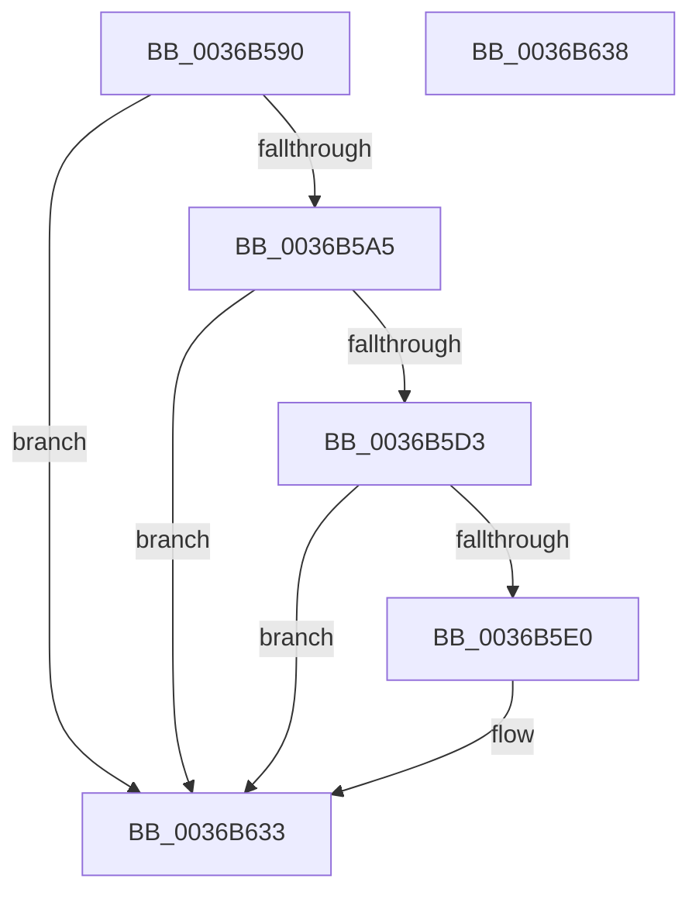

# MiPrefetchRestOfCluster

- RVA: `0x0036B590`–`0x0036B639` (길이 `169` bytes)
- VA: `0x000000014036B590`
- 실행 섹션: `.text`
- PDB 이름 있음: `예`; PDB Function 태그: `아니요`
- unwind 정보 RVA: `0x0005D2F4`
- 디코드: `40`개 명령, `169/169` bytes 표시
- 미해석 바이트: `0` (있으면 어셈블리에 `.byte`로 보존)

> 이 문서는 커널 이미지의 기계어와 PDB 기호를 분석해 생성했습니다. 4번과 5번은 함수 원형과 자료형을 바이너리 사용 방식에서 추정한 C 해석이며 원본 소스 복구 결과는 아닙니다.

## 1. Dependencies

- 직접 호출 지점: **2**; 고유 호출 대상: **2**
- 직접 호출자로 확인된 함수: **1**
- RIP 상대 이미지 참조: **0**

### Outgoing calls
- `0x0036B5F9` → [MiGetEffectivePagePriorityThread](MiGetEffectivePagePriorityThread_function_003626E0.md) (function, `0x003626E0`)
- `0x0036B62E` → [MiPrefetchVirtualMemory](MiPrefetchVirtualMemory_function_0036C560.md) (function, `0x0036C560`)

### Direct callers
- [MiWaitForInPageComplete](../38/MiWaitForInPageComplete_function_00380AB8.md) at `0x00380E90`

### Static image references
- 디코드된 RIP-relative 메모리 참조가 없습니다.

## 2. Other-region calls and transfers

- 다른 실행 섹션으로 향하는 call: **0**
- 별도 외부 분기/꼬리 이동을 확인하지 못했습니다.

## 3. Assembly (complete function range)

```asm
0036B590  48 83 EC 38                     sub rsp, 0x38
0036B594  4C 8B 4A 18                     mov r9, qword ptr [rdx + 0x18]
0036B598  4D 8B D8                        mov r11, r8
0036B59B  4C 3B 4A 10                     cmp r9, qword ptr [rdx + 0x10]
0036B59F  0F 83 8E 00 00 00               jae 0x14036b633
0036B5A5  4C 8B 91 E0 00 00 00            mov r10, qword ptr [rcx + 0xe0]
0036B5AC  8B 81 B8 00 00 00               mov eax, dword ptr [rcx + 0xb8]
0036B5B2  49 C1 E1 04                     shl r9, 4
0036B5B6  4C 03 4A 08                     add r9, qword ptr [rdx + 8]
0036B5BA  49 8D 8A FF 0F 00 00            lea rcx, [r10 + 0xfff]
0036B5C1  48 03 C8                        add rcx, rax
0036B5C4  48 81 E1 00 F0 FF FF            and rcx, 0xfffffffffffff000
0036B5CB  4D 8B 01                        mov r8, qword ptr [r9]
0036B5CE  49 3B C8                        cmp rcx, r8
0036B5D1  72 60                           jb 0x14036b633
0036B5D3  49 8B 51 08                     mov rdx, qword ptr [r9 + 8]
0036B5D7  4A 8D 04 02                     lea rax, [rdx + r8]
0036B5DB  48 3B C8                        cmp rcx, rax
0036B5DE  73 53                           jae 0x14036b633
0036B5E0  48 2B D1                        sub rdx, rcx
0036B5E3  48 89 4C 24 20                  mov qword ptr [rsp + 0x20], rcx
0036B5E8  49 03 D0                        add rdx, r8
0036B5EB  48 89 54 24 28                  mov qword ptr [rsp + 0x28], rdx
0036B5F0  65 48 8B 0C 25 88 01 00 00      mov rcx, qword ptr gs:[0x188]
0036B5F9  E8 E2 70 FF FF                  call 0x1403626e0
0036B5FE  83 E0 07                        and eax, 7
0036B601  48 8D 54 24 20                  lea rdx, [rsp + 0x20]
0036B606  44 8B C8                        mov r9d, eax
0036B609  B9 01 00 00 00                  mov ecx, 1
0036B60E  41 0F BA E9 0F                  bts r9d, 0xf
0036B613  44 8B C1                        mov r8d, ecx
0036B616  41 C1 E1 03                     shl r9d, 3
0036B61A  44 0B C8                        or r9d, eax
0036B61D  48 B8 00 00 00 00 00 80 FF FF   movabs rax, 0xffff800000000000
0036B627  4C 3B D0                        cmp r10, rax
0036B62A  4D 0F 42 C3                     cmovb r8, r11
0036B62E  E8 2D 0F 00 00                  call 0x14036c560
0036B633  48 83 C4 38                     add rsp, 0x38
0036B637  C3                              ret
0036B638  CC                              int3
```

## 4. C-style interpretation (structured pseudocode)

```c
__int64 __fastcall MiPrefetchRestOfCluster(__int64 a1, __int64 a2, __int64 a3)
{
    __int64 result;
    __int64 v_rsp;
    unsigned __int64 v_stack_m10;
    unsigned __int64 v_stack_m18;

    v_rsp = (v_rsp) - (56);
    if ((*(unsigned __int64 *)(a2 + 24)) >= (*(unsigned __int64 *)(a2 + 16))) goto loc_0036B633;
    a4 = (*(unsigned __int64 *)(a2 + 24)) << (4);
    a4 = (a4) + (*(unsigned __int64 *)(a2 + 8));
    a1 = (*(unsigned __int64 *)(a1 + 224) + 4095) + ((unsigned int)(*(unsigned int *)(a1 + 184)));
    a1 = (a1) & (0xFFFFFFFFFFFFF000ULL);
    if (a1 < (*(unsigned __int64 *)(a4))) goto loc_0036B633;
    result = *(unsigned __int64 *)(a4 + 8) + *(unsigned __int64 *)(a4) * 1;
    if (a1 < (*(unsigned __int64 *)(a4 + 8) + *(unsigned __int64 *)(a4) * 1)) {
        a2 = (*(unsigned __int64 *)(a4 + 8)) - (a1);
        v_stack_m18 = a1;
        a2 = (a2) + (*(unsigned __int64 *)(a4));
        v_stack_m10 = a2;
        a1 = *(unsigned __int64 *)(gs_base + (0 + 392));
        result = MiGetEffectivePagePriorityThread(a1, a2, *(unsigned __int64 *)(a4), a4);
        result = (unsigned int)((result) & (7));
        a2 = v_stack_m18;
        a4 = (unsigned int)(result);
        a1 = 1;
        a3 = (unsigned int)(a1);
        a4 = (unsigned int)((a4) << (3));
        a4 = (unsigned int)((a4) | ((unsigned int)(result)));
        if ((*(unsigned __int64 *)(a1 + 224)) < result) { a3 = a3; }
        result = MiPrefetchVirtualMemory(a1, a2, a3, a4);
    }
    v_rsp = (v_rsp) + (56);
    return result;
}
```

## 5. (Beta) C Style

```c
int64_t MiPrefetchRestOfCluster(void *Arg1, void *Arg2, int64_t Arg3)
{
    uint8_t *arg1 = (uint8_t *)Arg1;
    uint8_t *arg2 = (uint8_t *)Arg2;

    int64_t result;
    int64_t local_rsp;
    uint64_t v_stack_m10;
    uint64_t v_stack_m18;

    local_rsp = (local_rsp) - (56);
    if ((*(uint64_t *)(arg2 + 0x18)) >= (*(uint64_t *)(arg2 + 0x10))) goto loc_0036B633;
    a4 = (*(uint64_t *)(arg2 + 0x18)) << (4);
    a4 = (a4) + (*(uint64_t *)(arg2 + 0x8));
    Arg1 = (*(uint64_t *)(arg1 + 0xE0) + 4095) + ((uint32_t)(*(uint32_t *)(arg1 + 0xB8)));
    Arg1 = (Arg1) & (0xFFFFFFFFFFFFF000ULL);
    if (Arg1 < (*(uint64_t *)(a4))) goto loc_0036B633;
    result = *(uint64_t *)(a4 + 0x8) + *(uint64_t *)(a4) * 1;
    if (Arg1 < (*(uint64_t *)(a4 + 0x8) + *(uint64_t *)(a4) * 1)) {
        Arg2 = (*(uint64_t *)(a4 + 0x8)) - (Arg1);
        v_stack_m18 = Arg1;
        Arg2 = (Arg2) + (*(uint64_t *)(a4));
        v_stack_m10 = Arg2;
        Arg1 = *(uint64_t *)(gs_base + (0 + 0x188));
        result = MiGetEffectivePagePriorityThread(Arg1, Arg2, *(uint64_t *)(a4), a4);
        result = (uint32_t)((result) & (7));
        Arg2 = v_stack_m18;
        a4 = (uint32_t)(result);
        Arg1 = 1;
        Arg3 = (uint32_t)(Arg1);
        a4 = (uint32_t)((a4) << (3));
        a4 = (uint32_t)((a4) | ((uint32_t)(result)));
        if ((*(uint64_t *)(arg1 + 0xE0)) < result) { Arg3 = Arg3; }
        result = MiPrefetchVirtualMemory(Arg1, Arg2, Arg3, a4);
    }
    local_rsp = (local_rsp) + (56);
    return result;
}
```

### 관측된 메모리 오프셋

구조체 형식이 확인되지 않은 접근은 인자 기준의 오프셋으로만 기록했습니다.

| 기준 인자 | 오프셋 표현 | 폭 (bit) | 접근 |
|---|---:|---:|---|
| `Arg1` | `+ 0xB8` | `32` | `R` |
| `Arg1` | `+ 0xE0` | `64` | `R` |
| `Arg2` | `+ 0x8` | `64` | `R` |
| `Arg2` | `+ 0x10` | `64` | `R` |
| `Arg2` | `+ 0x18` | `64` | `R` |

## 6. Execution-region graph

[열기: 2D/3D 그래프와 함수 탐색 컨트롤 패널](../../../control-panel.html?section=text&rva=0x0036B590&view=graph)

- 2D 그래프는 위에서 아래로 흐르고, 3D 그래프는 빈 공간을 드래그해 회전합니다. Shift+드래그는 이동, 휠은 확대·축소, 함수 노드 선택은 대상 보고서 이동입니다.

### Static fallback


