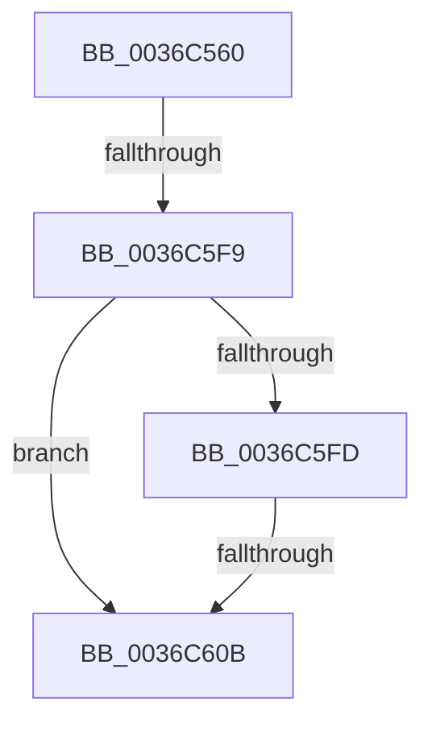

# MiPrefetchVirtualMemory

- RVA: `0x0036C560`–`0x0036C638` (길이 `216` bytes)
- VA: `0x000000014036C560`
- 실행 섹션: `.text`
- PDB 이름 있음: `예`; PDB Function 태그: `아니요`
- unwind 정보 RVA: `0x0007A408`
- 디코드: `52`개 명령, `216/216` bytes 표시
- 미해석 바이트: `0` (있으면 어셈블리에 `.byte`로 보존)

> 이 문서는 커널 이미지의 기계어와 PDB 기호를 분석해 생성했습니다. 4번과 5번은 함수 원형과 자료형을 바이너리 사용 방식에서 추정한 C 해석이며 원본 소스 복구 결과는 아닙니다.

## 1. Dependencies

- 직접 호출 지점: **0**; 고유 호출 대상: **0**
- 직접 호출자로 확인된 함수: **7**
- RIP 상대 이미지 참조: **2**

### Outgoing calls
- 직접 디코드된 call 명령이 없습니다.

### Direct callers
- [MmCopyMemory](../22/MmCopyMemory_function_002285B0.md) at `0x00228906`
- [MiBuildForkPte](../22/MiBuildForkPte_function_0022E32C.md) at `0x0022EBD4`
- [MiInPageSingleKernelStack](MiInPageSingleKernelStack_function_0036A3E8.md) at `0x0036A564`
- [MiPrefetchRestOfCluster](MiPrefetchRestOfCluster_function_0036B590.md) at `0x0036B62E`
- [MmPrefetchVirtualMemory](../../page/93/MmPrefetchVirtualMemory_function_0093A698.md) at `0x0093A738`
- [NtSetInformationVirtualMemory](../../page/9F/NtSetInformationVirtualMemory_function_009F4580.md) at `0x009F4A44`
- [MiPrefetchDriverPages](../../page/9F/MiPrefetchDriverPages_function_009F6A50.md) at `0x009F6AAB`

### Static image references
- `0x0036C578` → RVA `0x00E0A740` (`.data`; read)
- `0x0036C5FD` → RVA `0x00E30180` (`.data`; read)

## 2. Other-region calls and transfers

- 다른 실행 섹션으로 향하는 call: **0**
- call이 아닌 외부 분기/꼬리 이동: **2**
  - `0x0036C5F3` → [sub_0036CB04](Unknown_function_0036CB04.md) (`tail-transfer`)
  - `0x0036C605` → [sub_0036CB04](Unknown_function_0036CB04.md) (`tail-transfer`)

## 3. Assembly (complete function range)

```asm
0036C560  40 55                           push rbp
0036C562  53                              push rbx
0036C563  41 55                           push r13
0036C565  41 56                           push r14
0036C567  41 57                           push r15
0036C569  48 8D AC 24 60 FF FF FF         lea rbp, [rsp - 0xa0]
0036C571  48 81 EC A0 01 00 00            sub rsp, 0x1a0
0036C578  48 8B 05 C1 E1 A9 00            mov rax, qword ptr [rip + 0xa9e1c1]
0036C57F  48 33 C4                        xor rax, rsp
0036C582  48 89 85 80 00 00 00            mov qword ptr [rbp + 0x80], rax
0036C589  33 C0                           xor eax, eax
0036C58B  4C 89 44 24 68                  mov qword ptr [rsp + 0x68], r8
0036C590  0F 57 C0                        xorps xmm0, xmm0
0036C593  89 44 24 72                     mov dword ptr [rsp + 0x72], eax
0036C597  66 89 44 24 76                  mov word ptr [rsp + 0x76], ax
0036C59C  45 33 ED                        xor r13d, r13d
0036C59F  0F 11 45 C4                     movups xmmword ptr [rbp - 0x3c], xmm0
0036C5A3  48 89 45 D4                     mov qword ptr [rbp - 0x2c], rax
0036C5A7  4D 8B F8                        mov r15, r8
0036C5AA  89 45 DC                        mov dword ptr [rbp - 0x24], eax
0036C5AD  4C 8B C2                        mov r8, rdx
0036C5B0  0F 11 45 40                     movups xmmword ptr [rbp + 0x40], xmm0
0036C5B4  48 89 45 70                     mov qword ptr [rbp + 0x70], rax
0036C5B8  41 8B D9                        mov ebx, r9d
0036C5BB  0F 11 45 50                     movups xmmword ptr [rbp + 0x50], xmm0
0036C5BF  89 45 78                        mov dword ptr [rbp + 0x78], eax
0036C5C2  0F 11 45 60                     movups xmmword ptr [rbp + 0x60], xmm0
0036C5C6  65 4C 8B 34 25 88 01 00 00      mov r14, qword ptr gs:[0x188]
0036C5CF  48 89 54 24 50                  mov qword ptr [rsp + 0x50], rdx
0036C5D4  89 44 24 40                     mov dword ptr [rsp + 0x40], eax
0036C5D8  89 45 F8                        mov dword ptr [rbp - 8], eax
0036C5DB  41 80 BE AE 05 00 00 02         cmp byte ptr [r14 + 0x5ae], 2
0036C5E3  49 8B 96 B8 00 00 00            mov rdx, qword ptr [r14 + 0xb8]
0036C5EA  4C 89 6D F0                     mov qword ptr [rbp - 0x10], r13
0036C5EE  4C 89 74 24 48                  mov qword ptr [rsp + 0x48], r14
0036C5F3  0F 83 0B 05 00 00               jae 0x14036cb04
0036C5F9  84 DB                           test bl, bl
0036C5FB  78 0E                           js 0x14036c60b
0036C5FD  48 83 3D 7B 3B AC 00 FF         cmp qword ptr [rip + 0xac3b7b], -1
0036C605  0F 85 F9 04 00 00               jne 0x14036cb04
0036C60B  48 89 45 88                     mov qword ptr [rbp - 0x78], rax
0036C60F  48 89 45 90                     mov qword ptr [rbp - 0x70], rax
0036C613  48 8D 45 98                     lea rax, [rbp - 0x68]
0036C617  48 89 45 A0                     mov qword ptr [rbp - 0x60], rax
0036C61B  48 8D 45 98                     lea rax, [rbp - 0x68]
0036C61F  48 89 45 98                     mov qword ptr [rbp - 0x68], rax
0036C623  48 8D 45 A8                     lea rax, [rbp - 0x58]
0036C627  48 89 45 B0                     mov qword ptr [rbp - 0x50], rax
0036C62B  48 8D 45 A8                     lea rax, [rbp - 0x58]
0036C62F  48 89 45 A8                     mov qword ptr [rbp - 0x58], rax
0036C633  33 C0                           xor eax, eax
0036C635  89 5D C0                        mov dword ptr [rbp - 0x40], ebx
```

## 4. C-style interpretation (structured pseudocode)

```c
__int64 __fastcall MiPrefetchVirtualMemory(__int64 a1, __int64 a2, __int64 a3, int a4)
{
    __int64 result;
    __int64 v_r13;
    __int64 v_rsp;
    unsigned __int64 v_stack_m104;
    unsigned int v_stack_m108;
    unsigned __int64 v_stack_m118;
    unsigned __int64 v_stack_m120;
    unsigned __int64 v_stack_m128;
    unsigned __int64 v_stack_m130;
    unsigned __int64 v_stack_m138;
    unsigned __int64 v_stack_m140;
    unsigned __int16 v_stack_m152;
    unsigned int v_stack_m156;
    unsigned __int64 v_stack_m160;
    unsigned __int64 v_stack_m178;
    unsigned __int64 v_stack_m180;
    unsigned int v_stack_m188;
    unsigned __int64 v_stack_m48;
    unsigned int v_stack_m50;
    unsigned __int64 v_stack_m58;
    unsigned __int64 v_stack_m68;
    unsigned __int64 v_stack_m78;
    unsigned __int64 v_stack_m88;
    unsigned __int64 v_stack_mC8;
    unsigned int v_stack_mD0;
    unsigned __int64 v_stack_mD8;
    unsigned int v_stack_mEC;
    unsigned __int64 v_stack_mF4;

    v_rsp = (v_rsp) - (416);
    result = (*(unsigned __int64 *)(v_rip + 11133377)) ^ (v_rsp);
    v_stack_m48 = result;
    result = 0;
    v_stack_m160 = a3;
    v_stack_m156 = 0;
    v_stack_m152 = 0;
    v_r13 = 0;
    v_stack_m104 = v_xmm0;
    v_stack_mF4 = 0;
    v_stack_mEC = 0;
    v_stack_m88 = v_xmm0;
    v_stack_m58 = 0;
    v_stack_m78 = v_xmm0;
    v_stack_m50 = 0;
    v_stack_m68 = v_xmm0;
    v_stack_m178 = a2;
    v_stack_m188 = 0;
    v_stack_mD0 = 0;
    v_stack_mD8 = 0;
    v_stack_m180 = *(unsigned __int64 *)(gs_base + (0 + 392));
    if (sign_flag) goto loc_0036C60B;
loc_0036C60B:
    v_stack_m140 = 0;
    v_stack_m138 = 0;
    v_stack_m128 = v_stack_m130;
    v_stack_m130 = v_stack_m130;
    v_stack_m118 = v_stack_m120;
    v_stack_m120 = v_stack_m120;
    result = 0;
    v_stack_m108 = (unsigned int)((unsigned int)(a4));
    return result;
}
```

## 5. (Beta) C Style

```c
int64_t MiPrefetchVirtualMemory(int64_t Arg1, int64_t Arg2, int64_t Arg3, int32_t Arg4)
{
    int64_t result;
    int64_t local_r13;
    int64_t local_rsp;
    uint64_t v_stack_m104;
    uint32_t v_stack_m108;
    uint64_t v_stack_m118;
    uint64_t v_stack_m120;
    uint64_t v_stack_m128;
    uint64_t v_stack_m130;
    uint64_t v_stack_m138;
    uint64_t v_stack_m140;
    uint16_t v_stack_m152;
    uint32_t v_stack_m156;
    uint64_t v_stack_m160;
    uint64_t v_stack_m178;
    uint64_t v_stack_m180;
    uint32_t v_stack_m188;
    uint64_t v_stack_m48;
    uint32_t v_stack_m50;
    uint64_t v_stack_m58;
    uint64_t v_stack_m68;
    uint64_t v_stack_m78;
    uint64_t v_stack_m88;
    uint64_t v_stack_mC8;
    uint32_t v_stack_mD0;
    uint64_t v_stack_mD8;
    uint32_t v_stack_mEC;
    uint64_t v_stack_mF4;

    local_rsp = (local_rsp) - (416);
    result = (*(uint64_t *)(v_rip + 0xA9E1C1)) ^ (local_rsp);
    v_stack_m48 = result;
    result = 0;
    v_stack_m160 = Arg3;
    v_stack_m156 = 0;
    v_stack_m152 = 0;
    local_r13 = 0;
    v_stack_m104 = v_xmm0;
    v_stack_mF4 = 0;
    v_stack_mEC = 0;
    v_stack_m88 = v_xmm0;
    v_stack_m58 = 0;
    v_stack_m78 = v_xmm0;
    v_stack_m50 = 0;
    v_stack_m68 = v_xmm0;
    v_stack_m178 = Arg2;
    v_stack_m188 = 0;
    v_stack_mD0 = 0;
    v_stack_mD8 = 0;
    v_stack_m180 = *(uint64_t *)(gs_base + (0 + 0x188));
    if (sign_flag) goto loc_0036C60B;
loc_0036C60B:
    v_stack_m140 = 0;
    v_stack_m138 = 0;
    v_stack_m128 = v_stack_m130;
    v_stack_m130 = v_stack_m130;
    v_stack_m118 = v_stack_m120;
    v_stack_m120 = v_stack_m120;
    result = 0;
    v_stack_m108 = (uint32_t)((uint32_t)(Arg4));
    return result;
}
```

## 6. Execution-region graph

[열기: 2D/3D 그래프와 함수 탐색 컨트롤 패널](../../../control-panel.html?section=text&rva=0x0036C560&view=graph)

- 2D 그래프는 위에서 아래로 흐르고, 3D 그래프는 빈 공간을 드래그해 회전합니다. Shift+드래그는 이동, 휠은 확대·축소, 함수 노드 선택은 대상 보고서 이동입니다.

### Static fallback


