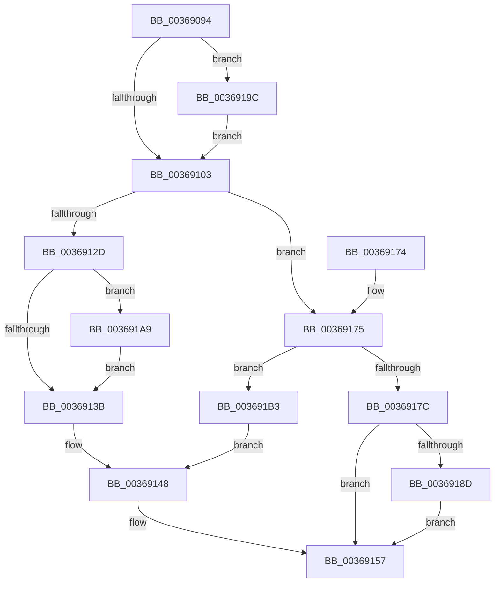

# MiPrepareToFlushSubsection

- RVA: `0x00369094`–`0x003691BA` (길이 `294` bytes)
- VA: `0x0000000140369094`
- 실행 섹션: `.text`
- PDB 이름 있음: `예`; PDB Function 태그: `아니요`
- unwind 정보 RVA: `0x0007A18C`
- 디코드: `87`개 명령, `294/294` bytes 표시
- 미해석 바이트: `0` (있으면 어셈블리에 `.byte`로 보존)

> 이 문서는 커널 이미지의 기계어와 PDB 기호를 분석해 생성했습니다. 4번과 5번은 함수 원형과 자료형을 바이너리 사용 방식에서 추정한 C 해석이며 원본 소스 복구 결과는 아닙니다.

## 1. Dependencies

- 직접 호출 지점: **12**; 고유 호출 대상: **10**
- 직접 호출자로 확인된 함수: **1**
- RIP 상대 이미지 참조: **0**

### Outgoing calls
- `0x003690D4` → [ObFastReferenceObjectLocked](../38/ObFastReferenceObjectLocked_function_00381DA0.md) (function, `0x00381DA0`)
- `0x003690E4` → [MiDecrementModifiedWriteCount](../29/MiDecrementModifiedWriteCount_function_00298184.md) (function, `0x00298184`)
- `0x003690F5` → [MiReleaseSpinLockExclusive](../24/MiReleaseSpinLockExclusive_function_002482C0.md) (function, `0x002482C0`)
- `0x00369106` → [FsRtlAcquireFileForCcFlushEx](../../page/9D/FsRtlAcquireFileForCcFlushEx_function_009D72F0.md) (function, `0x009D72F0`)
- `0x00369110` → [ExAcquireSpinLockExclusive](../24/ExAcquireSpinLockExclusive_function_00248690.md) (function, `0x00248690`)
- `0x00369132` → [MiReleaseSpinLockExclusive](../24/MiReleaseSpinLockExclusive_function_002482C0.md) (function, `0x002482C0`)
- `0x0036913E` → [MiDeleteControlArea](MiDeleteControlArea_function_003691F4.md) (function, `0x003691F4`)
- `0x00369150` → [ObfDereferenceObjectWithTag](../2F/ObfDereferenceObjectWithTag_function_002F78E0.md) (function, `0x002F78E0`)
- `0x00369184` → [MiTranslateSubsectionState](MiTranslateSubsectionState_function_00368E68.md) (function, `0x00368E68`)
- `0x00369193` → [MiReleaseSpinLockExclusive](../24/MiReleaseSpinLockExclusive_function_002482C0.md) (function, `0x002482C0`)
- `0x0036919F` → [MiReleaseControlAreaWaiters](../28/MiReleaseControlAreaWaiters_function_002865F0.md) (function, `0x002865F0`)
- `0x003691AC` → [FsRtlReleaseFileForCcFlush](../../page/9D/FsRtlReleaseFileForCcFlush_function_009D75A0.md) (function, `0x009D75A0`)

### Direct callers
- [MiDeleteCachedSubsection](../29/MiDeleteCachedSubsection_function_00297888.md) at `0x00297A08`

### Static image references
- 디코드된 RIP-relative 메모리 참조가 없습니다.

## 2. Other-region calls and transfers

- 다른 실행 섹션으로 향하는 call: **2**
  - `0x00369106` → [FsRtlAcquireFileForCcFlushEx](../../page/9D/FsRtlAcquireFileForCcFlushEx_function_009D72F0.md) (`.text` → `PAGE`)
  - `0x003691AC` → [FsRtlReleaseFileForCcFlush](../../page/9D/FsRtlReleaseFileForCcFlush_function_009D75A0.md) (`.text` → `PAGE`)
- 별도 외부 분기/꼬리 이동을 확인하지 못했습니다.

## 3. Assembly (complete function range)

```asm
00369094  48 89 5C 24 10                  mov qword ptr [rsp + 0x10], rbx
00369099  48 89 6C 24 18                  mov qword ptr [rsp + 0x18], rbp
0036909E  48 89 74 24 20                  mov qword ptr [rsp + 0x20], rsi
003690A3  57                              push rdi
003690A4  41 54                           push r12
003690A6  41 55                           push r13
003690A8  41 56                           push r14
003690AA  41 57                           push r15
003690AC  48 83 EC 20                     sub rsp, 0x20
003690B0  48 8B 39                        mov rdi, qword ptr [rcx]
003690B3  4D 8B F9                        mov r15, r9
003690B6  49 83 21 00                     and qword ptr [r9], 0
003690BA  4D 8B E8                        mov r13, r8
003690BD  49 89 78 48                     mov qword ptr [r8 + 0x48], rdi
003690C1  8A DA                           mov bl, dl
003690C3  4C 8B E1                        mov r12, rcx
003690C6  F0 48 FF 47 70                  lock inc qword ptr [rdi + 0x70]
003690CB  48 8D 4F 40                     lea rcx, [rdi + 0x40]
003690CF  BA 4D 6D 53 63                  mov edx, 0x63536d4d
003690D4  E8 C7 8C 01 00                  call 0x140381da0
003690D9  BA 01 00 00 00                  mov edx, 1
003690DE  48 8B CF                        mov rcx, rdi
003690E1  48 8B F0                        mov rsi, rax
003690E4  E8 9B F0 F2 FF                  call 0x140298184
003690E9  48 8D 6F 48                     lea rbp, [rdi + 0x48]
003690ED  8A D3                           mov dl, bl
003690EF  48 8B CD                        mov rcx, rbp
003690F2  4C 8B F0                        mov r14, rax
003690F5  E8 C6 F1 ED FF                  call 0x1402482c0
003690FA  4D 85 F6                        test r14, r14
003690FD  0F 85 99 00 00 00               jne 0x14036919c
00369103  48 8B CE                        mov rcx, rsi
00369106  E8 E5 E1 66 00                  call 0x1409d72f0
0036910B  48 8B CD                        mov rcx, rbp
0036910E  8B D8                           mov ebx, eax
00369110  E8 7B F5 ED FF                  call 0x140248690
00369115  49 83 65 48 00                  and qword ptr [r13 + 0x48], 0
0036911A  44 8A C8                        mov r9b, al
0036911D  48 83 CA FF                     or rdx, 0xffffffffffffffff
00369121  F0 48 0F C1 57 70               lock xadd qword ptr [rdi + 0x70], rdx
00369127  48 83 FA 01                     cmp rdx, 1
0036912B  75 48                           jne 0x140369175
0036912D  8A D0                           mov dl, al
0036912F  48 8B CD                        mov rcx, rbp
00369132  E8 89 F1 ED FF                  call 0x1402482c0
00369137  85 DB                           test ebx, ebx
00369139  79 6E                           jns 0x1403691a9
0036913B  48 8B CF                        mov rcx, rdi
0036913E  E8 B1 00 00 00                  call 0x1403691f4
00369143  BB 1B 00 00 C0                  mov ebx, 0xc000001b
00369148  BA 4D 6D 53 63                  mov edx, 0x63536d4d
0036914D  48 8B CE                        mov rcx, rsi
00369150  E8 8B E7 F8 FF                  call 0x1402f78e0
00369155  8B C3                           mov eax, ebx
00369157  48 8B 5C 24 58                  mov rbx, qword ptr [rsp + 0x58]
0036915C  48 8B 6C 24 60                  mov rbp, qword ptr [rsp + 0x60]
00369161  48 8B 74 24 68                  mov rsi, qword ptr [rsp + 0x68]
00369166  48 83 C4 20                     add rsp, 0x20
0036916A  41 5F                           pop r15
0036916C  41 5E                           pop r14
0036916E  41 5D                           pop r13
00369170  41 5C                           pop r12
00369172  5F                              pop rdi
00369173  C3                              ret
00369174  CC                              int3
00369175  FF 47 4C                        inc dword ptr [rdi + 0x4c]
00369178  85 DB                           test ebx, ebx
0036917A  78 37                           js 0x1403691b3
0036917C  33 D2                           xor edx, edx
0036917E  49 89 37                        mov qword ptr [r15], rsi
00369181  49 8B CC                        mov rcx, r12
00369184  E8 DF FC FF FF                  call 0x140368e68
00369189  85 C0                           test eax, eax
0036918B  78 CA                           js 0x140369157
0036918D  41 8A D1                        mov dl, r9b
00369190  48 8B CD                        mov rcx, rbp
00369193  E8 28 F1 ED FF                  call 0x1402482c0
00369198  33 C0                           xor eax, eax
0036919A  EB BB                           jmp 0x140369157
0036919C  49 8B CE                        mov rcx, r14
0036919F  E8 4C D4 F1 FF                  call 0x1402865f0
003691A4  E9 5A FF FF FF                  jmp 0x140369103
003691A9  48 8B CE                        mov rcx, rsi
003691AC  E8 EF E3 66 00                  call 0x1409d75a0
003691B1  EB 88                           jmp 0x14036913b
003691B3  BB 34 04 00 C0                  mov ebx, 0xc0000434
003691B8  EB 8E                           jmp 0x140369148
```

## 4. C-style interpretation (structured pseudocode)

```c
__int64 __fastcall MiPrepareToFlushSubsection(__int64 a1, unsigned __int8 a2, __int64 a3, __int64 a4)
{
    __int64 result;
    __int64 v_rsp;
    unsigned __int64 v_stack_p10;
    unsigned __int64 v_stack_p18;
    unsigned __int64 v_stack_p20;

    v_stack_p10 = v_rbx;
    v_stack_p18 = v_rbp;
    v_stack_p20 = v_rsi;
    v_rsp = (v_rsp) - (32);
    *(unsigned __int64 *)(a3 + 72) = *(unsigned __int64 *)(a1);
    result = ObFastReferenceObjectLocked(*(unsigned __int64 *)(a1) + 64, (unsigned int)(0x63536D4DULL), a3, a4);
    result = MiDecrementModifiedWriteCount(*(unsigned __int64 *)(a1), 1, a3, a4);
    result = MiReleaseSpinLockExclusive(*(unsigned __int64 *)(a1) + 72, a2, a3, a4);
    if (result != 0) goto loc_0036919C;
loc_00369103:
    result = FsRtlAcquireFileForCcFlushEx(result, a2, a3, a4);
    result = ExAcquireSpinLockExclusive(*(unsigned __int64 *)(a1) + 72, a2, a3, a4);
    a2 = (a2) | (-1);
    if (a2 != 1) goto loc_00369175;
    result = MiReleaseSpinLockExclusive(*(unsigned __int64 *)(a1) + 72, (unsigned __int8)(result), a3, (unsigned __int8)(result));
    if (!sign_flag) goto loc_003691A9;
loc_0036913B:
    result = MiDeleteControlArea(*(unsigned __int64 *)(a1), (unsigned __int8)(result), a3, (unsigned __int8)(result));
loc_00369148:
    result = ObfDereferenceObjectWithTag(result, (unsigned int)(0x63536D4DULL), a3, (unsigned __int8)(result));
loc_00369157:
    v_rsp = (v_rsp) + (32);
    return (unsigned int)((unsigned int)((unsigned int)(0xC000001BULL)));
loc_00369175:
    if (sign_flag) goto loc_003691B3;
    a2 = 0;
    *(unsigned __int64 *)(a4) = v_stack_p20;
    result = MiTranslateSubsectionState(a1, a2, a3, (unsigned __int8)(result));
    if (sign_flag) goto loc_00369157;
    result = MiReleaseSpinLockExclusive(v_stack_p18, (unsigned __int8)((unsigned __int8)(result)), a3, (unsigned __int8)(result));
    result = 0;
    goto loc_00369157;
loc_0036919C:
    result = MiReleaseControlAreaWaiters(0, (unsigned __int8)((unsigned __int8)(result)), a3, (unsigned __int8)(result));
    goto loc_00369103;
loc_003691A9:
    result = FsRtlReleaseFileForCcFlush(v_stack_p20, (unsigned __int8)((unsigned __int8)(result)), a3, (unsigned __int8)(result));
    goto loc_0036913B;
loc_003691B3:
    goto loc_00369148;
}
```

## 5. (Beta) C Style

```c
int64_t MiPrepareToFlushSubsection(void *Arg1, uint8_t Arg2, void *Arg3, void *Arg4)
{
    uint8_t *arg1 = (uint8_t *)Arg1;
    uint8_t *arg3 = (uint8_t *)Arg3;
    uint8_t *arg4 = (uint8_t *)Arg4;

    int64_t result;
    int64_t local_rsp;
    uint64_t v_stack_p10;
    uint64_t v_stack_p18;
    uint64_t v_stack_p20;

    v_stack_p10 = local_rbx;
    v_stack_p18 = local_rbp;
    v_stack_p20 = local_rsi;
    local_rsp = (local_rsp) - (32);
    *(uint64_t *)(arg3 + 0x48) = *(uint64_t *)(arg1);
    result = ObFastReferenceObjectLocked(*(uint64_t *)(arg1) + 64, (uint32_t)(0x63536D4DULL), Arg3, Arg4);
    result = MiDecrementModifiedWriteCount(*(uint64_t *)(arg1), 1, Arg3, Arg4);
    result = MiReleaseSpinLockExclusive(*(uint64_t *)(arg1) + 72, Arg2, Arg3, Arg4);
    if (result != 0) goto loc_0036919C;
loc_00369103:
    result = FsRtlAcquireFileForCcFlushEx(result, Arg2, Arg3, Arg4);
    result = ExAcquireSpinLockExclusive(*(uint64_t *)(arg1) + 72, Arg2, Arg3, Arg4);
    Arg2 = (Arg2) | (-1);
    if (Arg2 != 1) goto loc_00369175;
    result = MiReleaseSpinLockExclusive(*(uint64_t *)(arg1) + 72, (uint8_t)(result), Arg3, (uint8_t)(result));
    if (!sign_flag) goto loc_003691A9;
loc_0036913B:
    result = MiDeleteControlArea(*(uint64_t *)(arg1), (uint8_t)(result), Arg3, (uint8_t)(result));
loc_00369148:
    result = ObfDereferenceObjectWithTag(result, (uint32_t)(0x63536D4DULL), Arg3, (uint8_t)(result));
loc_00369157:
    local_rsp = (local_rsp) + (32);
    return (uint32_t)((uint32_t)((uint32_t)(0xC000001BULL)));
loc_00369175:
    if (sign_flag) goto loc_003691B3;
    Arg2 = 0;
    *(uint64_t *)(arg4) = v_stack_p20;
    result = MiTranslateSubsectionState(Arg1, Arg2, Arg3, (uint8_t)(result));
    if (sign_flag) goto loc_00369157;
    result = MiReleaseSpinLockExclusive(v_stack_p18, (uint8_t)((uint8_t)(result)), Arg3, (uint8_t)(result));
    result = 0;
    goto loc_00369157;
loc_0036919C:
    result = MiReleaseControlAreaWaiters(0, (uint8_t)((uint8_t)(result)), Arg3, (uint8_t)(result));
    goto loc_00369103;
loc_003691A9:
    result = FsRtlReleaseFileForCcFlush(v_stack_p20, (uint8_t)((uint8_t)(result)), Arg3, (uint8_t)(result));
    goto loc_0036913B;
loc_003691B3:
    goto loc_00369148;
}
```

### 관측된 메모리 오프셋

구조체 형식이 확인되지 않은 접근은 인자 기준의 오프셋으로만 기록했습니다.

| 기준 인자 | 오프셋 표현 | 폭 (bit) | 접근 |
|---|---:|---:|---|
| `Arg1` | `+ 0x0` | `64` | `R` |
| `Arg3` | `+ 0x48` | `64` | `R/W` |
| `Arg3` | `+ 0x48` | `64` | `W` |
| `Arg4` | `+ 0x0` | `64` | `R/W` |
| `Arg4` | `+ 0x0` | `64` | `W` |

## 6. Execution-region graph

[열기: 2D/3D 그래프와 함수 탐색 컨트롤 패널](../../../control-panel.html?section=text&rva=0x00369094&view=graph)

- 2D 그래프는 위에서 아래로 흐르고, 3D 그래프는 빈 공간을 드래그해 회전합니다. Shift+드래그는 이동, 휠은 확대·축소, 함수 노드 선택은 대상 보고서 이동입니다.

### Static fallback


