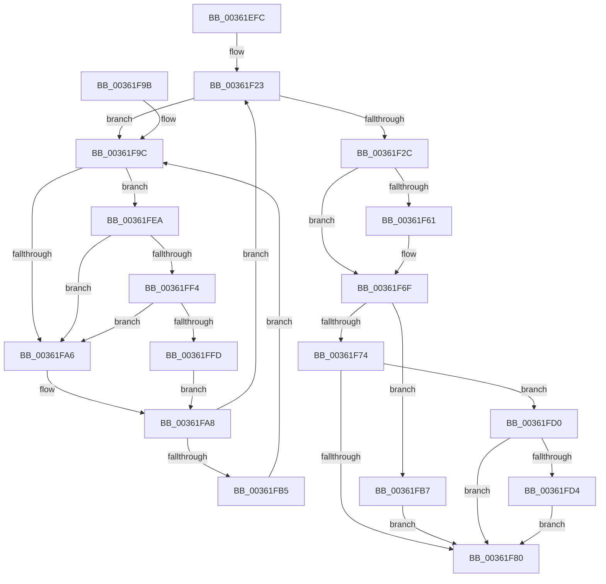

# MiProcessWsInSwapFault

- RVA: `0x00361EFC`–`0x00362006` (길이 `266` bytes)
- VA: `0x0000000140361EFC`
- 실행 섹션: `.text`
- PDB 이름 있음: `예`; PDB Function 태그: `아니요`
- unwind 정보 RVA: `0x00079D80`
- 디코드: `74`개 명령, `266/266` bytes 표시
- 미해석 바이트: `0` (있으면 어셈블리에 `.byte`로 보존)

> 이 문서는 커널 이미지의 기계어와 PDB 기호를 분석해 생성했습니다. 4번과 5번은 함수 원형과 자료형을 바이너리 사용 방식에서 추정한 C 해석이며 원본 소스 복구 결과는 아닙니다.

## 1. Dependencies

- 직접 호출 지점: **8**; 고유 호출 대상: **8**
- 직접 호출자로 확인된 함수: **1**
- RIP 상대 이미지 참조: **3**

### Outgoing calls
- `0x00361F2F` → [MiReleaseWsSwapReservationPfn](MiReleaseWsSwapReservationPfn_function_003628DC.md) (function, `0x003628DC`)
- `0x00361F6A` → [MiReleasePageFileInfo](../28/MiReleasePageFileInfo_function_00283FD0.md) (function, `0x00283FD0`)
- `0x00361F77` → [MiGetVaAge](../24/MiGetVaAge_function_00240AC0.md) (function, `0x00240AC0`)
- `0x00361FBA` → [MI_READ_PTE_LOCK_FREE](../28/MI_READ_PTE_LOCK_FREE_function_002828A0.md) (function, `0x002828A0`)
- `0x00361FC9` → [MiWriteValidPteNewProtection](../28/MiWriteValidPteNewProtection_function_00281810.md) (function, `0x00281810`)
- `0x00361FE3` → [MiSetVaAgeList](../29/MiSetVaAgeList_function_00290A20.md) (function, `0x00290A20`)
- `0x00361FF4` → [KiCheckVpBackingLongSpinWaitHypercall](../30/KiCheckVpBackingLongSpinWaitHypercall_function_0030F490.md) (function, `0x0030F490`)
- `0x00361FFF` → [HvlNotifyLongSpinWait](../30/HvlNotifyLongSpinWait_function_0030F460.md) (function, `0x0030F460`)

### Direct callers
- [sub_006E1C8E](../6E/Unknown_function_006E1C8E.md) at `0x006E1CBF`

### Static image references
- `0x00361F38` → RVA `0x00E30088` (`.data`; read)
- `0x00361F9E` → RVA `0x00FC52AC` (`ALMOSTRO`; reference)
- `0x00361FEA` → RVA `0x00FC6AB8` (`ALMOSTRO`; read)

## 2. Other-region calls and transfers

- 다른 실행 섹션으로 향하는 call: **0**
- 별도 외부 분기/꼬리 이동을 확인하지 못했습니다.

## 3. Assembly (complete function range)

```asm
00361EFC  48 8B C4                        mov rax, rsp
00361EFF  48 89 58 08                     mov qword ptr [rax + 8], rbx
00361F03  48 89 68 10                     mov qword ptr [rax + 0x10], rbp
00361F07  48 89 70 18                     mov qword ptr [rax + 0x18], rsi
00361F0B  48 89 78 20                     mov qword ptr [rax + 0x20], rdi
00361F0F  41 56                           push r14
00361F11  48 83 EC 20                     sub rsp, 0x20
00361F15  49 8B F1                        mov rsi, r9
00361F18  49 8B E8                        mov rbp, r8
00361F1B  48 8B DA                        mov rbx, rdx
00361F1E  4C 8B F1                        mov r14, rcx
00361F21  33 FF                           xor edi, edi
00361F23  F0 48 0F BA 6B 18 3F            lock bts qword ptr [rbx + 0x18], 0x3f
00361F2A  72 70                           jb 0x140361f9c
00361F2C  48 8B CB                        mov rcx, rbx
00361F2F  E8 A8 09 00 00                  call 0x1403628dc
00361F34  48 8B 4B 28                     mov rcx, qword ptr [rbx + 0x28]
00361F38  48 8B 15 49 E1 AC 00            mov rdx, qword ptr [rip + 0xace149]
00361F3F  48 C1 E9 2B                     shr rcx, 0x2b
00361F43  81 E1 FF 03 00 00               and ecx, 0x3ff
00361F49  48 8B 0C CA                     mov rcx, qword ptr [rdx + rcx*8]
00361F4D  48 BA FF FF FF FF FF FF FF 7F   movabs rdx, 0x7fffffffffffffff
00361F57  F0 48 21 53 18                  lock and qword ptr [rbx + 0x18], rdx
00361F5C  48 85 C0                        test rax, rax
00361F5F  74 0E                           je 0x140361f6f
00361F61  41 B8 01 00 00 00               mov r8d, 1
00361F67  48 8B D0                        mov rdx, rax
00361F6A  E8 61 20 F2 FF                  call 0x140283fd0
00361F6F  48 85 F6                        test rsi, rsi
00361F72  75 43                           jne 0x140361fb7
00361F74  48 8B D5                        mov rdx, rbp
00361F77  E8 44 EB ED FF                  call 0x140240ac0
00361F7C  3C 01                           cmp al, 1
00361F7E  75 50                           jne 0x140361fd0
00361F80  48 8B 5C 24 30                  mov rbx, qword ptr [rsp + 0x30]
00361F85  48 8B 6C 24 38                  mov rbp, qword ptr [rsp + 0x38]
00361F8A  48 8B 74 24 40                  mov rsi, qword ptr [rsp + 0x40]
00361F8F  48 8B 7C 24 48                  mov rdi, qword ptr [rsp + 0x48]
00361F94  48 83 C4 20                     add rsp, 0x20
00361F98  41 5E                           pop r14
00361F9A  C3                              ret
00361F9B  CC                              int3
00361F9C  FF C7                           inc edi
00361F9E  85 3D 08 33 C6 00               test dword ptr [rip + 0xc63308], edi
00361FA4  74 44                           je 0x140361fea
00361FA6  F3 90                           pause
00361FA8  48 8B 43 18                     mov rax, qword ptr [rbx + 0x18]
00361FAC  48 85 C0                        test rax, rax
00361FAF  0F 89 6E FF FF FF               jns 0x140361f23
00361FB5  EB E5                           jmp 0x140361f9c
00361FB7  48 8B CE                        mov rcx, rsi
00361FBA  E8 E1 08 F2 FF                  call 0x1402828a0
00361FBF  48 83 E0 DF                     and rax, 0xffffffffffffffdf
00361FC3  48 8B CE                        mov rcx, rsi
00361FC6  48 8B D0                        mov rdx, rax
00361FC9  E8 42 F8 F1 FF                  call 0x140281810
00361FCE  EB B0                           jmp 0x140361f80
00361FD0  3C 07                           cmp al, 7
00361FD2  73 AC                           jae 0x140361f80
00361FD4  41 B1 01                        mov r9b, 1
00361FD7  41 B8 01 00 00 00               mov r8d, 1
00361FDD  48 8B D5                        mov rdx, rbp
00361FE0  49 8B CE                        mov rcx, r14
00361FE3  E8 38 EA F2 FF                  call 0x140290a20
00361FE8  EB 96                           jmp 0x140361f80
00361FEA  8B 05 C8 4A C6 00               mov eax, dword ptr [rip + 0xc64ac8]
00361FF0  A8 40                           test al, 0x40
00361FF2  74 B2                           je 0x140361fa6
00361FF4  E8 97 D4 FA FF                  call 0x14030f490
00361FF9  84 C0                           test al, al
00361FFB  74 A9                           je 0x140361fa6
00361FFD  8B CF                           mov ecx, edi
00361FFF  E8 5C D4 FA FF                  call 0x14030f460
00362004  EB A2                           jmp 0x140361fa8
```

## 4. C-style interpretation (structured pseudocode)

```c
__int64 __fastcall MiProcessWsInSwapFault(__int64 a1, __int64 a2, __int64 a3, __int64 a4)
{
    __int64 result;
    __int64 v_rdi;
    __int64 v_rsp;
    unsigned __int64 v_stack_p10;
    unsigned __int64 v_stack_p18;
    unsigned __int64 v_stack_p20;
    unsigned __int64 v_stack_p8;

    *(unsigned __int64 *)(v_rsp + 8) = v_rbx;
    *(unsigned __int64 *)(v_rsp + 16) = v_rbp;
    *(unsigned __int64 *)(v_rsp + 24) = v_rsi;
    *(unsigned __int64 *)(v_rsp + 32) = v_rdi;
    v_rsp = (v_rsp) - (32);
    v_rdi = 0;
loc_00361F23:
    if (condition_is_below) goto loc_00361F9C;
    result = MiReleaseWsSwapReservationPfn(a2, a2, a3, a4);
    a1 = (*(unsigned __int64 *)(a2 + 40)) >> (43);
    a1 = (unsigned int)((a1) & (0x3FFULL));
    if (result != 0) {
        a3 = 1;
        a2 = result;
        result = MiReleasePageFileInfo(*(unsigned __int64 *)(*(unsigned __int64 *)(v_rip + 11329865) + a1 * 8), a2, a3, a4);
    }
    if (a4 != 0) goto loc_00361FB7;
    result = MiGetVaAge(*(unsigned __int64 *)(*(unsigned __int64 *)(v_rip + 11329865) + a1 * 8), a3, a3, a4);
    if (((unsigned __int8)(result)) != 1) goto loc_00361FD0;
loc_00361F80:
    v_rsp = (v_rsp) + (32);
    return result;
loc_00361F9C:
    v_rdi = (unsigned int)((v_stack_p20) + 1);
    if (((*(unsigned int *)(v_rip + 12989192)) & ((unsigned int)(v_rdi))) == 0) goto loc_00361FEA;
loc_00361FA6:
loc_00361FA8:
    if (!sign_flag) goto loc_00361F23;
    goto loc_00361F9C;
loc_00361FB7:
    result = MI_READ_PTE_LOCK_FREE(v_stack_p18, a3, a3, a4);
    result = (result) & (-33);
    result = MiWriteValidPteNewProtection(v_stack_p18, result, a3, a4);
    goto loc_00361F80;
loc_00361FD0:
    if (((unsigned __int8)(result)) >= 7) goto loc_00361F80;
    result = MiSetVaAgeList(a1, v_stack_p10, 1, 1);
    goto loc_00361F80;
loc_00361FEA:
    if ((((unsigned __int8)((unsigned int)(*(unsigned int *)(v_rip + 12995272)))) & (64)) == 0) goto loc_00361FA6;
    result = KiCheckVpBackingLongSpinWaitHypercall(a1, v_stack_p10, 1, 1);
    if ((unsigned __int8)(result) == 0) goto loc_00361FA6;
    result = HvlNotifyLongSpinWait((unsigned int)((unsigned int)(v_rdi)), v_stack_p10, 1, 1);
    goto loc_00361FA8;
}
```

## 5. (Beta) C Style

```c
int64_t MiProcessWsInSwapFault(int64_t Arg1, void *Arg2, int64_t Arg3, int64_t Arg4)
{
    uint8_t *arg2 = (uint8_t *)Arg2;

    int64_t result;
    int64_t local_rdi;
    int64_t local_rsp;
    uint64_t v_stack_p10;
    uint64_t v_stack_p18;
    uint64_t v_stack_p20;
    uint64_t v_stack_p8;

    *(uint64_t *)(local_rsp + 0x8) = local_rbx;
    *(uint64_t *)(local_rsp + 0x10) = local_rbp;
    *(uint64_t *)(local_rsp + 0x18) = local_rsi;
    *(uint64_t *)(local_rsp + 0x20) = local_rdi;
    local_rsp = (local_rsp) - (32);
    local_rdi = 0;
loc_00361F23:
    if (condition_is_below) goto loc_00361F9C;
    result = MiReleaseWsSwapReservationPfn(Arg2, Arg2, Arg3, Arg4);
    Arg1 = (*(uint64_t *)(arg2 + 0x28)) >> (43);
    Arg1 = (uint32_t)((Arg1) & (0x3FFULL));
    if (result != 0) {
        Arg3 = 1;
        Arg2 = result;
        result = MiReleasePageFileInfo(*(uint64_t *)(*(uint64_t *)(v_rip + 0xACE149) + Arg1 * 8), Arg2, Arg3, Arg4);
    }
    if (Arg4 != 0) goto loc_00361FB7;
    result = MiGetVaAge(*(uint64_t *)(*(uint64_t *)(v_rip + 0xACE149) + Arg1 * 8), Arg3, Arg3, Arg4);
    if (((uint8_t)(result)) != 1) goto loc_00361FD0;
loc_00361F80:
    local_rsp = (local_rsp) + (32);
    return result;
loc_00361F9C:
    local_rdi = (uint32_t)((v_stack_p20) + 1);
    if (((*(uint32_t *)(v_rip + 0xC63308)) & ((uint32_t)(local_rdi))) == 0) goto loc_00361FEA;
loc_00361FA6:
loc_00361FA8:
    if (!sign_flag) goto loc_00361F23;
    goto loc_00361F9C;
loc_00361FB7:
    result = MI_READ_PTE_LOCK_FREE(v_stack_p18, Arg3, Arg3, Arg4);
    result = (result) & (-33);
    result = MiWriteValidPteNewProtection(v_stack_p18, result, Arg3, Arg4);
    goto loc_00361F80;
loc_00361FD0:
    if (((uint8_t)(result)) >= 7) goto loc_00361F80;
    result = MiSetVaAgeList(Arg1, v_stack_p10, 1, 1);
    goto loc_00361F80;
loc_00361FEA:
    if ((((uint8_t)((uint32_t)(*(uint32_t *)(v_rip + 0xC64AC8)))) & (64)) == 0) goto loc_00361FA6;
    result = KiCheckVpBackingLongSpinWaitHypercall(Arg1, v_stack_p10, 1, 1);
    if ((uint8_t)(result) == 0) goto loc_00361FA6;
    result = HvlNotifyLongSpinWait((uint32_t)((uint32_t)(local_rdi)), v_stack_p10, 1, 1);
    goto loc_00361FA8;
}
```

### 관측된 메모리 오프셋

구조체 형식이 확인되지 않은 접근은 인자 기준의 오프셋으로만 기록했습니다.

| 기준 인자 | 오프셋 표현 | 폭 (bit) | 접근 |
|---|---:|---:|---|
| `Arg2` | `+ 0x18` | `64` | `R` |
| `Arg2` | `+ 0x18` | `64` | `R/W` |
| `Arg2` | `+ 0x28` | `64` | `R` |

## 6. Execution-region graph

[열기: 2D/3D 그래프와 함수 탐색 컨트롤 패널](../../../control-panel.html?section=text&rva=0x00361EFC&view=graph)

- 2D 그래프는 위에서 아래로 흐르고, 3D 그래프는 빈 공간을 드래그해 회전합니다. Shift+드래그는 이동, 휠은 확대·축소, 함수 노드 선택은 대상 보고서 이동입니다.

### Static fallback


