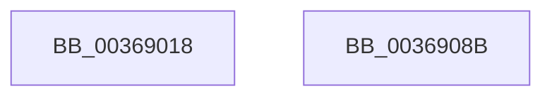

# MiQueueControlAreaDelete

- RVA: `0x00369018`–`0x0036908C` (길이 `116` bytes)
- VA: `0x0000000140369018`
- 실행 섹션: `.text`
- PDB 이름 있음: `예`; PDB Function 태그: `아니요`
- unwind 정보 RVA: `0x00060BC4`
- 디코드: `28`개 명령, `116/116` bytes 표시
- 미해석 바이트: `0` (있으면 어셈블리에 `.byte`로 보존)

> 이 문서는 커널 이미지의 기계어와 PDB 기호를 분석해 생성했습니다. 4번과 5번은 함수 원형과 자료형을 바이너리 사용 방식에서 추정한 C 해석이며 원본 소스 복구 결과는 아닙니다.

## 1. Dependencies

- 직접 호출 지점: **3**; 고유 호출 대상: **3**
- 직접 호출자로 확인된 함수: **1**
- RIP 상대 이미지 참조: **1**

### Outgoing calls
- `0x0036904A` → [ExAcquireSpinLockExclusive](../24/ExAcquireSpinLockExclusive_function_00248690.md) (function, `0x00248690`)
- `0x00369065` → [MiReleaseSpinLockExclusive](../24/MiReleaseSpinLockExclusive_function_002482C0.md) (function, `0x002482C0`)
- `0x00369076` → [KeSetEvent](../33/KeSetEvent_function_0033F310.md) (function, `0x0033F310`)

### Direct callers
- [MiDereferenceControlAreaProbe](MiDereferenceControlAreaProbe_function_003691C0.md) at `0x003691E5`

### Static image references
- `0x0036902F` → RVA `0x00E30088` (`.data`; read)

## 2. Other-region calls and transfers

- 다른 실행 섹션으로 향하는 call: **0**
- 별도 외부 분기/꼬리 이동을 확인하지 못했습니다.

## 3. Assembly (complete function range)

```asm
00369018  48 89 5C 24 08                  mov qword ptr [rsp + 8], rbx
0036901D  48 89 74 24 10                  mov qword ptr [rsp + 0x10], rsi
00369022  57                              push rdi
00369023  48 83 EC 20                     sub rsp, 0x20
00369027  0F B7 51 3C                     movzx edx, word ptr [rcx + 0x3c]
0036902B  48 8D 59 08                     lea rbx, [rcx + 8]
0036902F  48 8B 05 52 70 AC 00            mov rax, qword ptr [rip + 0xac7052]
00369036  81 E2 FF 03 00 00               and edx, 0x3ff
0036903C  48 8B 34 D0                     mov rsi, qword ptr [rax + rdx*8]
00369040  48 8D BE C0 06 00 00            lea rdi, [rsi + 0x6c0]
00369047  48 8B CF                        mov rcx, rdi
0036904A  E8 41 F6 ED FF                  call 0x140248690
0036904F  48 8B 96 78 08 00 00            mov rdx, qword ptr [rsi + 0x878]
00369056  48 8B CF                        mov rcx, rdi
00369059  48 89 13                        mov qword ptr [rbx], rdx
0036905C  8A D0                           mov dl, al
0036905E  48 89 9E 78 08 00 00            mov qword ptr [rsi + 0x878], rbx
00369065  E8 56 F2 ED FF                  call 0x1402482c0
0036906A  48 8D 8E 60 08 00 00            lea rcx, [rsi + 0x860]
00369071  45 33 C0                        xor r8d, r8d
00369074  33 D2                           xor edx, edx
00369076  E8 95 62 FD FF                  call 0x14033f310
0036907B  48 8B 5C 24 30                  mov rbx, qword ptr [rsp + 0x30]
00369080  48 8B 74 24 38                  mov rsi, qword ptr [rsp + 0x38]
00369085  48 83 C4 20                     add rsp, 0x20
00369089  5F                              pop rdi
0036908A  C3                              ret
0036908B  CC                              int3
```

## 4. C-style interpretation (structured pseudocode)

```c
__int64 __fastcall MiQueueControlAreaDelete(__int64 a1, __int64 a2, int a3)
{
    __int64 result;
    __int64 v_rsp;
    unsigned __int64 v_stack_p10;
    unsigned __int64 v_stack_p8;

    v_stack_p8 = v_rbx;
    v_stack_p10 = v_rsi;
    v_rsp = (v_rsp) - (32);
    a2 = (unsigned int)((*(unsigned __int16 *)(a1 + 60)) & (0x3FFULL));
    result = ExAcquireSpinLockExclusive(*(unsigned __int64 *)(*(unsigned __int64 *)(v_rip + 11300946) + a2 * 8) + 1728, a2, a3, a4);
    *(unsigned __int64 *)(a1 + 8) = *(unsigned __int64 *)(*(unsigned __int64 *)(*(unsigned __int64 *)(v_rip + 11300946) + a2 * 8) + 2168);
    *(unsigned __int64 *)(*(unsigned __int64 *)(*(unsigned __int64 *)(v_rip + 11300946) + a2 * 8) + 2168) = a1 + 8;
    result = MiReleaseSpinLockExclusive(*(unsigned __int64 *)(*(unsigned __int64 *)(v_rip + 11300946) + a2 * 8) + 1728, (unsigned __int8)(result), a3, a4);
    a3 = 0;
    a2 = 0;
    result = KeSetEvent(*(unsigned __int64 *)(*(unsigned __int64 *)(v_rip + 11300946) + a2 * 8) + 2144, a2, a3, a4);
    v_rsp = (v_rsp) + (32);
    return result;
}
```

## 5. (Beta) C Style

```c
int64_t MiQueueControlAreaDelete(void *Arg1, int64_t Arg2, int32_t Arg3)
{
    uint8_t *arg1 = (uint8_t *)Arg1;

    int64_t result;
    int64_t local_rsp;
    uint64_t v_stack_p10;
    uint64_t v_stack_p8;

    v_stack_p8 = local_rbx;
    v_stack_p10 = local_rsi;
    local_rsp = (local_rsp) - (32);
    Arg2 = (uint32_t)((*(uint16_t *)(arg1 + 0x3C)) & (0x3FFULL));
    result = ExAcquireSpinLockExclusive(*(uint64_t *)(*(uint64_t *)(v_rip + 0xAC7052) + Arg2 * 8) + 1728, Arg2, Arg3, a4);
    *(uint64_t *)(arg1 + 0x8) = *(uint64_t *)(*(uint64_t *)(*(uint64_t *)(v_rip + 0xAC7052) + Arg2 * 8) + 0x878);
    *(void **)(*(uint64_t *)(*(uint64_t *)(v_rip + 0xAC7052) + Arg2 * 8) + 0x878) = Arg1 + 8;
    result = MiReleaseSpinLockExclusive(*(uint64_t *)(*(uint64_t *)(v_rip + 0xAC7052) + Arg2 * 8) + 1728, (uint8_t)(result), Arg3, a4);
    Arg3 = 0;
    Arg2 = 0;
    result = KeSetEvent(*(uint64_t *)(*(uint64_t *)(v_rip + 0xAC7052) + Arg2 * 8) + 2144, Arg2, Arg3, a4);
    local_rsp = (local_rsp) + (32);
    return result;
}
```

### 관측된 메모리 오프셋

구조체 형식이 확인되지 않은 접근은 인자 기준의 오프셋으로만 기록했습니다.

| 기준 인자 | 오프셋 표현 | 폭 (bit) | 접근 |
|---|---:|---:|---|
| `Arg1` | `+ 0x0` | `64` | `W` |
| `Arg1` | `+ 0x8` | `64` | `R` |
| `Arg1` | `+ 0x3C` | `16` | `R` |

## 6. Execution-region graph

[열기: 2D/3D 그래프와 함수 탐색 컨트롤 패널](../../../control-panel.html?section=text&rva=0x00369018&view=graph)

- 2D 그래프는 위에서 아래로 흐르고, 3D 그래프는 빈 공간을 드래그해 회전합니다. Shift+드래그는 이동, 휠은 확대·축소, 함수 노드 선택은 대상 보고서 이동입니다.

### Static fallback


