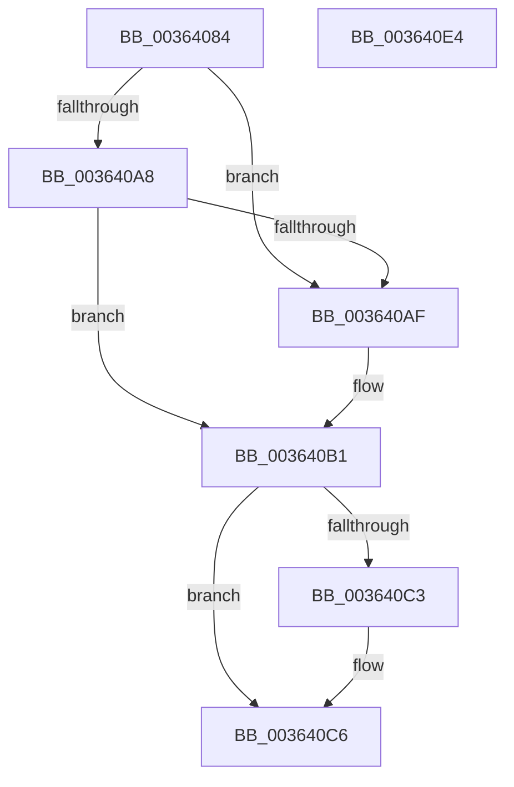

# MiReferenceControlAreaPfn

- RVA: `0x00364084`–`0x003640E5` (길이 `97` bytes)
- VA: `0x0000000140364084`
- 실행 섹션: `.text`
- PDB 이름 있음: `예`; PDB Function 태그: `아니요`
- unwind 정보 RVA: `0x0005C954`
- 디코드: `29`개 명령, `97/97` bytes 표시
- 미해석 바이트: `0` (있으면 어셈블리에 `.byte`로 보존)

> 이 문서는 커널 이미지의 기계어와 PDB 기호를 분석해 생성했습니다. 4번과 5번은 함수 원형과 자료형을 바이너리 사용 방식에서 추정한 C 해석이며 원본 소스 복구 결과는 아닙니다.

## 1. Dependencies

- 직접 호출 지점: **2**; 고유 호출 대상: **2**
- 직접 호출자로 확인된 함수: **7**
- RIP 상대 이미지 참조: **0**

### Outgoing calls
- `0x003640B5` → [ExAcquireSpinLockExclusiveAtDpcLevel](../24/ExAcquireSpinLockExclusiveAtDpcLevel_function_00248E80.md) (function, `0x00248E80`)
- `0x003640CA` → [ExReleaseSpinLockExclusiveFromDpcLevel](../24/ExReleaseSpinLockExclusiveFromDpcLevel_function_002497E0.md) (function, `0x002497E0`)

### Direct callers
- [MiInitializeNewImageSectionProtos](../2A/MiInitializeNewImageSectionProtos_function_002ABB80.md) at `0x002ABD4D`
- [MiInitializeImageProtos](../2A/MiInitializeImageProtos_function_002ABDAC.md) at `0x002ABFD3`
- [MiFinishMdlForMappedFileFault](../2A/MiFinishMdlForMappedFileFault_function_002AC974.md) at `0x002AC9B1`
- [MiMakePageAvoidRead](../2B/MiMakePageAvoidRead_function_002B7DE0.md) at `0x002B81BF`
- [sub_002F6E32](../2F/Unknown_function_002F6E32.md) at `0x002F7281`
- [MiPfPutPagesInTransition](MiPfPutPagesInTransition_function_003640EC.md) at `0x00364555`
- [MiInitializeDynamicPfns](../67/MiInitializeDynamicPfns_function_00672BD0.md) at `0x00672D13`

### Static image references
- 디코드된 RIP-relative 메모리 참조가 없습니다.

## 2. Other-region calls and transfers

- 다른 실행 섹션으로 향하는 call: **0**
- 별도 외부 분기/꼬리 이동을 확인하지 못했습니다.

## 3. Assembly (complete function range)

```asm
00364084  48 89 5C 24 08                  mov qword ptr [rsp + 8], rbx
00364089  48 89 6C 24 10                  mov qword ptr [rsp + 0x10], rbp
0036408E  48 89 74 24 18                  mov qword ptr [rsp + 0x18], rsi
00364093  57                              push rdi
00364094  48 83 EC 20                     sub rsp, 0x20
00364098  8B 41 38                        mov eax, dword ptr [rcx + 0x38]
0036409B  48 8B DA                        mov rbx, rdx
0036409E  41 8B E8                        mov ebp, r8d
003640A1  48 8B F9                        mov rdi, rcx
003640A4  A8 20                           test al, 0x20
003640A6  75 07                           jne 0x1403640af
003640A8  48 83 79 40 00                  cmp qword ptr [rcx + 0x40], 0
003640AD  75 02                           jne 0x1403640b1
003640AF  33 DB                           xor ebx, ebx
003640B1  48 83 C1 48                     add rcx, 0x48
003640B5  E8 C6 4D EE FF                  call 0x140248e80
003640BA  48 01 6F 20                     add qword ptr [rdi + 0x20], rbp
003640BE  48 85 DB                        test rbx, rbx
003640C1  74 03                           je 0x1403640c6
003640C3  01 6B 68                        add dword ptr [rbx + 0x68], ebp
003640C6  48 8D 4F 48                     lea rcx, [rdi + 0x48]
003640CA  E8 11 57 EE FF                  call 0x1402497e0
003640CF  48 8B 5C 24 30                  mov rbx, qword ptr [rsp + 0x30]
003640D4  48 8B 6C 24 38                  mov rbp, qword ptr [rsp + 0x38]
003640D9  48 8B 74 24 40                  mov rsi, qword ptr [rsp + 0x40]
003640DE  48 83 C4 20                     add rsp, 0x20
003640E2  5F                              pop rdi
003640E3  C3                              ret
003640E4  CC                              int3
```

## 4. C-style interpretation (structured pseudocode)

```c
__int64 __fastcall MiReferenceControlAreaPfn(__int64 a1, __int64 a2, int a3)
{
    __int64 result;
    __int64 v_rbx;
    __int64 v_rsp;
    unsigned __int64 v_stack_p10;
    unsigned __int64 v_stack_p18;
    unsigned __int64 v_stack_p8;

    v_stack_p8 = v_rbx;
    v_stack_p10 = v_rbp;
    v_stack_p18 = v_rsi;
    v_rsp = (v_rsp) - (32);
    if ((((unsigned __int8)((unsigned int)(*(unsigned int *)(a1 + 56)))) & (32)) != 0) goto loc_003640AF;
    v_rbx = a2;
    if ((*(unsigned __int64 *)(a1 + 64)) == 0) {
        v_rbx = 0;
    }
    a1 = (a1) + (72);
    result = ExAcquireSpinLockExclusiveAtDpcLevel(a1, a2, a3, a4);
    if (0 != 0) {
    }
    result = ExReleaseSpinLockExclusiveFromDpcLevel(a1 + 72, a2, a3, a4);
    v_rsp = (v_rsp) + (32);
    return result;
}
```

## 5. (Beta) C Style

```c
int64_t MiReferenceControlAreaPfn(void *Arg1, int64_t Arg2, int32_t Arg3)
{
    uint8_t *arg1 = (uint8_t *)Arg1;

    int64_t result;
    int64_t local_rbx;
    int64_t local_rsp;
    uint64_t v_stack_p10;
    uint64_t v_stack_p18;
    uint64_t v_stack_p8;

    v_stack_p8 = local_rbx;
    v_stack_p10 = local_rbp;
    v_stack_p18 = local_rsi;
    local_rsp = (local_rsp) - (32);
    if ((((uint8_t)((uint32_t)(*(uint32_t *)(arg1 + 0x38)))) & (32)) != 0) goto loc_003640AF;
    local_rbx = Arg2;
    if ((*(uint64_t *)(arg1 + 0x40)) == 0) {
        local_rbx = 0;
    }
    Arg1 = (Arg1) + (72);
    result = ExAcquireSpinLockExclusiveAtDpcLevel(Arg1, Arg2, Arg3, a4);
    if (0 != 0) {
    }
    result = ExReleaseSpinLockExclusiveFromDpcLevel(Arg1 + 72, Arg2, Arg3, a4);
    local_rsp = (local_rsp) + (32);
    return result;
}
```

### 관측된 메모리 오프셋

구조체 형식이 확인되지 않은 접근은 인자 기준의 오프셋으로만 기록했습니다.

| 기준 인자 | 오프셋 표현 | 폭 (bit) | 접근 |
|---|---:|---:|---|
| `Arg1` | `+ 0x20` | `64` | `R/W` |
| `Arg1` | `+ 0x38` | `32` | `R` |
| `Arg1` | `+ 0x40` | `64` | `R` |
| `Arg1` | `+ 0x48` | `64` | `R` |

## 6. Execution-region graph

[열기: 2D/3D 그래프와 함수 탐색 컨트롤 패널](../../../control-panel.html?section=text&rva=0x00364084&view=graph)

- 2D 그래프는 위에서 아래로 흐르고, 3D 그래프는 빈 공간을 드래그해 회전합니다. Shift+드래그는 이동, 휠은 확대·축소, 함수 노드 선택은 대상 보고서 이동입니다.

### Static fallback


