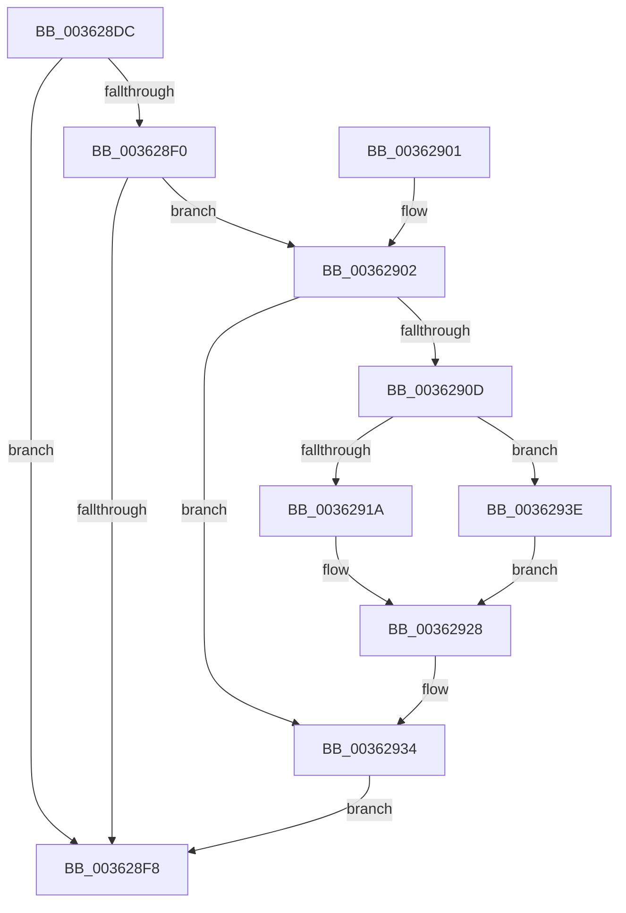

# MiReleaseWsSwapReservationPfn

- RVA: `0x003628DC`–`0x0036294C` (길이 `112` bytes)
- VA: `0x00000001403628DC`
- 실행 섹션: `.text`
- PDB 이름 있음: `예`; PDB Function 태그: `아니요`
- unwind 정보 RVA: `0x00079E08`
- 디코드: `39`개 명령, `112/112` bytes 표시
- 미해석 바이트: `0` (있으면 어셈블리에 `.byte`로 보존)

> 이 문서는 커널 이미지의 기계어와 PDB 기호를 분석해 생성했습니다. 4번과 5번은 함수 원형과 자료형을 바이너리 사용 방식에서 추정한 C 해석이며 원본 소스 복구 결과는 아닙니다.

## 1. Dependencies

- 직접 호출 지점: **1**; 고유 호출 대상: **1**
- 직접 호출자로 확인된 함수: **3**
- RIP 상대 이미지 참조: **0**

### Outgoing calls
- `0x00362937` → [MiSetPfnModified](MiSetPfnModified_function_00362960.md) (function, `0x00362960`)

### Direct callers
- [MiAllocateWsle](../33/MiAllocateWsle_function_003332C0.md) at `0x00333A8A`
- [MiProcessWsInSwapFault](MiProcessWsInSwapFault_function_00361EFC.md) at `0x00361F2F`
- [MiInPageSingleKernelStack](MiInPageSingleKernelStack_function_0036A3E8.md) at `0x0036A693`

### Static image references
- 디코드된 RIP-relative 메모리 참조가 없습니다.

## 2. Other-region calls and transfers

- 다른 실행 섹션으로 향하는 call: **0**
- 별도 외부 분기/꼬리 이동을 확인하지 못했습니다.

## 3. Assembly (complete function range)

```asm
003628DC  40 53                           push rbx
003628DE  48 83 EC 20                     sub rsp, 0x20
003628E2  48 8B 41 28                     mov rax, qword ptr [rcx + 0x28]
003628E6  33 DB                           xor ebx, ebx
003628E8  4C 8B C1                        mov r8, rcx
003628EB  48 85 C0                        test rax, rax
003628EE  78 08                           js 0x1403628f8
003628F0  48 8B 41 10                     mov rax, qword ptr [rcx + 0x10]
003628F4  A8 06                           test al, 6
003628F6  75 0A                           jne 0x140362902
003628F8  48 8B C3                        mov rax, rbx
003628FB  48 83 C4 20                     add rsp, 0x20
003628FF  5B                              pop rbx
00362900  C3                              ret
00362901  CC                              int3
00362902  F6 41 22 08                     test byte ptr [rcx + 0x22], 8
00362906  BA 01 00 00 00                  mov edx, 1
0036290B  75 27                           jne 0x140362934
0036290D  48 8B 59 10                     mov rbx, qword ptr [rcx + 0x10]
00362911  8A C3                           mov al, bl
00362913  C0 E8 02                        shr al, 2
00362916  84 C2                           test dl, al
00362918  75 24                           jne 0x14036293e
0036291A  8A C3                           mov al, bl
0036291C  D0 E8                           shr al, 1
0036291E  22 C2                           and al, dl
00362920  F6 D8                           neg al
00362922  48 1B C0                        sbb rax, rax
00362925  48 23 D8                        and rbx, rax
00362928  48 8B 49 10                     mov rcx, qword ptr [rcx + 0x10]
0036292C  48 83 E1 FD                     and rcx, 0xfffffffffffffffd
00362930  49 89 48 10                     mov qword ptr [r8 + 0x10], rcx
00362934  49 8B C8                        mov rcx, r8
00362937  E8 24 00 00 00                  call 0x140362960
0036293C  EB BA                           jmp 0x1403628f8
0036293E  48 8B 41 10                     mov rax, qword ptr [rcx + 0x10]
00362942  48 83 E0 FB                     and rax, 0xfffffffffffffffb
00362946  48 89 41 10                     mov qword ptr [rcx + 0x10], rax
0036294A  EB DC                           jmp 0x140362928
```

## 4. C-style interpretation (structured pseudocode)

```c
__int64 __fastcall MiReleaseWsSwapReservationPfn(__int64 a1)
{
    __int64 result;
    __int64 v_rbx;
    __int64 v_rsp;

    v_rsp = (v_rsp) - (32);
    v_rbx = 0;
    if (sign_flag) goto loc_003628F8;
    if ((((unsigned __int8)(*(unsigned __int64 *)(a1 + 16))) & (6)) != 0) goto loc_00362902;
loc_003628F8:
    v_rsp = (v_rsp) + (32);
    return 0;
loc_00362902:
    if (((*(unsigned __int8 *)(a1 + 34)) & (8)) != 0) goto loc_00362934;
    result = (unsigned __int8)(((unsigned __int8)(*(unsigned __int64 *)(a1 + 16))) >> (2));
    if (((1) & ((unsigned __int8)(result))) != 0) goto loc_0036293E;
    result = (unsigned __int8)(((unsigned __int8)(*(unsigned __int64 *)(a1 + 16))) >> (1));
    result = (unsigned __int8)((result) & (1));
    result = (unsigned __int8)(-(result));
    v_rbx = (*(unsigned __int64 *)(a1 + 16)) & (result);
loc_00362928:
    a1 = (*(unsigned __int64 *)(a1 + 16)) & (-3);
    *(unsigned __int64 *)(a1 + 16) = a1;
loc_00362934:
    result = MiSetPfnModified(a1, 1, a1, a4);
    goto loc_003628F8;
loc_0036293E:
    result = (*(unsigned __int64 *)(a1 + 16)) & (-5);
    *(unsigned __int64 *)(a1 + 16) = result;
    goto loc_00362928;
}
```

## 5. (Beta) C Style

```c
int64_t MiReleaseWsSwapReservationPfn(void *Arg1)
{
    uint8_t *arg1 = (uint8_t *)Arg1;

    int64_t result;
    int64_t local_rbx;
    int64_t local_rsp;

    local_rsp = (local_rsp) - (32);
    local_rbx = 0;
    if (sign_flag) goto loc_003628F8;
    if ((((uint8_t)(*(uint64_t *)(arg1 + 0x10))) & (6)) != 0) goto loc_00362902;
loc_003628F8:
    local_rsp = (local_rsp) + (32);
    return 0;
loc_00362902:
    if (((*(uint8_t *)(arg1 + 0x22)) & (8)) != 0) goto loc_00362934;
    result = (uint8_t)(((uint8_t)(*(uint64_t *)(arg1 + 0x10))) >> (2));
    if (((1) & ((uint8_t)(result))) != 0) goto loc_0036293E;
    result = (uint8_t)(((uint8_t)(*(uint64_t *)(arg1 + 0x10))) >> (1));
    result = (uint8_t)((result) & (1));
    result = (uint8_t)(-(result));
    local_rbx = (*(uint64_t *)(arg1 + 0x10)) & (result);
loc_00362928:
    Arg1 = (*(uint64_t *)(arg1 + 0x10)) & (-3);
    *(void **)(arg1 + 0x10) = Arg1;
loc_00362934:
    result = MiSetPfnModified(Arg1, 1, Arg1, a4);
    goto loc_003628F8;
loc_0036293E:
    result = (*(uint64_t *)(arg1 + 0x10)) & (-5);
    *(uint64_t *)(arg1 + 0x10) = result;
    goto loc_00362928;
}
```

### 관측된 메모리 오프셋

구조체 형식이 확인되지 않은 접근은 인자 기준의 오프셋으로만 기록했습니다.

| 기준 인자 | 오프셋 표현 | 폭 (bit) | 접근 |
|---|---:|---:|---|
| `Arg1` | `+ 0x10` | `64` | `R` |
| `Arg1` | `+ 0x10` | `64` | `W` |
| `Arg1` | `+ 0x22` | `8` | `R` |
| `Arg1` | `+ 0x28` | `64` | `R` |

## 6. Execution-region graph

[열기: 2D/3D 그래프와 함수 탐색 컨트롤 패널](../../../control-panel.html?section=text&rva=0x003628DC&view=graph)

- 2D 그래프는 위에서 아래로 흐르고, 3D 그래프는 빈 공간을 드래그해 회전합니다. Shift+드래그는 이동, 휠은 확대·축소, 함수 노드 선택은 대상 보고서 이동입니다.

### Static fallback


