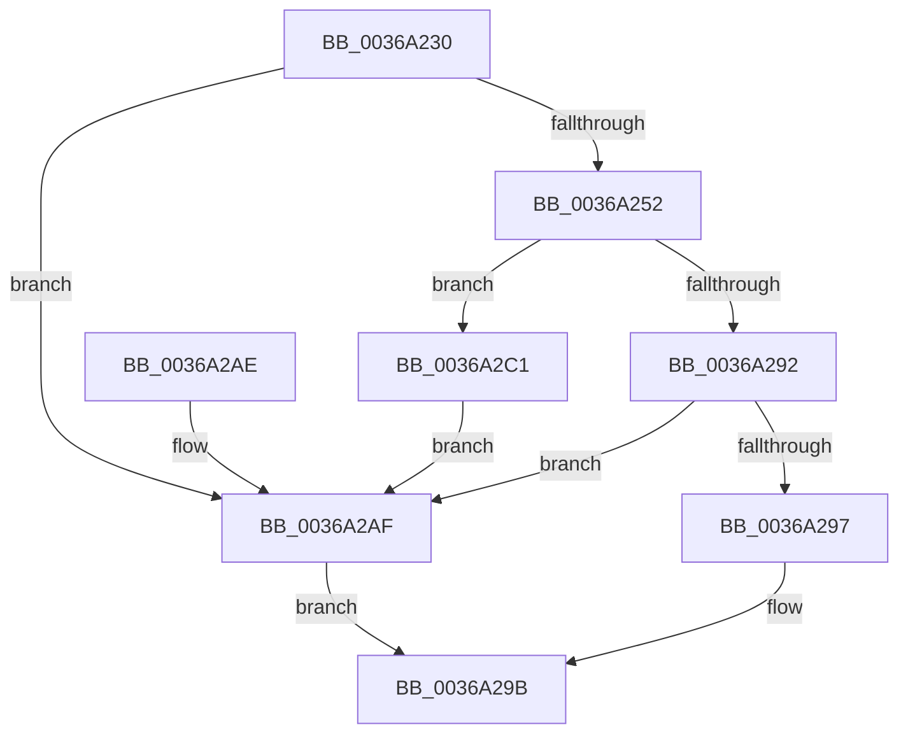

# MiRelockFaultState

- RVA: `0x0036A230`–`0x0036A2DC` (길이 `172` bytes)
- VA: `0x000000014036A230`
- 실행 섹션: `.text`
- PDB 이름 있음: `예`; PDB Function 태그: `아니요`
- unwind 정보 RVA: `0x0007A278`
- 디코드: `52`개 명령, `172/172` bytes 표시
- 미해석 바이트: `0` (있으면 어셈블리에 `.byte`로 보존)

> 이 문서는 커널 이미지의 기계어와 PDB 기호를 분석해 생성했습니다. 4번과 5번은 함수 원형과 자료형을 바이너리 사용 방식에서 추정한 C 해석이며 원본 소스 복구 결과는 아닙니다.

## 1. Dependencies

- 직접 호출 지점: **5**; 고유 호출 대상: **5**
- 직접 호출자로 확인된 함수: **6**
- RIP 상대 이미지 참조: **0**

### Outgoing calls
- `0x0036A255` → [MiLockWorkingSetShared](../27/MiLockWorkingSetShared_function_0027CBF0.md) (function, `0x0027CBF0`)
- `0x0036A285` → [MiLockLowestValidPageTableEx](../28/MiLockLowestValidPageTableEx_function_00280D10.md) (function, `0x00280D10`)
- `0x0036A2B6` → [MiLockWorkingSetExclusive](../32/MiLockWorkingSetExclusive_function_003238A0.md) (function, `0x003238A0`)
- `0x0036A2C7` → [MiUnlockPageTable](../21/MiUnlockPageTable_function_00216EC0.md) (function, `0x00216EC0`)
- `0x0036A2D3` → [MiUnlockWorkingSetShared](../27/MiUnlockWorkingSetShared_function_0027D690.md) (function, `0x0027D690`)

### Direct callers
- [MiFinishHardFault](../2B/MiFinishHardFault_function_002B6F10.md) at `0x002B7325`
- [MiKernelWriteToExecutableMemory](MiKernelWriteToExecutableMemory_function_00368F18.md) at `0x00368F9C`
- [MiKernelWriteToExecutableMemory](MiKernelWriteToExecutableMemory_function_00368F18.md) at `0x00368FA9`
- [MiPrivateFixup](MiPrivateFixup_function_003693E8.md) at `0x003697A9`
- [MiPrivateFixup](MiPrivateFixup_function_003693E8.md) at `0x00369A00`
- [MiWaitForCollidedFaultComplete](MiWaitForCollidedFaultComplete_function_00369EDC.md) at `0x0036A049`
- [MiIssueHardFault](../38/MiIssueHardFault_function_00380074.md) at `0x00380751`
- [MiIdealClusterPage](../4D/MiIdealClusterPage_function_004DB964.md) at `0x004DBF9E`

### Static image references
- 디코드된 RIP-relative 메모리 참조가 없습니다.

## 2. Other-region calls and transfers

- 다른 실행 섹션으로 향하는 call: **0**
- 별도 외부 분기/꼬리 이동을 확인하지 못했습니다.

## 3. Assembly (complete function range)

```asm
0036A230  48 89 5C 24 10                  mov qword ptr [rsp + 0x10], rbx
0036A235  48 89 6C 24 18                  mov qword ptr [rsp + 0x18], rbp
0036A23A  56                              push rsi
0036A23B  57                              push rdi
0036A23C  41 56                           push r14
0036A23E  48 83 EC 20                     sub rsp, 0x20
0036A242  48 8B 31                        mov rsi, qword ptr [rcx]
0036A245  33 FF                           xor edi, edi
0036A247  48 8B EA                        mov rbp, rdx
0036A24A  48 8B D9                        mov rbx, rcx
0036A24D  48 85 D2                        test rdx, rdx
0036A250  74 5D                           je 0x14036a2af
0036A252  48 8B CE                        mov rcx, rsi
0036A255  E8 96 29 F1 FF                  call 0x14027cbf0
0036A25A  48 8B D5                        mov rdx, rbp
0036A25D  44 0F B6 F0                     movzx r14d, al
0036A261  48 C1 E2 19                     shl rdx, 0x19
0036A265  48 B8 00 00 00 00 80 F6 FF FF   movabs rax, 0xfffff68000000000
0036A26F  48 C1 E0 19                     shl rax, 0x19
0036A273  4C 8D 44 24 40                  lea r8, [rsp + 0x40]
0036A278  48 2B D0                        sub rdx, rax
0036A27B  45 33 C9                        xor r9d, r9d
0036A27E  48 C1 FA 10                     sar rdx, 0x10
0036A282  48 8B CE                        mov rcx, rsi
0036A285  E8 86 6A F1 FF                  call 0x140280d10
0036A28A  48 8B F8                        mov rdi, rax
0036A28D  48 3B C5                        cmp rax, rbp
0036A290  75 2F                           jne 0x14036a2c1
0036A292  48 85 C0                        test rax, rax
0036A295  74 18                           je 0x14036a2af
0036A297  48 89 43 10                     mov qword ptr [rbx + 0x10], rax
0036A29B  48 8B 5C 24 48                  mov rbx, qword ptr [rsp + 0x48]
0036A2A0  48 8B 6C 24 50                  mov rbp, qword ptr [rsp + 0x50]
0036A2A5  48 83 C4 20                     add rsp, 0x20
0036A2A9  41 5E                           pop r14
0036A2AB  5F                              pop rdi
0036A2AC  5E                              pop rsi
0036A2AD  C3                              ret
0036A2AE  CC                              int3
0036A2AF  80 4B 0D 01                     or byte ptr [rbx + 0xd], 1
0036A2B3  48 8B CE                        mov rcx, rsi
0036A2B6  E8 E5 95 FB FF                  call 0x1403238a0
0036A2BB  48 89 7B 10                     mov qword ptr [rbx + 0x10], rdi
0036A2BF  EB DA                           jmp 0x14036a29b
0036A2C1  48 8B D0                        mov rdx, rax
0036A2C4  48 8B CE                        mov rcx, rsi
0036A2C7  E8 F4 CB EA FF                  call 0x140216ec0
0036A2CC  41 0F B6 D6                     movzx edx, r14b
0036A2D0  48 8B CE                        mov rcx, rsi
0036A2D3  E8 B8 33 F1 FF                  call 0x14027d690
0036A2D8  33 FF                           xor edi, edi
0036A2DA  EB D3                           jmp 0x14036a2af
```

## 4. C-style interpretation (structured pseudocode)

```c
__int64 __fastcall MiRelockFaultState(__int64 a1, __int64 a2, __int64 a3, int a4)
{
    __int64 result;
    __int64 v_rdi;
    __int64 v_rsp;
    unsigned __int64 v_stack_p10;
    unsigned __int64 v_stack_p18;
    unsigned __int64 v_stack_p8;

    v_stack_p10 = v_rbx;
    v_stack_p18 = v_rbp;
    v_rsp = (v_rsp) - (32);
    v_rdi = 0;
    if (a2 == 0) goto loc_0036A2AF;
    result = MiLockWorkingSetShared(*(unsigned __int64 *)(a1), a2, a3, a4);
    a2 = (a2) << (25);
    result = (result) << (25);
    a2 = (a2) - (result);
    a4 = 0;
    a2 = (a2) >> (16);
    result = MiLockLowestValidPageTableEx(*(unsigned __int64 *)(a1), a2, v_stack_p8, a4);
    if (result != a2) goto loc_0036A2C1;
    if (result == 0) goto loc_0036A2AF;
    *(unsigned __int64 *)(a1 + 16) = result;
loc_0036A29B:
    v_rsp = (v_rsp) + (32);
    return result;
loc_0036A2AF:
    result = MiLockWorkingSetExclusive(*(unsigned __int64 *)(a1), a2, v_stack_p8, a4);
    *(unsigned __int64 *)(v_stack_p10 + 16) = result;
    goto loc_0036A29B;
loc_0036A2C1:
    result = MiUnlockPageTable(*(unsigned __int64 *)(a1), result, v_stack_p8, a4);
    result = MiUnlockWorkingSetShared(*(unsigned __int64 *)(a1), (unsigned __int8)((unsigned __int8)(result)), v_stack_p8, a4);
    v_rdi = 0;
    goto loc_0036A2AF;
}
```

## 5. (Beta) C Style

```c
int64_t MiRelockFaultState(void *Arg1, int64_t Arg2, int64_t Arg3, int32_t Arg4)
{
    uint8_t *arg1 = (uint8_t *)Arg1;

    int64_t result;
    int64_t local_rdi;
    int64_t local_rsp;
    uint64_t v_stack_p10;
    uint64_t v_stack_p18;
    uint64_t v_stack_p8;

    v_stack_p10 = local_rbx;
    v_stack_p18 = local_rbp;
    local_rsp = (local_rsp) - (32);
    local_rdi = 0;
    if (Arg2 == 0) goto loc_0036A2AF;
    result = MiLockWorkingSetShared(*(uint64_t *)(arg1), Arg2, Arg3, Arg4);
    Arg2 = (Arg2) << (25);
    result = (result) << (25);
    Arg2 = (Arg2) - (result);
    Arg4 = 0;
    Arg2 = (Arg2) >> (16);
    result = MiLockLowestValidPageTableEx(*(uint64_t *)(arg1), Arg2, v_stack_p8, Arg4);
    if (result != Arg2) goto loc_0036A2C1;
    if (result == 0) goto loc_0036A2AF;
    *(uint64_t *)(arg1 + 0x10) = result;
loc_0036A29B:
    local_rsp = (local_rsp) + (32);
    return result;
loc_0036A2AF:
    result = MiLockWorkingSetExclusive(*(uint64_t *)(arg1), Arg2, v_stack_p8, Arg4);
    *(uint64_t *)(v_stack_p10 + 0x10) = result;
    goto loc_0036A29B;
loc_0036A2C1:
    result = MiUnlockPageTable(*(uint64_t *)(arg1), result, v_stack_p8, Arg4);
    result = MiUnlockWorkingSetShared(*(uint64_t *)(arg1), (uint8_t)((uint8_t)(result)), v_stack_p8, Arg4);
    local_rdi = 0;
    goto loc_0036A2AF;
}
```

### 관측된 메모리 오프셋

구조체 형식이 확인되지 않은 접근은 인자 기준의 오프셋으로만 기록했습니다.

| 기준 인자 | 오프셋 표현 | 폭 (bit) | 접근 |
|---|---:|---:|---|
| `Arg1` | `+ 0x0` | `64` | `R` |
| `Arg1` | `+ 0xD` | `8` | `R/W` |
| `Arg1` | `+ 0x10` | `64` | `W` |

## 6. Execution-region graph

[열기: 2D/3D 그래프와 함수 탐색 컨트롤 패널](../../../control-panel.html?section=text&rva=0x0036A230&view=graph)

- 2D 그래프는 위에서 아래로 흐르고, 3D 그래프는 빈 공간을 드래그해 회전합니다. Shift+드래그는 이동, 휠은 확대·축소, 함수 노드 선택은 대상 보고서 이동입니다.

### Static fallback


