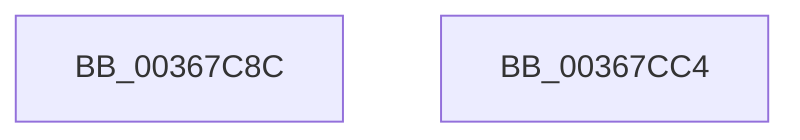

# MiReturnExcessPoolCharges

- RVA: `0x00367C8C`–`0x00367CC5` (길이 `57` bytes)
- VA: `0x0000000140367C8C`
- 실행 섹션: `.text`
- PDB 이름 있음: `예`; PDB Function 태그: `아니요`
- unwind 정보 RVA: `0x0007A034`
- 디코드: `16`개 명령, `57/57` bytes 표시
- 미해석 바이트: `0` (있으면 어셈블리에 `.byte`로 보존)

> 이 문서는 커널 이미지의 기계어와 PDB 기호를 분석해 생성했습니다. 4번과 5번은 함수 원형과 자료형을 바이너리 사용 방식에서 추정한 C 해석이며 원본 소스 복구 결과는 아닙니다.

## 1. Dependencies

- 직접 호출 지점: **1**; 고유 호출 대상: **1**
- 직접 호출자로 확인된 함수: **4**
- RIP 상대 이미지 참조: **0**

### Outgoing calls
- `0x00367CBA` → [MiReturnPoolCharges](MiReturnPoolCharges_function_003679B4.md) (function, `0x003679B4`)

### Direct callers
- [MiGetPoolPages](../32/MiGetPoolPages_function_00327D3C.md) at `0x00327EE5`
- [MiGetLargePoolPages](../32/MiGetLargePoolPages_function_00327FF8.md) at `0x00328087`
- [MiReturnExcessPoolCommit](../32/MiReturnExcessPoolCommit_function_00328D3C.md) at `0x00328DB4`
- [MmAllocateIndependentPagesEx](../../page/AA/MmAllocateIndependentPagesEx_function_00AA0CFC.md) at `0x00AA0F94`

### Static image references
- 디코드된 RIP-relative 메모리 참조가 없습니다.

## 2. Other-region calls and transfers

- 다른 실행 섹션으로 향하는 call: **0**
- 별도 외부 분기/꼬리 이동을 확인하지 못했습니다.

## 3. Assembly (complete function range)

```asm
00367C8C  4C 8B DC                        mov r11, rsp
00367C8F  48 83 EC 68                     sub rsp, 0x68
00367C93  0F 57 C0                        xorps xmm0, xmm0
00367C96  33 C0                           xor eax, eax
00367C98  0F 11 44 24 20                  movups xmmword ptr [rsp + 0x20], xmm0
00367C9D  45 33 C0                        xor r8d, r8d
00367CA0  0F 11 44 24 30                  movups xmmword ptr [rsp + 0x30], xmm0
00367CA5  0F 11 44 24 40                  movups xmmword ptr [rsp + 0x40], xmm0
00367CAA  49 89 4B B8                     mov qword ptr [r11 - 0x48], rcx
00367CAE  49 89 4B D0                     mov qword ptr [r11 - 0x30], rcx
00367CB2  49 8D 4B B8                     lea rcx, [r11 - 0x48]
00367CB6  49 89 43 E8                     mov qword ptr [r11 - 0x18], rax
00367CBA  E8 F5 FC FF FF                  call 0x1403679b4
00367CBF  48 83 C4 68                     add rsp, 0x68
00367CC3  C3                              ret
00367CC4  CC                              int3
```

## 4. C-style interpretation (structured pseudocode)

```c
__int64 __fastcall MiReturnExcessPoolCharges(__int64 a1, __int64 a2, int a3)
{
    __int64 result;
    __int64 v_rsp;
    unsigned __int64 v_stack_m28;
    unsigned __int64 v_stack_m38;
    unsigned __int64 v_stack_m48;

    v_rsp = (v_rsp) - (104);
    result = 0;
    v_stack_m48 = v_xmm0;
    a3 = 0;
    v_stack_m38 = v_xmm0;
    v_stack_m28 = v_xmm0;
    *(unsigned __int64 *)(v_rsp - 72) = a1;
    *(unsigned __int64 *)(v_rsp - 48) = a1;
    *(unsigned __int64 *)(v_rsp - 24) = 0;
    result = MiReturnPoolCharges(v_rsp - 72, a2, a3, a4);
    v_rsp = (v_rsp) + (104);
    return result;
}
```

## 5. (Beta) C Style

```c
int64_t MiReturnExcessPoolCharges(int64_t Arg1, int64_t Arg2, int32_t Arg3)
{
    int64_t result;
    int64_t local_rsp;
    uint64_t v_stack_m28;
    uint64_t v_stack_m38;
    uint64_t v_stack_m48;

    local_rsp = (local_rsp) - (104);
    result = 0;
    v_stack_m48 = v_xmm0;
    Arg3 = 0;
    v_stack_m38 = v_xmm0;
    v_stack_m28 = v_xmm0;
    *(uint64_t *)(local_rsp - 0x48) = Arg1;
    *(uint64_t *)(local_rsp - 0x30) = Arg1;
    *(uint64_t *)(local_rsp - 0x18) = 0;
    result = MiReturnPoolCharges(local_rsp - 72, Arg2, Arg3, a4);
    local_rsp = (local_rsp) + (104);
    return result;
}
```

## 6. Execution-region graph

[열기: 2D/3D 그래프와 함수 탐색 컨트롤 패널](../../../control-panel.html?section=text&rva=0x00367C8C&view=graph)

- 2D 그래프는 위에서 아래로 흐르고, 3D 그래프는 빈 공간을 드래그해 회전합니다. Shift+드래그는 이동, 휠은 확대·축소, 함수 노드 선택은 대상 보고서 이동입니다.

### Static fallback


