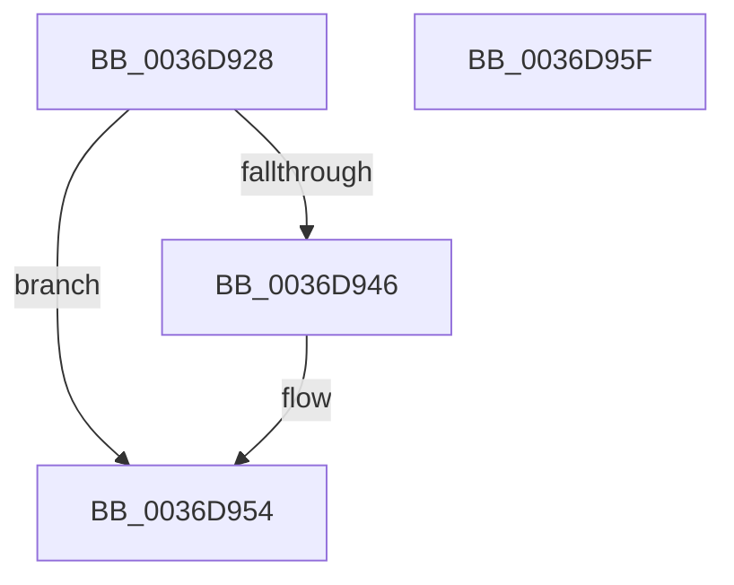

# MiReturnFaultCharges

- RVA: `0x0036D928`–`0x0036D960` (길이 `56` bytes)
- VA: `0x000000014036D928`
- 실행 섹션: `.text`
- PDB 이름 있음: `예`; PDB Function 태그: `아니요`
- unwind 정보 RVA: `0x0005CAAC`
- 디코드: `18`개 명령, `56/56` bytes 표시
- 미해석 바이트: `0` (있으면 어셈블리에 `.byte`로 보존)

> 이 문서는 커널 이미지의 기계어와 PDB 기호를 분석해 생성했습니다. 4번과 5번은 함수 원형과 자료형을 바이너리 사용 방식에서 추정한 C 해석이며 원본 소스 복구 결과는 아닙니다.

## 1. Dependencies

- 직접 호출 지점: **2**; 고유 호출 대상: **2**
- 직접 호출자로 확인된 함수: **12**
- RIP 상대 이미지 참조: **0**

### Outgoing calls
- `0x0036D93B` → [MiReturnResident](../28/MiReturnResident_function_00286890.md) (function, `0x00286890`)
- `0x0036D94F` → [MiReturnCommit](../24/MiReturnCommit_function_00248410.md) (function, `0x00248410`)

### Direct callers
- [MiObtainFaultCharges](../28/MiObtainFaultCharges_function_0028AEB0.md) at `0x0028AFF0`
- [MiMigratePfn](../28/MiMigratePfn_function_0028DBB0.md) at `0x0028E29C`
- [MiGetPageForHeader](../2A/MiGetPageForHeader_function_002AC120.md) at `0x002AC2B9`
- [MiResolveMappedFileFault](MiResolveMappedFileFault_function_0036B640.md) at `0x0036BB59`
- [MiResolvePageFileFault](MiResolvePageFileFault_function_0036D968.md) at `0x0036E8B4`
- [MiResolvePageFileFault](MiResolvePageFileFault_function_0036D968.md) at `0x0036E8E2`
- [MiPrefetchPagesViable](../45/MiPrefetchPagesViable_function_0045A644.md) at `0x0045A6BC`
- [MiSwitchToTransition](../4C/MiSwitchToTransition_function_004C0F5C.md) at `0x004C116F`
- [MiSwitchToTransition](../4C/MiSwitchToTransition_function_004C0F5C.md) at `0x004C162B`
- [sub_006E313A](../6E/Unknown_function_006E313A.md) at `0x006E339A`
- [sub_006E3B0E](../6E/Unknown_function_006E3B0E.md) at `0x006E3B19`
- [MiPfPrepareReadList](../../page/93/MiPfPrepareReadList_function_0093CD5C.md) at `0x0093D427`
- [MiFreeReadListPages](../../page/93/MiFreeReadListPages_function_0093D600.md) at `0x0093D6EA`
- [MiPfPrepareSequentialReadList](../../page/93/MiPfPrepareSequentialReadList_function_0093D8E8.md) at `0x0093E0D1`
- [MiPfPrepareSequentialReadList](../../page/93/MiPfPrepareSequentialReadList_function_0093D8E8.md) at `0x0093E15C`
- [MiPfPrepareSequentialReadList](../../page/93/MiPfPrepareSequentialReadList_function_0093D8E8.md) at `0x0093E172`

### Static image references
- 디코드된 RIP-relative 메모리 참조가 없습니다.

## 2. Other-region calls and transfers

- 다른 실행 섹션으로 향하는 call: **0**
- 별도 외부 분기/꼬리 이동을 확인하지 못했습니다.

## 3. Assembly (complete function range)

```asm
0036D928  48 89 5C 24 08                  mov qword ptr [rsp + 8], rbx
0036D92D  57                              push rdi
0036D92E  48 83 EC 20                     sub rsp, 0x20
0036D932  45 8B D8                        mov r11d, r8d
0036D935  48 8B DA                        mov rbx, rdx
0036D938  48 8B F9                        mov rdi, rcx
0036D93B  E8 50 8F F1 FF                  call 0x140286890
0036D940  41 F6 C3 01                     test r11b, 1
0036D944  74 0E                           je 0x14036d954
0036D946  45 33 C0                        xor r8d, r8d
0036D949  48 8B D3                        mov rdx, rbx
0036D94C  48 8B CF                        mov rcx, rdi
0036D94F  E8 BC AA ED FF                  call 0x140248410
0036D954  48 8B 5C 24 30                  mov rbx, qword ptr [rsp + 0x30]
0036D959  48 83 C4 20                     add rsp, 0x20
0036D95D  5F                              pop rdi
0036D95E  C3                              ret
0036D95F  CC                              int3
```

## 4. C-style interpretation (structured pseudocode)

```c
__int64 __fastcall MiReturnFaultCharges(__int64 a1, __int64 a2, int a3)
{
    __int64 result;
    __int64 v_rsp;
    unsigned __int64 v_stack_p8;

    v_stack_p8 = v_rbx;
    v_rsp = (v_rsp) - (32);
    result = MiReturnResident(a1, a2, a3, a4);
    if ((((unsigned __int8)((unsigned int)(a3))) & (1)) != 0) {
        a3 = 0;
        a2 = a2;
        a1 = a1;
        result = MiReturnCommit(a1, a2, a3, a4);
    }
    v_rsp = (v_rsp) + (32);
    return result;
}
```

## 5. (Beta) C Style

```c
int64_t MiReturnFaultCharges(int64_t Arg1, int64_t Arg2, int32_t Arg3)
{
    int64_t result;
    int64_t local_rsp;
    uint64_t v_stack_p8;

    v_stack_p8 = local_rbx;
    local_rsp = (local_rsp) - (32);
    result = MiReturnResident(Arg1, Arg2, Arg3, a4);
    if ((((uint8_t)((uint32_t)(Arg3))) & (1)) != 0) {
        Arg3 = 0;
        Arg2 = Arg2;
        Arg1 = Arg1;
        result = MiReturnCommit(Arg1, Arg2, Arg3, a4);
    }
    local_rsp = (local_rsp) + (32);
    return result;
}
```

## 6. Execution-region graph

[열기: 2D/3D 그래프와 함수 탐색 컨트롤 패널](../../../control-panel.html?section=text&rva=0x0036D928&view=graph)

- 2D 그래프는 위에서 아래로 흐르고, 3D 그래프는 빈 공간을 드래그해 회전합니다. Shift+드래그는 이동, 휠은 확대·축소, 함수 노드 선택은 대상 보고서 이동입니다.

### Static fallback


