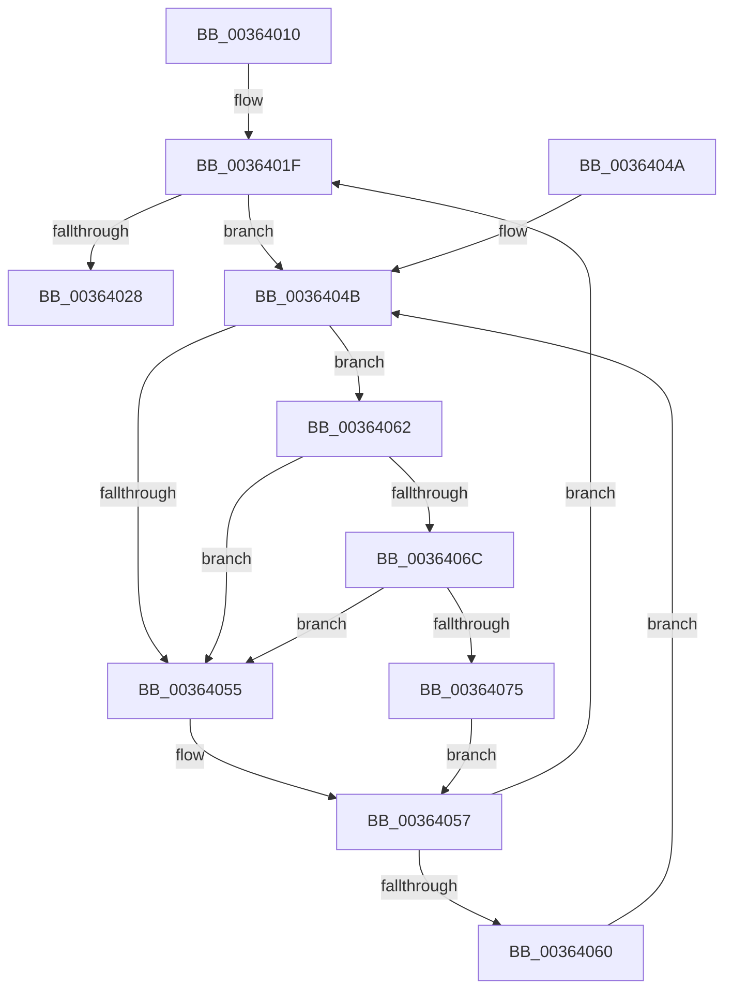

# MiReturnPfnReferenceCountAtDpc

- RVA: `0x00364010`–`0x0036407E` (길이 `110` bytes)
- VA: `0x0000000140364010`
- 실행 섹션: `.text`
- PDB 이름 있음: `예`; PDB Function 태그: `아니요`
- unwind 정보 RVA: `0x00070720`
- 디코드: `33`개 명령, `110/110` bytes 표시
- 미해석 바이트: `0` (있으면 어셈블리에 `.byte`로 보존)

> 이 문서는 커널 이미지의 기계어와 PDB 기호를 분석해 생성했습니다. 4번과 5번은 함수 원형과 자료형을 바이너리 사용 방식에서 추정한 C 해석이며 원본 소스 복구 결과는 아닙니다.

## 1. Dependencies

- 직접 호출 지점: **3**; 고유 호출 대상: **3**
- 직접 호출자로 확인된 함수: **7**
- RIP 상대 이미지 참조: **2**

### Outgoing calls
- `0x0036402B` → [MiRemoveLockedPageChargeAndDecRef](../24/MiRemoveLockedPageChargeAndDecRef_function_002459D0.md) (function, `0x002459D0`)
- `0x0036406C` → [KiCheckVpBackingLongSpinWaitHypercall](../30/KiCheckVpBackingLongSpinWaitHypercall_function_0030F490.md) (function, `0x0030F490`)
- `0x00364077` → [HvlNotifyLongSpinWait](../30/HvlNotifyLongSpinWait_function_0030F460.md) (function, `0x0030F460`)

### Direct callers
- [MiReturnPfnReferenceCount](../2A/MiReturnPfnReferenceCount_function_002AA824.md) at `0x002AA84A`
- [MiInitializeNewImageSectionProtos](../2A/MiInitializeNewImageSectionProtos_function_002ABB80.md) at `0x002ABC90`
- [sub_002B5D4A](../2B/Unknown_function_002B5D4A.md) at `0x002B5F14`
- [MiFinishHardFault](../2B/MiFinishHardFault_function_002B6F10.md) at `0x002B7713`
- [MiPfPutPagesInTransition](MiPfPutPagesInTransition_function_003640EC.md) at `0x003646A7`
- [MiPfPutPagesInTransition](MiPfPutPagesInTransition_function_003640EC.md) at `0x0036481B`
- [MiReleasePrefetchGapPages](MiReleasePrefetchGapPages_function_00367C08.md) at `0x00367C25`
- [MiIdealClusterPage](../4D/MiIdealClusterPage_function_004DB964.md) at `0x004DC01B`

### Static image references
- `0x0036404D` → RVA `0x00FC52AC` (`ALMOSTRO`; reference)
- `0x00364062` → RVA `0x00FC6AB8` (`ALMOSTRO`; read)

## 2. Other-region calls and transfers

- 다른 실행 섹션으로 향하는 call: **0**
- 별도 외부 분기/꼬리 이동을 확인하지 못했습니다.

## 3. Assembly (complete function range)

```asm
00364010  48 89 5C 24 08                  mov qword ptr [rsp + 8], rbx
00364015  57                              push rdi
00364016  48 83 EC 20                     sub rsp, 0x20
0036401A  48 8B D9                        mov rbx, rcx
0036401D  33 FF                           xor edi, edi
0036401F  F0 48 0F BA 6B 18 3F            lock bts qword ptr [rbx + 0x18], 0x3f
00364026  72 23                           jb 0x14036404b
00364028  48 8B CB                        mov rcx, rbx
0036402B  E8 A0 19 EE FF                  call 0x1402459d0
00364030  48 B9 FF FF FF FF FF FF FF 7F   movabs rcx, 0x7fffffffffffffff
0036403A  F0 48 21 4B 18                  lock and qword ptr [rbx + 0x18], rcx
0036403F  48 8B 5C 24 30                  mov rbx, qword ptr [rsp + 0x30]
00364044  48 83 C4 20                     add rsp, 0x20
00364048  5F                              pop rdi
00364049  C3                              ret
0036404A  CC                              int3
0036404B  FF C7                           inc edi
0036404D  85 3D 59 12 C6 00               test dword ptr [rip + 0xc61259], edi
00364053  74 0D                           je 0x140364062
00364055  F3 90                           pause
00364057  48 8B 43 18                     mov rax, qword ptr [rbx + 0x18]
0036405B  48 85 C0                        test rax, rax
0036405E  79 BF                           jns 0x14036401f
00364060  EB E9                           jmp 0x14036404b
00364062  8B 05 50 2A C6 00               mov eax, dword ptr [rip + 0xc62a50]
00364068  A8 40                           test al, 0x40
0036406A  74 E9                           je 0x140364055
0036406C  E8 1F B4 FA FF                  call 0x14030f490
00364071  84 C0                           test al, al
00364073  74 E0                           je 0x140364055
00364075  8B CF                           mov ecx, edi
00364077  E8 E4 B3 FA FF                  call 0x14030f460
0036407C  EB D9                           jmp 0x140364057
```

## 4. C-style interpretation (structured pseudocode)

```c
__int64 __fastcall MiReturnPfnReferenceCountAtDpc(__int64 a1)
{
    __int64 result;
    __int64 v_rdi;
    __int64 v_rsp;
    unsigned __int64 v_stack_p8;

    v_stack_p8 = v_rbx;
    v_rsp = (v_rsp) - (32);
    v_rdi = 0;
loc_0036401F:
    if (condition_is_below) goto loc_0036404B;
    result = MiRemoveLockedPageChargeAndDecRef(a1, a2, a3, a4);
    v_rsp = (v_rsp) + (32);
    return result;
loc_0036404B:
    v_rdi = (unsigned int)((v_rdi) + 1);
    if (((*(unsigned int *)(v_rip + 12980825)) & ((unsigned int)(v_rdi))) == 0) goto loc_00364062;
loc_00364055:
loc_00364057:
    if (!sign_flag) goto loc_0036401F;
    goto loc_0036404B;
loc_00364062:
    if ((((unsigned __int8)((unsigned int)(*(unsigned int *)(v_rip + 12986960)))) & (64)) == 0) goto loc_00364055;
    result = KiCheckVpBackingLongSpinWaitHypercall(a1, a2, a3, a4);
    if ((unsigned __int8)(result) == 0) goto loc_00364055;
    result = HvlNotifyLongSpinWait((unsigned int)((unsigned int)(v_rdi)), a2, a3, a4);
    goto loc_00364057;
}
```

## 5. (Beta) C Style

```c
int64_t MiReturnPfnReferenceCountAtDpc(void *Arg1)
{
    uint8_t *arg1 = (uint8_t *)Arg1;

    int64_t result;
    int64_t local_rdi;
    int64_t local_rsp;
    uint64_t v_stack_p8;

    v_stack_p8 = local_rbx;
    local_rsp = (local_rsp) - (32);
    local_rdi = 0;
loc_0036401F:
    if (condition_is_below) goto loc_0036404B;
    result = MiRemoveLockedPageChargeAndDecRef(Arg1, a2, a3, a4);
    local_rsp = (local_rsp) + (32);
    return result;
loc_0036404B:
    local_rdi = (uint32_t)((local_rdi) + 1);
    if (((*(uint32_t *)(v_rip + 0xC61259)) & ((uint32_t)(local_rdi))) == 0) goto loc_00364062;
loc_00364055:
loc_00364057:
    if (!sign_flag) goto loc_0036401F;
    goto loc_0036404B;
loc_00364062:
    if ((((uint8_t)((uint32_t)(*(uint32_t *)(v_rip + 0xC62A50)))) & (64)) == 0) goto loc_00364055;
    result = KiCheckVpBackingLongSpinWaitHypercall(Arg1, a2, a3, a4);
    if ((uint8_t)(result) == 0) goto loc_00364055;
    result = HvlNotifyLongSpinWait((uint32_t)((uint32_t)(local_rdi)), a2, a3, a4);
    goto loc_00364057;
}
```

### 관측된 메모리 오프셋

구조체 형식이 확인되지 않은 접근은 인자 기준의 오프셋으로만 기록했습니다.

| 기준 인자 | 오프셋 표현 | 폭 (bit) | 접근 |
|---|---:|---:|---|
| `Arg1` | `+ 0x18` | `64` | `R` |
| `Arg1` | `+ 0x18` | `64` | `R/W` |

## 6. Execution-region graph

[열기: 2D/3D 그래프와 함수 탐색 컨트롤 패널](../../../control-panel.html?section=text&rva=0x00364010&view=graph)

- 2D 그래프는 위에서 아래로 흐르고, 3D 그래프는 빈 공간을 드래그해 회전합니다. Shift+드래그는 이동, 휠은 확대·축소, 함수 노드 선택은 대상 보고서 이동입니다.

### Static fallback


