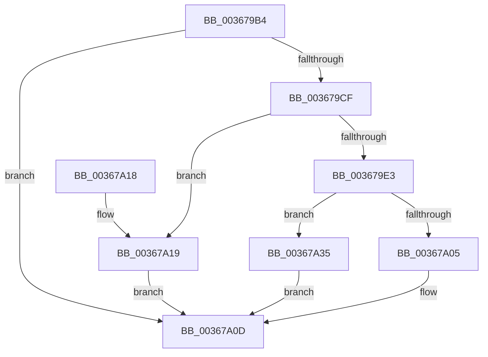

# MiReturnPoolCharges

- RVA: `0x003679B4`–`0x00367A3F` (길이 `139` bytes)
- VA: `0x00000001403679B4`
- 실행 섹션: `.text`
- PDB 이름 있음: `예`; PDB Function 태그: `아니요`
- unwind 정보 RVA: `0x00063C24`
- 디코드: `38`개 명령, `139/139` bytes 표시
- 미해석 바이트: `0` (있으면 어셈블리에 `.byte`로 보존)

> 이 문서는 커널 이미지의 기계어와 PDB 기호를 분석해 생성했습니다. 4번과 5번은 함수 원형과 자료형을 바이너리 사용 방식에서 추정한 C 해석이며 원본 소스 복구 결과는 아닙니다.

## 1. Dependencies

- 직접 호출 지점: **3**; 고유 호출 대상: **3**
- 직접 호출자로 확인된 함수: **2**
- RIP 상대 이미지 참조: **4**

### Outgoing calls
- `0x003679E6` → [MiReturnCommit](../24/MiReturnCommit_function_00248410.md) (function, `0x00248410`)
- `0x003679F5` → [MiReturnResident](../28/MiReturnResident_function_00286890.md) (function, `0x00286890`)
- `0x00367A2E` → [MiReturnSystemCharges](MiReturnSystemCharges_function_00367A48.md) (function, `0x00367A48`)

### Direct callers
- [MiReturnPhysicalPoolPages](../32/MiReturnPhysicalPoolPages_function_00328568.md) at `0x00328765`
- [MiReturnExcessPoolCharges](MiReturnExcessPoolCharges_function_00367C8C.md) at `0x00367CBA`

### Static image references
- `0x003679BE` → RVA `0x00E3D998` (`.data`; read)
- `0x003679D7` → RVA `0x00E38D00` (`.data`; read)
- `0x00367A05` → RVA `0x00E376C8` (`.data`; read/write)
- `0x00367A35` → RVA `0x00E376D0` (`.data`; read/write)

## 2. Other-region calls and transfers

- 다른 실행 섹션으로 향하는 call: **0**
- 별도 외부 분기/꼬리 이동을 확인하지 못했습니다.

## 3. Assembly (complete function range)

```asm
003679B4  48 89 5C 24 08                  mov qword ptr [rsp + 8], rbx
003679B9  57                              push rdi
003679BA  48 83 EC 20                     sub rsp, 0x20
003679BE  48 8B 05 D3 5F AD 00            mov rax, qword ptr [rip + 0xad5fd3]
003679C5  8B FA                           mov edi, edx
003679C7  48 8B D9                        mov rbx, rcx
003679CA  48 85 C0                        test rax, rax
003679CD  74 3E                           je 0x140367a0d
003679CF  48 8B 51 18                     mov rdx, qword ptr [rcx + 0x18]
003679D3  48 2B 51 08                     sub rdx, qword ptr [rcx + 8]
003679D7  48 8D 0D 22 13 AD 00            lea rcx, [rip + 0xad1322]
003679DE  83 FF 02                        cmp edi, 2
003679E1  74 36                           je 0x140367a19
003679E3  45 33 C0                        xor r8d, r8d
003679E6  E8 25 0A EE FF                  call 0x140248410
003679EB  48 8B 13                        mov rdx, qword ptr [rbx]
003679EE  48 8D 0D 0B 13 AD 00            lea rcx, [rip + 0xad130b]
003679F5  E8 96 EE F1 FF                  call 0x140286890
003679FA  4C 8B 5B 18                     mov r11, qword ptr [rbx + 0x18]
003679FE  49 F7 DB                        neg r11
00367A01  85 FF                           test edi, edi
00367A03  75 30                           jne 0x140367a35
00367A05  F0 4C 01 1D BB FC AC 00         lock add qword ptr [rip + 0xacfcbb], r11
00367A0D  48 8B 5C 24 30                  mov rbx, qword ptr [rsp + 0x30]
00367A12  48 83 C4 20                     add rsp, 0x20
00367A16  5F                              pop rdi
00367A17  C3                              ret
00367A18  CC                              int3
00367A19  41 80 E0 04                     and r8b, 4
00367A1D  41 F6 D8                        neg r8b
00367A20  4C 8B C2                        mov r8, rdx
00367A23  45 1B C9                        sbb r9d, r9d
00367A26  41 83 E1 0A                     and r9d, 0xa
00367A2A  41 83 C1 04                     add r9d, 4
00367A2E  E8 15 00 00 00                  call 0x140367a48
00367A33  EB D8                           jmp 0x140367a0d
00367A35  F0 4C 01 1D 93 FC AC 00         lock add qword ptr [rip + 0xacfc93], r11
00367A3D  EB CE                           jmp 0x140367a0d
```

## 4. C-style interpretation (structured pseudocode)

```c
__int64 __fastcall MiReturnPoolCharges(__int64 a1, int a2, int a3, int a4)
{
    __int64 result;
    __int64 v_r11;
    __int64 v_rsp;
    unsigned __int64 v_stack_p8;

    v_stack_p8 = v_rbx;
    v_rsp = (v_rsp) - (32);
    if (*(unsigned __int64 *)(v_rip + 11362259) == 0) goto loc_00367A0D;
    a2 = (*(unsigned __int64 *)(a1 + 24)) - (*(unsigned __int64 *)(a1 + 8));
    if (((unsigned int)((unsigned int)(a2))) == 2) goto loc_00367A19;
    a3 = 0;
    result = MiReturnCommit(v_rip + 11342626, a2, a3, a4);
    result = MiReturnResident(v_rip + 11342603, *(unsigned __int64 *)(a1), a3, a4);
    v_r11 = -(*(unsigned __int64 *)(a1 + 24));
    if ((unsigned int)((unsigned int)(a2)) != 0) goto loc_00367A35;
loc_00367A0D:
    v_rsp = (v_rsp) + (32);
    return result;
loc_00367A19:
    a3 = (unsigned __int8)((a3) & (4));
    a3 = (unsigned __int8)(-(a3));
    a4 = (unsigned int)((a4) & (10));
    a4 = (unsigned int)((a4) + (4));
    result = MiReturnSystemCharges(v_rip + 11342603, *(unsigned __int64 *)(a1), *(unsigned __int64 *)(a1), a4);
    goto loc_00367A0D;
loc_00367A35:
    goto loc_00367A0D;
}
```

## 5. (Beta) C Style

```c
int64_t MiReturnPoolCharges(void *Arg1, int32_t Arg2, int32_t Arg3, int32_t Arg4)
{
    uint8_t *arg1 = (uint8_t *)Arg1;

    int64_t result;
    int64_t local_r11;
    int64_t local_rsp;
    uint64_t v_stack_p8;

    v_stack_p8 = local_rbx;
    local_rsp = (local_rsp) - (32);
    if (*(uint64_t *)(v_rip + 0xAD5FD3) == 0) goto loc_00367A0D;
    Arg2 = (*(uint64_t *)(arg1 + 0x18)) - (*(uint64_t *)(arg1 + 0x8));
    if (((uint32_t)((uint32_t)(Arg2))) == 2) goto loc_00367A19;
    Arg3 = 0;
    result = MiReturnCommit(v_rip + 11342626, Arg2, Arg3, Arg4);
    result = MiReturnResident(v_rip + 11342603, *(uint64_t *)(arg1), Arg3, Arg4);
    local_r11 = -(*(uint64_t *)(arg1 + 0x18));
    if ((uint32_t)((uint32_t)(Arg2)) != 0) goto loc_00367A35;
loc_00367A0D:
    local_rsp = (local_rsp) + (32);
    return result;
loc_00367A19:
    Arg3 = (uint8_t)((Arg3) & (4));
    Arg3 = (uint8_t)(-(Arg3));
    Arg4 = (uint32_t)((Arg4) & (10));
    Arg4 = (uint32_t)((Arg4) + (4));
    result = MiReturnSystemCharges(v_rip + 11342603, *(uint64_t *)(arg1), *(uint64_t *)(arg1), Arg4);
    goto loc_00367A0D;
loc_00367A35:
    goto loc_00367A0D;
}
```

### 관측된 메모리 오프셋

구조체 형식이 확인되지 않은 접근은 인자 기준의 오프셋으로만 기록했습니다.

| 기준 인자 | 오프셋 표현 | 폭 (bit) | 접근 |
|---|---:|---:|---|
| `Arg1` | `+ 0x0` | `64` | `R` |
| `Arg1` | `+ 0x8` | `64` | `R` |
| `Arg1` | `+ 0x18` | `64` | `R` |

## 6. Execution-region graph

[열기: 2D/3D 그래프와 함수 탐색 컨트롤 패널](../../../control-panel.html?section=text&rva=0x003679B4&view=graph)

- 2D 그래프는 위에서 아래로 흐르고, 3D 그래프는 빈 공간을 드래그해 회전합니다. Shift+드래그는 이동, 휠은 확대·축소, 함수 노드 선택은 대상 보고서 이동입니다.

### Static fallback


