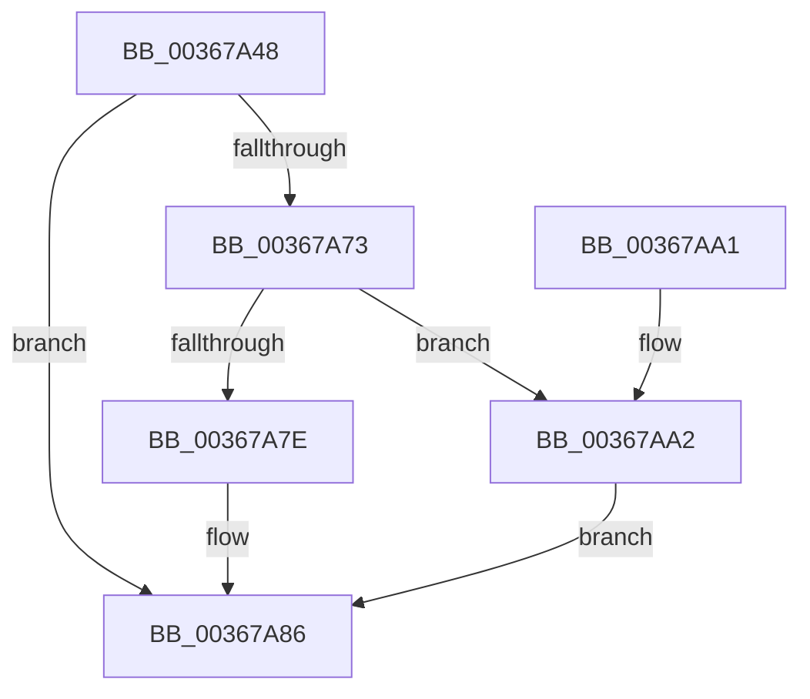

# MiReturnSystemCharges

- RVA: `0x00367A48`–`0x00367AAC` (길이 `100` bytes)
- VA: `0x0000000140367A48`
- 실행 섹션: `.text`
- PDB 이름 있음: `예`; PDB Function 태그: `아니요`
- unwind 정보 RVA: `0x0005C748`
- 디코드: `29`개 명령, `100/100` bytes 표시
- 미해석 바이트: `0` (있으면 어셈블리에 `.byte`로 보존)

> 이 문서는 커널 이미지의 기계어와 PDB 기호를 분석해 생성했습니다. 4번과 5번은 함수 원형과 자료형을 바이너리 사용 방식에서 추정한 C 해석이며 원본 소스 복구 결과는 아닙니다.

## 1. Dependencies

- 직접 호출 지점: **2**; 고유 호출 대상: **2**
- 직접 호출자로 확인된 함수: **7**
- RIP 상대 이미지 참조: **2**

### Outgoing calls
- `0x00367A69` → [MiReturnCommit](../24/MiReturnCommit_function_00248410.md) (function, `0x00248410`)
- `0x00367A8C` → [MiReturnResident](../28/MiReturnResident_function_00286890.md) (function, `0x00286890`)

### Direct callers
- [MiDeleteSystemPageTableTail](MiDeleteSystemPageTableTail_function_00367830.md) at `0x003678D3`
- [MiReturnPoolCharges](MiReturnPoolCharges_function_003679B4.md) at `0x00367A2E`
- [MiGetPageTablePages](../37/MiGetPageTablePages_function_00376C3C.md) at `0x00376EB6`
- [MiCleanupPageTablePages](../3B/MiCleanupPageTablePages_function_003B5EB8.md) at `0x003B5EFC`
- [MiInitializeDynamicBitmap](../67/MiInitializeDynamicBitmap_function_0067F5BC.md) at `0x0067F98D`
- [MiDeleteSparseRange](../../page/80/MiDeleteSparseRange_function_0080C1D0.md) at `0x0080C244`
- [MiGetLargePagesForSystemMapping](../../page/AC/MiGetLargePagesForSystemMapping_function_00AC5094.md) at `0x00AC523B`

### Static image references
- `0x00367A7E` → RVA `0x00E376E0` (`.data`; read/write)
- `0x00367AA2` → RVA `0x00E376F8` (`.data`; read/write)

## 2. Other-region calls and transfers

- 다른 실행 섹션으로 향하는 call: **0**
- 별도 외부 분기/꼬리 이동을 확인하지 못했습니다.

## 3. Assembly (complete function range)

```asm
00367A48  48 89 5C 24 08                  mov qword ptr [rsp + 8], rbx
00367A4D  48 89 74 24 10                  mov qword ptr [rsp + 0x10], rsi
00367A52  57                              push rdi
00367A53  48 83 EC 20                     sub rsp, 0x20
00367A57  49 8B C0                        mov rax, r8
00367A5A  48 8B DA                        mov rbx, rdx
00367A5D  48 8B D0                        mov rdx, rax
00367A60  45 33 C0                        xor r8d, r8d
00367A63  41 8B F9                        mov edi, r9d
00367A66  48 8B F1                        mov rsi, rcx
00367A69  E8 A2 09 EE FF                  call 0x140248410
00367A6E  83 FF 01                        cmp edi, 1
00367A71  74 13                           je 0x140367a86
00367A73  48 8B C3                        mov rax, rbx
00367A76  48 F7 D8                        neg rax
00367A79  83 FF 03                        cmp edi, 3
00367A7C  74 24                           je 0x140367aa2
00367A7E  F0 48 01 05 5A FC AC 00         lock add qword ptr [rip + 0xacfc5a], rax
00367A86  48 8B D3                        mov rdx, rbx
00367A89  48 8B CE                        mov rcx, rsi
00367A8C  E8 FF ED F1 FF                  call 0x140286890
00367A91  48 8B 5C 24 30                  mov rbx, qword ptr [rsp + 0x30]
00367A96  48 8B 74 24 38                  mov rsi, qword ptr [rsp + 0x38]
00367A9B  48 83 C4 20                     add rsp, 0x20
00367A9F  5F                              pop rdi
00367AA0  C3                              ret
00367AA1  CC                              int3
00367AA2  F0 48 01 05 4E FC AC 00         lock add qword ptr [rip + 0xacfc4e], rax
00367AAA  EB DA                           jmp 0x140367a86
```

## 4. C-style interpretation (structured pseudocode)

```c
__int64 __fastcall MiReturnSystemCharges(__int64 a1, __int64 a2, __int64 a3, int a4)
{
    __int64 result;
    __int64 v_rsp;
    unsigned __int64 v_stack_p10;
    unsigned __int64 v_stack_p8;

    v_stack_p8 = v_rbx;
    v_stack_p10 = v_rsi;
    v_rsp = (v_rsp) - (32);
    a3 = 0;
    result = MiReturnCommit(a1, a3, a3, a4);
    if (((unsigned int)((unsigned int)(a4))) == 1) goto loc_00367A86;
    result = -(a2);
    if (((unsigned int)((unsigned int)(a4))) == 3) goto loc_00367AA2;
loc_00367A86:
    result = MiReturnResident(a1, a2, a3, a4);
    v_rsp = (v_rsp) + (32);
    return result;
loc_00367AA2:
    goto loc_00367A86;
}
```

## 5. (Beta) C Style

```c
int64_t MiReturnSystemCharges(int64_t Arg1, int64_t Arg2, int64_t Arg3, int32_t Arg4)
{
    int64_t result;
    int64_t local_rsp;
    uint64_t v_stack_p10;
    uint64_t v_stack_p8;

    v_stack_p8 = local_rbx;
    v_stack_p10 = local_rsi;
    local_rsp = (local_rsp) - (32);
    Arg3 = 0;
    result = MiReturnCommit(Arg1, Arg3, Arg3, Arg4);
    if (((uint32_t)((uint32_t)(Arg4))) == 1) goto loc_00367A86;
    result = -(Arg2);
    if (((uint32_t)((uint32_t)(Arg4))) == 3) goto loc_00367AA2;
loc_00367A86:
    result = MiReturnResident(Arg1, Arg2, Arg3, Arg4);
    local_rsp = (local_rsp) + (32);
    return result;
loc_00367AA2:
    goto loc_00367A86;
}
```

## 6. Execution-region graph

[열기: 2D/3D 그래프와 함수 탐색 컨트롤 패널](../../../control-panel.html?section=text&rva=0x00367A48&view=graph)

- 2D 그래프는 위에서 아래로 흐르고, 3D 그래프는 빈 공간을 드래그해 회전합니다. Shift+드래그는 이동, 휠은 확대·축소, 함수 노드 선택은 대상 보고서 이동입니다.

### Static fallback


