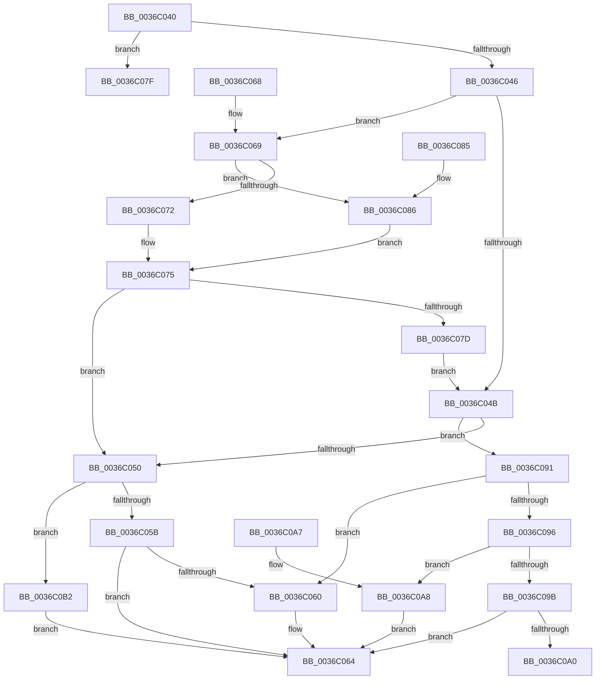

# MiSanitizePfnProtection

- RVA: `0x0036C040`–`0x0036C0B8` (길이 `120` bytes)
- VA: `0x000000014036C040`
- 실행 섹션: `.text`
- PDB 이름 있음: `예`; PDB Function 태그: `아니요`
- unwind 정보 RVA: `0x000DB714`
- 디코드: `46`개 명령, `120/120` bytes 표시
- 미해석 바이트: `0` (있으면 어셈블리에 `.byte`로 보존)

> 이 문서는 커널 이미지의 기계어와 PDB 기호를 분석해 생성했습니다. 4번과 5번은 함수 원형과 자료형을 바이너리 사용 방식에서 추정한 C 해석이며 원본 소스 복구 결과는 아닙니다.

## 1. Dependencies

- 직접 호출 지점: **0**; 고유 호출 대상: **0**
- 직접 호출자로 확인된 함수: **4**
- RIP 상대 이미지 참조: **0**

### Outgoing calls
- 직접 디코드된 call 명령이 없습니다.

### Direct callers
- [sub_002C3A7C](../2C/Unknown_function_002C3A7C.md) at `0x002C3E6B`
- [sub_002C3A7C](../2C/Unknown_function_002C3A7C.md) at `0x002C3EEB`
- [sub_002C3A7C](../2C/Unknown_function_002C3A7C.md) at `0x002C3FF9`
- [sub_002C3A7C](../2C/Unknown_function_002C3A7C.md) at `0x002C40B1`
- [MiSetProtectionOnTransitionPte](../2C/MiSetProtectionOnTransitionPte_function_002C586C.md) at `0x002C59CE`
- [MiResolveMappedFileFault](MiResolveMappedFileFault_function_0036B640.md) at `0x0036B8EE`
- [sub_006DC4D4](../6D/Unknown_function_006DC4D4.md) at `0x006DC594`

### Static image references
- 디코드된 RIP-relative 메모리 참조가 없습니다.

## 2. Other-region calls and transfers

- 다른 실행 섹션으로 향하는 call: **0**
- 별도 외부 분기/꼬리 이동을 확인하지 못했습니다.

## 3. Assembly (complete function range)

```asm
0036C040  41 83 F8 18                     cmp r8d, 0x18
0036C044  74 39                           je 0x14036c07f
0036C046  83 FA 18                        cmp edx, 0x18
0036C049  74 1E                           je 0x14036c069
0036C04B  83 E2 18                        and edx, 0x18
0036C04E  75 41                           jne 0x14036c091
0036C050  41 8B C0                        mov eax, r8d
0036C053  83 E0 18                        and eax, 0x18
0036C056  83 F8 18                        cmp eax, 0x18
0036C059  74 57                           je 0x14036c0b2
0036C05B  83 F8 08                        cmp eax, 8
0036C05E  75 04                           jne 0x14036c064
0036C060  41 83 E0 F7                     and r8d, 0xfffffff7
0036C064  41 8B C0                        mov eax, r8d
0036C067  C3                              ret
0036C068  CC                              int3
0036C069  8B 51 30                        mov edx, dword ptr [rcx + 0x30]
0036C06C  0F BA E2 15                     bt edx, 0x15
0036C070  73 14                           jae 0x14036c086
0036C072  C1 EA 07                        shr edx, 7
0036C075  83 E2 1F                        and edx, 0x1f
0036C078  83 FA 18                        cmp edx, 0x18
0036C07B  74 D3                           je 0x14036c050
0036C07D  EB CC                           jmp 0x14036c04b
0036C07F  B8 18 00 00 00                  mov eax, 0x18
0036C084  C3                              ret
0036C085  CC                              int3
0036C086  48 8B 41 48                     mov rax, qword ptr [rcx + 0x48]
0036C08A  8B 50 20                        mov edx, dword ptr [rax + 0x20]
0036C08D  D1 EA                           shr edx, 1
0036C08F  EB E4                           jmp 0x14036c075
0036C091  83 FA 10                        cmp edx, 0x10
0036C094  74 CA                           je 0x14036c060
0036C096  83 FA 08                        cmp edx, 8
0036C099  74 0D                           je 0x14036c0a8
0036C09B  83 FA 18                        cmp edx, 0x18
0036C09E  75 C4                           jne 0x14036c064
0036C0A0  44 0B C2                        or r8d, edx
0036C0A3  41 8B C0                        mov eax, r8d
0036C0A6  C3                              ret
0036C0A7  CC                              int3
0036C0A8  41 83 E0 EF                     and r8d, 0xffffffef
0036C0AC  41 83 C8 08                     or r8d, 8
0036C0B0  EB B2                           jmp 0x14036c064
0036C0B2  41 83 E0 E7                     and r8d, 0xffffffe7
0036C0B6  EB AC                           jmp 0x14036c064
```

## 4. C-style interpretation (structured pseudocode)

```c
__int64 __fastcall MiSanitizePfnProtection(__int64 a1, int a2, int a3)
{
    __int64 result;

    if (a3 == 24) goto loc_0036C07F;
    if (a2 == 24) goto loc_0036C069;
loc_0036C04B:
    a2 = (unsigned int)((a2) & (24));
    if (condition_is_not_equal) goto loc_0036C091;
loc_0036C050:
    result = (unsigned int)(((unsigned int)(a3)) & (24));
    if (((unsigned int)(result)) == 24) goto loc_0036C0B2;
    if (((unsigned int)(result)) == 8) {
        a3 = (unsigned int)((a3) & (0xFFFFFFF7ULL));
    }
    return (unsigned int)(a3);
loc_0036C069:
    if (condition_is_above_or_equal) goto loc_0036C086;
    a2 = (unsigned int)(((unsigned int)(*(unsigned int *)(a1 + 48))) >> (7));
loc_0036C075:
    a2 = (unsigned int)((a2) & (31));
    if (a2 == 24) goto loc_0036C050;
    goto loc_0036C04B;
loc_0036C07F:
    return 24;
loc_0036C086:
    a2 = (unsigned int)(((unsigned int)(*(unsigned int *)(*(unsigned __int64 *)(a1 + 72) + 32))) >> (1));
    goto loc_0036C075;
loc_0036C091:
    if (a2 == 16) goto loc_0036C060;
    if (a2 == 8) goto loc_0036C0A8;
    if (a2 != 24) goto loc_0036C064;
    a3 = (unsigned int)((a3) | (a2));
    return (unsigned int)(a3);
loc_0036C0A8:
    a3 = (unsigned int)((a3) & (0xFFFFFFEFULL));
    a3 = (unsigned int)((a3) | (8));
    goto loc_0036C064;
loc_0036C0B2:
    a3 = (unsigned int)((a3) & (0xFFFFFFE7ULL));
    goto loc_0036C064;
}
```

## 5. (Beta) C Style

```c
int64_t MiSanitizePfnProtection(void *Arg1, int32_t Arg2, int32_t Arg3)
{
    uint8_t *arg1 = (uint8_t *)Arg1;

    int64_t result;

    if (Arg3 == 24) goto loc_0036C07F;
    if (Arg2 == 24) goto loc_0036C069;
loc_0036C04B:
    Arg2 = (uint32_t)((Arg2) & (24));
    if (condition_is_not_equal) goto loc_0036C091;
loc_0036C050:
    result = (uint32_t)(((uint32_t)(Arg3)) & (24));
    if (((uint32_t)(result)) == 24) goto loc_0036C0B2;
    if (((uint32_t)(result)) == 8) {
        Arg3 = (uint32_t)((Arg3) & (0xFFFFFFF7ULL));
    }
    return (uint32_t)(Arg3);
loc_0036C069:
    if (condition_is_above_or_equal) goto loc_0036C086;
    Arg2 = (uint32_t)(((uint32_t)(*(uint32_t *)(arg1 + 0x30))) >> (7));
loc_0036C075:
    Arg2 = (uint32_t)((Arg2) & (31));
    if (Arg2 == 24) goto loc_0036C050;
    goto loc_0036C04B;
loc_0036C07F:
    return 24;
loc_0036C086:
    Arg2 = (uint32_t)(((uint32_t)(*(uint32_t *)(*(uint64_t *)(arg1 + 0x48) + 0x20))) >> (1));
    goto loc_0036C075;
loc_0036C091:
    if (Arg2 == 16) goto loc_0036C060;
    if (Arg2 == 8) goto loc_0036C0A8;
    if (Arg2 != 24) goto loc_0036C064;
    Arg3 = (uint32_t)((Arg3) | (Arg2));
    return (uint32_t)(Arg3);
loc_0036C0A8:
    Arg3 = (uint32_t)((Arg3) & (0xFFFFFFEFULL));
    Arg3 = (uint32_t)((Arg3) | (8));
    goto loc_0036C064;
loc_0036C0B2:
    Arg3 = (uint32_t)((Arg3) & (0xFFFFFFE7ULL));
    goto loc_0036C064;
}
```

### 관측된 메모리 오프셋

구조체 형식이 확인되지 않은 접근은 인자 기준의 오프셋으로만 기록했습니다.

| 기준 인자 | 오프셋 표현 | 폭 (bit) | 접근 |
|---|---:|---:|---|
| `Arg1` | `+ 0x30` | `32` | `R` |
| `Arg1` | `+ 0x48` | `64` | `R` |

## 6. Execution-region graph

[열기: 2D/3D 그래프와 함수 탐색 컨트롤 패널](../../../control-panel.html?section=text&rva=0x0036C040&view=graph)

- 2D 그래프는 위에서 아래로 흐르고, 3D 그래프는 빈 공간을 드래그해 회전합니다. Shift+드래그는 이동, 휠은 확대·축소, 함수 노드 선택은 대상 보고서 이동입니다.

### Static fallback


