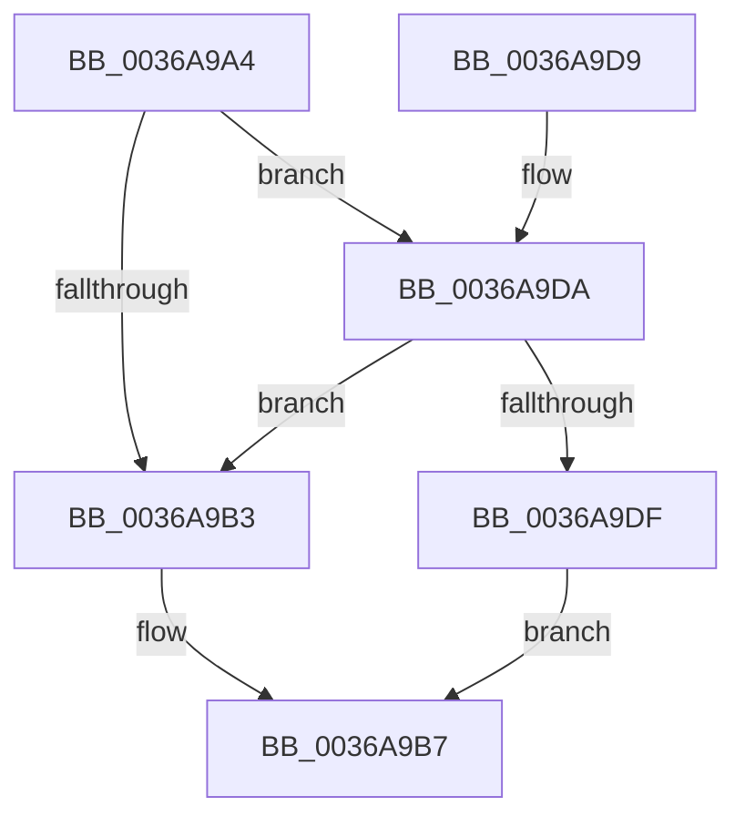

# MiSetInPagePriority

- RVA: `0x0036A9A4`–`0x0036A9E5` (길이 `65` bytes)
- VA: `0x000000014036A9A4`
- 실행 섹션: `.text`
- PDB 이름 있음: `예`; PDB Function 태그: `아니요`
- unwind 정보 RVA: `0x000DB714`
- 디코드: `19`개 명령, `65/65` bytes 표시
- 미해석 바이트: `0` (있으면 어셈블리에 `.byte`로 보존)

> 이 문서는 커널 이미지의 기계어와 PDB 기호를 분석해 생성했습니다. 4번과 5번은 함수 원형과 자료형을 바이너리 사용 방식에서 추정한 C 해석이며 원본 소스 복구 결과는 아닙니다.

## 1. Dependencies

- 직접 호출 지점: **0**; 고유 호출 대상: **0**
- 직접 호출자로 확인된 함수: **4**
- RIP 상대 이미지 참조: **0**

### Outgoing calls
- 직접 디코드된 call 명령이 없습니다.

### Direct callers
- [MiPfPutPagesInTransition](MiPfPutPagesInTransition_function_003640EC.md) at `0x00364331`
- [MiSetInPagePrefetchPriority](MiSetInPagePrefetchPriority_function_0036A974.md) at `0x0036A991`
- [sub_006E313A](../6E/Unknown_function_006E313A.md) at `0x006E337B`
- [MiPfAllocateMdls](../../page/93/MiPfAllocateMdls_function_0093E45C.md) at `0x0093E5AC`

### Static image references
- 디코드된 RIP-relative 메모리 참조가 없습니다.

## 2. Other-region calls and transfers

- 다른 실행 섹션으로 향하는 call: **0**
- 별도 외부 분기/꼬리 이동을 확인하지 못했습니다.

## 3. Assembly (complete function range)

```asm
0036A9A4  8B 81 C0 00 00 00               mov eax, dword ptr [rcx + 0xc0]
0036A9AA  4C 8B C9                        mov r9, rcx
0036A9AD  41 83 F8 05                     cmp r8d, 5
0036A9B1  72 27                           jb 0x14036a9da
0036A9B3  0F BA F0 14                     btr eax, 0x14
0036A9B7  41 0F B6 C8                     movzx ecx, r8b
0036A9BB  25 FF 07 FE FF                  and eax, 0xfffe07ff
0036A9C0  83 E1 07                        and ecx, 7
0036A9C3  8D 14 CD 00 00 00 00            lea edx, [rcx*8]
0036A9CA  0B D1                           or edx, ecx
0036A9CC  C1 E2 0B                        shl edx, 0xb
0036A9CF  0B D0                           or edx, eax
0036A9D1  41 89 91 C0 00 00 00            mov dword ptr [r9 + 0xc0], edx
0036A9D8  C3                              ret
0036A9D9  CC                              int3
0036A9DA  41 3B D0                        cmp edx, r8d
0036A9DD  76 D4                           jbe 0x14036a9b3
0036A9DF  0F BA E8 14                     bts eax, 0x14
0036A9E3  EB D2                           jmp 0x14036a9b7
```

## 4. C-style interpretation (structured pseudocode)

```c
__int64 __fastcall MiSetInPagePriority(__int64 a1, __int64 a2, int a3)
{
    __int64 result;

    if (a3 < 5) goto loc_0036A9DA;
loc_0036A9B3:
loc_0036A9B7:
    result = (unsigned int)(((unsigned int)(*(unsigned int *)(a1 + 192))) & (0xFFFE07FFULL));
    a1 = (unsigned int)(((unsigned __int8)(a3)) & (7));
    a2 = (unsigned int)((a1 * 8) | ((unsigned int)(a1)));
    a2 = (unsigned int)((a2) << (11));
    a2 = (unsigned int)((a2) | ((unsigned int)(result)));
    *(unsigned int *)(a1 + 192) = (unsigned int)(a2);
    return result;
loc_0036A9DA:
    if (((unsigned int)(a2)) <= a3) goto loc_0036A9B3;
    goto loc_0036A9B7;
}
```

## 5. (Beta) C Style

```c
int64_t MiSetInPagePriority(void *Arg1, int64_t Arg2, int32_t Arg3)
{
    uint8_t *arg1 = (uint8_t *)Arg1;

    int64_t result;

    if (Arg3 < 5) goto loc_0036A9DA;
loc_0036A9B3:
loc_0036A9B7:
    result = (uint32_t)(((uint32_t)(*(uint32_t *)(arg1 + 0xC0))) & (0xFFFE07FFULL));
    Arg1 = (uint32_t)(((uint8_t)(Arg3)) & (7));
    Arg2 = (uint32_t)((Arg1 * 8) | ((uint32_t)(Arg1)));
    Arg2 = (uint32_t)((Arg2) << (11));
    Arg2 = (uint32_t)((Arg2) | ((uint32_t)(result)));
    *(uint32_t *)(arg1 + 0xC0) = (uint32_t)(Arg2);
    return result;
loc_0036A9DA:
    if (((uint32_t)(Arg2)) <= Arg3) goto loc_0036A9B3;
    goto loc_0036A9B7;
}
```

### 관측된 메모리 오프셋

구조체 형식이 확인되지 않은 접근은 인자 기준의 오프셋으로만 기록했습니다.

| 기준 인자 | 오프셋 표현 | 폭 (bit) | 접근 |
|---|---:|---:|---|
| `Arg1` | `+ 0xC0` | `32` | `R` |
| `Arg1` | `+ 0xC0` | `32` | `W` |

## 6. Execution-region graph

[열기: 2D/3D 그래프와 함수 탐색 컨트롤 패널](../../../control-panel.html?section=text&rva=0x0036A9A4&view=graph)

- 2D 그래프는 위에서 아래로 흐르고, 3D 그래프는 빈 공간을 드래그해 회전합니다. Shift+드래그는 이동, 휠은 확대·축소, 함수 노드 선택은 대상 보고서 이동입니다.

### Static fallback


