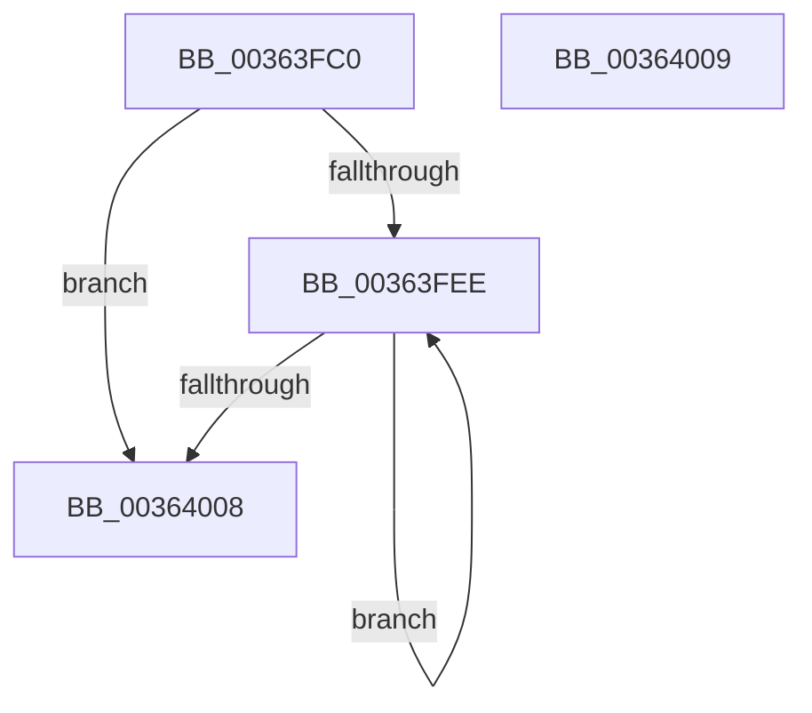

# MiSetPfnContainingFrame

- RVA: `0x00363FC0`–`0x0036400A` (길이 `74` bytes)
- VA: `0x0000000140363FC0`
- 실행 섹션: `.text`
- PDB 이름 있음: `예`; PDB Function 태그: `아니요`
- unwind 정보 RVA: `0x000DB714`
- 디코드: `22`개 명령, `74/74` bytes 표시
- 미해석 바이트: `0` (있으면 어셈블리에 `.byte`로 보존)

> 이 문서는 커널 이미지의 기계어와 PDB 기호를 분석해 생성했습니다. 4번과 5번은 함수 원형과 자료형을 바이너리 사용 방식에서 추정한 C 해석이며 원본 소스 복구 결과는 아닙니다.

## 1. Dependencies

- 직접 호출 지점: **0**; 고유 호출 대상: **0**
- 직접 호출자로 확인된 함수: **42**
- RIP 상대 이미지 참조: **0**

### Outgoing calls
- 직접 디코드된 call 명령이 없습니다.

### Direct callers
- [MiReplacePageTablePage](../22/MiReplacePageTablePage_function_00229184.md) at `0x002296C3`
- [MiReplacePageTablePage](../22/MiReplacePageTablePage_function_00229184.md) at `0x002297DA`
- [MiReplacePageTablePage](../22/MiReplacePageTablePage_function_00229184.md) at `0x00229A14`
- [MiDemoteCombinedPte](../22/MiDemoteCombinedPte_function_0022ABAC.md) at `0x0022ADBB`
- [MiCombineInitialInstance](../22/MiCombineInitialInstance_function_0022BC0C.md) at `0x0022C1BB`
- [MiHandleForkTransitionPte](../22/MiHandleForkTransitionPte_function_0022D34C.md) at `0x0022D67E`
- [MiBuildForkPte](../22/MiBuildForkPte_function_0022E32C.md) at `0x0022E635`
- [MiInitializeTransitionPfn](../2A/MiInitializeTransitionPfn_function_002AC2E8.md) at `0x002AC361`
- [MiReplaceTransitionPage](../2B/MiReplaceTransitionPage_function_002B1120.md) at `0x002B1838`
- [MiReplaceTransitionPage](../2B/MiReplaceTransitionPage_function_002B1120.md) at `0x002B188F`
- [MiStealPage](../2B/MiStealPage_function_002B28D0.md) at `0x002B3C04`
- [MiInitializeMdlSinglePage](../2C/MiInitializeMdlSinglePage_function_002C939C.md) at `0x002C93FC`
- [MiInitializeMdlPfn](../2C/MiInitializeMdlPfn_function_002C9670.md) at `0x002C96CF`
- [MiCopyOnWrite](MiCopyOnWrite_function_00362A0C.md) at `0x00362D8E`
- [MiInitializeHardFaultPfn](MiInitializeHardFaultPfn_function_00363DD8.md) at `0x00363EB3`
- [MiReplacePageOfProtoPool](MiReplacePageOfProtoPool_function_00364BB8.md) at `0x00365136`
- [MiInitializePfnForOtherProcess](../38/MiInitializePfnForOtherProcess_function_00382A20.md) at `0x00382B2F`
- [MiSwapNumaStandbyPage](../38/MiSwapNumaStandbyPage_function_00385144.md) at `0x00385729`
- [MiUnmapMdlCommon](../3E/MiUnmapMdlCommon_function_003E7DF0.md) at `0x003E83B5`
- [MiExclusiveInsertPfnChainInList](../44/MiExclusiveInsertPfnChainInList_function_00445C48.md) at `0x00445E08`
- [MiSetPfnOwnedAndActive](../46/MiSetPfnOwnedAndActive_function_004652AC.md) at `0x004653F7`
- [MiBuildForkPageTable](../4A/MiBuildForkPageTable_function_004ACF5C.md) at `0x004ACFDD`
- [MiInitializeLargeNonPagedPoolLeafFrames](../4B/MiInitializeLargeNonPagedPoolLeafFrames_function_004B7CE4.md) at `0x004B7D88`
- [MiSwitchToTransition](../4C/MiSwitchToTransition_function_004C0F5C.md) at `0x004C1443`
- [MiInitializeAwePfn](../4F/MiInitializeAwePfn_function_004F6D94.md) at `0x004F6DD5`
- [MiMakeLargePageTable](../4F/MiMakeLargePageTable_function_004F9198.md) at `0x004F932B`
- [MiInitializeNewPfns](../67/MiInitializeNewPfns_function_00670E94.md) at `0x0067100A`
- [MiCreatePfnTemplate](../67/MiCreatePfnTemplate_function_00671824.md) at `0x006719A0`
- [MiUpdateLargePageSectionPfns](../67/MiUpdateLargePageSectionPfns_function_00678F8C.md) at `0x00679143`
- [MiReturnBadPagesToBadList](../67/MiReturnBadPagesToBadList_function_0067A374.md) at `0x0067A422`
- [MmMarkPhysicalMemoryAsBad](../67/MmMarkPhysicalMemoryAsBad_function_0067AA50.md) at `0x0067AEA1`
- [MiChangePagingFileMaximum](../67/MiChangePagingFileMaximum_function_0067FEFC.md) at `0x0068025C`
- [MiAddExpansionNonPagedPool](../68/MiAddExpansionNonPagedPool_function_00682B4C.md) at `0x00682C31`
- [MiClearDriverTablePtes](../68/MiClearDriverTablePtes_function_00683024.md) at `0x00683333`
- [MmMapDriverTablePage](../68/MmMapDriverTablePage_function_00683EAC.md) at `0x00683FC6`
- [MiClearAweLargePageMetadata](../68/MiClearAweLargePageMetadata_function_006880EC.md) at `0x00688101`
- [MiDemoteValidLargePageOneLevel](../68/MiDemoteValidLargePageOneLevel_function_0068A3F4.md) at `0x0068A8DA`
- [sub_006E3E8A](../6E/Unknown_function_006E3E8A.md) at `0x006E3EAA`
- [sub_006E4A1A](../6E/Unknown_function_006E4A1A.md) at `0x006E4B23`
- [sub_006F28BE](../6F/Unknown_function_006F28BE.md) at `0x006F2959`
- [MiAllocateTopLevelPage](../../page/A5/MiAllocateTopLevelPage_function_00A5F2EC.md) at `0x00A5F3B7`
- [MiAllocateDummyPage](../../init/C5/MiAllocateDummyPage_function_00C5F6E8.md) at `0x00C5F83D`
- [MiSwitchToPfns](../../init/C6/MiSwitchToPfns_function_00C62C90.md) at `0x00C62D1E`
- [MxInsertEnclaveBootPages](../../init/C6/MxInsertEnclaveBootPages_function_00C68CB0.md) at `0x00C68D75`
- [MxInsertEnclaveBootPages](../../init/C6/MxInsertEnclaveBootPages_function_00C68CB0.md) at `0x00C68DFA`
- [MiInitializeDecayPfns](../../init/C6/MiInitializeDecayPfns_function_00C6CC04.md) at `0x00C6CC7C`

### Static image references
- 디코드된 RIP-relative 메모리 참조가 없습니다.

## 2. Other-region calls and transfers

- 다른 실행 섹션으로 향하는 call: **0**
- 별도 외부 분기/꼬리 이동을 확인하지 못했습니다.

## 3. Assembly (complete function range)

```asm
00363FC0  4C 8B 41 28                     mov r8, qword ptr [rcx + 0x28]
00363FC4  4C 8B C9                        mov r9, rcx
00363FC7  49 8B C8                        mov rcx, r8
00363FCA  49 BB 00 00 00 00 00 FF FF FF   movabs r11, 0xffffff0000000000
00363FD4  48 33 CA                        xor rcx, rdx
00363FD7  4C 8B D2                        mov r10, rdx
00363FDA  49 23 CB                        and rcx, r11
00363FDD  49 8B C0                        mov rax, r8
00363FE0  48 33 CA                        xor rcx, rdx
00363FE3  F0 49 0F B1 49 28               lock cmpxchg qword ptr [r9 + 0x28], rcx
00363FE9  4C 3B C0                        cmp r8, rax
00363FEC  74 1A                           je 0x140364008
00363FEE  48 8B D0                        mov rdx, rax
00363FF1  48 8B C8                        mov rcx, rax
00363FF4  49 33 D2                        xor rdx, r10
00363FF7  49 23 D3                        and rdx, r11
00363FFA  49 33 D2                        xor rdx, r10
00363FFD  F0 49 0F B1 51 28               lock cmpxchg qword ptr [r9 + 0x28], rdx
00364003  48 3B C8                        cmp rcx, rax
00364006  75 E6                           jne 0x140363fee
00364008  C3                              ret
00364009  CC                              int3
```

## 4. C-style interpretation (structured pseudocode)

```c
__int64 __fastcall MiSetPfnContainingFrame(__int64 a1, __int64 a2)
{
    a1 = (*(unsigned __int64 *)(a1 + 40)) ^ (a2);
    a1 = (a1) & (v_r11);
    a1 = (a1) ^ (a2);
    if ((*(unsigned __int64 *)(a1 + 40)) == (*(unsigned __int64 *)(a1 + 40))) goto loc_00364008;
loc_00363FEE:
    a2 = (*(unsigned __int64 *)(a1 + 40)) ^ (a2);
    a2 = (a2) & (v_r11);
    a2 = (a2) ^ (a2);
    if ((*(unsigned __int64 *)(a1 + 40)) != (*(unsigned __int64 *)(a1 + 40))) goto loc_00363FEE;
loc_00364008:
    return *(unsigned __int64 *)(a1 + 40);
}
```

## 5. (Beta) C Style

```c
int64_t MiSetPfnContainingFrame(void *Arg1, int64_t Arg2)
{
    uint8_t *arg1 = (uint8_t *)Arg1;

    Arg1 = (*(uint64_t *)(arg1 + 0x28)) ^ (Arg2);
    Arg1 = (Arg1) & (local_r11);
    Arg1 = (Arg1) ^ (Arg2);
    if ((*(uint64_t *)(arg1 + 0x28)) == (*(uint64_t *)(arg1 + 0x28))) goto loc_00364008;
loc_00363FEE:
    Arg2 = (*(uint64_t *)(arg1 + 0x28)) ^ (Arg2);
    Arg2 = (Arg2) & (local_r11);
    Arg2 = (Arg2) ^ (Arg2);
    if ((*(uint64_t *)(arg1 + 0x28)) != (*(uint64_t *)(arg1 + 0x28))) goto loc_00363FEE;
loc_00364008:
    return *(uint64_t *)(arg1 + 0x28);
}
```

### 관측된 메모리 오프셋

구조체 형식이 확인되지 않은 접근은 인자 기준의 오프셋으로만 기록했습니다.

| 기준 인자 | 오프셋 표현 | 폭 (bit) | 접근 |
|---|---:|---:|---|
| `Arg1` | `+ 0x28` | `64` | `R` |

## 6. Execution-region graph

[열기: 2D/3D 그래프와 함수 탐색 컨트롤 패널](../../../control-panel.html?section=text&rva=0x00363FC0&view=graph)

- 2D 그래프는 위에서 아래로 흐르고, 3D 그래프는 빈 공간을 드래그해 회전합니다. Shift+드래그는 이동, 휠은 확대·축소, 함수 노드 선택은 대상 보고서 이동입니다.

### Static fallback


