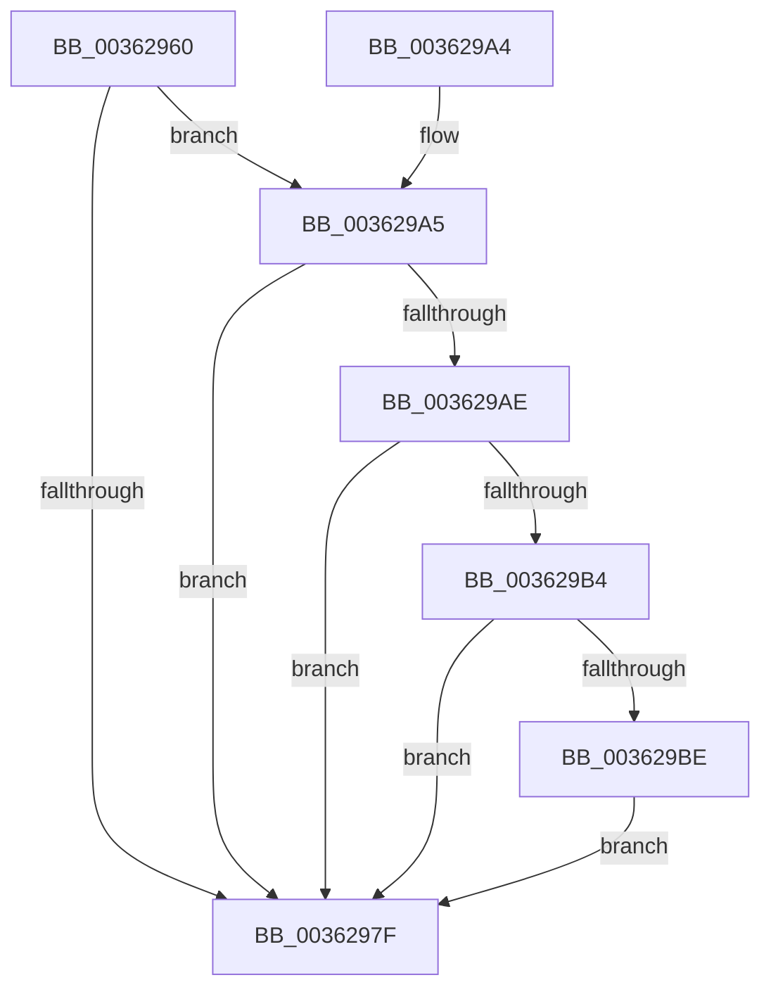

# MiSetPfnModified

- RVA: `0x00362960`–`0x003629CC` (길이 `108` bytes)
- VA: `0x0000000140362960`
- 실행 섹션: `.text`
- PDB 이름 있음: `예`; PDB Function 태그: `아니요`
- unwind 정보 RVA: `0x00079E14`
- 디코드: `35`개 명령, `108/108` bytes 표시
- 미해석 바이트: `0` (있으면 어셈블리에 `.byte`로 보존)

> 이 문서는 커널 이미지의 기계어와 PDB 기호를 분석해 생성했습니다. 4번과 5번은 함수 원형과 자료형을 바이너리 사용 방식에서 추정한 C 해석이며 원본 소스 복구 결과는 아닙니다.

## 1. Dependencies

- 직접 호출 지점: **1**; 고유 호출 대상: **1**
- 직접 호출자로 확인된 함수: **33**
- RIP 상대 이미지 참조: **0**

### Outgoing calls
- `0x003629A5` → [MiCanPfnOriginalPteBeLost](../37/MiCanPfnOriginalPteBeLost_function_00373D3C.md) (function, `0x00373D3C`)

### Direct callers
- [MiStoreModifiedWriteComplete](../20/MiStoreModifiedWriteComplete_function_002045E8.md) at `0x00204671`
- [MiAbandonPrivatePfn](../22/MiAbandonPrivatePfn_function_0022F548.md) at `0x0022F5BC`
- [MiAbandonPrivatePfn](../22/MiAbandonPrivatePfn_function_0022F548.md) at `0x0022F612`
- [MiActOnPte](../24/MiActOnPte_function_00244C90.md) at `0x002455E9`
- [MiActOnPte](../24/MiActOnPte_function_00244C90.md) at `0x0024577F`
- [MiMarkMdlComplete](../2A/MiMarkMdlComplete_function_002A75D0.md) at `0x002A766B`
- [MiStoreWriteModifiedPages](../2B/MiStoreWriteModifiedPages_function_002B46C4.md) at `0x002B5049`
- [MiInsertPageInList](../2B/MiInsertPageInList_function_002BA000.md) at `0x002BAA69`
- [MiTrimSharedPageFromViews](../2E/MiTrimSharedPageFromViews_function_002E16F8.md) at `0x002E1F32`
- [MiCompleteProtoPteFault](../34/MiCompleteProtoPteFault_function_00345710.md) at `0x00345FA8`
- [MiStoreModifiedWriteCompletePfn](MiStoreModifiedWriteCompletePfn_function_00362850.md) at `0x003628CA`
- [MiReleaseWsSwapReservationPfn](MiReleaseWsSwapReservationPfn_function_003628DC.md) at `0x00362937`
- [MiCopyOnWrite](MiCopyOnWrite_function_00362A0C.md) at `0x00362DF7`
- [MiInitializeEnclavePfn](MiInitializeEnclavePfn_function_003682A8.md) at `0x003683B3`
- [MiDeleteEnclavePage](MiDeleteEnclavePage_function_00368CCC.md) at `0x00368DAF`
- [MiPrivateFixup](MiPrivateFixup_function_003693E8.md) at `0x003697FB`
- [MiWriteCompletePfn](../37/MiWriteCompletePfn_function_003737C4.md) at `0x0037396E`
- [MiDeleteSectionCluster](../37/MiDeleteSectionCluster_function_00373DF0.md) at `0x00374050`
- [MiInitializePfnForOtherProcess](../38/MiInitializePfnForOtherProcess_function_00382A20.md) at `0x00382AFF`
- [MiReservePageFileSpaceForPage](../38/MiReservePageFileSpaceForPage_function_0038377C.md) at `0x00383D12`
- [MiMakeOutswappedPageResident](../43/MiMakeOutswappedPageResident_function_00431AD0.md) at `0x00431E3D`
- [sub_0044565B](../44/Unknown_function_0044565B.md) at `0x00445741`
- [MiMapPageFileHash](../49/MiMapPageFileHash_function_004921E0.md) at `0x004926D8`
- [MiSetPagesModified](../49/MiSetPagesModified_function_0049DC2C.md) at `0x0049DFB5`
- [MiBuildForkPageTable](../4A/MiBuildForkPageTable_function_004ACF5C.md) at `0x004AD064`
- [MiMapSystemCachePage](../4D/MiMapSystemCachePage_function_004D3588.md) at `0x004D3631`
- [MiSplitDirectMapPage](../4D/MiSplitDirectMapPage_function_004DAAA0.md) at `0x004DAC1A`
- [MiMarkFileOnlyPfnBad](../68/MiMarkFileOnlyPfnBad_function_006815C4.md) at `0x006816EB`
- [MiPurgeFileOnlyPfn](../68/MiPurgeFileOnlyPfn_function_00681CEC.md) at `0x00681E97`
- [MmMapDriverTablePage](../68/MmMapDriverTablePage_function_00683EAC.md) at `0x00683FB0`
- [MiDbgMarkPfnModified](../68/MiDbgMarkPfnModified_function_0068524C.md) at `0x00685369`
- [MiNoPagesLastChance](../68/MiNoPagesLastChance_function_0068B22C.md) at `0x0068B658`
- [sub_006E7436](../6E/Unknown_function_006E7436.md) at `0x006E74B3`
- [sub_006EFE28](../6E/Unknown_function_006EFE28.md) at `0x006EFED0`
- [MiInsertRegistryPageInModifiedList](../../init/C7/MiInsertRegistryPageInModifiedList_function_00C76010.md) at `0x00C760A9`

### Static image references
- 디코드된 RIP-relative 메모리 참조가 없습니다.

## 2. Other-region calls and transfers

- 다른 실행 섹션으로 향하는 call: **0**
- 별도 외부 분기/꼬리 이동을 확인하지 못했습니다.

## 3. Assembly (complete function range)

```asm
00362960  48 89 5C 24 08                  mov qword ptr [rsp + 8], rbx
00362965  57                              push rdi
00362966  48 83 EC 20                     sub rsp, 0x20
0036296A  8B 59 20                        mov ebx, dword ptr [rcx + 0x20]
0036296D  44 8B DA                        mov r11d, edx
00362970  89 5C 24 38                     mov dword ptr [rsp + 0x38], ebx
00362974  48 8B F9                        mov rdi, rcx
00362977  C1 EB 10                        shr ebx, 0x10
0036297A  F6 C3 08                        test bl, 8
0036297D  75 26                           jne 0x1403629a5
0036297F  41 C0 E3 04                     shl r11b, 4
00362983  44 32 DB                        xor r11b, bl
00362986  41 80 E3 10                     and r11b, 0x10
0036298A  44 32 DB                        xor r11b, bl
0036298D  48 8B 5C 24 30                  mov rbx, qword ptr [rsp + 0x30]
00362992  44 88 5C 24 3A                  mov byte ptr [rsp + 0x3a], r11b
00362997  8B 44 24 38                     mov eax, dword ptr [rsp + 0x38]
0036299B  89 47 20                        mov dword ptr [rdi + 0x20], eax
0036299E  48 83 C4 20                     add rsp, 0x20
003629A2  5F                              pop rdi
003629A3  C3                              ret
003629A4  CC                              int3
003629A5  E8 92 13 01 00                  call 0x140373d3c
003629AA  85 C0                           test eax, eax
003629AC  74 D1                           je 0x14036297f
003629AE  F6 47 22 10                     test byte ptr [rdi + 0x22], 0x10
003629B2  75 CB                           jne 0x14036297f
003629B4  8B 47 10                        mov eax, dword ptr [rdi + 0x10]
003629B7  C0 E8 02                        shr al, 2
003629BA  A8 01                           test al, 1
003629BC  74 C1                           je 0x14036297f
003629BE  48 8B 47 10                     mov rax, qword ptr [rdi + 0x10]
003629C2  48 83 E0 FB                     and rax, 0xfffffffffffffffb
003629C6  48 89 47 10                     mov qword ptr [rdi + 0x10], rax
003629CA  EB B3                           jmp 0x14036297f
```

## 4. C-style interpretation (structured pseudocode)

```c
__int64 __fastcall MiSetPfnModified(__int64 a1, int a2)
{
    __int64 result;
    __int64 v_r11;
    __int64 v_rbx;
    __int64 v_rsp;
    unsigned int v_stack_p10;
    unsigned __int8 v_stack_p12;
    unsigned __int64 v_stack_p8;

    v_stack_p8 = v_rbx;
    v_rsp = (v_rsp) - (32);
    v_stack_p10 = (unsigned int)((unsigned int)(*(unsigned int *)(a1 + 32)));
    v_rbx = (unsigned int)(((unsigned int)(*(unsigned int *)(a1 + 32))) >> (16));
    if ((((unsigned __int8)(v_rbx)) & (8)) != 0) goto loc_003629A5;
loc_0036297F:
    v_r11 = (unsigned __int8)(((unsigned int)(a2)) << (4));
    v_r11 = (unsigned __int8)((v_r11) ^ ((unsigned __int8)(v_rbx)));
    v_r11 = (unsigned __int8)((v_r11) & (16));
    v_r11 = (unsigned __int8)((v_r11) ^ ((unsigned __int8)(v_rbx)));
    v_stack_p12 = (unsigned __int8)(v_r11);
    *(unsigned int *)(a1 + 32) = (unsigned int)((unsigned int)(v_stack_p10));
    v_rsp = (v_rsp) + (32);
    return (unsigned int)(v_stack_p10);
loc_003629A5:
    result = MiCanPfnOriginalPteBeLost(a1, a2, a3, a4);
    if ((unsigned int)(result) == 0) goto loc_0036297F;
    if (((*(unsigned __int8 *)(a1 + 34)) & (16)) != 0) goto loc_0036297F;
    result = (unsigned __int8)(((unsigned int)(*(unsigned int *)(a1 + 16))) >> (2));
    if ((((unsigned __int8)(result)) & (1)) == 0) goto loc_0036297F;
    result = (*(unsigned __int64 *)(a1 + 16)) & (-5);
    *(unsigned __int64 *)(a1 + 16) = result;
    goto loc_0036297F;
}
```

## 5. (Beta) C Style

```c
int64_t MiSetPfnModified(void *Arg1, int32_t Arg2)
{
    uint8_t *arg1 = (uint8_t *)Arg1;

    int64_t result;
    int64_t local_r11;
    int64_t local_rbx;
    int64_t local_rsp;
    uint32_t v_stack_p10;
    uint8_t v_stack_p12;
    uint64_t v_stack_p8;

    v_stack_p8 = local_rbx;
    local_rsp = (local_rsp) - (32);
    v_stack_p10 = (uint32_t)((uint32_t)(*(uint32_t *)(arg1 + 0x20)));
    local_rbx = (uint32_t)(((uint32_t)(*(uint32_t *)(arg1 + 0x20))) >> (16));
    if ((((uint8_t)(local_rbx)) & (8)) != 0) goto loc_003629A5;
loc_0036297F:
    local_r11 = (uint8_t)(((uint32_t)(Arg2)) << (4));
    local_r11 = (uint8_t)((local_r11) ^ ((uint8_t)(local_rbx)));
    local_r11 = (uint8_t)((local_r11) & (16));
    local_r11 = (uint8_t)((local_r11) ^ ((uint8_t)(local_rbx)));
    v_stack_p12 = (uint8_t)(local_r11);
    *(uint32_t *)(arg1 + 0x20) = (uint32_t)((uint32_t)(v_stack_p10));
    local_rsp = (local_rsp) + (32);
    return (uint32_t)(v_stack_p10);
loc_003629A5:
    result = MiCanPfnOriginalPteBeLost(Arg1, Arg2, a3, a4);
    if ((uint32_t)(result) == 0) goto loc_0036297F;
    if (((*(uint8_t *)(arg1 + 0x22)) & (16)) != 0) goto loc_0036297F;
    result = (uint8_t)(((uint32_t)(*(uint32_t *)(arg1 + 0x10))) >> (2));
    if ((((uint8_t)(result)) & (1)) == 0) goto loc_0036297F;
    result = (*(uint64_t *)(arg1 + 0x10)) & (-5);
    *(uint64_t *)(arg1 + 0x10) = result;
    goto loc_0036297F;
}
```

### 관측된 메모리 오프셋

구조체 형식이 확인되지 않은 접근은 인자 기준의 오프셋으로만 기록했습니다.

| 기준 인자 | 오프셋 표현 | 폭 (bit) | 접근 |
|---|---:|---:|---|
| `Arg1` | `+ 0x10` | `32` | `R` |
| `Arg1` | `+ 0x10` | `64` | `R` |
| `Arg1` | `+ 0x10` | `64` | `W` |
| `Arg1` | `+ 0x20` | `32` | `R` |
| `Arg1` | `+ 0x20` | `32` | `W` |
| `Arg1` | `+ 0x22` | `8` | `R` |

## 6. Execution-region graph

[열기: 2D/3D 그래프와 함수 탐색 컨트롤 패널](../../../control-panel.html?section=text&rva=0x00362960&view=graph)

- 2D 그래프는 위에서 아래로 흐르고, 3D 그래프는 빈 공간을 드래그해 회전합니다. Shift+드래그는 이동, 휠은 확대·축소, 함수 노드 선택은 대상 보고서 이동입니다.

### Static fallback


