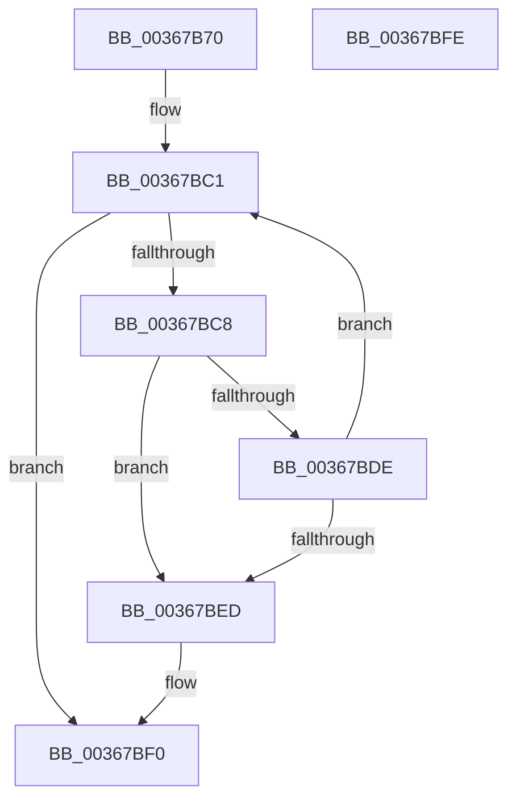

# MiSkipEntirePagefileRegions

- RVA: `0x00367B70`–`0x00367BFF` (길이 `143` bytes)
- VA: `0x0000000140367B70`
- 실행 섹션: `.text`
- PDB 이름 있음: `예`; PDB Function 태그: `아니요`
- unwind 정보 RVA: `0x00068D5C`
- 디코드: `43`개 명령, `143/143` bytes 표시
- 미해석 바이트: `0` (있으면 어셈블리에 `.byte`로 보존)

> 이 문서는 커널 이미지의 기계어와 PDB 기호를 분석해 생성했습니다. 4번과 5번은 함수 원형과 자료형을 바이너리 사용 방식에서 추정한 C 해석이며 원본 소스 복구 결과는 아닙니다.

## 1. Dependencies

- 직접 호출 지점: **1**; 고유 호출 대상: **1**
- 직접 호출자로 확인된 함수: **1**
- RIP 상대 이미지 참조: **0**

### Outgoing calls
- `0x00367BB2` → [MiLocatePagefileSubsection](MiLocatePagefileSubsection_function_00367AC0.md) (function, `0x00367AC0`)

### Direct callers
- [MiQueryAddressState](../32/MiQueryAddressState_function_0032C380.md) at `0x0032D345`

### Static image references
- 디코드된 RIP-relative 메모리 참조가 없습니다.

## 2. Other-region calls and transfers

- 다른 실행 섹션으로 향하는 call: **0**
- 별도 외부 분기/꼬리 이동을 확인하지 못했습니다.

## 3. Assembly (complete function range)

```asm
00367B70  48 89 5C 24 10                  mov qword ptr [rsp + 0x10], rbx
00367B75  57                              push rdi
00367B76  48 83 EC 20                     sub rsp, 0x20
00367B7A  4C 8B 59 48                     mov r11, qword ptr [rcx + 0x48]
00367B7E  49 8B D8                        mov rbx, r8
00367B81  44 0F B6 51 20                  movzx r10d, byte ptr [rcx + 0x20]
00367B86  49 8B F9                        mov rdi, r9
00367B89  4C 8B 41 50                     mov r8, qword ptr [rcx + 0x50]
00367B8D  8B 41 18                        mov eax, dword ptr [rcx + 0x18]
00367B90  49 8B CB                        mov rcx, r11
00367B93  4D 2B 43 08                     sub r8, qword ptr [r11 + 8]
00367B97  49 C1 F8 03                     sar r8, 3
00367B9B  49 C1 E2 20                     shl r10, 0x20
00367B9F  4C 0B D0                        or r10, rax
00367BA2  4D 2B C2                        sub r8, r10
00367BA5  4C 03 C2                        add r8, rdx
00367BA8  48 8D 54 24 30                  lea rdx, [rsp + 0x30]
00367BAD  4C 89 44 24 30                  mov qword ptr [rsp + 0x30], r8
00367BB2  E8 09 FF FF FF                  call 0x140367ac0
00367BB7  48 8B 4C 24 50                  mov rcx, qword ptr [rsp + 0x50]
00367BBC  48 8B 54 24 30                  mov rdx, qword ptr [rsp + 0x30]
00367BC1  48 83 79 08 00                  cmp qword ptr [rcx + 8], 0
00367BC6  75 28                           jne 0x140367bf0
00367BC8  8B 41 2C                        mov eax, dword ptr [rcx + 0x2c]
00367BCB  2B C2                           sub eax, edx
00367BCD  8B D0                           mov edx, eax
00367BCF  48 8B C7                        mov rax, rdi
00367BD2  48 2B C3                        sub rax, rbx
00367BD5  48 C1 F8 03                     sar rax, 3
00367BD9  48 3B D0                        cmp rdx, rax
00367BDC  73 0F                           jae 0x140367bed
00367BDE  48 8B 49 10                     mov rcx, qword ptr [rcx + 0x10]
00367BE2  48 8D 1C D3                     lea rbx, [rbx + rdx*8]
00367BE6  33 D2                           xor edx, edx
00367BE8  48 85 C9                        test rcx, rcx
00367BEB  75 D4                           jne 0x140367bc1
00367BED  48 8B DF                        mov rbx, rdi
00367BF0  48 8B C3                        mov rax, rbx
00367BF3  48 8B 5C 24 38                  mov rbx, qword ptr [rsp + 0x38]
00367BF8  48 83 C4 20                     add rsp, 0x20
00367BFC  5F                              pop rdi
00367BFD  C3                              ret
00367BFE  CC                              int3
```

## 4. C-style interpretation (structured pseudocode)

```c
__int64 __fastcall MiSkipEntirePagefileRegions(__int64 a1, __int64 a2, __int64 a3, __int64 a4, __int64 a5)
{
    __int64 result;
    __int64 v_r10;
    __int64 v_rsp;
    unsigned __int64 v_stack_p10;
    unsigned __int64 v_stack_p8;

    v_stack_p10 = v_rbx;
    v_rsp = (v_rsp) - (32);
    a3 = (*(unsigned __int64 *)(a1 + 80)) - (*(unsigned __int64 *)(*(unsigned __int64 *)(a1 + 72) + 8));
    a3 = (a3) >> (3);
    v_r10 = (*(unsigned __int8 *)(a1 + 32)) << (32);
    v_r10 = (v_r10) | ((unsigned int)(*(unsigned int *)(a1 + 24)));
    a3 = (a3) - (v_r10);
    a3 = (a3) + (a2);
    v_stack_p8 = a3;
    result = MiLocatePagefileSubsection(*(unsigned __int64 *)(a1 + 72), v_stack_p8, a3, a4);
loc_00367BC1:
    if ((*(unsigned __int64 *)(a5 + 8)) != 0) goto loc_00367BF0;
    result = (unsigned int)(((unsigned int)(*(unsigned int *)(a5 + 44))) - ((unsigned int)(v_stack_p8)));
    result = (a4) - (a3);
    result = (result) >> (3);
    if (((unsigned int)((unsigned int)(result))) >= result) goto loc_00367BED;
    a2 = 0;
    if (*(unsigned __int64 *)(a5 + 16) != 0) goto loc_00367BC1;
loc_00367BED:
loc_00367BF0:
    v_rsp = (v_rsp) + (32);
    return a4;
}
```

## 5. (Beta) C Style

```c
int64_t MiSkipEntirePagefileRegions(void *Arg1, int64_t Arg2, void *Arg3, int64_t Arg4, int64_t Arg5)
{
    uint8_t *arg1 = (uint8_t *)Arg1;
    uint8_t *arg3 = (uint8_t *)Arg3;

    int64_t result;
    int64_t local_r10;
    int64_t local_rsp;
    uint64_t v_stack_p10;
    uint64_t v_stack_p8;

    v_stack_p10 = local_rbx;
    local_rsp = (local_rsp) - (32);
    Arg3 = (*(uint64_t *)(arg1 + 0x50)) - (*(uint64_t *)(*(uint64_t *)(arg1 + 0x48) + 0x8));
    Arg3 = (Arg3) >> (3);
    local_r10 = (*(uint8_t *)(arg1 + 0x20)) << (32);
    local_r10 = (local_r10) | ((uint32_t)(*(uint32_t *)(arg1 + 0x18)));
    Arg3 = (Arg3) - (local_r10);
    Arg3 = (Arg3) + (Arg2);
    v_stack_p8 = Arg3;
    result = MiLocatePagefileSubsection(*(uint64_t *)(arg1 + 0x48), v_stack_p8, Arg3, Arg4);
loc_00367BC1:
    if ((*(uint64_t *)(Arg5 + 0x8)) != 0) goto loc_00367BF0;
    result = (uint32_t)(((uint32_t)(*(uint32_t *)(Arg5 + 0x2C))) - ((uint32_t)(v_stack_p8)));
    result = (Arg4) - (Arg3);
    result = (result) >> (3);
    if (((uint32_t)((uint32_t)(result))) >= result) goto loc_00367BED;
    Arg2 = 0;
    if (*(uint64_t *)(Arg5 + 0x10) != 0) goto loc_00367BC1;
loc_00367BED:
loc_00367BF0:
    local_rsp = (local_rsp) + (32);
    return Arg4;
}
```

### 관측된 메모리 오프셋

구조체 형식이 확인되지 않은 접근은 인자 기준의 오프셋으로만 기록했습니다.

| 기준 인자 | 오프셋 표현 | 폭 (bit) | 접근 |
|---|---:|---:|---|
| `Arg1` | `+ 0x18` | `32` | `R` |
| `Arg1` | `+ 0x20` | `8` | `R` |
| `Arg1` | `+ 0x48` | `64` | `R` |
| `Arg1` | `+ 0x50` | `64` | `R` |
| `Arg3` | `+ 0x0 + rdx*8` | `64` | `R` |

## 6. Execution-region graph

[열기: 2D/3D 그래프와 함수 탐색 컨트롤 패널](../../../control-panel.html?section=text&rva=0x00367B70&view=graph)

- 2D 그래프는 위에서 아래로 흐르고, 3D 그래프는 빈 공간을 드래그해 회전합니다. Shift+드래그는 이동, 휠은 확대·축소, 함수 노드 선택은 대상 보고서 이동입니다.

### Static fallback


