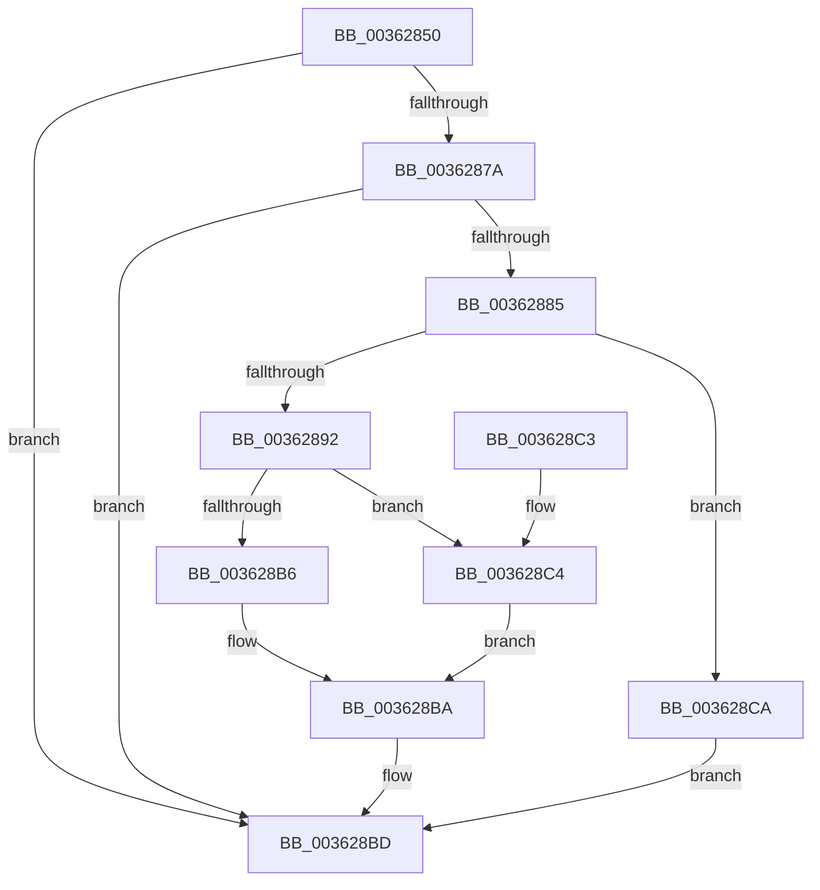

# MiStoreModifiedWriteCompletePfn

- RVA: `0x00362850`–`0x003628D4` (길이 `132` bytes)
- VA: `0x0000000140362850`
- 실행 섹션: `.text`
- PDB 이름 있음: `예`; PDB Function 태그: `아니요`
- unwind 정보 RVA: `0x00070B1C`
- 디코드: `40`개 명령, `132/132` bytes 표시
- 미해석 바이트: `0` (있으면 어셈블리에 `.byte`로 보존)

> 이 문서는 커널 이미지의 기계어와 PDB 기호를 분석해 생성했습니다. 4번과 5번은 함수 원형과 자료형을 바이너리 사용 방식에서 추정한 C 해석이며 원본 소스 복구 결과는 아닙니다.

## 1. Dependencies

- 직접 호출 지점: **1**; 고유 호출 대상: **1**
- 직접 호출자로 확인된 함수: **1**
- RIP 상대 이미지 참조: **1**

### Outgoing calls
- `0x003628CA` → [MiSetPfnModified](MiSetPfnModified_function_00362960.md) (function, `0x00362960`)

### Direct callers
- [MiWriteComplete](../40/MiWriteComplete_function_004069B0.md) at `0x00406B46`

### Static image references
- `0x0036285D` → RVA `0x00E30088` (`.data`; read)

## 2. Other-region calls and transfers

- 다른 실행 섹션으로 향하는 call: **0**
- 별도 외부 분기/꼬리 이동을 확인하지 못했습니다.

## 3. Assembly (complete function range)

```asm
00362850  40 53                           push rbx
00362852  48 83 EC 20                     sub rsp, 0x20
00362856  48 8B 41 28                     mov rax, qword ptr [rcx + 0x28]
0036285A  48 8B DA                        mov rbx, rdx
0036285D  4C 8B 05 24 D8 AC 00            mov r8, qword ptr [rip + 0xacd824]
00362864  48 C1 E8 2B                     shr rax, 0x2b
00362868  25 FF 03 00 00                  and eax, 0x3ff
0036286D  4D 8B 0C C0                     mov r9, qword ptr [r8 + rax*8]
00362871  44 8B 02                        mov r8d, dword ptr [rdx]
00362874  41 F6 C0 02                     test r8b, 2
00362878  75 43                           jne 0x1403628bd
0036287A  48 8B 41 18                     mov rax, qword ptr [rcx + 0x18]
0036287E  48 0F BA E0 3E                  bt rax, 0x3e
00362883  72 38                           jb 0x1403628bd
00362885  8B 41 20                        mov eax, dword ptr [rcx + 0x20]
00362888  BA 01 00 00 00                  mov edx, 1
0036288D  66 3B C2                        cmp ax, dx
00362890  77 38                           ja 0x1403628ca
00362892  8B 41 20                        mov eax, dword ptr [rcx + 0x20]
00362895  89 44 24 30                     mov dword ptr [rsp + 0x30], eax
00362899  C1 E8 10                        shr eax, 0x10
0036289C  24 FA                           and al, 0xfa
0036289E  0C 02                           or al, 2
003628A0  88 44 24 32                     mov byte ptr [rsp + 0x32], al
003628A4  8B 44 24 30                     mov eax, dword ptr [rsp + 0x30]
003628A8  89 41 20                        mov dword ptr [rcx + 0x20], eax
003628AB  41 8B 81 AC 06 00 00            mov eax, dword ptr [r9 + 0x6ac]
003628B2  84 C2                           test dl, al
003628B4  75 0E                           jne 0x1403628c4
003628B6  41 83 C8 08                     or r8d, 8
003628BA  44 89 03                        mov dword ptr [rbx], r8d
003628BD  48 83 C4 20                     add rsp, 0x20
003628C1  5B                              pop rbx
003628C2  C3                              ret
003628C3  CC                              int3
003628C4  41 83 C8 04                     or r8d, 4
003628C8  EB F0                           jmp 0x1403628ba
003628CA  E8 91 00 00 00                  call 0x140362960
003628CF  83 0B 02                        or dword ptr [rbx], 2
003628D2  EB E9                           jmp 0x1403628bd
```

## 4. C-style interpretation (structured pseudocode)

```c
__int64 __fastcall MiStoreModifiedWriteCompletePfn(__int64 a1, __int64 a2)
{
    __int64 result;
    __int64 v_rsp;
    unsigned int v_stack_p8;
    unsigned __int8 v_stack_pA;

    v_rsp = (v_rsp) - (32);
    result = (*(unsigned __int64 *)(a1 + 40)) >> (43);
    result = (unsigned int)((result) & (0x3FFULL));
    if ((((unsigned __int8)((unsigned int)(*(unsigned int *)(a2)))) & (2)) != 0) goto loc_003628BD;
    if (condition_is_below) goto loc_003628BD;
    if (((unsigned __int16)((unsigned int)(*(unsigned int *)(a1 + 32)))) > 1) goto loc_003628CA;
    v_stack_p8 = (unsigned int)((unsigned int)(*(unsigned int *)(a1 + 32)));
    result = (unsigned int)(((unsigned int)(*(unsigned int *)(a1 + 32))) >> (16));
    result = (unsigned __int8)((result) & (250));
    result = (unsigned __int8)((result) | (2));
    v_stack_pA = (unsigned __int8)(result);
    *(unsigned int *)(a1 + 32) = (unsigned int)((unsigned int)(v_stack_p8));
    if (((1) & ((unsigned __int8)((unsigned int)(*(unsigned int *)(*(unsigned __int64 *)(*(unsigned __int64 *)(v_rip + 11327524) + result * 8) + 1708))))) != 0) goto loc_003628C4;
    a3 = (unsigned int)(((unsigned int)(*(unsigned int *)(a2))) | (8));
loc_003628BA:
    *(unsigned int *)(a2) = (unsigned int)(a3);
loc_003628BD:
    v_rsp = (v_rsp) + (32);
    return (unsigned int)(*(unsigned int *)(*(unsigned __int64 *)(*(unsigned __int64 *)(v_rip + 11327524) + result * 8) + 1708));
loc_003628C4:
    a3 = (unsigned int)((a3) | (4));
    goto loc_003628BA;
loc_003628CA:
    result = MiSetPfnModified(a1, 1, a3, *(unsigned __int64 *)(*(unsigned __int64 *)(v_rip + 11327524) + result * 8));
    goto loc_003628BD;
}
```

## 5. (Beta) C Style

```c
int64_t MiStoreModifiedWriteCompletePfn(void *Arg1, void *Arg2)
{
    uint8_t *arg1 = (uint8_t *)Arg1;
    uint8_t *arg2 = (uint8_t *)Arg2;

    int64_t result;
    int64_t local_rsp;
    uint32_t v_stack_p8;
    uint8_t v_stack_pA;

    local_rsp = (local_rsp) - (32);
    result = (*(uint64_t *)(arg1 + 0x28)) >> (43);
    result = (uint32_t)((result) & (0x3FFULL));
    if ((((uint8_t)((uint32_t)(*(uint32_t *)(arg2)))) & (2)) != 0) goto loc_003628BD;
    if (condition_is_below) goto loc_003628BD;
    if (((uint16_t)((uint32_t)(*(uint32_t *)(arg1 + 0x20)))) > 1) goto loc_003628CA;
    v_stack_p8 = (uint32_t)((uint32_t)(*(uint32_t *)(arg1 + 0x20)));
    result = (uint32_t)(((uint32_t)(*(uint32_t *)(arg1 + 0x20))) >> (16));
    result = (uint8_t)((result) & (250));
    result = (uint8_t)((result) | (2));
    v_stack_pA = (uint8_t)(result);
    *(uint32_t *)(arg1 + 0x20) = (uint32_t)((uint32_t)(v_stack_p8));
    if (((1) & ((uint8_t)((uint32_t)(*(uint32_t *)(*(uint64_t *)(*(uint64_t *)(v_rip + 0xACD824) + result * 8) + 0x6AC))))) != 0) goto loc_003628C4;
    a3 = (uint32_t)(((uint32_t)(*(uint32_t *)(arg2))) | (8));
loc_003628BA:
    *(uint32_t *)(arg2) = (uint32_t)(a3);
loc_003628BD:
    local_rsp = (local_rsp) + (32);
    return (uint32_t)(*(uint32_t *)(*(uint64_t *)(*(uint64_t *)(v_rip + 0xACD824) + result * 8) + 0x6AC));
loc_003628C4:
    a3 = (uint32_t)((a3) | (4));
    goto loc_003628BA;
loc_003628CA:
    result = MiSetPfnModified(Arg1, 1, a3, *(uint64_t *)(*(uint64_t *)(v_rip + 0xACD824) + result * 8));
    goto loc_003628BD;
}
```

### 관측된 메모리 오프셋

구조체 형식이 확인되지 않은 접근은 인자 기준의 오프셋으로만 기록했습니다.

| 기준 인자 | 오프셋 표현 | 폭 (bit) | 접근 |
|---|---:|---:|---|
| `Arg1` | `+ 0x18` | `64` | `R` |
| `Arg1` | `+ 0x20` | `32` | `R` |
| `Arg1` | `+ 0x20` | `32` | `W` |
| `Arg1` | `+ 0x28` | `64` | `R` |
| `Arg2` | `+ 0x0` | `32` | `R` |
| `Arg2` | `+ 0x0` | `32` | `R/W` |
| `Arg2` | `+ 0x0` | `32` | `W` |

## 6. Execution-region graph

[열기: 2D/3D 그래프와 함수 탐색 컨트롤 패널](../../../control-panel.html?section=text&rva=0x00362850&view=graph)

- 2D 그래프는 위에서 아래로 흐르고, 3D 그래프는 빈 공간을 드래그해 회전합니다. Shift+드래그는 이동, 휠은 확대·축소, 함수 노드 선택은 대상 보고서 이동입니다.

### Static fallback


