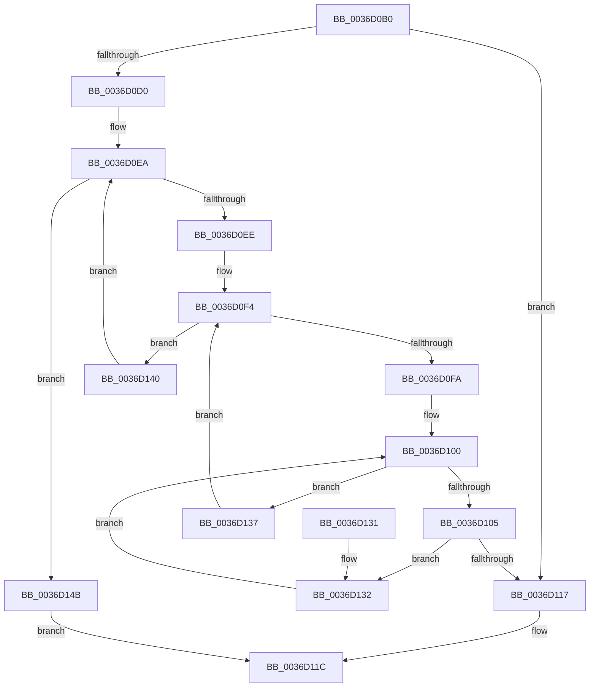

# MiSufficientAvailablePages

- RVA: `0x0036D0B0`–`0x0036D14F` (길이 `159` bytes)
- VA: `0x000000014036D0B0`
- 실행 섹션: `.text`
- PDB 이름 있음: `예`; PDB Function 태그: `아니요`
- unwind 정보 RVA: `0x0007A598`
- 디코드: `45`개 명령, `159/159` bytes 표시
- 미해석 바이트: `0` (있으면 어셈블리에 `.byte`로 보존)

> 이 문서는 커널 이미지의 기계어와 PDB 기호를 분석해 생성했습니다. 4번과 5번은 함수 원형과 자료형을 바이너리 사용 방식에서 추정한 C 해석이며 원본 소스 복구 결과는 아닙니다.

## 1. Dependencies

- 직접 호출 지점: **0**; 고유 호출 대상: **0**
- 직접 호출자로 확인된 함수: **17**
- RIP 상대 이미지 참조: **2**

### Outgoing calls
- 직접 디코드된 call 명령이 없습니다.

### Direct callers
- [sub_0027F251](../27/Unknown_function_0027F251.md) at `0x0027F28A`
- [MiFindContiguousPagesEx](../28/MiFindContiguousPagesEx_function_0028BDE0.md) at `0x0028C534`
- [MiWaitForFreePage](../2A/MiWaitForFreePage_function_002A3324.md) at `0x002A34CC`
- [sub_002BE65D](../2B/Unknown_function_002BE65D.md) at `0x002BE682`
- [MiScanPagefiles](../2D/MiScanPagefiles_function_002DBE60.md) at `0x002DBE9F`
- [MiGetPoolPages](../32/MiGetPoolPages_function_00327D3C.md) at `0x00327F05`
- [sub_0033EABD](../33/Unknown_function_0033EABD.md) at `0x0033EBF4`
- [MiAllocateAccessLog](MiAllocateAccessLog_function_0036B04C.md) at `0x0036B07C`
- [MiPickClusterForMappedFileFault](MiPickClusterForMappedFileFault_function_0036C0C0.md) at `0x0036C1D4`
- [sub_0036C6B5](Unknown_function_0036C6B5.md) at `0x0036C7A9`
- [MiResolvePageFileFault](MiResolvePageFileFault_function_0036D968.md) at `0x0036E198`
- [MiGetPageTablePages](../37/MiGetPageTablePages_function_00376C3C.md) at `0x00376E38`
- [MiFillNoReservationCluster](../40/MiFillNoReservationCluster_function_00405B40.md) at `0x00405CB7`
- [MiRetryNonPagedAllocation](../48/MiRetryNonPagedAllocation_function_0048C100.md) at `0x0048C160`
- [MiNoPagesLastChance](../68/MiNoPagesLastChance_function_0068B22C.md) at `0x0068B422`
- [sub_006F639E](../6F/Unknown_function_006F639E.md) at `0x006F63B9`
- [MiFindLargePageMemory](../../page/AA/MiFindLargePageMemory_function_00AA8334.md) at `0x00AA83B6`

### Static image references
- `0x0036D0D6` → RVA `0x00E2DCCC` (`.data`; read)
- `0x0036D0E3` → RVA `0x00FC5000` (`ALMOSTRO`; read)

## 2. Other-region calls and transfers

- 다른 실행 섹션으로 향하는 call: **0**
- 별도 외부 분기/꼬리 이동을 확인하지 못했습니다.

## 3. Assembly (complete function range)

```asm
0036D0B0  48 89 5C 24 08                  mov qword ptr [rsp + 8], rbx
0036D0B5  48 89 6C 24 10                  mov qword ptr [rsp + 0x10], rbp
0036D0BA  48 89 74 24 18                  mov qword ptr [rsp + 0x18], rsi
0036D0BF  48 89 7C 24 20                  mov qword ptr [rsp + 0x20], rdi
0036D0C4  4C 8B 89 00 49 00 00            mov r9, qword ptr [rcx + 0x4900]
0036D0CB  4C 3B CA                        cmp r9, rdx
0036D0CE  73 47                           jae 0x14036d117
0036D0D0  48 8B 71 10                     mov rsi, qword ptr [rcx + 0x10]
0036D0D4  33 C0                           xor eax, eax
0036D0D6  8B 2D F0 0B AC 00               mov ebp, dword ptr [rip + 0xac0bf0]
0036D0DC  48 81 C6 60 3A 00 00            add rsi, 0x3a60
0036D0E3  0F B7 3D 16 7F C5 00            movzx edi, word ptr [rip + 0xc57f16]
0036D0EA  3B C7                           cmp eax, edi
0036D0EC  73 5D                           jae 0x14036d14b
0036D0EE  45 33 D2                        xor r10d, r10d
0036D0F1  4C 8B DE                        mov r11, rsi
0036D0F4  49 83 FA 01                     cmp r10, 1
0036D0F8  7F 46                           jg 0x14036d140
0036D0FA  49 8B 1B                        mov rbx, qword ptr [r11]
0036D0FD  45 33 C0                        xor r8d, r8d
0036D100  44 3B C5                        cmp r8d, ebp
0036D103  73 32                           jae 0x14036d137
0036D105  41 8B C8                        mov ecx, r8d
0036D108  48 03 C9                        add rcx, rcx
0036D10B  0F B7 0C CB                     movzx ecx, word ptr [rbx + rcx*8]
0036D10F  4C 03 C9                        add r9, rcx
0036D112  4C 3B CA                        cmp r9, rdx
0036D115  72 1B                           jb 0x14036d132
0036D117  B8 01 00 00 00                  mov eax, 1
0036D11C  48 8B 5C 24 08                  mov rbx, qword ptr [rsp + 8]
0036D121  48 8B 6C 24 10                  mov rbp, qword ptr [rsp + 0x10]
0036D126  48 8B 74 24 18                  mov rsi, qword ptr [rsp + 0x18]
0036D12B  48 8B 7C 24 20                  mov rdi, qword ptr [rsp + 0x20]
0036D130  C3                              ret
0036D131  CC                              int3
0036D132  41 FF C0                        inc r8d
0036D135  EB C9                           jmp 0x14036d100
0036D137  49 FF C2                        inc r10
0036D13A  49 83 C3 08                     add r11, 8
0036D13E  EB B4                           jmp 0x14036d0f4
0036D140  48 81 C6 80 DF 00 00            add rsi, 0xdf80
0036D147  FF C0                           inc eax
0036D149  EB 9F                           jmp 0x14036d0ea
0036D14B  33 C0                           xor eax, eax
0036D14D  EB CD                           jmp 0x14036d11c
```

## 4. C-style interpretation (structured pseudocode)

```c
__int64 __fastcall MiSufficientAvailablePages(__int64 a1, __int64 a2, int a3)
{
    __int64 result;
    __int64 v_r10;
    __int64 v_r11;
    __int64 v_rsi;
    unsigned __int64 v_stack_p10;
    unsigned __int64 v_stack_p18;
    unsigned __int64 v_stack_p20;
    unsigned __int64 v_stack_p8;

    v_stack_p8 = v_rbx;
    v_stack_p10 = v_rbp;
    v_stack_p18 = v_rsi;
    v_stack_p20 = v_rdi;
    if ((*(unsigned __int64 *)(a1 + 18688)) >= a2) goto loc_0036D117;
    result = 0;
    v_rsi = (*(unsigned __int64 *)(a1 + 16)) + (0x3A60ULL);
loc_0036D0EA:
    if (0 >= ((unsigned int)(*(unsigned __int16 *)(v_rip + 12943126)))) goto loc_0036D14B;
    v_r10 = 0;
loc_0036D0F4:
    if (0 > 1) goto loc_0036D140;
    a3 = 0;
loc_0036D100:
    if (0 >= ((unsigned int)((unsigned int)(*(unsigned int *)(v_rip + 11275248))))) goto loc_0036D137;
    a1 = (0) + (0);
    a4 = (*(unsigned __int64 *)(a1 + 18688)) + (*(unsigned __int16 *)(*(unsigned __int64 *)(v_rsi) + a1 * 8));
    if (a4 < a2) goto loc_0036D132;
loc_0036D117:
loc_0036D11C:
    return 1;
loc_0036D132:
    a3 = (unsigned int)((a3) + 1);
    goto loc_0036D100;
loc_0036D137:
    v_r10 = (v_r10) + 1;
    v_r11 = (v_rsi) + (8);
    goto loc_0036D0F4;
loc_0036D140:
    v_rsi = (v_stack_p18) + (0xDF80ULL);
    result = (unsigned int)((1) + 1);
    goto loc_0036D0EA;
loc_0036D14B:
    result = 0;
    goto loc_0036D11C;
}
```

## 5. (Beta) C Style

```c
int64_t MiSufficientAvailablePages(void *Arg1, int64_t Arg2, int32_t Arg3)
{
    uint8_t *arg1 = (uint8_t *)Arg1;

    int64_t result;
    int64_t local_r10;
    int64_t local_r11;
    int64_t local_rsi;
    uint64_t v_stack_p10;
    uint64_t v_stack_p18;
    uint64_t v_stack_p20;
    uint64_t v_stack_p8;

    v_stack_p8 = local_rbx;
    v_stack_p10 = local_rbp;
    v_stack_p18 = local_rsi;
    v_stack_p20 = local_rdi;
    if ((*(uint64_t *)(arg1 + 0x4900)) >= Arg2) goto loc_0036D117;
    result = 0;
    local_rsi = (*(uint64_t *)(arg1 + 0x10)) + (0x3A60ULL);
loc_0036D0EA:
    if (0 >= ((uint32_t)(*(uint16_t *)(v_rip + 0xC57F16)))) goto loc_0036D14B;
    local_r10 = 0;
loc_0036D0F4:
    if (0 > 1) goto loc_0036D140;
    Arg3 = 0;
loc_0036D100:
    if (0 >= ((uint32_t)((uint32_t)(*(uint32_t *)(v_rip + 0xAC0BF0))))) goto loc_0036D137;
    Arg1 = (0) + (0);
    a4 = (*(uint64_t *)(arg1 + 0x4900)) + (*(uint16_t *)(*(uint64_t *)(local_rsi) + arg1 * 8));
    if (a4 < Arg2) goto loc_0036D132;
loc_0036D117:
loc_0036D11C:
    return 1;
loc_0036D132:
    Arg3 = (uint32_t)((Arg3) + 1);
    goto loc_0036D100;
loc_0036D137:
    local_r10 = (local_r10) + 1;
    local_r11 = (local_rsi) + (8);
    goto loc_0036D0F4;
loc_0036D140:
    local_rsi = (v_stack_p18) + (0xDF80ULL);
    result = (uint32_t)((1) + 1);
    goto loc_0036D0EA;
loc_0036D14B:
    result = 0;
    goto loc_0036D11C;
}
```

### 관측된 메모리 오프셋

구조체 형식이 확인되지 않은 접근은 인자 기준의 오프셋으로만 기록했습니다.

| 기준 인자 | 오프셋 표현 | 폭 (bit) | 접근 |
|---|---:|---:|---|
| `Arg1` | `+ 0x10` | `64` | `R` |
| `Arg1` | `+ 0x4900` | `64` | `R` |

## 6. Execution-region graph

[열기: 2D/3D 그래프와 함수 탐색 컨트롤 패널](../../../control-panel.html?section=text&rva=0x0036D0B0&view=graph)

- 2D 그래프는 위에서 아래로 흐르고, 3D 그래프는 빈 공간을 드래그해 회전합니다. Shift+드래그는 이동, 휠은 확대·축소, 함수 노드 선택은 대상 보고서 이동입니다.

### Static fallback


