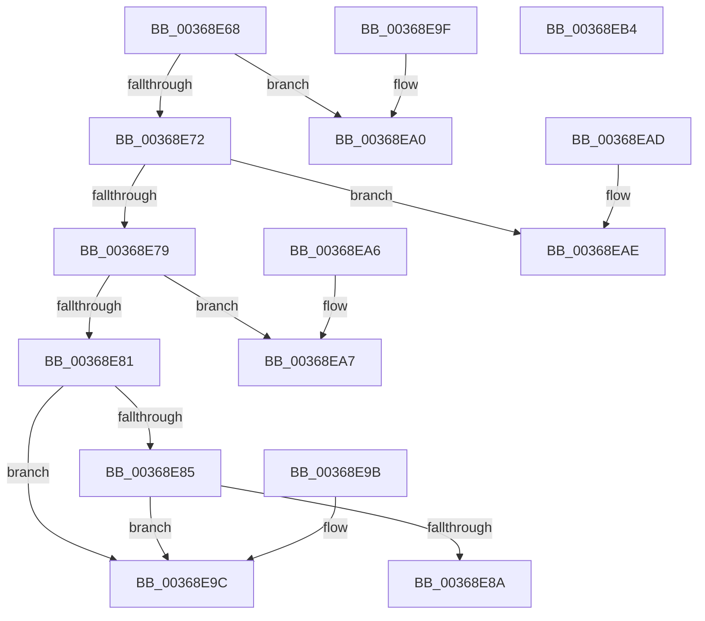

# MiTranslateSubsectionState

- RVA: `0x00368E68`–`0x00368EB5` (길이 `77` bytes)
- VA: `0x0000000140368E68`
- 실행 섹션: `.text`
- PDB 이름 있음: `예`; PDB Function 태그: `아니요`
- unwind 정보 RVA: `0x000DB714`
- 디코드: `32`개 명령, `77/77` bytes 표시
- 미해석 바이트: `0` (있으면 어셈블리에 `.byte`로 보존)

> 이 문서는 커널 이미지의 기계어와 PDB 기호를 분석해 생성했습니다. 4번과 5번은 함수 원형과 자료형을 바이너리 사용 방식에서 추정한 C 해석이며 원본 소스 복구 결과는 아닙니다.

## 1. Dependencies

- 직접 호출 지점: **0**; 고유 호출 대상: **0**
- 직접 호출자로 확인된 함수: **1**
- RIP 상대 이미지 참조: **0**

### Outgoing calls
- 직접 디코드된 call 명령이 없습니다.

### Direct callers
- [MiPrepareToFlushSubsection](MiPrepareToFlushSubsection_function_00369094.md) at `0x00369184`

### Static image references
- 디코드된 RIP-relative 메모리 참조가 없습니다.

## 2. Other-region calls and transfers

- 다른 실행 섹션으로 향하는 call: **0**
- 별도 외부 분기/꼬리 이동을 확인하지 못했습니다.

## 3. Assembly (complete function range)

```asm
00368E68  48 83 79 50 01                  cmp qword ptr [rcx + 0x50], 1
00368E6D  4C 8B 01                        mov r8, qword ptr [rcx]
00368E70  75 2E                           jne 0x140368ea0
00368E72  8B 41 20                        mov eax, dword ptr [rcx + 0x20]
00368E75  A8 01                           test al, 1
00368E77  75 35                           jne 0x140368eae
00368E79  41 8B 40 38                     mov eax, dword ptr [r8 + 0x38]
00368E7D  A8 01                           test al, 1
00368E7F  75 26                           jne 0x140368ea7
00368E81  85 D2                           test edx, edx
00368E83  75 17                           jne 0x140368e9c
00368E85  39 51 68                        cmp dword ptr [rcx + 0x68], edx
00368E88  74 12                           je 0x140368e9c
00368E8A  24 08                           and al, 8
00368E8C  F6 D8                           neg al
00368E8E  1B C0                           sbb eax, eax
00368E90  25 F3 FD FF FF                  and eax, 0xfffffdf3
00368E95  05 2D 02 00 C0                  add eax, 0xc000022d
00368E9A  C3                              ret
00368E9B  CC                              int3
00368E9C  33 C0                           xor eax, eax
00368E9E  C3                              ret
00368E9F  CC                              int3
00368EA0  B8 43 02 00 C0                  mov eax, 0xc0000243
00368EA5  C3                              ret
00368EA6  CC                              int3
00368EA7  B8 89 01 00 C0                  mov eax, 0xc0000189
00368EAC  C3                              ret
00368EAD  CC                              int3
00368EAE  B8 88 00 00 C0                  mov eax, 0xc0000088
00368EB3  C3                              ret
00368EB4  CC                              int3
```

## 4. C-style interpretation (structured pseudocode)

```c
__int64 __fastcall MiTranslateSubsectionState(__int64 a1, int a2)
{
    __int64 result;

    if ((*(unsigned __int64 *)(a1 + 80)) != 1) goto loc_00368EA0;
    if ((((unsigned __int8)((unsigned int)(*(unsigned int *)(a1 + 32)))) & (1)) != 0) goto loc_00368EAE;
    if ((((unsigned __int8)((unsigned int)(*(unsigned int *)(*(unsigned __int64 *)(a1) + 56)))) & (1)) != 0) goto loc_00368EA7;
    if (a2 != 0) goto loc_00368E9C;
    if ((*(unsigned int *)(a1 + 104)) == a2) goto loc_00368E9C;
    result = (unsigned __int8)(((unsigned int)(*(unsigned int *)(*(unsigned __int64 *)(a1) + 56))) & (8));
    result = (unsigned __int8)(-(result));
    result = (unsigned int)((result) & (0xFFFFFDF3ULL));
    result = (unsigned int)((result) + (0xC000022DULL));
    return result;
loc_00368E9C:
    result = 0;
    return result;
loc_00368EA0:
    return (unsigned int)(0xC0000243ULL);
loc_00368EA7:
    return (unsigned int)(0xC0000189ULL);
loc_00368EAE:
    return (unsigned int)(0xC0000088ULL);
}
```

## 5. (Beta) C Style

```c
int64_t MiTranslateSubsectionState(void *Arg1, int32_t Arg2)
{
    uint8_t *arg1 = (uint8_t *)Arg1;

    int64_t result;

    if ((*(uint64_t *)(arg1 + 0x50)) != 1) goto loc_00368EA0;
    if ((((uint8_t)((uint32_t)(*(uint32_t *)(arg1 + 0x20)))) & (1)) != 0) goto loc_00368EAE;
    if ((((uint8_t)((uint32_t)(*(uint32_t *)(*(uint64_t *)(arg1) + 0x38)))) & (1)) != 0) goto loc_00368EA7;
    if (Arg2 != 0) goto loc_00368E9C;
    if ((*(uint32_t *)(arg1 + 0x68)) == Arg2) goto loc_00368E9C;
    result = (uint8_t)(((uint32_t)(*(uint32_t *)(*(uint64_t *)(arg1) + 0x38))) & (8));
    result = (uint8_t)(-(result));
    result = (uint32_t)((result) & (0xFFFFFDF3ULL));
    result = (uint32_t)((result) + (0xC000022DULL));
    return result;
loc_00368E9C:
    result = 0;
    return result;
loc_00368EA0:
    return (uint32_t)(0xC0000243ULL);
loc_00368EA7:
    return (uint32_t)(0xC0000189ULL);
loc_00368EAE:
    return (uint32_t)(0xC0000088ULL);
}
```

### 관측된 메모리 오프셋

구조체 형식이 확인되지 않은 접근은 인자 기준의 오프셋으로만 기록했습니다.

| 기준 인자 | 오프셋 표현 | 폭 (bit) | 접근 |
|---|---:|---:|---|
| `Arg1` | `+ 0x0` | `64` | `R` |
| `Arg1` | `+ 0x20` | `32` | `R` |
| `Arg1` | `+ 0x50` | `64` | `R` |
| `Arg1` | `+ 0x68` | `32` | `R` |

## 6. Execution-region graph

[열기: 2D/3D 그래프와 함수 탐색 컨트롤 패널](../../../control-panel.html?section=text&rva=0x00368E68&view=graph)

- 2D 그래프는 위에서 아래로 흐르고, 3D 그래프는 빈 공간을 드래그해 회전합니다. Shift+드래그는 이동, 휠은 확대·축소, 함수 노드 선택은 대상 보고서 이동입니다.

### Static fallback


