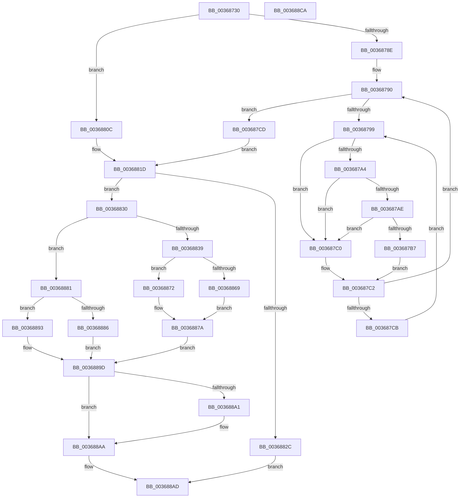

# MiUpdateAwePageTable

- RVA: `0x00368730`–`0x003688CB` (길이 `411` bytes)
- VA: `0x0000000140368730`
- 실행 섹션: `.text`
- PDB 이름 있음: `예`; PDB Function 태그: `아니요`
- unwind 정보 RVA: `0x00075C18`
- 디코드: `114`개 명령, `411/411` bytes 표시
- 미해석 바이트: `0` (있으면 어셈블리에 `.byte`로 보존)

> 이 문서는 커널 이미지의 기계어와 PDB 기호를 분석해 생성했습니다. 4번과 5번은 함수 원형과 자료형을 바이너리 사용 방식에서 추정한 C 해석이며 원본 소스 복구 결과는 아닙니다.

## 1. Dependencies

- 직접 호출 지점: **6**; 고유 호출 대상: **5**
- 직접 호출자로 확인된 함수: **4**
- RIP 상대 이미지 참조: **2**

### Outgoing calls
- `0x00368755` → [MI_READ_PTE_LOCK_FREE](../28/MI_READ_PTE_LOCK_FREE_function_002828A0.md) (function, `0x002828A0`)
- `0x003687AE` → [KiCheckVpBackingLongSpinWaitHypercall](../30/KiCheckVpBackingLongSpinWaitHypercall_function_0030F490.md) (function, `0x0030F490`)
- `0x003687B9` → [HvlNotifyLongSpinWait](../30/HvlNotifyLongSpinWait_function_0030F460.md) (function, `0x0030F460`)
- `0x0036883C` → [MI_READ_PTE_LOCK_FREE](../28/MI_READ_PTE_LOCK_FREE_function_002828A0.md) (function, `0x002828A0`)
- `0x0036888C` → [MiIncreaseUsedPtes](../24/MiIncreaseUsedPtes_function_00243630.md) (function, `0x00243630`)
- `0x00368898` → [MiDecreaseUsedPtes](../37/MiDecreaseUsedPtes_function_00378080.md) (function, `0x00378080`)

### Direct callers
- [MiWriteEnclavePte](MiWriteEnclavePte_function_00368570.md) at `0x0036865F`
- [MiDeleteEnclavePage](MiDeleteEnclavePage_function_00368CCC.md) at `0x00368D29`
- [MiFinishPteChangesInPageTable](../4E/MiFinishPteChangesInPageTable_function_004EE660.md) at `0x004EE6D3`
- [MiUnmapLegacyAwePage](../68/MiUnmapLegacyAwePage_function_0068993C.md) at `0x006899F1`

### Static image references
- `0x0036879C` → RVA `0x00FC52AC` (`ALMOSTRO`; reference)
- `0x003687A4` → RVA `0x00FC6AB8` (`ALMOSTRO`; read)

## 2. Other-region calls and transfers

- 다른 실행 섹션으로 향하는 call: **0**
- 별도 외부 분기/꼬리 이동을 확인하지 못했습니다.

## 3. Assembly (complete function range)

```asm
00368730  48 89 5C 24 08                  mov qword ptr [rsp + 8], rbx
00368735  48 89 6C 24 10                  mov qword ptr [rsp + 0x10], rbp
0036873A  48 89 74 24 18                  mov qword ptr [rsp + 0x18], rsi
0036873F  57                              push rdi
00368740  41 54                           push r12
00368742  41 55                           push r13
00368744  41 56                           push r14
00368746  41 57                           push r15
00368748  48 83 EC 20                     sub rsp, 0x20
0036874C  41 8B F8                        mov edi, r8d
0036874F  4C 8B E2                        mov r12, rdx
00368752  4C 8B F9                        mov r15, rcx
00368755  E8 46 A1 F1 FF                  call 0x1402828a0
0036875A  48 C1 E8 0C                     shr rax, 0xc
0036875E  48 B9 FF FF FF FF FF 00 00 00   movabs rcx, 0xffffffffff
00368768  48 23 C1                        and rax, rcx
0036876B  49 BD 00 00 00 00 00 DE FF FF   movabs r13, 0xffffde0000000000
00368775  48 8D 34 40                     lea rsi, [rax + rax*2]
00368779  48 C1 E6 04                     shl rsi, 4
0036877D  49 8B C5                        mov rax, r13
00368780  33 DB                           xor ebx, ebx
00368782  48 03 F0                        add rsi, rax
00368785  44 8D 73 01                     lea r14d, [rbx + 1]
00368789  4D 85 E4                        test r12, r12
0036878C  74 7E                           je 0x14036880c
0036878E  8B EB                           mov ebp, ebx
00368790  F0 48 0F BA 6E 18 3F            lock bts qword ptr [rsi + 0x18], 0x3f
00368797  73 34                           jae 0x1403687cd
00368799  41 03 EE                        add ebp, r14d
0036879C  85 2D 0A CB C5 00               test dword ptr [rip + 0xc5cb0a], ebp
003687A2  75 1C                           jne 0x1403687c0
003687A4  8B 05 0E E3 C5 00               mov eax, dword ptr [rip + 0xc5e30e]
003687AA  A8 40                           test al, 0x40
003687AC  74 12                           je 0x1403687c0
003687AE  E8 DD 6C FA FF                  call 0x14030f490
003687B3  84 C0                           test al, al
003687B5  74 09                           je 0x1403687c0
003687B7  8B CD                           mov ecx, ebp
003687B9  E8 A2 6C FA FF                  call 0x14030f460
003687BE  EB 02                           jmp 0x1403687c2
003687C0  F3 90                           pause
003687C2  48 8B 46 18                     mov rax, qword ptr [rsi + 0x18]
003687C6  48 85 C0                        test rax, rax
003687C9  79 C5                           jns 0x140368790
003687CB  EB CC                           jmp 0x140368799
003687CD  48 8B 46 18                     mov rax, qword ptr [rsi + 0x18]
003687D1  48 B9 FF FF FF FF FF FF FF 3F   movabs rcx, 0x3fffffffffffffff
003687DB  48 8B E8                        mov rbp, rax
003687DE  48 23 E9                        and rbp, rcx
003687E1  48 B9 00 00 00 00 00 00 00 C0   movabs rcx, 0xc000000000000000
003687EB  49 03 EC                        add rbp, r12
003687EE  48 33 C5                        xor rax, rbp
003687F1  48 23 C1                        and rax, rcx
003687F4  48 33 C5                        xor rax, rbp
003687F7  48 89 46 18                     mov qword ptr [rsi + 0x18], rax
003687FB  48 B8 FF FF FF FF FF FF FF 7F   movabs rax, 0x7fffffffffffffff
00368805  F0 48 21 46 18                  lock and qword ptr [rsi + 0x18], rax
0036880A  EB 11                           jmp 0x14036881d
0036880C  48 8B 6E 18                     mov rbp, qword ptr [rsi + 0x18]
00368810  48 B9 FF FF FF FF FF FF FF 3F   movabs rcx, 0x3fffffffffffffff
0036881A  48 23 E9                        and rbp, rcx
0036881D  48 B8 68 DF BE 7D FB F6 FF FF   movabs rax, 0xfffff6fb7dbedf68
00368827  4C 3B F8                        cmp r15, rax
0036882A  75 04                           jne 0x140368830
0036882C  33 C0                           xor eax, eax
0036882E  EB 7D                           jmp 0x1403688ad
00368830  BE 02 00 00 00                  mov esi, 2
00368835  85 FF                           test edi, edi
00368837  75 48                           jne 0x140368881
00368839  49 8B CF                        mov rcx, r15
0036883C  E8 5F A0 F1 FF                  call 0x1402828a0
00368841  48 B9 FF FF FF FF FF 00 00 00   movabs rcx, 0xffffffffff
0036884B  48 C1 E8 0C                     shr rax, 0xc
0036884F  48 23 C1                        and rax, rcx
00368852  48 8D 0C 40                     lea rcx, [rax + rax*2]
00368856  48 C1 E1 04                     shl rcx, 4
0036885A  49 8B C5                        mov rax, r13
0036885D  48 03 C8                        add rcx, rax
00368860  8B 41 24                        mov eax, dword ptr [rcx + 0x24]
00368863  0F BA E0 1A                     bt eax, 0x1a
00368867  73 09                           jae 0x140368872
00368869  48 8B 01                        mov rax, qword ptr [rcx]
0036886C  48 C1 E8 20                     shr rax, 0x20
00368870  EB 08                           jmp 0x14036887a
00368872  48 8B 41 10                     mov rax, qword ptr [rcx + 0x10]
00368876  48 C1 E8 10                     shr rax, 0x10
0036887A  25 FF 03 00 00                  and eax, 0x3ff
0036887F  EB 1C                           jmp 0x14036889d
00368881  49 8B D7                        mov rdx, r15
00368884  7E 0D                           jle 0x140368893
00368886  44 8B CE                        mov r9d, esi
00368889  44 8B C7                        mov r8d, edi
0036888C  E8 9F AD ED FF                  call 0x140243630
00368891  EB 0A                           jmp 0x14036889d
00368893  F7 DF                           neg edi
00368895  44 8B C7                        mov r8d, edi
00368898  E8 E3 F7 00 00                  call 0x140378080
0036889D  85 C0                           test eax, eax
0036889F  74 09                           je 0x1403688aa
003688A1  49 3B EE                        cmp rbp, r14
003688A4  0F 44 DE                        cmove ebx, esi
003688A7  44 8B F3                        mov r14d, ebx
003688AA  41 8B C6                        mov eax, r14d
003688AD  48 8B 5C 24 50                  mov rbx, qword ptr [rsp + 0x50]
003688B2  48 8B 6C 24 58                  mov rbp, qword ptr [rsp + 0x58]
003688B7  48 8B 74 24 60                  mov rsi, qword ptr [rsp + 0x60]
003688BC  48 83 C4 20                     add rsp, 0x20
003688C0  41 5F                           pop r15
003688C2  41 5E                           pop r14
003688C4  41 5D                           pop r13
003688C6  41 5C                           pop r12
003688C8  5F                              pop rdi
003688C9  C3                              ret
003688CA  CC                              int3
```

## 4. C-style interpretation (structured pseudocode)

```c
__int64 __fastcall MiUpdateAwePageTable(__int64 a1, __int64 a2, int a3)
{
    __int64 result;
    __int64 v_r14;
    __int64 v_rbp;
    __int64 v_rbx;
    __int64 v_rdi;
    __int64 v_rsi;
    __int64 v_rsp;
    unsigned __int64 v_stack_p10;
    unsigned __int64 v_stack_p18;
    unsigned __int64 v_stack_p8;

    v_stack_p8 = v_rbx;
    v_stack_p10 = v_rbp;
    v_stack_p18 = v_rsi;
    v_rsp = (v_rsp) - (32);
    result = MI_READ_PTE_LOCK_FREE(a1, a2, a3, a4);
    result = (result) >> (12);
    result = (result) & (a1);
    v_rsi = (result + result * 2) << (4);
    v_rbx = 0;
    v_rsi = (v_rsi) + (v_r13);
    if (a2 == 0) goto loc_0036880C;
loc_00368790:
    if (condition_is_above_or_equal) goto loc_003687CD;
loc_00368799:
    v_rbp = (unsigned int)((0) + ((unsigned int)(v_rbx + 1)));
    if (((*(unsigned int *)(v_rip + 12962570)) & ((unsigned int)(v_rbp))) != 0) goto loc_003687C0;
    if ((((unsigned __int8)((unsigned int)(*(unsigned int *)(v_rip + 12968718)))) & (64)) == 0) goto loc_003687C0;
    result = KiCheckVpBackingLongSpinWaitHypercall(a1, a2, a3, a4);
    if ((unsigned __int8)(result) == 0) goto loc_003687C0;
    result = HvlNotifyLongSpinWait((unsigned int)((unsigned int)(v_rbp)), a2, a3, a4);
    goto loc_003687C2;
loc_003687C0:
loc_003687C2:
    if (!sign_flag) goto loc_00368790;
    goto loc_00368799;
loc_003687CD:
    v_rbp = (*(unsigned __int64 *)(v_rsi + 24)) & ((unsigned int)((unsigned int)(v_rbp)));
    v_rbp = (v_rbp) + (a2);
    result = (*(unsigned __int64 *)(v_rsi + 24)) ^ (v_rbp);
    result = (result) & ((unsigned int)((unsigned int)(v_rbp)));
    result = (result) ^ (v_rbp);
    *(unsigned __int64 *)(v_rsi + 24) = result;
    goto loc_0036881D;
loc_0036880C:
    v_rbp = (*(unsigned __int64 *)(v_rsi + 24)) & ((unsigned int)((unsigned int)(v_rbp)));
loc_0036881D:
    if (a1 != result) goto loc_00368830;
    result = 0;
    goto loc_003688AD;
loc_00368830:
    if ((unsigned int)((unsigned int)(a3)) != 0) goto loc_00368881;
    result = MI_READ_PTE_LOCK_FREE(a1, a2, a3, a4);
    result = (result) >> (12);
    result = (result) & (a1);
    a1 = (result + result * 2) << (4);
    a1 = (a1) + (v_r13);
    if (condition_is_above_or_equal) goto loc_00368872;
    result = (*(unsigned __int64 *)(a1)) >> (32);
    goto loc_0036887A;
loc_00368872:
    result = (*(unsigned __int64 *)(a1 + 16)) >> (16);
loc_0036887A:
    result = (unsigned int)((result) & (0x3FFULL));
    goto loc_0036889D;
loc_00368881:
    if (condition_is_less_or_equal) goto loc_00368893;
    result = MiIncreaseUsedPtes(a1, a1, (unsigned int)((unsigned int)((unsigned int)(a3))), 2);
    goto loc_0036889D;
loc_00368893:
    v_rdi = (unsigned int)(-((unsigned int)(a3)));
    result = MiDecreaseUsedPtes(a1, a1, (unsigned int)((unsigned int)(v_rdi)), 2);
loc_0036889D:
    v_r14 = v_rbx + 1;
    if ((unsigned int)(result) != 0) {
        if (v_rbp == (v_rbx + 1)) { v_rbx = 2; }
        v_r14 = (unsigned int)(v_rbx);
    }
loc_003688AD:
    v_rsp = (v_rsp) + (32);
    return (unsigned int)((unsigned int)(v_r14));
}
```

## 5. (Beta) C Style

```c
int64_t MiUpdateAwePageTable(int64_t Arg1, int64_t Arg2, int32_t Arg3)
{
    int64_t result;
    int64_t local_r14;
    int64_t local_rbp;
    int64_t local_rbx;
    int64_t local_rdi;
    int64_t local_rsi;
    int64_t local_rsp;
    uint64_t v_stack_p10;
    uint64_t v_stack_p18;
    uint64_t v_stack_p8;

    v_stack_p8 = local_rbx;
    v_stack_p10 = local_rbp;
    v_stack_p18 = local_rsi;
    local_rsp = (local_rsp) - (32);
    result = MI_READ_PTE_LOCK_FREE(Arg1, Arg2, Arg3, a4);
    result = (result) >> (12);
    result = (result) & (Arg1);
    local_rsi = (result + result * 2) << (4);
    local_rbx = 0;
    local_rsi = (local_rsi) + (local_r13);
    if (Arg2 == 0) goto loc_0036880C;
loc_00368790:
    if (condition_is_above_or_equal) goto loc_003687CD;
loc_00368799:
    local_rbp = (uint32_t)((0) + ((uint32_t)(local_rbx + 1)));
    if (((*(uint32_t *)(v_rip + 0xC5CB0A)) & ((uint32_t)(local_rbp))) != 0) goto loc_003687C0;
    if ((((uint8_t)((uint32_t)(*(uint32_t *)(v_rip + 0xC5E30E)))) & (64)) == 0) goto loc_003687C0;
    result = KiCheckVpBackingLongSpinWaitHypercall(Arg1, Arg2, Arg3, a4);
    if ((uint8_t)(result) == 0) goto loc_003687C0;
    result = HvlNotifyLongSpinWait((uint32_t)((uint32_t)(local_rbp)), Arg2, Arg3, a4);
    goto loc_003687C2;
loc_003687C0:
loc_003687C2:
    if (!sign_flag) goto loc_00368790;
    goto loc_00368799;
loc_003687CD:
    local_rbp = (*(uint64_t *)(local_rsi + 0x18)) & ((uint32_t)((uint32_t)(local_rbp)));
    local_rbp = (local_rbp) + (Arg2);
    result = (*(uint64_t *)(local_rsi + 0x18)) ^ (local_rbp);
    result = (result) & ((uint32_t)((uint32_t)(local_rbp)));
    result = (result) ^ (local_rbp);
    *(uint64_t *)(local_rsi + 0x18) = result;
    goto loc_0036881D;
loc_0036880C:
    local_rbp = (*(uint64_t *)(local_rsi + 0x18)) & ((uint32_t)((uint32_t)(local_rbp)));
loc_0036881D:
    if (Arg1 != result) goto loc_00368830;
    result = 0;
    goto loc_003688AD;
loc_00368830:
    if ((uint32_t)((uint32_t)(Arg3)) != 0) goto loc_00368881;
    result = MI_READ_PTE_LOCK_FREE(Arg1, Arg2, Arg3, a4);
    result = (result) >> (12);
    result = (result) & (Arg1);
    Arg1 = (result + result * 2) << (4);
    Arg1 = (Arg1) + (local_r13);
    if (condition_is_above_or_equal) goto loc_00368872;
    result = (*(uint64_t *)(Arg1)) >> (32);
    goto loc_0036887A;
loc_00368872:
    result = (*(uint64_t *)(Arg1 + 0x10)) >> (16);
loc_0036887A:
    result = (uint32_t)((result) & (0x3FFULL));
    goto loc_0036889D;
loc_00368881:
    if (condition_is_less_or_equal) goto loc_00368893;
    result = MiIncreaseUsedPtes(Arg1, Arg1, (uint32_t)((uint32_t)((uint32_t)(Arg3))), 2);
    goto loc_0036889D;
loc_00368893:
    local_rdi = (uint32_t)(-((uint32_t)(Arg3)));
    result = MiDecreaseUsedPtes(Arg1, Arg1, (uint32_t)((uint32_t)(local_rdi)), 2);
loc_0036889D:
    local_r14 = local_rbx + 1;
    if ((uint32_t)(result) != 0) {
        if (local_rbp == (local_rbx + 1)) { local_rbx = 2; }
        local_r14 = (uint32_t)(local_rbx);
    }
loc_003688AD:
    local_rsp = (local_rsp) + (32);
    return (uint32_t)((uint32_t)(local_r14));
}
```

## 6. Execution-region graph

[열기: 2D/3D 그래프와 함수 탐색 컨트롤 패널](../../../control-panel.html?section=text&rva=0x00368730&view=graph)

- 2D 그래프는 위에서 아래로 흐르고, 3D 그래프는 빈 공간을 드래그해 회전합니다. Shift+드래그는 이동, 휠은 확대·축소, 함수 노드 선택은 대상 보고서 이동입니다.

### Static fallback


