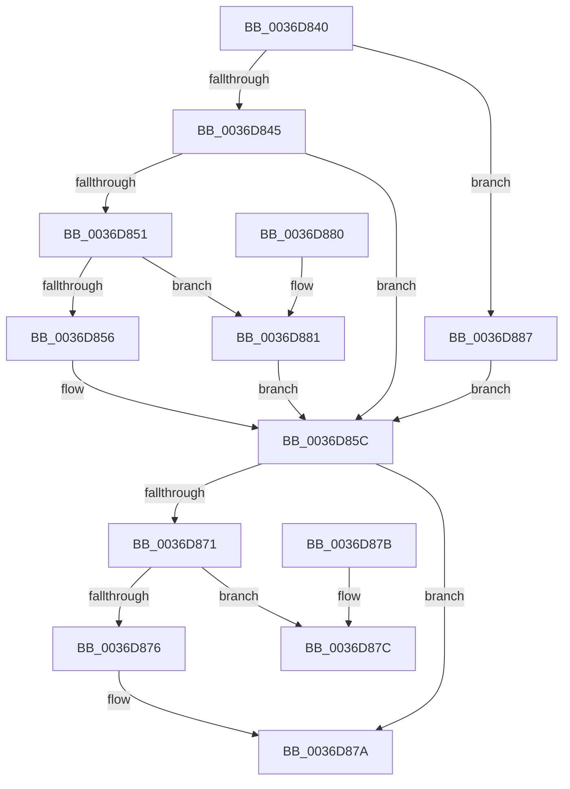

# MiUpdatePageFileHighInPte

- RVA: `0x0036D840`–`0x0036D889` (길이 `73` bytes)
- VA: `0x000000014036D840`
- 실행 섹션: `.text`
- PDB 이름 있음: `예`; PDB Function 태그: `아니요`
- unwind 정보 RVA: `0x000DB714`
- 디코드: `26`개 명령, `73/73` bytes 표시
- 미해석 바이트: `0` (있으면 어셈블리에 `.byte`로 보존)

> 이 문서는 커널 이미지의 기계어와 PDB 기호를 분석해 생성했습니다. 4번과 5번은 함수 원형과 자료형을 바이너리 사용 방식에서 추정한 C 해석이며 원본 소스 복구 결과는 아닙니다.

## 1. Dependencies

- 직접 호출 지점: **0**; 고유 호출 대상: **0**
- 직접 호출자로 확인된 함수: **19**
- RIP 상대 이미지 참조: **1**

### Outgoing calls
- 직접 디코드된 call 명령이 없습니다.

### Direct callers
- [MiBuildForkPte](../22/MiBuildForkPte_function_0022E32C.md) at `0x0022E81F`
- [MiActOnPte](../24/MiActOnPte_function_00244C90.md) at `0x00244E08`
- [MiActOnPte](../24/MiActOnPte_function_00244C90.md) at `0x002456EB`
- [MiActOnPte](../24/MiActOnPte_function_00244C90.md) at `0x002457DA`
- [MiStoreWriteModifiedPages](../2B/MiStoreWriteModifiedPages_function_002B46C4.md) at `0x002B5266`
- [MmAllocateNonChargedSecurePages](../2C/MmAllocateNonChargedSecurePages_function_002C886C.md) at `0x002C8A91`
- [MiInitializeMdlPfn](../2C/MiInitializeMdlPfn_function_002C9670.md) at `0x002C976D`
- [MiResolvePageFileFault](MiResolvePageFileFault_function_0036D968.md) at `0x0036E26C`
- [MiResolvePageFileFault](MiResolvePageFileFault_function_0036D968.md) at `0x0036E337`
- [MiOutSwapWorkingSetPte](../37/MiOutSwapWorkingSetPte_function_00372190.md) at `0x0037270D`
- [MiReservePageFileSpace](../38/MiReservePageFileSpace_function_00383ED8.md) at `0x00384193`
- [MiReservePageFileSpace](../38/MiReservePageFileSpace_function_00383ED8.md) at `0x00384243`
- [MiBuildReservationCluster](../40/MiBuildReservationCluster_function_004071A0.md) at `0x00407476`
- [MiBuildReservationCluster](../40/MiBuildReservationCluster_function_004071A0.md) at `0x0040757C`
- [MiMapPageFileHash](../49/MiMapPageFileHash_function_004921E0.md) at `0x00492341`
- [MiMapPageFileHash](../49/MiMapPageFileHash_function_004921E0.md) at `0x00492487`
- [MiMapPageFileHash](../49/MiMapPageFileHash_function_004921E0.md) at `0x0049261E`
- [MiCreatePfnTemplate](../67/MiCreatePfnTemplate_function_00671824.md) at `0x0067198A`
- [MiClearDriverTablePtes](../68/MiClearDriverTablePtes_function_00683024.md) at `0x0068336B`
- [MmMapDriverTablePage](../68/MmMapDriverTablePage_function_00683EAC.md) at `0x0068406A`
- [MmAllocateSecureKernelPages](../68/MmAllocateSecureKernelPages_function_0068F394.md) at `0x0068F5EB`
- [sub_006DB710](../6D/Unknown_function_006DB710.md) at `0x006DB767`
- [sub_006E3BD0](../6E/Unknown_function_006E3BD0.md) at `0x006E3C44`
- [sub_006E3BD0](../6E/Unknown_function_006E3BD0.md) at `0x006E3CAC`
- [MiFreeReservationRun](../../page/A4/MiFreeReservationRun_function_00A4AB74.md) at `0x00A4ABC2`
- [MiUpdateBootHpatPagesInUse](../../init/C6/MiUpdateBootHpatPagesInUse_function_00C67548.md) at `0x00C676A9`
- [MiCreateBootSlabEntries](../../init/C6/MiCreateBootSlabEntries_function_00C69A50.md) at `0x00C69B54`

### Static image references
- `0x0036D845` → RVA `0x00E2DC80` (`.data`; read)

## 2. Other-region calls and transfers

- 다른 실행 섹션으로 향하는 call: **0**
- 별도 외부 분기/꼬리 이동을 확인하지 못했습니다.

## 3. Assembly (complete function range)

```asm
0036D840  48 85 C9                        test rcx, rcx
0036D843  74 42                           je 0x14036d887
0036D845  48 8B 05 34 04 AC 00            mov rax, qword ptr [rip + 0xac0434]
0036D84C  48 85 C0                        test rax, rax
0036D84F  74 0B                           je 0x14036d85c
0036D851  F6 C1 10                        test cl, 0x10
0036D854  75 2B                           jne 0x14036d881
0036D856  48 F7 D0                        not rax
0036D859  48 23 C8                        and rcx, rax
0036D85C  8B C1                           mov eax, ecx
0036D85E  48 8B 0D 1B 04 AC 00            mov rcx, qword ptr [rip + 0xac041b]
0036D865  48 C1 E2 20                     shl rdx, 0x20
0036D869  48 0B C2                        or rax, rdx
0036D86C  48 85 C9                        test rcx, rcx
0036D86F  74 09                           je 0x14036d87a
0036D871  48 85 C8                        test rax, rcx
0036D874  74 06                           je 0x14036d87c
0036D876  48 83 C8 10                     or rax, 0x10
0036D87A  C3                              ret
0036D87B  CC                              int3
0036D87C  48 0B C1                        or rax, rcx
0036D87F  C3                              ret
0036D880  CC                              int3
0036D881  48 83 E1 EF                     and rcx, 0xffffffffffffffef
0036D885  EB D5                           jmp 0x14036d85c
0036D887  EB D3                           jmp 0x14036d85c
```

## 4. C-style interpretation (structured pseudocode)

```c
__int64 __fastcall MiUpdatePageFileHighInPte(__int64 a1, __int64 a2)
{
    __int64 result;

    if (a1 == 0) goto loc_0036D887;
    if (*(unsigned __int64 *)(v_rip + 11273268) == 0) goto loc_0036D85C;
    if ((((unsigned __int8)(a1)) & (16)) != 0) goto loc_0036D881;
    result = ~(*(unsigned __int64 *)(v_rip + 11273268));
    a1 = (a1) & (result);
loc_0036D85C:
    a2 = (a2) << (32);
    result = ((unsigned int)((unsigned int)(a1))) | (a2);
    if (*(unsigned __int64 *)(v_rip + 11273243) == 0) goto loc_0036D87A;
    if (((result) & (*(unsigned __int64 *)(v_rip + 11273243))) == 0) goto loc_0036D87C;
    result = (result) | (16);
loc_0036D87A:
    return result;
loc_0036D87C:
    result = (result) | (*(unsigned __int64 *)(v_rip + 11273243));
    return result;
loc_0036D881:
    a1 = (*(unsigned __int64 *)(v_rip + 11273243)) & (-17);
    goto loc_0036D85C;
loc_0036D887:
    goto loc_0036D85C;
}
```

## 5. (Beta) C Style

```c
int64_t MiUpdatePageFileHighInPte(int64_t Arg1, int64_t Arg2)
{
    int64_t result;

    if (Arg1 == 0) goto loc_0036D887;
    if (*(uint64_t *)(v_rip + 0xAC0434) == 0) goto loc_0036D85C;
    if ((((uint8_t)(Arg1)) & (16)) != 0) goto loc_0036D881;
    result = ~(*(uint64_t *)(v_rip + 0xAC0434));
    Arg1 = (Arg1) & (result);
loc_0036D85C:
    Arg2 = (Arg2) << (32);
    result = ((uint32_t)((uint32_t)(Arg1))) | (Arg2);
    if (*(uint64_t *)(v_rip + 0xAC041B) == 0) goto loc_0036D87A;
    if (((result) & (*(uint64_t *)(v_rip + 0xAC041B))) == 0) goto loc_0036D87C;
    result = (result) | (16);
loc_0036D87A:
    return result;
loc_0036D87C:
    result = (result) | (*(uint64_t *)(v_rip + 0xAC041B));
    return result;
loc_0036D881:
    Arg1 = (*(uint64_t *)(v_rip + 0xAC041B)) & (-17);
    goto loc_0036D85C;
loc_0036D887:
    goto loc_0036D85C;
}
```

## 6. Execution-region graph

[열기: 2D/3D 그래프와 함수 탐색 컨트롤 패널](../../../control-panel.html?section=text&rva=0x0036D840&view=graph)

- 2D 그래프는 위에서 아래로 흐르고, 3D 그래프는 빈 공간을 드래그해 회전합니다. Shift+드래그는 이동, 휠은 확대·축소, 함수 노드 선택은 대상 보고서 이동입니다.

### Static fallback


